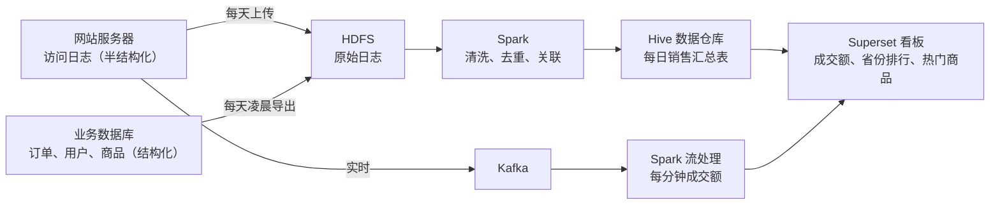
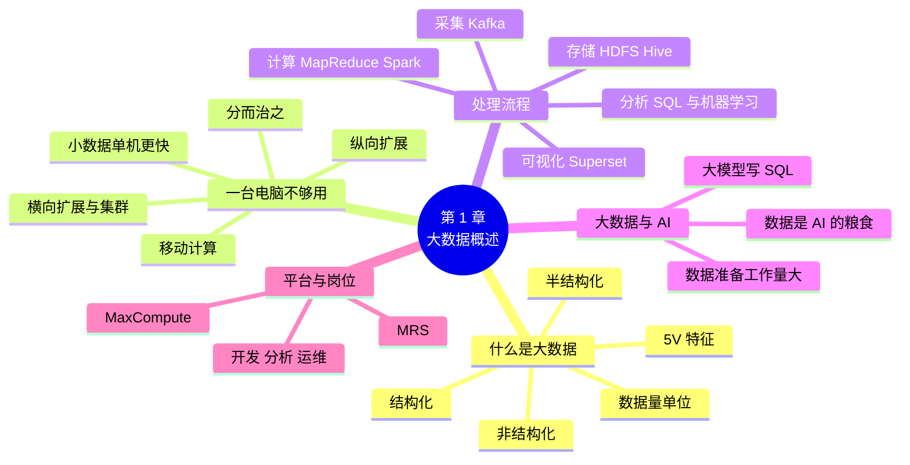

# 第 1 章 大数据概述与技术生态

!!! abstract "本章学时"
    理论 4 学时 · 实验 1 学时（本章共 3 个实验，教师可任选）

## 学习目标

学完本章，你应该能够：

1. **说出**大数据的 5V 特征，区分结构化、半结构化和非结构化数据，并各举一个电商平台中的例子（记忆、理解）；
2. **估算**一批数据的大小和一台电脑处理它所需的时间，说明横向扩展、分而治之和移动计算为什么能解决“一台电脑不够用”的问题（应用）；
3. **画出**大数据处理的五个步骤，并为每一步说出本书用到的组件（理解）；
4. **判断**一个数据处理任务应该用 pandas 这样的单机工具，还是用 Hadoop、Spark 这样的集群工具（评价）；
5. **运行**第一个 PySpark 程序，统计小象优选各省份的订单量和销售额（应用）。

!!! info "先修要求"
    学习本章前，你需要掌握：

    - Python 的基本语法，会用 `pip` 安装库、在命令行运行 `.py` 文件（“Python 程序设计”课程）；
    - 会用 pandas 读取 CSV 文件、做简单的分组统计（“Python 程序设计”或“数据分析”课程）；
    - 知道文件夹、文件大小、KB 和 MB 这些计算机常识。

??? abstract "本章概念清单（16 个，点击查看定义和例子）"
    1. [大数据](../../appendix/glossary.md#g-大数据)
    2. [5V 特征](../../appendix/glossary.md#g-5V-特征)
    3. [结构化数据](../../appendix/glossary.md#g-结构化数据)
    4. [半结构化数据](../../appendix/glossary.md#g-半结构化数据)
    5. [非结构化数据](../../appendix/glossary.md#g-非结构化数据)
    6. [纵向扩展](../../appendix/glossary.md#g-纵向扩展)
    7. [横向扩展](../../appendix/glossary.md#g-横向扩展)
    8. [集群](../../appendix/glossary.md#g-集群)
    9. [节点](../../appendix/glossary.md#g-节点)
    10. [移动计算](../../appendix/glossary.md#g-移动计算)
    11. [大数据处理流程](../../appendix/glossary.md#g-大数据处理流程)
    12. [批处理](../../appendix/glossary.md#g-批处理)
    13. [流处理](../../appendix/glossary.md#g-流处理)
    14. [Hadoop](../../appendix/glossary.md#g-Hadoop)
    15. [本地模式](../../appendix/glossary.md#g-本地模式)
    16. [Text-to-SQL](../../appendix/glossary.md#g-Text-to-SQL)

## 情景导入

小周刚入职“小象优选”电商平台的数据组。第一天，组长带他看了一眼公司的数据：网站和 App 每天留下 100 万行左右的访问日志，商品库里有 2000 种商品，注册用户 10 万人，9 月份一个月成交了 10 万笔订单，用户还写下了 2 万条商品评价。

“这些数据你用 Excel 能打开吗？”组长问。小周心里算了算：访问日志一天就有 100 万行，Excel 一张表最多 104 万行左右，勉强能塞下一天的。“那一年的呢？还有大促那天，日志会涨几百倍。”小周答不上来了。

组长接着说：“我们组每天要做的，就是把这些数据收上来、存好、算出结果，交给运营和老板看，还要准备给推荐系统训练模型用的数据。数据小的时候，你在笔记本上用 pandas 就行；数据大了，就得让很多台机器一起干活。这门手艺，叫**大数据技术**。”

本章是全书的“地图”。我们先弄清楚“大数据”到底大在哪里，用“算一算”的方法感受一台电脑的极限；再看一份数据从产生到变成报表要经过哪几步、每一步用什么工具；最后了解大数据和人工智能的关系，以及国内常见的大数据平台和岗位。本章实验中，你会在自己的电脑上生成小象优选的数据，并第一次运行 Spark 程序。

## 1.1 什么是大数据

### 1.1.1 身边的大数据

打开手机购物 App，首页推荐的商品、搜索框下面的“大家都在搜”、下单后的物流轨迹、月底收到的账单分析，背后都是对大量数据的收集和计算。以小象优选为例，平台每天都在产生下面几类数据：

| 数据 | 从哪里来 | 长什么样 | 小象优选的规模 |
|---|---|---|---|
| 访问日志 | 用户每打开一个页面，服务器记一行 | 一行文本，字段用空格隔开 | 每天约 100 万行、70 MB |
| 订单 | 用户下单、支付、退款 | 数据库里的表格，每行一笔订单 | 9 月共 10 万笔、8 MB |
| 用户和商品 | 注册、上架 | 数据库里的表格 | 10 万用户、2000 种商品 |
| 商品评价 | 用户写的文字 | 一段中文 | 2 万条 |
| 商品图片和直播视频 | 商家上传、直播录制 | 图片、视频文件 | 每张图片几百 KB，每小时视频几 GB |

这些数据单看每一条都不起眼，可是天天积累、各种来源放在一起，就多到用 Excel 打不开、一台电脑算不过来了。[**大数据**](../../appendix/glossary.md#g-大数据 "规模大、产生快、种类多，用传统单机软件难以在可接受时间内存储和处理的数据集合，也指处理这类数据的技术"){ .term }指的就是这种规模大、产生快、种类多，用传统的单机软件难以在可以接受的时间内存储和处理的数据集合，也常常指处理这类数据的技术。

国家数据局发布的《全国数据资源调查报告（2024 年）》显示，2024 年全国数据生产总量达到 41.06 ZB，比上一年增长 25%。<sup class="cite">[[1]](#ref1-1)</sup> 1 ZB 大约是 10 亿 TB，如果用 1 TB 的移动硬盘来装，要 410 多亿块。

### 1.1.2 大数据的 5V 特征

“数据多”只是大数据的一个方面。2001 年，分析师 Doug Laney 用数据量（Volume）、速度（Velocity）、多样性（Variety）三个词概括数据管理面临的新挑战，<sup class="cite">[[2]](#ref1-2)</sup> 后来业界又加上了价值（Value）和真实性（Veracity），合称大数据的 [**5V 特征**](../../appendix/glossary.md#g-5V-特征 "描述大数据的五个方面：量大（Volume）、快（Velocity）、多样（Variety）、价值密度低（Value）、真实性（Veracity）"){ .term }：

| 特征 | 含义 | 在小象优选身上的表现 |
|---|---|---|
| Volume 量大 | 数据总量大，常以 TB、PB 计 | 访问日志每天 70 MB，一年 25 GB；大促当天可能涨几百倍 |
| Velocity 快 | 数据产生得快，也要求处理得快 | 大促期间每秒上千次点击，运营要在大屏上实时看到成交额 |
| Variety 多样 | 数据格式多种多样 | 订单是表格，日志是文本行，评价是中文句子，还有图片和视频 |
| Value 价值密度低 | 有用的信息分散在海量数据里，要加工才能提炼出来 | 100 万行日志里，真正说明“用户想买什么”的可能只有几千行 |
| Veracity 真实性 | 数据中有错误、重复和造假，要甄别 | 评价里约 5% 是刷评；日志里有爬虫的访问和格式错误的行 |

记住 5V 的意义不在于背下五个英文单词，而在于遇到一个数据问题时，能想到从这五个方面去分析它“难在哪里”：量大，就要多台机器一起存、一起算（第 3、4 章）；快，就要实时处理（第 9 章）；多样，就要有能处理各种格式的工具；价值密度低、真实性差，就要清洗和分析（第 7、8 章）。

### 1.1.3 算一算：数据有多大

谈大数据离不开数据量的单位。计算机中最小的存储单位是字节（Byte，B），一个英文字母占 1 个字节，一个汉字用 UTF-8 编码占 3 个字节。往上每一级是前一级的 1024 倍：

| 单位 | 换算 | 大概有多大 |
|---|---|---|
| KB | 1 KB = 1024 B | 一段 300 字左右的中文商品评价 |
| MB | 1 MB = 1024 KB | 一张手机照片约 3 MB；小象优选的订单表 8 MB |
| GB | 1 GB = 1024 MB | 一部高清电影约 2～4 GB |
| TB | 1 TB = 1024 GB | 一块普通移动硬盘 |
| PB | 1 PB = 1024 TB | 大型互联网公司一天新增的数据量级 |
| EB、ZB | 每级再乘以 1024 | 全国、全球一年的数据生产量用 ZB 计 |

!!! example "算一算：小象优选一天的访问日志有多大"
    日志中的一行长这样：

    ```text
    2026-09-30T00:00:00 32.232.242.36 u0058620 GET /item/p01948 200 16531 Android
    ```

    数一数，这一行大约 74 个字符，都是英文和数字，每个占 1 个字节，加上换行符约 75 字节。

    - 一天 100 万行：75 × 1,000,000 ≈ 75,000,000 字节 ≈ 71.5 MB（除以 1024 两次）；
    - 一年 365 天：71.5 MB × 365 ≈ 26,000 MB ≈ 25.5 GB；
    - 大促当天流量涨 300 倍：71.5 MB × 300 ≈ 21 GB，一天就接近平时一年的量。

    实际生成的日志文件是 70.2 MB（`labs/data/xiaoxiang/access.log`），和估算基本一致。这种“先估一个数量级”的习惯很有用：在动手之前，就能判断该用 pandas 还是集群、要准备多大的硬盘。

### 1.1.4 结构化、半结构化和非结构化数据

5V 中的“多样”，最常见的分法是按数据有没有固定的格式，分成三类：

- [**结构化数据**](../../appendix/glossary.md#g-结构化数据 "有固定的行和列、每列含义和类型事先规定好的数据，可以直接放进数据库表"){ .term }：有固定的行和列，每一列的含义和类型事先规定好，可以直接放进数据库表或 Excel。小象优选的订单表、用户表、商品表都是结构化数据，用 SQL 和 pandas 处理最方便。
- [**半结构化数据**](../../appendix/glossary.md#g-半结构化数据 "有一定格式但不像表格那样整齐、不同记录字段可以不同的数据"){ .term }：有一定的格式，但不像表格那样整齐，不同记录的字段可以不一样，常见的有日志、JSON、XML。访问日志每行都按“时间 IP 用户 方法 页面 状态码 字节数 终端”排列，但要先按空格切开才能当表格用；App 上报的 JSON 埋点数据，不同事件带的字段也不一样。
- [**非结构化数据**](../../appendix/glossary.md#g-非结构化数据 "没有预先定义格式的数据，要借助人工智能技术才能变成可统计的信息"){ .term }：没有预先定义的格式，如评价文字、商品图片、客服通话录音、直播视频。它们要借助自然语言处理、计算机视觉等人工智能技术，才能变成可以统计的信息，例如从评价中判断情感是好评还是差评。

据业界估计，企业新产生的数据中，非结构化数据占大部分。不过本书的实验以结构化和半结构化数据为主：这是大数据开发和数据分析岗位每天处理得最多的数据，也是给人工智能模型准备训练数据的第一步。

## 1.2 为什么一台电脑不够用

### 1.2.1 算一算：1 TB 数据读一遍要多久

处理数据的第一步，是把它从硬盘读出来。读的速度取决于硬盘：普通机械硬盘每秒大约能连续读 150 MB，SATA 固态硬盘约 500 MB，更快的 NVMe 固态硬盘可达几 GB。

!!! example "算一算：小象优选一年的日志加上历史订单，按 1 TB 计"
    - 一台电脑、一块机械硬盘：1 TB = 1024 × 1024 MB = 1,048,576 MB，1,048,576 ÷ 150 ≈ 6990 秒 ≈ **1.9 小时**。这只是读一遍，还没开始计算。
    - 换成固态硬盘：1,048,576 ÷ 500 ≈ 2097 秒，约 35 分钟，仍然很慢，而且 1 TB 的数据放不进 16 GB 的内存，只能一块一块地读。
    - 100 台机器，每台存 1/100、只读自己的那份：10,486 MB ÷ 150 ≈ 70 秒，**一分多钟**就读完了。

    如果数据有 1 PB，一台机器读一遍要 80 天，100 台机器也要接近 20 个小时，就得上千台机器一起干活。

这就是大数据技术要解决的核心问题：**数据大到一台机器存不下、读不完、算不动的时候，怎么办？**

### 1.2.2 纵向扩展与横向扩展

让计算机处理更多数据，有两条路：

- [**纵向扩展**](../../appendix/glossary.md#g-纵向扩展 "通过给一台机器加内存、换更快的硬盘和 CPU 来提高处理能力"){ .term }：给一台机器换更好的配置，加内存、换更快的硬盘和 CPU。好处是程序不用改；缺点是一台机器的配置有上限，越高端的服务器越贵，而且这台机器一坏，整个系统就停了。
- [**横向扩展**](../../appendix/glossary.md#g-横向扩展 "通过增加机器数量、组成集群来提高处理能力"){ .term }：增加机器的数量，用很多台普通服务器组成一个[**集群**](../../appendix/glossary.md#g-集群 "通过网络连接、由软件统一协调、一起完成存储和计算任务的一组计算机"){ .term }，让它们一起存、一起算。集群中的每台机器叫一个[**节点**](../../appendix/glossary.md#g-节点 "集群中的一台机器（在随书集群中是一个 Docker 容器），分为主节点和工作节点"){ .term }。数据再多，加机器就是了；一台机器坏了，其他机器可以顶上。代价是需要专门的软件来协调这些机器，程序的写法也要变。

打个比方：一家快递站包裹太多，纵向扩展是把一个快递员换成更能干的，横向扩展是多招几个快递员、分片区送。业务量小的时候前者省事，业务量大到一定程度，只有后者走得通。谷歌、阿里巴巴这些互联网公司都选择了横向扩展：用成千上万台普通服务器组成集群，靠软件保证“坏几台机器也不出错”。Hadoop、Spark 就是这样的软件。

### 1.2.3 分而治之与移动计算

让一个集群一起干活，有两个关键的思想。

第一个是[**分而治之**](../../appendix/glossary.md#g-分而治之 "把一个大问题拆成许多互不相干的小问题分别解决，再把小问题的答案合并起来的思路"){ .term }：把一个大任务拆成许多互不相干的小任务，分给各台机器同时处理，最后把结果汇总起来。全市 2 万份试卷分给 100 位老师批改，最后由一个人把成绩汇总，就是分而治之。第 4 章的 MapReduce 和后面的 Spark，都是按这个思路设计的。

第二个是[**移动计算**](../../appendix/glossary.md#g-移动计算 "把计算程序发送到存放数据的机器上就地运行，而不是把数据集中搬到一处再算的做法"){ .term }，也就是“移动计算比移动数据更划算”。传统的做法是把数据从存储服务器搬到计算服务器上再算；可是 1 TB 数据在千兆网络上传一遍就要两个多小时，比计算本身还慢。大数据系统反过来：数据分散存放在集群的各台机器上（第 3 章的 HDFS），计算程序只有几 KB，把程序发到存数据的机器上，就地计算，只把很小的结果传回来。

### 1.2.4 用动画比一比：单机和集群各要多久

集群这么快，是不是什么数据都该交给集群？在下面的动画里试一试。

<iframe class="sim-frame" src="../../sims/cluster-estimator/main.html" height="860" loading="lazy" title="单机与集群耗时估算器"></iframe>

拖动滑块改变数据量和机器数，比较一台电脑和集群的耗时；“试一试”的三个按钮分别对应一天的日志、一年的日志和全公司的数据。[全屏打开](../../sims/cluster-estimator/main.html){ target=_blank }
{ .sim-caption }

你会发现两件事：

1. **数据小的时候，集群反而更慢。** 集群每次计算都要先分配机器、启动程序，最后还要汇总，这些准备工作要花十几秒甚至更久。处理 70 MB 的日志，一台电脑不到 1 秒就读完了，集群光启动就要 20 秒。第 4 章在随书集群上实测，同样统计 100 万行日志，集群用了约 25 秒，本机直接运行不到 10 秒。
2. **机器加到一定数量后，再加意义不大。** 1 TB 数据交给 100 台机器，处理时间已经只剩一分多钟，启动的 20 秒占了相当一部分；再加到 1000 台，总时间几乎不变。

所以，**用不用集群，要看数据有多大**。一般来说，数据在几 GB 以内、一台电脑的内存装得下时，用 Python 和 pandas 就够了，又快又简单；数据到了几十 GB 以上，或者每天都在增长、迟早会装不下时，才需要 Hadoop 和 Spark。本章实验 1-1 会让你亲手感受“数据变大”以后，pandas 需要多少内存。

## 1.3 大数据处理流程与组件地图

### 1.3.1 数据要经过的五个步骤

小象优选的运营主管每天早上打开电脑，就能在大屏上看到昨天的成交额、各省的销售排行、最热门的商品。这张报表背后，数据经过了五个步骤，这就是[**大数据处理流程**](../../appendix/glossary.md#g-大数据处理流程 "数据从产生到产生价值经过的五个步骤：采集、存储、计算、分析与挖掘、可视化"){ .term }：


1. **数据采集**：把分散在各处的数据收集起来。网站服务器上的日志、业务数据库里的订单、App 上报的点击事件，都要汇集到大数据平台。实时产生的数据通常先送进 Kafka 这样的消息队列（第 9 章）。
2. **数据存储**：把数据可靠地保存下来。大量的原始文件存在分布式文件系统 HDFS 上（第 3 章），整理好的数据组织成 Hive 的数据表（第 5 章）。
3. **数据计算**：对数据进行清洗、转换、关联和汇总。这一步最耗资源，由 MapReduce（第 4 章）或 Spark（第 6～8 章）在集群上完成，按处理方式分为两种：[**批处理**](../../appendix/glossary.md#g-批处理 "把一段时间内积累的数据一次性处理完的方式，结果有一定延迟"){ .term }把一段时间内攒下的数据一次处理完，例如每天凌晨统计前一天的销售额；[**流处理**](../../appendix/glossary.md#g-流处理 "数据一产生就在几秒内处理的方式，也叫实时处理"){ .term }在数据产生后几秒内就处理，例如大促时实时更新的成交额大屏。
4. **数据分析与挖掘**：用 SQL 回答业务问题（各省卖了多少？哪些用户流失了？），用机器学习发现规律、做出预测（用户会买什么？这条评价是不是刷的？），对应第 8、10 章。
5. **数据可视化**：把结果画成图表、做成报表和大屏，交给决策者（第 12 章）。

在实际工作中，这五步不是只走一遍，而是每天、每小时甚至每秒都在自动运行，形成一条条“数据流水线”。另外，每一步都要注意数据安全和个人信息保护，第 12 章会专门讲数据合规。

### 1.3.2 Hadoop 和 Spark 从哪里来

今天的大数据技术，起源于谷歌在 2003—2006 年发表的三篇论文。2003 年的 GFS 论文介绍了谷歌怎样用上千台普通机器组成一个文件系统，<sup class="cite">[[3]](#ref1-3)</sup> 2004 年的 MapReduce 论文介绍了怎样在这样的集群上做计算，另一篇介绍了分布式数据库 BigTable。谷歌没有公开代码，开源社区就照着论文自己实现：2006 年，Doug Cutting 等人把相关代码独立出来，起名 [**Hadoop**](../../appendix/glossary.md#g-Hadoop "开源的分布式存储和计算框架，核心包括 HDFS、MapReduce 和 YARN，围绕它形成了庞大的大数据生态"){ .term }（这是他儿子一只玩具大象的名字）。<sup class="cite">[[4]](#ref1-4)</sup>

**Hadoop** 现在是 Apache 软件基金会的开源项目，核心由三部分组成：负责存储的 HDFS、负责计算的 MapReduce、负责调度资源的 YARN。围绕它，又发展出了 Hive、HBase、Spark、Kafka 等一大批工具，统称“Hadoop 生态”。

Hadoop MapReduce 能处理海量数据，但每一步都要读写磁盘，速度较慢。2009 年，美国加州大学伯克利分校的实验室开发了 **Spark**，把中间结果尽量放在内存里，速度快了很多，还支持 SQL、实时计算和机器学习。<sup class="cite">[[5]](#ref1-5)</sup> 今天，Spark 已经是大数据计算的主力，本书第 6～11 章都围绕它展开。

### 1.3.3 本书用到的组件

大数据的组件很多，初学者常常被一长串名字吓住。其实只要按处理流程把它们放到对应的位置上，就清楚了。本书用到的组件如下：

| 组件 | 一句话介绍 | 属于哪一步 | 本书章节 |
|---|---|---|---|
| HDFS | 把大文件切块、分散存到很多台机器上，坏一台也不丢 | 存储 | 第 3 章 |
| YARN | 集群的“调度中心”，把各台机器的内存和 CPU 分给要运行的程序 | 计算（资源） | 第 4 章 |
| MapReduce | Hadoop 最早的计算引擎，用“分开算、再汇总”的方法处理数据 | 计算 | 第 4 章 |
| Hive | 把 HDFS 上的文件当成数据表，用 SQL 查询 | 存储、分析 | 第 5 章 |
| Spark | 基于内存的计算引擎，能做清洗、SQL、实时计算和机器学习 | 计算、分析 | 第 6～11 章 |
| Kafka | 消息队列，接收源源不断产生的实时数据 | 采集 | 第 9 章 |
| Superset | 开源的可视化工具，用 SQL 查询结果做图表和看板 | 可视化 | 第 12 章 |

这些组件运行在哪里？本书在你自己的电脑上用 Docker 搭一个小集群（第 2 章），1 个主节点、2 个工作节点，每个“节点”其实是一个 Docker 容器。它和企业里成百上千台服务器的集群，用的是同样的软件、同样的命令，只是规模小。

!!! tip "怎样学这些组件"
    不需要把每个组件的原理都钻研透。本书对每个组件只讲三件事：**它解决什么问题、背后大致发生了什么、怎样用它完成任务**，重点放在第三件。遇到工作中没学过的组件时，也用这三个问题去学，很快就能上手。

## 1.4 大数据与人工智能

### 1.4.1 人工智能的“粮食”从哪里来

你所在的专业叫“人工智能技术应用”，为什么要学大数据？因为今天的人工智能，绝大多数是从数据中“学”出来的：推荐系统从几亿条点击记录里学习用户的喜好，图像识别模型从几百万张标好的图片里学习认物体，大语言模型从几万亿个词的文本里学习说话。**数据是人工智能的“粮食”，大数据技术就是种粮、收粮、加工粮食的手艺。**

以小象优选首页的“猜你喜欢”为例，要训练一个推荐模型，数据要经过下面这些加工：

| 步骤 | 做什么 | 用到的大数据技术 | 本书章节 |
|---|---|---|---|
| 收集 | 把每个用户最近 90 天的浏览、加购、下单记录收集起来 | 日志采集、Kafka | 第 9 章 |
| 存储 | 几个月的日志有几百 GB，存进 HDFS 和 Hive 表 | HDFS、Hive | 第 3、5 章 |
| 清洗 | 去掉爬虫访问、刷单记录、格式错误的行，统一日期格式 | Spark | 第 7 章 |
| 构造特征 | 算出每个用户“最常买的品类”“最近 7 天活跃几次”，每个商品“最近卖了多少” | Spark SQL | 第 8 章 |
| 训练模型 | 在几千万行的特征表上训练模型 | Spark MLlib | 第 10 章 |

可以看到，在一个人工智能项目里，真正“训练模型”只是最后一步，前面大部分的时间和工作量都花在数据的收集、清洗和加工上。业内常说“数据准备占了一个 AI 项目 80% 的工作量”，说法不一定精确，但道理是对的。

### 1.4.2 两者怎样配合

大数据和人工智能的关系，可以概括为三句话：

1. **大数据给人工智能提供原料。** 没有足够多、足够干净的数据，再好的算法也训练不出好模型。
2. **人工智能让大数据产生更大的价值。** 统计报表只能告诉你“过去发生了什么”，机器学习模型还能预测“将来会怎样”，如哪些用户可能流失、明天要备多少货。
3. **人工智能也在改变大数据的工作方式。** 例如用大模型把自然语言的问题翻译成 SQL、自动生成数据清洗代码（见 1.6 节）。

所以在人工智能相关的岗位上，会用大数据工具处理数据，是一项基本功。

## 1.5 国产大数据平台与相关岗位

### 1.5.1 云上的大数据平台

自己买服务器、装 Hadoop 和 Spark、维护集群，需要专门的运维团队。越来越多的企业直接使用云服务商提供的大数据平台，按用量付费。国内常见的有：

- **阿里云 MaxCompute**（原名 ODPS）：阿里巴巴自研的大数据计算服务，是一个云上的数据仓库。用户不用管服务器，把数据传上去，用 SQL 或 Python 就能分析，存储和计算可以分别按需扩展、按量付费。<sup class="cite">[[6]](#ref1-6)</sup>
- **华为云 MapReduce 服务（MRS）**：在云上一键创建 Hadoop、Spark、Hive、Kafka 等开源组件组成的集群，支持按业务高峰低谷自动增减节点，并针对国产鲲鹏处理器做了优化。<sup class="cite">[[7]](#ref1-7)</sup>

此外，腾讯云、百度智能云等也都有类似的产品。这些平台的界面各不相同，但底层的思想和本书讲的一样：数据分块存在很多台机器上，计算任务被拆开并行执行。像 MRS 这样的平台，用的就是本书学习的 HDFS、YARN、Hive、Spark，命令和 SQL 几乎可以照搬。**在本书的小集群上学会的东西，到了企业的云平台上同样用得上。**

### 1.5.2 大数据相关的岗位

2019 年，人力资源和社会保障部等三部门发布的 13 个新职业中，就包括“大数据工程技术人员”。<sup class="cite">[[8]](#ref1-8)</sup> 在招聘网站上，专科毕业生能够应聘的大数据相关岗位主要有三类：

| 岗位 | 每天做什么 | 需要的技能 | 对应本书 |
|---|---|---|---|
| 大数据开发（数据开发工程师、ETL 工程师） | 把业务数据导入平台，编写清洗、统计的任务，让它们每天自动运行 | SQL、Hive、Spark、Python、Linux | 第 3～9 章 |
| 数据分析（数据分析师、BI 工程师） | 根据业务问题写 SQL 取数，做报表和看板，写分析报告 | SQL、Python、可视化工具、业务理解 | 第 5、8、12 章 |
| 大数据运维（平台运维工程师） | 搭建和维护集群，监控节点和作业，处理故障 | Linux、Docker、Hadoop 配置、排错 | 第 2、4、11 章 |

此外，人工智能训练师、数据标注等岗位，也要会用这些工具整理和检查数据。这三类岗位有一个共同点：**都离不开 SQL、Linux 和至少一门编程语言**。本书的实验会让你在这几项上都得到练习。想系统了解大数据的技术体系，可以参考国内高校广泛使用的教材《大数据技术原理与应用》。<sup class="cite">[[9]](#ref1-9)</sup>

## 1.6 前沿视窗

**云上大数据：从“管机器”到“只管数据”。**早年企业用大数据，要自己采购几十上百台服务器、安装和调试 Hadoop，光搭环境就要几个星期。云平台出现后，创建一个集群只要在网页上点几下、等十几分钟。现在又更进一步，出现了“无服务器”（Serverless）的大数据服务：用户连集群都看不到，只要提交 SQL 或 Python 程序，平台自动分配计算资源、按实际用量收费，MaxCompute 就是这种形态。<sup class="cite">[[6]](#ref1-6)</sup> 与之配合的“存算分离”架构，把数据统一存放在便宜的对象存储里，计算资源随用随开，第 3 章的前沿视窗会再谈到它。不管形态怎么变，本书讲的数据分块存储、任务拆分并行的思想都是这些平台的基础。

**用大模型写 SQL。**“帮我查一下 9 月份广东省销售额最高的 10 个商品”，以前要由数据分析师写成 SQL 语句才能查，现在可以让大语言模型把这句话自动翻译成 SQL，这类技术叫 [Text-to-SQL](../../appendix/glossary.md#g-Text-to-SQL "用大语言模型等技术把自然语言的问题自动翻译成 SQL 查询语句"){ .term }（文本转 SQL）。不少云平台和数据分析工具都加入了这项功能。不过它还远没有到“不用学 SQL”的程度：2023 年发表的 BIRD 评测集包含 95 个真实的大型数据库，论文报告当时表现最好的 ChatGPT 生成的 SQL 只有约 40% 能查出正确结果，而人类专家能达到约 93%。<sup class="cite">[[10]](#ref1-10)</sup> 近两年大模型进步很快，准确率在不断提高，但模型常常会弄错表名、字段名和业务口径（例如“销售额”该不该算退款的订单）。**能看懂、能检查、能修改大模型写出的 SQL，正是数据岗位越来越看重的能力。**本书第 5、8 章会系统学习 SQL，第 8 章的前沿视窗还会回到这个话题。

## 本章实验

!!! abstract "实验总览"
    | 实验 | 类型 | 建议时长 | 内容 |
    |---|---|---|---|
    | 实验 1-1 | ★ 基础 | 30 分钟 | 生成 1 万到 100 万行订单，比较文件大小、pandas 读取时间和占用的内存，推算 1 亿行要多少内存 |
    | 实验 1-2 | ★ 基础 | 40 分钟 | 安装 Java 和 PySpark，运行第一个 Spark 程序，统计各省份的订单量和销售额 |
    | 实验 1-3 | ☆ 拓展 | 30 分钟 | 选一个熟悉的业务，画出它的数据流程图，标出每一步可能用的组件 |

    本章实验都在自己的电脑上完成，不需要集群。实验代码见配套资源 `labs/ch01/` 目录，数据由 `labs/data/make_data.py` 生成。编者的运行环境：4 核 CPU、16 GB 内存的 Linux 主机，Python 3.12，OpenJDK 21，PySpark 4.1.4。

### 实验 1-1 ★ 生成小象优选数据，感受“数据变大”

**实验目的**

1. 安装本书的 Python 实验环境，生成小象优选的模拟数据；
2. 生成 1 万、10 万、100 万行订单，记录文件大小、pandas 读取时间和占用的内存；
3. 根据测量结果推算更大的数据需要多少内存，判断什么时候单机处理不了。

**实验环境**：本机 CPU，Python 3.12（numpy 2.5 不支持更早的版本），需要约 2 GB 空闲内存和 200 MB 硬盘空间。

**实验数据**：`labs/data/make_data.py` 按固定随机种子 2026 生成的小象优选数据，包括用户、商品、订单、评价和访问日志，内容均为虚构。实验 1-1 的脚本复用其中生成订单的函数，把订单表放大到不同的行数。

**实验步骤与代码**

第 1 步，下载配套资源，进入 `labs` 目录，安装依赖并生成数据（约 10 秒）。`-i` 后面是清华大学的 PyPI 镜像，国内下载更快：

```bash
cd labs
pip install -r requirements.txt -i https://pypi.tuna.tsinghua.edu.cn/simple
python data/make_data.py
```

第 2 步，运行实验脚本。它依次生成 1 万、10 万、100 万行订单，每生成一份就用 pandas 读进来，测量用时和内存。核心代码如下（完整代码见 `labs/ch01/lab1_1_data_size.py`）：

```python
for n in sizes:
    path = os.path.join(OUT, f"orders_{n}.csv")
    make_orders(np.random.default_rng(SEED + 2), n, users, products).to_csv(path, index=False)
    file_mb = os.path.getsize(path) / 1024 / 1024           # 文件大小，换算成 MB

    t = time.time()
    df = pd.read_csv(path)                                   # 读进内存
    read = time.time() - t
    mem_mb = df.memory_usage(deep=True).sum() / 1024 / 1024  # deep=True：连字符串的实际大小一起算
    print(f"{n:,} | {file_mb:.1f} | {gen:.1f} | {read:.2f} | {mem_mb:.0f} | {mem_mb / file_mb:.1f} 倍")
```

```bash
python ch01/lab1_1_data_size.py
```

第 3 步（可选），电脑有 4 GB 以上空闲内存的同学，再加一档 300 万行：

```bash
python ch01/lab1_1_data_size.py --max 3000000
```

**运行结果**

编者运行第 3 步的输出：

```text
行数 | 文件大小(MB) | 生成(秒) | pandas 读取(秒) | 占用内存(MB) | 内存/文件
10,000 | 0.8 | 0.1 | 0.03 | 4 | 5.6 倍
100,000 | 8.0 | 0.7 | 0.19 | 45 | 5.6 倍
1,000,000 | 80.0 | 7.5 | 1.62 | 448 | 5.6 倍
3,000,000 | 239.8 | 19.8 | 6.07 | 1345 | 5.6 倍

按 3,000,000 行的结果推算 1 亿行：文件约 7.8 GB，读进 pandas 约需内存 43.8 GB，读取约 3.4 分钟
```

从结果可以看出三点：

1. 行数每增加 10 倍，文件大小、读取时间和内存也大约增加 10 倍，**数据处理的开销和数据量基本成正比**。
2. **读进 pandas 后，占用的内存是文件大小的 5.6 倍。**订单表里有很多文字列（编号、省份、支付方式），pandas 把每个字符串都存成一个单独的 Python 对象，比文件里的纯文本占地方得多。
3. 按这个比例，1 亿行订单的文件不到 8 GB，硬盘放得下，可要读进 pandas 需要 40 多 GB 内存，普通笔记本只有 8～16 GB，**根本读不进来**。这时就需要第 6 章起学习的 Spark：它把数据分成很多份，每次只处理一部分，还能分给多台机器。

**实验记录表**

| 行数 | 文件大小（MB） | 读取用时（秒） | 占用内存（MB） | 内存/文件 |
|---|---|---|---|---|
| 1 万 | | | | |
| 10 万 | | | | |
| 100 万 | | | | |
| 推算 1 亿行 | | | | — |

**常见问题排查**

| 现象 | 原因 | 解决办法 |
|---|---|---|
| `ERROR: No matching distribution found for numpy==2.5.3` | Python 版本低于 3.12 | 安装 Python 3.12，用 `python --version` 确认后重新安装依赖 |
| `ModuleNotFoundError: No module named 'make_data'` | 没有在 `labs` 目录下运行 | 先 `cd labs`，再运行 `python ch01/lab1_1_data_size.py` |
| `FileNotFoundError: data/xiaoxiang/orders.csv` | 没有先生成数据 | 运行第 1 步的 `python data/make_data.py` |
| 运行到 300 万行时电脑变得很卡或程序被结束 | 空闲内存不够 | 关掉浏览器等程序，或者只做默认的 100 万行 |

**思考与练习**

1. 用 `pd.read_csv(path, usecols=["amount", "province"])` 只读两列，100 万行占用的内存是多少？由此你能想到哪些在单机上处理较大数据的办法？
2. 你的电脑有多少内存？按你测得的“内存/文件”比例，pandas 最多能处理多少行订单？

**实验报告要求**

提交运行结果截图和实验记录表。用 3～5 句话回答：小象优选的订单表增长到多少行时，你的电脑就处理不了了？为什么文件只有几 GB，内存却不够用？

### 实验 1-2 ★ 第一次运行 PySpark

**实验目的**

1. 安装 Java 和 PySpark，在自己的电脑上以[本地模式](../../appendix/glossary.md#g-本地模式 "Spark 在一台电脑上运行、用多个 CPU 核模拟集群的方式，不需要安装 Hadoop"){ .term }运行 Spark；
2. 运行第一个 Spark 程序，统计小象优选各省份已完成订单的订单量和销售额；
3. 打开 Spark 的网页，初步认识“作业被拆成任务并行执行”。

**实验环境**：本机 CPU，Python 3.12，Java 17 或 21，PySpark 4.1.4。Spark 用 Java 虚拟机运行，所以要先装 Java；本地模式用电脑的多个 CPU 核模拟一个小集群，不需要安装 Hadoop。

**实验数据**：实验 1-1 第 1 步生成的 `labs/data/xiaoxiang/orders.csv`，小象优选 2026 年 9 月的 10 万笔订单。

**实验步骤与代码**

第 1 步，安装 Java。在命令行输入 `java -version`，如果显示 17 或 21 开头的版本号，就可以跳过这一步：

- **Windows**：建议在 WSL（Windows 中的 Linux 子系统，第 2 章安装 Docker 时也要用到）里做本实验，按下面 Ubuntu 的方法安装。直接在 Windows 上运行也可以完成本实验，但后面写文件的实验需要额外配置，不推荐。
- **macOS**：`brew install openjdk@21`。
- **Ubuntu 或 WSL**：`sudo apt install openjdk-21-jdk`。

第 2 步，安装 PySpark（实验 1-1 已经通过 `requirements.txt` 装好的可以跳过）。安装包约 430 MB，使用国内镜像更快：

```bash
pip install pyspark==4.1.4 -i https://pypi.tuna.tsinghua.edu.cn/simple
```

第 3 步，阅读程序。下面是 `labs/ch01/lab1_2_first_pyspark.py` 的主要部分，和 pandas 的写法很像：

```python
from pyspark.sql import SparkSession
from pyspark.sql import functions as F

spark = (SparkSession.builder
         .appName("小象优选-各省订单统计")
         .master("local[*]")                        # 本地模式：用本机所有 CPU 核模拟一个小集群
         .config("spark.ui.showConsoleProgress", "false")   # 不显示进度条
         .getOrCreate())
spark.sparkContext.setLogLevel("ERROR")              # 只显示错误信息，屏幕清爽一些

orders = spark.read.csv("data/xiaoxiang/orders.csv", header=True, inferSchema=True)
result = (orders.filter(F.col("status") == "已完成")         # 只统计已完成的订单
          .groupBy("province")                               # 按省份分组
          .agg(F.count("*").alias("订单数"),
               F.sum("amount").cast("decimal(14,2)").alias("销售额"))
          .orderBy(F.desc("销售额")))
result.show(10)
spark.stop()
```

和 pandas 对照着看：`spark.read.csv` 相当于 `pd.read_csv`，`filter` 相当于按条件筛选行，`groupBy(...).agg(...)` 相当于 `groupby(...).agg(...)`。`cast("decimal(14,2)")` 把销售额保留两位小数，否则大数字会显示成科学计数法。

第 4 步，在 `labs` 目录下运行：

```bash
python ch01/lab1_2_first_pyspark.py
```

第 5 步（可选），程序运行时 Spark 会在 4040 端口开一个网页。想看的话，在 `spark.stop()` 前加一行 `input("按回车键结束")`，再运行一次，趁程序暂停时用浏览器打开 <http://localhost:4040>，点 Jobs 页，可以看到刚才的统计被拆成了几个任务。

**运行结果**

编者的输出（开头几行 WARN 警告省略）：

```text
Spark 4.1.4 启动完成，用时 5.6 秒，并行度 4
订单表共 100,000 行，字段：['order_id', 'user_id', 'product_id', 'quantity', 'amount', 'order_time', 'province', 'pay_type', 'status']
+--------+------+-----------+
|province|订单数|     销售额|
+--------+------+-----------+
|    广东|  8400|13021535.20|
|    河南|  6669|10427730.10|
|    山东|  6422|10097487.30|
|    四川|  5435| 8536911.90|
|    江苏|  5135| 8167535.90|
|    河北|  4716| 7543968.30|
|    浙江|  4277| 6634796.80|
|    湖南|  4045| 6461508.50|
|    安徽|  3878| 6120454.30|
|    湖北|  3558| 5762870.60|
+--------+------+-----------+
only showing top 10 rows
统计用时 1.9 秒，共 31 个省份
```

“并行度 4”表示编者的电脑有 4 个 CPU 核，Spark 最多同时运行 4 个任务。广东省以 8400 笔已完成订单、1302 万元的销售额排在第一。

你可能注意到：Spark 光启动就花了 5 秒多，统计又花了近 2 秒，而同样的统计用 pandas 不到 1 秒就能完成。这和 1.2.4 节的结论一致：**10 万行数据用 Spark 是“杀鸡用牛刀”**。我们现在用它，是为了在小数据上先把写法学会，等数据大到 pandas 处理不了时，同样的代码可以原封不动地交给集群运行。

**实验记录表**

| 观察内容 | 你的结果 |
|---|---|
| `java -version` 显示的版本 | |
| Spark 启动用时、并行度 | |
| 销售额前 3 名的省份和金额 | |
| 统计用时 | |

**常见问题排查**

| 现象 | 原因 | 解决办法 |
|---|---|---|
| `JAVA_HOME is not set` 或 `Java gateway process exited` | 没装 Java，或者系统找不到它 | 按第 1 步安装 Java，重新打开命令行窗口，用 `java -version` 确认 |
| `UnsupportedClassVersionError` | Java 版本太老（如 Java 8 或 11） | Spark 4 需要 Java 17 或 21，安装新版本并设置 `JAVA_HOME` |
| 开头出现几行 `WARN Utils: Your hostname ... resolves to a loopback address` 和 `WARN NativeCodeLoader` | 本机主机名和 Hadoop 本地库的提示 | 不影响运行，可以忽略 |
| 中文表头的列没有对齐 | 一个汉字占两个字符宽度，`show()` 按一个字符计算 | 不影响结果；想看整齐的结果可以用 `result.toPandas()` 转成 pandas 表 |
| 4040 网页打不开 | 程序已经结束，网页随之关闭 | 按第 5 步在程序末尾加 `input()` 让它暂停 |

**思考与练习**

1. 修改程序，统计各支付方式（`pay_type`）已完成订单的订单数和销售额。哪种支付方式最多？
2. 把 `.master("local[*]")` 改成 `.master("local[1]")`，只用 1 个 CPU 核，统计用时有变化吗？为什么在这么小的数据上变化不明显？

**实验报告要求**

提交运行结果截图和实验记录表，附上思考与练习第 1 题修改后的代码和结果。

### 实验 1-3 ☆ 画一张企业数据流程图

**实验目的**

1. 用 1.3 节的五个步骤分析一个真实业务的数据从哪里来、到哪里去；
2. 为每一步选出合适的组件，说明理由；
3. 练习用流程图表达数据处理方案。

**实验环境**：纸笔，或任意画图工具（如 draw.io、ProcessOn、PowerPoint）。不需要写代码。

**实验数据**：自选业务。可以是你所在单位的业务，也可以从下面选一个：外卖平台、共享单车、学校的教务系统、医院的挂号系统、快递公司。

**实验步骤**

第 1 步，列出这个业务会产生哪些数据，每种数据是结构化、半结构化还是非结构化，估算每天大约有多少。

第 2 步，想一个这些数据能回答的业务问题，例如“共享单车每天早高峰各个地铁站附近缺多少辆车”。

第 3 步，按“采集 → 存储 → 计算 → 分析 → 可视化”画出数据流程图，在每一步旁边写上可能用的组件和产出的结果。

第 4 步，标出哪些步骤要每天批处理、哪些需要实时处理，说明理由。

**参考结果**

以小象优选的“每日销售看板”为例：



日志和订单每天凌晨批量导入、清洗和汇总，生成第二天早上看的报表；大促期间运营还要盯着实时成交额，所以另走一条 Kafka 加流处理的实时链路。

**实验记录表**

| 步骤 | 数据或结果 | 组件 | 批处理还是实时 |
|---|---|---|---|
| 采集 | | | |
| 存储 | | | |
| 计算 | | | |
| 分析 | | | |
| 可视化 | | | |

**思考与练习**

1. 你的流程图中，哪一步的数据量最大？如果它增长 100 倍，哪个组件最先需要扩容？
2. 流程中哪些数据涉及个人信息（手机号、住址、身份证号等）？应该在哪一步做脱敏处理？

**实验报告要求**

提交数据流程图和实验记录表，用一段话说明你为每一步选择组件的理由。学完全书后，可以回头修改这张图，看看你的理解有什么变化。

## 本章小结

- **大数据**指规模大、产生快、种类多，用传统单机软件难以在可接受时间内处理的数据，可以用 **5V 特征**分析：量大、快、多样、价值密度低、真实性。按格式分为**结构化**、**半结构化**和**非结构化**数据。
- 数据量单位每级相差 1024 倍。动手之前先“算一算”：小象优选一天的日志约 70 MB，一年约 25 GB；1 TB 数据一台机器读一遍要近 2 小时，100 台机器一分多钟。
- 一台电脑不够用时，**横向扩展**比**纵向扩展**更划算：用很多台普通机器组成**集群**，按**分而治之**的思路拆分任务，并且**移动计算**而不是移动数据。
- 集群每次计算都有启动开销，**数据小的时候单机更快**。实验 1-1 显示，pandas 读入订单表后占用的内存约是文件的 5.6 倍，1 亿行订单就需要 40 多 GB 内存。几 GB 以内用 pandas，更大时再用 Hadoop 和 Spark。
- **大数据处理流程**分为采集、存储、计算、分析、可视化五步。本书用到的组件：Kafka 采集，HDFS 和 Hive 存储，YARN 调度，MapReduce 和 Spark 计算（**批处理**和**流处理**），Superset 可视化。
- 数据是人工智能的“粮食”，一个 AI 项目的大部分工作量在数据的收集、清洗和加工上。企业越来越多地使用 MaxCompute、MRS 等云上大数据平台，底层思想和本书一致。大数据开发、数据分析、大数据运维三类岗位都离不开 SQL、Linux 和编程。



**下一章预告**

本章我们在一台电脑上运行了 Spark，但“很多台机器一起干活”还只停留在纸面上。下一章将用 **Docker** 在你的电脑上搭建一个真正的 Hadoop 集群：1 个主节点、2 个工作节点，一条命令就能启动。你会学会 Docker 的基本用法，看懂集群的配置文件，在网页上查看集群的状态，还会亲手给集群加一个节点。后面各章的实验，都在这个集群上完成。

## 参考文献

正文中的上标编号（如<sup class="cite">[[1]](#ref1-1)</sup>）对应下面的文献。带链接的可以直接打开；书籍可在图书馆或电子书平台查阅。

<div class="refs" markdown>

**教材与专著**

- <span id="ref1-4"></span>[4] WHITE T. Hadoop: the definitive guide[M]. 4th ed. Sebastopol: O'Reilly Media, 2015.
    <span class="ref-note">Hadoop 领域最常用的参考书，第 1 章“Meet Hadoop”介绍了数据增长、横向扩展的思路和 Hadoop 的由来（包括名字来自一只玩具大象），对应 1.2、1.3 节。</span>
- <span id="ref1-9"></span>[9] 林子雨. 大数据技术原理与应用[M]. 3 版. 北京：人民邮电出版社，2021.
    <span class="ref-note">国内高校广泛使用的大数据教材，第 1 章“大数据概述”和第 2 章“大数据处理架构 Hadoop”可作为本章的补充阅读。</span>

**经典论文**

- <span id="ref1-2"></span>[2] LANEY D. 3D data management: controlling data volume, velocity, and variety[R]. Stamford: META Group, 2001.
    <span class="ref-note">最早用 Volume、Velocity、Variety 概括数据管理挑战的研究报告，是“大数据 3V/5V”说法的来源，对应 1.1.2 节。</span>
- <span id="ref1-3"></span>[3] GHEMAWAT S, GOBIOFF H, LEUNG S T. The Google file system[C]//Proceedings of the 19th ACM Symposium on Operating Systems Principles (SOSP '03). New York: ACM, 2003: 29-43.
    <span class="ref-note">谷歌介绍用普通机器组成大规模文件系统的论文，HDFS 照它设计，对应 1.3.2 节，第 3 章还会用到。</span>
- <span id="ref1-5"></span>[5] ZAHARIA M, CHOWDHURY M, FRANKLIN M J, et al. Spark: cluster computing with working sets[C]//2nd USENIX Workshop on Hot Topics in Cloud Computing (HotCloud '10). Boston: USENIX, 2010.
    <span class="ref-note">伯克利团队最早介绍 Spark 的论文，说明了把数据留在内存里反复使用的好处，对应 1.3.2 节。</span>
- <span id="ref1-10"></span>[10] LI J, HUI B, QU G, et al. Can LLM already serve as a database interface? A big bench for large-scale database grounded text-to-SQLs[C]//Advances in Neural Information Processing Systems 36 (NeurIPS 2023), Datasets and Benchmarks Track. 2023.
    <span class="ref-note">BIRD 评测集，包含 95 个真实数据库、1.2 万多个问题，报告了 ChatGPT 约 40% 与人类约 93% 的执行准确率，对应 1.6 节。</span>

**在线资源与数据**

- <span id="ref1-1"></span>[1] 国家数据局. 全国数据资源调查报告（2024 年）[R/OL]. （2025-04-29）[2026-10-30]. <https://www.news.cn/politics/20250528/ff34ef0b8ea94c8c9f6e08849fdbba42/c.html>.
    <span class="ref-note">报告显示 2024 年全国数据生产总量 41.06 ZB，同比增长 25%；链接为新华网的报道，对应 1.1.1 节。</span>
- <span id="ref1-6"></span>[6] 阿里云. What is MaxCompute?[EB/OL]. [2026-10-30]. <https://help.aliyun.com/en/maxcompute/product-overview/what-is-maxcompute>.
    <span class="ref-note">MaxCompute 的官方产品介绍：原名 ODPS，无服务器、存算分离、按量付费，支持 SQL 和兼容 pandas 的 MaxFrame，对应 1.5.1 和 1.6 节。</span>
- <span id="ref1-7"></span>[7] 华为云. MapReduce 服务 MRS：产品优势[EB/OL]. [2026-10-30]. <https://support.huaweicloud.com/productdesc-mrs/mrs_08_0002.html>.
    <span class="ref-note">MRS 的官方介绍：云上一键创建 Hadoop、Spark、Hive、Kafka 等组件的集群，弹性伸缩、存算分离、鲲鹏优化，对应 1.5.1 节。</span>
- <span id="ref1-8"></span>[8] 人力资源社会保障部办公厅，市场监管总局办公厅，统计局办公室. 关于发布人工智能工程技术人员等职业信息的通知：人社厅发〔2019〕48 号[A/OL]. （2019-04-01）[2026-10-30].
    <span class="ref-note">发布了包括大数据工程技术人员、人工智能工程技术人员在内的 13 个新职业，对应 1.5.2 节。</span>

</div>

## 课后练习

选择题和判断题可以直接点击选项作答，系统会马上告诉你对错，并展开答案与解析；多选题选好后点“提交答案”。简答和实操题请先自己作答，再点开“答案与解析”核对。每道题的解析下方都有“回看”链接，做错了可以直接跳回正文复习。

**一、单项选择题**

<div class="quiz" data-answer="C" markdown>

**1.** 大促期间，运营要求在大屏上每隔几秒更新一次成交额。这主要体现了大数据 5V 特征中的（　　）。

- A. Volume 量大
- B. Variety 多样
- C. Velocity 快
- D. Veracity 真实性

</div>

??? tip "答案与解析"
    **答案：C**

    Velocity 既指数据产生得快，也指要求处理得快。每隔几秒更新成交额，需要实时处理（第 9 章）。

    考查：5V 特征 · 认知层次：理解 · [回看 1.1.2](#112-5v)
    { .quiz-meta }

<div class="quiz" data-answer="B" markdown>

**2.** 下列小象优选的数据中，属于半结构化数据的是（　　）。

- A. 订单表
- B. 网站访问日志
- C. 商品图片
- D. 客服通话录音

</div>

??? tip "答案与解析"
    **答案：B**

    访问日志每行有固定的字段顺序，但不是现成的表格，要先按空格切开才能当表格用，属于半结构化数据。订单表是结构化数据，图片和录音是非结构化数据。

    考查：数据类型 · 认知层次：理解 · [回看 1.1.4](#114)
    { .quiz-meta }

<div class="quiz" data-answer="D" markdown>

**3.** 一个文件大小为 2 GB，换算成 MB 是（　　）。

- A. 2000 MB
- B. 1024 MB
- C. 20480 MB
- D. 2048 MB

</div>

??? tip "答案与解析"
    **答案：D**

    1 GB = 1024 MB，2 GB = 2048 MB。日常生活中常说“1 GB 约等于 1000 MB”，但在计算机存储中按 1024 换算。

    考查：数据量单位 · 认知层次：应用 · [回看 1.1.3](#113)
    { .quiz-meta }

<div class="quiz" data-answer="A" markdown>

**4.** 一块机械硬盘每秒约读 150 MB，把 300 GB 数据读一遍大约需要（　　）。

- A. 34 分钟
- B. 3.4 分钟
- C. 2 秒
- D. 5.6 小时

</div>

??? tip "答案与解析"
    **答案：A**

    300 GB = 300 × 1024 = 307,200 MB，307,200 ÷ 150 ≈ 2048 秒，约 34 分钟。

    考查：数据量估算 · 认知层次：应用 · [回看 1.2.1](#121-1-tb)
    { .quiz-meta }

<div class="quiz" data-answer="B" markdown>

**5.** 某公司数据越来越多，决定把 1 台服务器的内存从 64 GB 升级到 512 GB。这种做法属于（　　）。

- A. 横向扩展
- B. 纵向扩展
- C. 移动计算
- D. 分而治之

</div>

??? tip "答案与解析"
    **答案：B**

    给一台机器换更好的配置是纵向扩展；增加机器的数量组成集群才是横向扩展。纵向扩展有上限，而且这台机器坏了整个系统就停了。

    考查：纵向扩展与横向扩展 · 认知层次：理解 · [回看 1.2.2](#122)
    { .quiz-meta }

<div class="quiz" data-answer="C" markdown>

**6.** 大数据系统把计算程序发送到存有数据的机器上就地运行，而不是把数据集中到一台机器上再算。这样做的主要原因是（　　）。

- A. 计算程序比数据更容易出错
- B. 存数据的机器 CPU 更快
- C. 程序只有几 KB，数据有几 TB，在网络上传输数据太慢
- D. 数据不允许离开原来的机器

</div>

??? tip "答案与解析"
    **答案：C**

    这就是“移动计算比移动数据更划算”。1 TB 数据在千兆网络上传一遍要两个多小时，而程序很小，传过去几乎不花时间。

    考查：移动计算 · 认知层次：理解 · [回看 1.2.3](#123)
    { .quiz-meta }

<div class="quiz" data-answer="D" markdown>

**7.** 下列组件中，主要负责“数据存储”这一步，把大文件切块、分散存放到多台机器上的是（　　）。

- A. Kafka
- B. YARN
- C. Superset
- D. HDFS

</div>

??? tip "答案与解析"
    **答案：D**

    HDFS 是 Hadoop 的分布式文件系统（第 3 章）。Kafka 用于采集实时数据，YARN 负责调度资源，Superset 用于可视化。

    考查：组件地图 · 认知层次：记忆 · [回看 1.3.3](#133)
    { .quiz-meta }

<div class="quiz" data-answer="A" markdown>

**8.** 小象优选每天凌晨 2 点统计前一天各省的销售额，早上 8 点前生成报表。这种处理方式叫（　　）。

- A. 批处理
- B. 流处理
- C. 纵向扩展
- D. 数据采集

</div>

??? tip "答案与解析"
    **答案：A**

    把一段时间内攒下的数据一次处理完，是批处理。流处理是在数据产生后几秒内就处理。

    考查：批处理与流处理 · 认知层次：理解 · [回看 1.3.1](#131)
    { .quiz-meta }

<div class="quiz" data-answer="B" markdown>

**9.** 实验 1-1 中，100 万行订单的 CSV 文件为 80 MB，读入 pandas 后占用约 448 MB 内存。按这个比例，一台空闲内存 8 GB 的电脑，最多大约能读入多少行订单？（　　）

- A. 约 100 万行
- B. 约 1800 万行
- C. 约 1 亿行
- D. 约 10 亿行

</div>

??? tip "答案与解析"
    **答案：B**

    每 100 万行约占 448 MB，8 GB = 8192 MB，8192 ÷ 448 ≈ 18.3，约 1800 万行。实际上还要给系统和其他程序留出内存，能处理的行数会更少。

    考查：单机处理的极限 · 认知层次：应用 · [回看 实验 1-1](#1-1)
    { .quiz-meta }

**二、多项选择题**

<div class="quiz quiz-multi" data-answer="ABD" markdown>

**1.** 关于用集群处理数据，下列说法正确的有（　　）。

- A. 集群每次计算都要花时间启动，数据很小时可能比单机还慢
- B. 一台机器坏了，其他机器可以接着工作
- C. 机器越多，总耗时一定越短，而且会一直按比例缩短
- D. 需要专门的软件来协调各台机器

</div>

??? tip "答案与解析"
    **答案：ABD**

    C 错：启动开销是集群耗时的下限，机器加到一定数量后再加，总时间几乎不再减少（见 1.2.4 节的动画）。

    考查：横向扩展与集群 · 认知层次：理解 · [回看 1.2.4](#124)
    { .quiz-meta }

<div class="quiz quiz-multi" data-answer="ACD" markdown>

**2.** 下列属于 Hadoop 核心组成部分的有（　　）。

- A. HDFS
- B. Kafka
- C. MapReduce
- D. YARN

</div>

??? tip "答案与解析"
    **答案：ACD**

    Hadoop 的核心是存储 HDFS、计算 MapReduce 和资源调度 YARN。Kafka 是独立的消息队列项目，属于更广义的大数据生态。

    考查：Hadoop · 认知层次：记忆 · [回看 1.3.2](#132-hadoop-spark)
    { .quiz-meta }

<div class="quiz quiz-multi" data-answer="ABC" markdown>

**3.** 为小象优选训练一个“猜你喜欢”推荐模型，在训练模型之前通常需要做的有（　　）。

- A. 收集用户的浏览、加购、下单记录
- B. 去掉爬虫访问和刷单记录
- C. 计算“用户最常买的品类”等特征
- D. 把所有数据打印出来人工检查

</div>

??? tip "答案与解析"
    **答案：ABC**

    收集、清洗、构造特征是训练前的标准步骤，也是一个 AI 项目工作量最大的部分。几千万行数据不可能人工逐条检查，要用程序统计和抽查。

    考查：大数据与人工智能 · 认知层次：理解 · [回看 1.4.1](#141)
    { .quiz-meta }

<div class="quiz quiz-multi" data-answer="BCD" markdown>

**4.** 关于用大模型把自然语言问题翻译成 SQL（Text-to-SQL），下列说法正确的有（　　）。

- A. 准确率已经接近 100%，数据岗位不再需要学 SQL
- B. 模型可能弄错表名、字段名
- C. 模型可能弄错业务口径，如“销售额”是否包含退款订单
- D. 使用者需要能看懂和检查模型写出的 SQL

</div>

??? tip "答案与解析"
    **答案：BCD**

    BIRD 评测中，当时最好的模型只有约 40% 的 SQL 能查出正确结果。即使准确率不断提高，生成的 SQL 也必须由懂业务、懂 SQL 的人检查。

    考查：前沿视窗 · 认知层次：评价 · [回看 1.6](#16)
    { .quiz-meta }

**三、判断题**

<div class="quiz quiz-judge" data-answer="×" markdown>

**1.** 只要数据量大，就可以称为大数据，与数据的种类、产生速度无关。

</div>

??? tip "答案与解析"
    **答案：×**

    量大只是 5V 之一。数据产生快、种类多、价值密度低、真假混杂，都会让传统单机软件难以处理。

    考查：5V 特征 · 认知层次：理解 · [回看 1.1.2](#112-5v)
    { .quiz-meta }

<div class="quiz quiz-judge" data-answer="√" markdown>

**2.** 处理几十 MB 的数据时，在笔记本上用 pandas 往往比提交到 Hadoop 集群更快。

</div>

??? tip "答案与解析"
    **答案：√**

    集群光启动就要十几秒。第 4 章实测：100 万行日志在集群上统计约 25 秒，本机直接运行不到 10 秒。

    考查：单机与集群的选择 · 认知层次：评价 · [回看 1.2.4](#124)
    { .quiz-meta }

<div class="quiz quiz-judge" data-answer="×" markdown>

**3.** pandas 读入一个 1 GB 的 CSV 文件，占用的内存一般也是 1 GB 左右。

</div>

??? tip "答案与解析"
    **答案：×**

    实验 1-1 中，订单表读入后占用的内存约是文件大小的 5.6 倍，主要因为每个字符串都被存成一个单独的对象。

    考查：单机处理的极限 · 认知层次：理解 · [回看 实验 1-1](#1-1)
    { .quiz-meta }

<div class="quiz quiz-judge" data-answer="√" markdown>

**4.** 华为云 MRS 这类云上大数据平台使用的是 Hadoop、Spark、Hive 等开源组件，在本书小集群上学会的命令和 SQL 可以在上面使用。

</div>

??? tip "答案与解析"
    **答案：√**

    MRS 在云上创建的就是由开源组件组成的集群，云平台省去了采购和维护机器的工作，用法基本一致。

    考查：国产大数据平台 · 认知层次：理解 · [回看 1.5.1](#151)
    { .quiz-meta }

<div class="quiz quiz-judge" data-answer="×" markdown>

**5.** Spark 用本地模式（`local[*]`）运行时，必须先安装好 Hadoop 集群。

</div>

??? tip "答案与解析"
    **答案：×**

    本地模式用一台电脑的多个 CPU 核模拟集群，只需要 Java 和 PySpark，不需要 Hadoop，实验 1-2 就是这样运行的。

    考查：PySpark 入门 · 认知层次：理解 · [回看 实验 1-2](#1-2-pyspark)
    { .quiz-meta }

**四、简答题**

**1.** 用 5V 特征分析一家外卖平台的数据，每个特征各举一个例子。

??? tip "答案与解析"
    **参考答案：** 量大：每天几千万笔订单、几亿条骑手定位记录。快：骑手位置每几秒上报一次，用户要实时看到骑手在哪里、预计多久送达。多样：订单是表格，App 点击是日志和 JSON，用户评价是文字，菜品是图片。价值密度低：海量定位记录中，真正能说明“哪里经常堵车、哪家店出餐慢”的只是一小部分，要经过统计才能提炼出来。真实性：有刷单、恶意差评、定位漂移的数据，分析前要识别和清洗。

    **评分要点：** 每个特征 1 分，例子贴切再加 1 分（共 6 分）。

    考查：5V 特征 · 认知层次：应用 · [回看 1.1.2](#112-5v)
    { .quiz-meta }

**2.** 小王说：“集群那么快，公司以后所有数据处理都放到 Hadoop 集群上做。”你同意吗？请结合数据量说明理由。

??? tip "答案与解析"
    **参考答案：** 不完全同意。集群每次计算都要分配资源、启动程序、汇总结果，有十几秒以上的固定开销，数据只有几 MB 到几 GB、一台电脑内存装得下时，用 pandas 等单机工具更快、更简单，也更容易调试。只有数据大到单机内存装不下、读一遍要很久，或者在持续增长时，集群的并行优势才超过启动开销。合理的做法是按数据量选择工具，小数据用单机，大数据用集群。

    **评分要点：** 指出集群的启动开销（2 分），说明小数据单机更合适（2 分），给出按数据量选择的结论（2 分）。

    考查：单机与集群的选择 · 认知层次：评价 · [回看 1.2.4](#124)
    { .quiz-meta }

**3.** 画出（或用文字写出）大数据处理的五个步骤，并为每一步写出一个本书用到的组件。

??? tip "答案与解析"
    **参考答案：** 采集（Kafka）→ 存储（HDFS、Hive）→ 计算（MapReduce、Spark）→ 分析与挖掘（Spark SQL、Spark MLlib）→ 可视化（Superset）。YARN 为计算这一步分配资源。

    **评分要点：** 五个步骤顺序正确（3 分），组件对应正确（3 分）。

    考查：大数据处理流程 · 认知层次：理解 · [回看 1.3.1](#131)
    { .quiz-meta }

**五、实操题**

**1.** 修改实验 1-2 的程序，统计各品类商品的销售额。提示：订单表只有商品编号，品类在 `products.csv` 中，需要先读入商品表，再用 `orders.join(products, "product_id")` 把两张表按商品编号连起来。

??? tip "答案与解析"
    **参考答案：**

    ```python
    products = spark.read.csv("data/xiaoxiang/products.csv", header=True, inferSchema=True)
    result = (orders.filter(F.col("status") == "已完成")
              .join(products.select("product_id", "category"), "product_id")
              .groupBy("category")
              .agg(F.count("*").alias("订单数"),
                   F.sum("amount").cast("decimal(14,2)").alias("销售额"))
              .orderBy(F.desc("销售额")))
    result.show()
    ```

    结果共 8 个品类，各品类的销售额之和应等于实验 1-2 中各省份销售额之和。多表连接会在第 8 章系统学习。

    **评分要点：** 正确读入商品表（1 分），连接条件正确（2 分），分组统计和排序正确（2 分），结果截图（1 分）。

    考查：PySpark 入门 · 认知层次：应用 · [回看 实验 1-2](#1-2-pyspark)
    { .quiz-meta }

**2.** 用 1.2.4 节的估算器回答：小象优选积累了 5 TB 日志，每台机器的处理速度按“机械硬盘读取，约 150 MB/秒”、启动开销按 MapReduce 约 20 秒计，要在 5 分钟内处理完，至少需要多少台机器？写出计算过程，再用动画验证。

??? tip "答案与解析"
    **参考答案：** 5 TB = 5 × 1024 × 1024 = 5,242,880 MB。设每台机器处理数据的时间为 x 秒，汇总时间按 0.05x 计，则 20 + x + 0.05x ≤ 300，x ≤ 280 ÷ 1.05 ≈ 267 秒。需要的总速度 = 5,242,880 ÷ 267 ≈ 19,640 MB/秒，除以每台 150 MB/秒，约 131 台，所以至少需要 131 台机器。在动画中把数据量拖到 5 TB、机器数拖到 130 台左右，集群耗时约 5 分钟；机器再多一些，就能留出余量。

    **评分要点：** 单位换算正确（1 分），考虑启动开销和汇总时间（2 分），算出机器数量（2 分），动画验证截图（1 分）。

    考查：数据量估算 · 认知层次：应用 · [回看 1.2.4](#124)
    { .quiz-meta }
