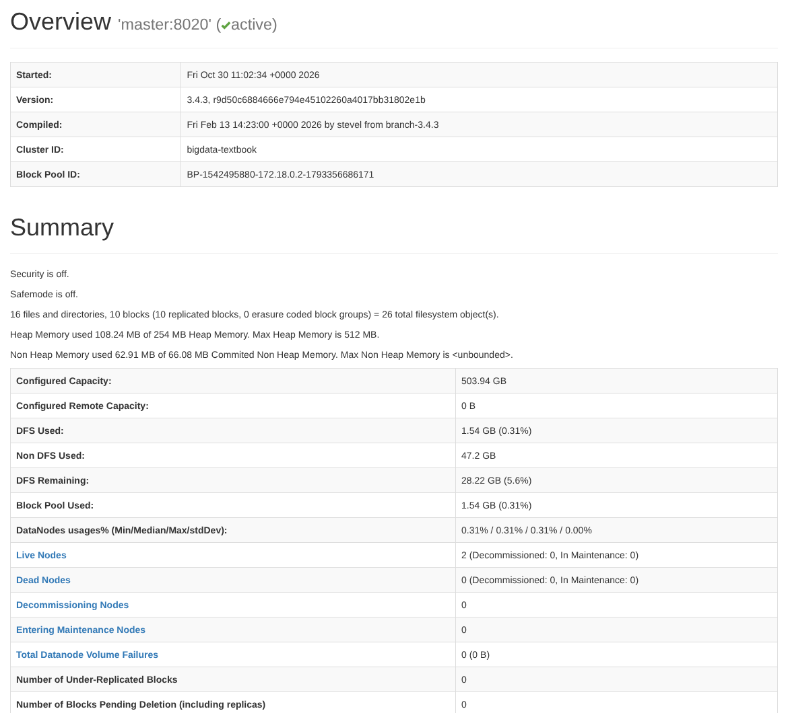
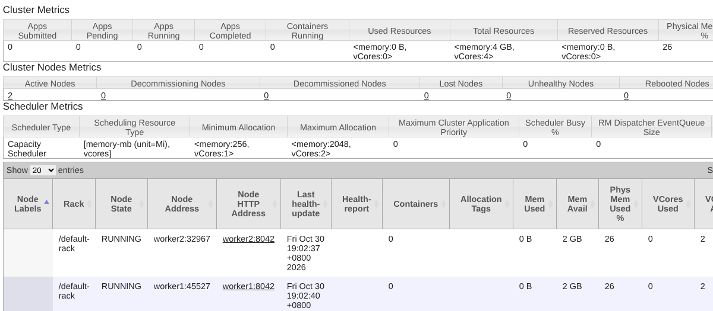
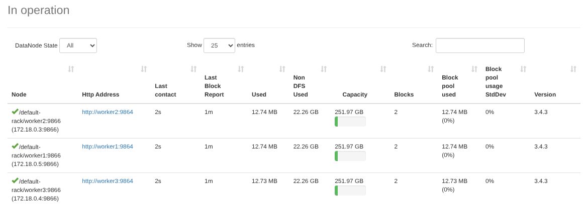
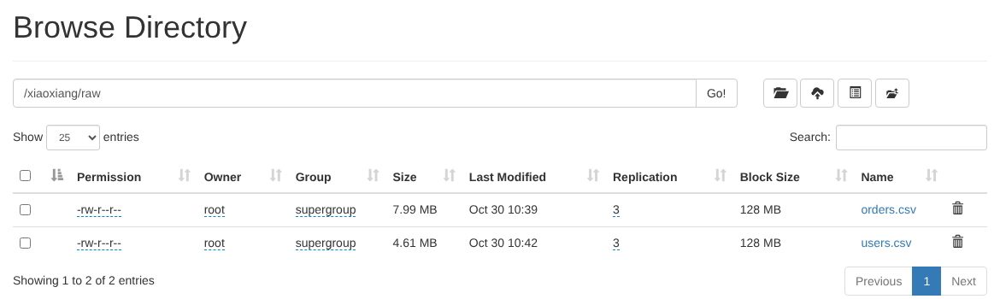
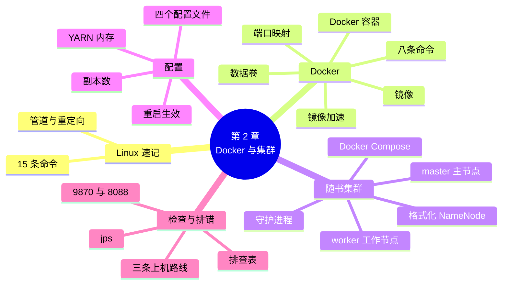

# 第 2 章 实验环境：Docker 与 Hadoop 集群

!!! abstract "本章学时"
    理论 5 学时 · 实验 1 学时（本章共 3 个实验，教师可任选）

## 学习目标

学完本章，你应该能够：

1. **说出**镜像、Docker 容器、端口映射、数据卷四个概念的含义，以及随书集群中每个容器运行哪些 Hadoop 进程（记忆、理解）；
2. **使用**常用的 Linux 命令和 Docker 命令，拉取镜像、运行和管理容器（应用）；
3. **启动**随书 Hadoop 集群，用 `jps`、9870 和 8088 网页检查它是否正常，并填写节点检查表（应用）；
4. **修改**Hadoop 最常改的配置项（副本数、内存），让修改生效，并给集群增加一个工作节点（应用）；
5. **排查**端口被占、内存不够、节点不健康、镜像下载失败等常见问题（分析）。

!!! info "先修要求"
    学习本章前，你需要掌握：

    - 第 1 章的集群、节点、HDFS、YARN 等概念（[第 1 章 大数据概述与技术生态](../01-overview/index.md)）；
    - 会打开命令行窗口（Windows 的 PowerShell、macOS 的“终端”），输入命令并回车运行；
    - 知道 IP 地址和端口是什么（“计算机网络基础”课程）。

??? abstract "本章概念清单（13 个，点击查看定义和例子）"
    1. [Docker](../../appendix/glossary.md#g-Docker)
    2. [镜像](../../appendix/glossary.md#g-镜像)
    3. [Docker 容器](../../appendix/glossary.md#g-Docker-容器)
    4. [镜像仓库](../../appendix/glossary.md#g-镜像仓库)
    5. [镜像加速](../../appendix/glossary.md#g-镜像加速)
    6. [端口映射](../../appendix/glossary.md#g-端口映射)
    7. [数据卷](../../appendix/glossary.md#g-数据卷)
    8. [Docker Compose](../../appendix/glossary.md#g-Docker-Compose)
    9. [主节点](../../appendix/glossary.md#g-主节点)
    10. [工作节点](../../appendix/glossary.md#g-工作节点)
    11. [守护进程](../../appendix/glossary.md#g-守护进程)
    12. [格式化 NameNode](../../appendix/glossary.md#g-格式化-NameNode)
    13. [jps](../../appendix/glossary.md#g-jps)

## 情景导入

小周想在自己的笔记本上练习 Hadoop。他在网上找了一篇安装教程，照着做了一个晚上：先装虚拟机软件，建三台 Linux 虚拟机，每台都装 Java、下载 Hadoop、配置环境变量、改主机名、设置免密登录，再把七八个配置文件改一遍……第二天启动集群，报错了。他搜了半天，发现是某台虚拟机的一个配置文件里少写了一个字母。这种在虚拟机上一步步手工安装的方法，在不少教材中都有详细介绍。<sup class="cite">[[1]](#ref2-1)</sup>

数据组长看了看说：“我们组新同事都用 Docker。集群的配置已经写好放在一个文件里，你装好 Docker，一条命令就能起来，三分钟搞定。弄坏了也不怕，删掉重来就行。”

本章就来做这件事。我们先速记本书要用的 Linux 命令，再学习“够用就好”的 Docker 知识，然后用一条命令启动一个 1 主 2 从的 Hadoop 集群，看懂它的配置、学会检查它是否正常、遇到问题怎样排查。本章搭好的集群，是后面所有集群实验的“实验室”，请务必把它跑通。

## 2.1 Linux 速记：本书用到的 15 条命令

大数据组件几乎都运行在 Linux 上，随书集群的每个容器里也是 Linux（Ubuntu 22.04）。本书只用到下面 15 条命令，在“Linux 操作系统”课程中都学过，这里列出来方便查阅，详细用法见[附录 A](../../appendix/a-linux-pyspark.md)。

| 命令 | 作用 | 例子 |
|---|---|---|
| `pwd` | 显示当前所在的目录 | `pwd` → `/labs` |
| `ls` | 列出目录中的文件，`-l` 显示详细信息，`-h` 用 KB/MB 显示大小 | `ls -lh data/xiaoxiang` |
| `cd` | 进入目录，`cd ..` 回到上一级 | `cd /labs/cluster` |
| `mkdir` | 新建目录，`-p` 可以一次建多级 | `mkdir -p out/day1` |
| `cp` | 复制文件，`-r` 复制目录 | `cp orders.csv orders_bak.csv` |
| `mv` | 移动或改名 | `mv a.txt b.txt` |
| `rm` | 删除文件，`-r` 删除目录（删除后无法恢复，要小心） | `rm -r out` |
| `cat` | 显示文件全部内容 | `cat conf/workers` |
| `head` / `tail` | 显示文件开头或结尾几行，`-n` 指定行数 | `head -n 3 orders.csv` |
| `grep` | 找出包含某个词的行 | `grep replication conf/hdfs-site.xml` |
| `wc -l` | 数文件有多少行 | `wc -l access.log` |
| `df -h` | 查看磁盘还剩多少空间 | `df -h /` |
| `free -h` | 查看内存用了多少、还剩多少 | `free -h` |
| `ps` | 查看正在运行的进程 | `ps aux` |
| `curl` | 在命令行访问网址，常用来检查网页服务是否正常 | `curl -I http://localhost:9870` |

还有两个符号经常和这些命令配合使用：管道 `|` 把前一条命令的输出交给后一条命令，例如 `cat access.log | grep /cart | wc -l` 数出访问购物车页面的次数；重定向 `>` 把输出写进文件，例如 `head -n 100 orders.csv > small.csv`。

!!! tip "Windows 同学怎么办"
    Windows 的 PowerShell 里没有 `grep`、`head` 等命令。本书的做法是：**和集群有关的命令，都进入容器里运行**（容器里是 Linux）；本机上的 Python 实验在 PowerShell 或 WSL 中运行。WSL 是 Windows 自带的 Linux 子系统，安装 Docker Desktop 时会一起启用，见 2.2.3 节。

## 2.2 Docker 够用就好

### 2.2.1 为什么用 Docker

搭建 Hadoop 集群难，难在“环境”：每台机器要装对版本的 Java、Hadoop，几十个配置项要互相对得上，一处写错就起不来。而且你的电脑是 Windows、他的是 macOS、服务器是 Linux，同一篇教程到了不同的电脑上，遇到的问题各不相同。

[**Docker**](../../appendix/glossary.md#g-Docker "把软件和它需要的运行环境打包在一起、在任何装有 Docker 的电脑上以相同方式运行的容器技术"){ .term } 解决的就是这个问题。它把一个软件和它需要的整个运行环境（操作系统文件、Java、Hadoop、配置）打包在一起，到了任何装有 Docker 的电脑上，都能以完全相同的方式运行。打个比方：以前搬家要把家具一件件拆开搬、到新家再装起来；Docker 就像集装箱，东西在箱子里摆好，整箱搬走，到哪儿打开都一样。<sup class="cite">[[2]](#ref2-2)</sup>

用 Docker 搭集群还有两个好处：一是**省资源**，Docker 容器不像虚拟机那样每个都要运行一个完整的操作系统，一台笔记本能同时跑好几个；二是**弄坏了不怕**，删掉容器、重新启动，几十秒就回到初始状态。

### 2.2.2 四个概念

学 Docker，先弄懂四个概念：

- [**镜像**](../../appendix/glossary.md#g-镜像 "打包好的软件和运行环境，只读，用来启动容器，名字后面的标签表示版本"){ .term }（Image）：软件和运行环境的“安装包”，只读，不会被改动。例如 `apache/hadoop:3.4.3` 是 Apache 官方发布的 Hadoop 3.4.3 镜像，冒号前是镜像名，冒号后是版本标签。<sup class="cite">[[3]](#ref2-3)</sup>镜像存放在[**镜像仓库**](../../appendix/glossary.md#g-镜像仓库 "存放和分发镜像的服务，最大的公共仓库是 Docker Hub"){ .term }里，最大的公共仓库是 Docker Hub。
- [**Docker 容器**](../../appendix/glossary.md#g-Docker-容器 "用镜像启动的运行实例，有自己的主机名、IP 地址和文件，彼此隔离；与 YARN 的“容器”不是一回事"){ .term }（Container）：用镜像启动起来的一个运行实例。一个镜像可以启动很多个容器，每个容器有自己的主机名、IP 地址和文件，互不干扰。随书集群就是用同一个 Hadoop 镜像启动的 3 个容器。注意它和第 4 章 YARN 中的“容器”不是一回事，后者是 YARN 分给任务的一份内存和 CPU。
- [**端口映射**](../../appendix/glossary.md#g-端口映射 "把宿主机的端口转发到容器的端口，让外部能访问容器里的服务，写作“宿主机端口:容器端口”"){ .term }：容器里的程序开了端口，外面的电脑默认访问不到。端口映射把你电脑（宿主机）的某个端口转到容器的某个端口，写法是“宿主机端口:容器端口”。例如 `9870:9870` 让你在浏览器打开 `localhost:9870` 时，实际访问的是 master 容器里 NameNode 的网页。
- [**数据卷**](../../appendix/glossary.md#g-数据卷 "由 Docker 管理、在删除容器后仍然保留的存储空间，也可以把宿主机目录挂载进容器"){ .term }（Volume）：容器删除后，它里面新写的文件也就没了。要长期保存的数据，放在数据卷里，或者把宿主机的一个目录“挂载”到容器里。随书集群把 HDFS 的数据放在数据卷里，把本机的 `labs/` 目录挂载到容器的 `/labs`，你在电脑上改了代码，容器里马上就能用。

四者的关系可以这样记：**镜像是模具，容器是用模具做出来的产品；端口映射是产品对外的窗口，数据卷是产品外挂的保险柜。**

### 2.2.3 安装 Docker 与国内镜像加速

不同系统的安装方法如下，详细步骤见 Docker 官方文档：<sup class="cite">[[4]](#ref2-4)</sup>

| 系统 | 安装什么 | 注意事项 |
|---|---|---|
| Windows 10/11 | Docker Desktop | 安装时勾选使用 WSL 2；要在 BIOS 中打开 CPU 虚拟化（一般默认已打开） |
| macOS | Docker Desktop | 区分 Apple 芯片和 Intel 芯片两个版本 |
| Linux（Ubuntu 等） | Docker Engine 和 Compose 插件 | 安装后用 `sudo usermod -aG docker $USER` 把自己加入 docker 组，重新登录后不用每次输 `sudo` |

装好后在命令行输入 `docker version` 和 `docker compose version`，都能显示版本号就说明安装成功。Docker Desktop 用户还要在 Settings → Resources 中确认给 Docker 分配的内存不少于 6 GB，否则集群可能起不来。

**国内镜像加速。**Docker 默认从国外的 Docker Hub 下载镜像，在国内常常很慢甚至下载失败。[**镜像加速**](../../appendix/glossary.md#g-镜像加速 "让 Docker 改从国内的镜像站下载镜像的设置，解决访问 Docker Hub 慢的问题"){ .term }是让 Docker 改从国内的镜像站下载：在 Docker 的配置中加入加速地址（Docker Desktop 在 Settings → Docker Engine 里，Linux 在 `/etc/docker/daemon.json` 里）：

```json
{
  "registry-mirrors": ["https://<加速地址>"]
}
```

加速地址可以使用学校实训平台或云服务商提供的地址（例如在阿里云“容器镜像服务”控制台可以领取一个个人加速地址）。公共加速服务时有变动，以任课教师提供的为准。如果网络实在不通，还有一个“离线”的办法：由老师在能联网的电脑上用 `docker save` 把镜像导出成一个文件，同学拷贝后用 `docker load -i hadoop-3.4.3.tar` 导入，效果和下载完全一样。

### 2.2.4 八条常用命令

下面八条命令覆盖了本书用到的全部单个容器操作。实验 2-1 会逐条练习：

| 命令 | 作用 | 例子 |
|---|---|---|
| `docker pull` | 从仓库下载镜像 | `docker pull nginx:1.29` |
| `docker images` | 列出本机已有的镜像和大小 | `docker images` |
| `docker run` | 用镜像启动一个新容器；`-d` 后台运行，`-p` 端口映射，`--name` 起名字 | `docker run -d -p 8080:80 --name web nginx:1.29` |
| `docker ps` | 列出正在运行的容器，`-a` 包括已停止的 | `docker ps -a` |
| `docker logs` | 查看容器的输出日志，排错时最常用 | `docker logs web` |
| `docker exec` | 在运行中的容器里执行命令，`-it ... bash` 进入容器的命令行 | `docker exec -it web bash` |
| `docker stop` | 停止容器 | `docker stop web` |
| `docker rm` | 删除已停止的容器（镜像还在，随时可以再启动新容器） | `docker rm web` |

编者电脑上本书用到的镜像大小如下，第一次下载需要一些时间和磁盘空间：

| 镜像 | 大小 | 用在 |
|---|---|---|
| `apache/hadoop:3.4.3` | 2.2 GB | 第 2～5 章 |
| `apache/hive:4.2.1` | 3.93 GB | 第 5 章 |
| `apache/spark:4.1.4-scala2.13-java21-python3-ubuntu` | 2.18 GB | 第 6～11 章 |
| `apache/kafka:4.4.0` | 705 MB | 第 9 章 |

这里显示的是解压后占用的磁盘空间，下载时是压缩包，会小一些。本章只需要 Hadoop 镜像。

## 2.3 一条命令启动 Hadoop 集群

### 2.3.1 Docker Compose：把多个容器写在一个文件里

一个 Hadoop 集群要好几个容器一起工作：它们要在同一个网络里互相找得到，要按顺序启动，各自挂载配置文件和数据卷。如果用 `docker run` 一个个地启动，命令又长又容易出错。[**Docker Compose**](../../appendix/glossary.md#g-Docker-Compose "把多个容器的设置写在一个 YAML 文件里，用一条命令统一启动、停止的工具"){ .term } 让我们把多个容器的设置写进一个 `docker-compose.yml` 文件，然后一条命令全部启动、一条命令全部停止。<sup class="cite">[[5]](#ref2-5)</sup>

随书集群由三个容器组成：

- **master**（[**主节点**](../../appendix/glossary.md#g-主节点 "集群中负责管理和协调的节点，运行 NameNode、ResourceManager 等管理进程"){ .term }）：运行 NameNode（管理 HDFS 的文件目录）、ResourceManager（管理整个集群的计算资源）、JobHistoryServer（记录已完成的作业）和 HttpFS（让集群外的程序读写 HDFS）；
- **worker1、worker2**（[**工作节点**](../../appendix/glossary.md#g-工作节点 "集群中负责存储数据和执行计算任务的节点，运行 DataNode 和 NodeManager"){ .term }）：各运行一个 DataNode（存数据）和一个 NodeManager（跑计算任务）。存数据的机器同时负责计算，正是第 1 章讲的“移动计算”。

这些在后台一直运行、提供服务的程序，叫作[**守护进程**](../../appendix/glossary.md#g-守护进程 "在后台持续运行、对外提供服务的程序"){ .term }。NameNode 和 DataNode 的工作原理在第 3 章讲，ResourceManager 和 NodeManager 在第 4 章讲，本章先把它们跑起来。

### 2.3.2 看懂 docker-compose.yml

配套资源 `labs/cluster/` 目录下有这些文件：

```text
labs/cluster/
├── docker-compose.yml           # 集群的总设置：3 个容器
├── docker-compose.worker3.yml   # 实验 2-3 用：再加一个工作节点
├── start-master.sh              # master 容器启动时运行的脚本
├── start-worker.sh              # worker 容器启动时运行的脚本
├── check_cluster.sh             # 实验 2-2 用：一键检查集群
└── conf/                        # Hadoop 的配置文件，挂载到每个容器里
    ├── core-site.xml  hdfs-site.xml  yarn-site.xml  mapred-site.xml  workers
```

`docker-compose.yml` 中 master 部分的关键几行如下（完整文件见配套资源）：

```yaml
name: bigdata                      # 项目名，容器会叫 bigdata-master-1 等

x-hadoop: &hadoop                  # 三个容器的公共设置，下面用 <<: *hadoop 引用
  image: apache/hadoop:3.4.3       # 用哪个镜像
  environment:
    TZ: Asia/Shanghai              # 时区设为北京时间
    HADOOP_HEAPSIZE_MAX: 512m      # 每个守护进程最多用 512 MB 内存

services:
  master:
    <<: *hadoop
    hostname: master               # 容器的主机名，其他容器用这个名字找到它
    command: ["bash", "/opt/start-master.sh"]   # 启动后运行的脚本
    ports:
      - "9870:9870"     # NameNode 网页
      - "8088:8088"     # ResourceManager 网页
      - "19888:19888"   # 作业历史网页
      - "14000:14000"   # HttpFS：用 Python 读写 HDFS
    volumes:
      - ./conf/hdfs-site.xml:/opt/hadoop/etc/hadoop/hdfs-site.xml:ro   # 配置文件，ro 表示只读
      - ../:/labs                  # 把整个 labs 目录挂进容器
      - master-data:/data/hadoop   # 数据卷：NameNode 的元数据存在这里
```

worker1、worker2 的写法类似，只是启动脚本换成 `start-worker.sh`，数据卷换成各自的 `worker1-data`、`worker2-data`。读这个文件时抓住四个问题就够了：**用哪个镜像？主机名叫什么？开了哪些端口？挂载了哪些文件和数据卷？**

三个容器会被自动放进同一个名为 `bigdata_default` 的网络，彼此直接用主机名访问，例如配置文件中的 `hdfs://master:8020` 就是 NameNode 的地址。下面的动画把这些关系画成了一张“集群地图”。

### 2.3.3 用动画认识集群地图

<iframe class="sim-frame" src="../../sims/cluster-map/main.html" height="900" loading="lazy" title="集群地图"></iframe>

点击每个容器，看它运行哪些进程、开了哪些端口、数据存在哪里；点击上方的 localhost 端口，看浏览器的请求怎样转到容器里。“加入 worker3”和“停掉 worker2”分别对应实验 2-3 和第 3 章的实验 3-2。[全屏打开](../../sims/cluster-map/main.html){ target=_blank }
{ .sim-caption }

### 2.3.4 启动、停止和重置

在 `labs/cluster` 目录下：

```bash
docker compose up -d        # 启动集群（-d 表示在后台运行）
docker compose ps           # 查看三个容器的状态
docker compose logs master  # 查看 master 的启动日志，排错时用
docker compose exec master bash   # 进入 master 容器的命令行，输入 exit 退出
docker compose stop         # 暂停集群，下次 docker compose start 继续
docker compose down         # 删除容器，数据卷保留，HDFS 中的文件还在
docker compose down -v      # 连数据卷一起删除，HDFS 回到空白状态
```

第一次启动时，`start-master.sh` 会先[**格式化 NameNode**](../../appendix/glossary.md#g-格式化-NameNode "第一次使用 HDFS 前初始化 NameNode 元数据目录的操作，相当于给新硬盘建立文件系统，只做一次"){ .term }，相当于给一块新硬盘建立文件系统，只做一次；以后再启动，脚本发现已经格式化过就跳过这一步。所以 `down` 之后再 `up`，HDFS 中的文件都还在；只有加了 `-v` 才会清空重来。

容器启动只要一两秒，但里面的 Hadoop 守护进程还要二三十秒才能全部就绪，期间打开网页显示“无法访问”是正常的，稍等再刷新即可。

## 2.4 Hadoop 的四个配置文件

### 2.4.1 每个文件管什么

Hadoop 的配置都是 XML 格式，每一项由“名称”和“值”组成：

```xml
<property>
    <name>dfs.replication</name>
    <value>2</value>
</property>
```

随书集群把配置文件放在 `labs/cluster/conf/`，挂载到每个容器的 `/opt/hadoop/etc/hadoop/` 下。四个文件分工如下：<sup class="cite">[[6]](#ref2-6)</sup>

| 文件 | 管什么 | 随书集群中的关键配置 |
|---|---|---|
| `core-site.xml` | 全局设置，最重要的是 HDFS 的地址 | `fs.defaultFS = hdfs://master:8020`；`hadoop.tmp.dir = /data/hadoop`（数据存放目录） |
| `hdfs-site.xml` | HDFS 的设置 | `dfs.replication = 2`（副本数）；`dfs.blocksize = 134217728`（块大小 128 MB） |
| `yarn-site.xml` | YARN 的设置 | `yarn.nodemanager.resource.memory-mb = 2048`（每个节点给 YARN 2 GB 内存）；`yarn.nodemanager.resource.cpu-vcores = 2` |
| `mapred-site.xml` | MapReduce 的设置 | `mapreduce.framework.name = yarn`（在 YARN 上运行）；Map、Reduce 任务各用 512 MB |

另外，`workers` 文件列出所有工作节点的主机名，每行一个。

这么多配置项不需要背。工作中最常改的只有两三项：**副本数**（数据要存几份）、**每个节点给 YARN 多少内存和 CPU**（能同时跑多少任务），以及块大小。其余的保持默认或照抄现成的配置即可。<sup class="cite">[[7]](#ref2-7)</sup>查一个配置项的含义，可以在 Hadoop 官方文档中搜索它的名字，每个文件都有一份列出全部配置项和默认值的说明。

### 2.4.2 改了配置怎样生效

改完配置文件后，**要重启相应的守护进程才会生效**，因为它们只在启动时读一次配置。在随书集群上，最简单的办法是重启所有容器：

```bash
docker compose restart
docker compose exec master hdfs getconf -confKey dfs.replication   # 查看当前生效的值
```

编者实测还发现一个容易踩的坑：**随书集群是把单个配置文件挂载进容器的。有些编辑器保存文件时，会先写一个新文件、再替换掉旧文件（Linux 下的 `sed -i` 命令也是这样），容器里看到的仍然是旧文件。**这时只要执行一次 `docker compose restart`，容器就会重新挂载到新文件。用 `getconf` 确认一下，是检查配置有没有生效的好习惯。

另外要记住：**副本数这样的配置只影响以后新写入的文件**，已经存在的文件不会自动改变，要用 `hdfs dfs -setrep` 命令单独修改。实验 2-3 会亲手验证这一点。

## 2.5 检查集群是否正常

集群启动后，从三个层面检查：

**第一，进程在不在。** [**jps**](../../appendix/glossary.md#g-jps "Java 自带的命令，列出正在运行的 Java 进程，用来检查 Hadoop 守护进程是否启动"){ .term } 是 Java 自带的命令，列出正在运行的 Java 进程。Hadoop 的守护进程都是 Java 程序，用它一查就知道该有的进程是否都起来了：

```bash
docker compose exec master jps
docker compose exec worker1 jps
```

master 上应有 NameNode、ResourceManager、JobHistoryServer、HttpFSServerWebServer 四个进程，每个 worker 上应有 DataNode、NodeManager 两个。少了哪个，就用 `docker compose logs` 看对应容器的日志找原因。

**第二，节点有没有连上。** 进程在，不代表工作节点已经向主节点“报到”成功：

```bash
docker compose exec master hdfs dfsadmin -report   # 看 Live datanodes 是不是 2
docker compose exec master yarn node -list          # 看 Total Nodes 是不是 2
```

**第三，网页能不能打开。** 在浏览器中打开下面的地址：

| 端口 | 网页 | 看什么 |
|---|---|---|
| 9870 | HDFS NameNode | Overview 页的 Live Nodes 应为 2；Datanodes 页列出每个节点；Utilities → Browse the file system 浏览文件 |
| 8088 | YARN ResourceManager | Nodes 页的两个节点都应是 RUNNING；Total Resources 应为 4 GB 内存、4 个 vCores |
| 19888 | 作业历史 | 第 4 章提交作业后查看 |
| 14000 | HttpFS | 第 3 章用 Python 读写 HDFS 时用，浏览器里不常打开 |

下面是编者集群的 9870 网页 Overview 页。Summary 表格中，Live Nodes 为 2、Dead Nodes 为 0、Number of Under-Replicated Blocks（副本不足的块）为 0，说明 HDFS 一切正常：



8088 网页的 Nodes 页上，两个 NodeManager 都是 RUNNING，Cluster Metrics 中的 Total Resources 为 `<memory:4 GB, vCores:4>`：



为了省事，配套资源提供了一个检查脚本 `check_cluster.sh`，把上面三个层面的检查一次做完，实验 2-2 会用到它。

## 2.6 常见问题排查

搭环境时出问题很正常。遇到问题按“**看状态 → 看日志 → 对照排查表**”三步走：先用 `docker compose ps` 看哪个容器没起来，再用 `docker compose logs <容器名>` 看它的日志，最后到下表中找对应的现象。

| 现象 | 原因 | 解决办法 |
|---|---|---|
| `docker pull` 很慢或报 `timeout`、`connection refused` | 访问 Docker Hub 的网络不通 | 配置镜像加速（2.2.3 节），或由老师用 `docker save`/`docker load` 离线分发镜像 |
| `docker compose up` 报 `port is already allocated` 或 `address already in use` | 本机已有程序占用了 9870、8088 等端口 | 关闭占用端口的程序；或把 `docker-compose.yml` 中 `ports` 冒号**左边**的端口改成别的，如 `"19870:9870"`，然后访问 `localhost:19870` |
| 容器反复重启，`docker compose ps` 显示 `Restarting` 或 `Exited (137)` | 内存不够，容器被系统强制结束 | 关闭其他程序；Docker Desktop 中把内存调到 6 GB 以上 |
| Windows 上报 `WSL 2 installation is incomplete` 或 Docker Desktop 起不来 | WSL 2 没有安装好，或 CPU 虚拟化没有打开 | 以管理员身份运行 `wsl --install`，重启电脑；在任务管理器“性能”页确认“虚拟化：已启用” |
| 网页打不开，但容器都在运行 | 守护进程还没启动完 | 等 30 秒再刷新；用 `docker compose logs master` 看是否有报错 |
| `hdfs dfsadmin -report` 显示 Live datanodes 少于 2 | worker 还没连上 master，或 worker 的 DataNode 启动失败 | 等一会儿再查；查看 `docker compose logs worker1`；仍不行就 `docker compose down -v` 后重新启动 |
| 8088 网页上节点显示 UNHEALTHY，作业一直不运行 | 电脑磁盘使用率过高，NodeManager 认为磁盘不健康 | 清理磁盘，保证有 10 GB 以上空闲；随书配置已把阈值放宽到 98.5% |
| 改了配置文件但 `getconf` 显示的还是旧值 | 守护进程没有重启，或编辑器替换了文件导致挂载失效 | 执行 `docker compose restart`（2.4.2 节） |
| 网页上的时间比北京时间少 8 小时 | 9870 等网页按浏览器所在电脑的时区显示时间，电脑（如云主机）时区不是北京时间 | 不影响使用；命令行输出的时间是北京时间 |

## 2.7 三条上机路线

不是每个人的电脑都适合跑集群。随书集群三个容器加起来，运行时大约要占用 3～4 GB 内存。根据自己的条件，选一条路线：

| 路线 | 适合 | 怎么做 | 注意 |
|---|---|---|---|
| 自己的电脑 | 内存 8 GB 以上（推荐 16 GB），空闲磁盘 20 GB 以上 | 安装 Docker Desktop，按本章操作 | 做实验时关掉不用的程序；Windows 要启用 WSL 2 |
| 云主机 | 电脑配置不够，或想体验真实的服务器 | 在阿里云、华为云等购买一台 4 核 16 GB 的 Linux 云主机（按量付费，用完释放），安装 Docker Engine，上传配套资源 | 网页端口不要直接开放到公网，用 SSH 隧道访问；用完记得释放，避免持续扣费 |
| 学校实训平台 | 学校提供了在线实验环境 | 按老师给的地址登录，平台上一般已装好 Docker 和镜像 | 下课前把自己的代码保存到平台的持久化目录或下载到本地 |

三条路线运行的是同一套配置文件和命令，书上的结果在哪条路线上都能复现。

## 2.8 前沿视窗

**从“自己搭集群”到“云上一键开集群”。**企业里的大数据集群少则几十台、多则上万台机器，自己搭建和维护的成本很高。现在各大云服务商都提供了托管的大数据集群服务，如华为云 MapReduce 服务（MRS）、阿里云 E-MapReduce：在网页上选好组件（Hadoop、Spark、Hive、Kafka 等）、节点数量和配置，十几分钟就能创建一个集群，还能按业务的高峰低谷自动增减节点，用多少付多少。<sup class="cite">[[8]](#ref2-8)</sup> 这些服务省去了装软件、改配置的工作，但集群里运行的还是 NameNode、DataNode、ResourceManager 这些守护进程，**本章学会的检查和排错方法依然适用**。

**容器正在成为大数据平台的底座。**本章用 Docker 在一台电脑上运行几个容器；在企业里，成千上万个容器要分布到大量服务器上，就需要容器编排系统 Kubernetes 来统一调度。Kubernetes 由谷歌开源，借鉴了谷歌内部十多年管理容器集群的经验。<sup class="cite">[[9]](#ref2-9)</sup> 如今 Spark、Flink 等计算引擎都可以直接运行在 Kubernetes 上，越来越多的企业把大数据和人工智能的计算任务放到同一个 Kubernetes 集群中，统一管理 CPU 和 GPU 资源。从 Docker 学起，正是走进这一套技术的第一步。

## 本章实验

!!! abstract "实验总览"
    | 实验 | 类型 | 建议时长 | 内容 |
    |---|---|---|---|
    | 实验 2-1 | ★ 基础 | 30 分钟 | 安装 Docker，用 nginx 镜像练习拉取、运行、查看、进入、停止和删除容器，体会端口映射 |
    | 实验 2-2 | ★ 基础 | 30 分钟 | 一条命令启动 Hadoop 集群，用检查脚本和网页确认每个节点正常，填写节点检查表 |
    | 实验 2-3 | ☆ 拓展 | 40 分钟 | 把副本数改成 3，给集群加一个工作节点 worker3，观察网页和文件副本的变化 |

    实验在自己的电脑（或云主机、实训平台）上用 Docker 完成，建议内存 8 GB 以上、空闲磁盘 20 GB 以上。集群配置在配套资源 `labs/cluster/` 目录。编者的运行环境：4 核 CPU、16 GB 内存的 Linux 主机，Docker 29.9，Docker Compose 5.6，Hadoop 3.4.3 官方镜像。

### 实验 2-1 ★ 安装 Docker 并运行第一个容器

**实验目的**

1. 安装 Docker，配置镜像加速，验证安装成功；
2. 用八条常用命令完成一个容器从下载到删除的全过程；
3. 通过端口映射在浏览器中访问容器里的网站，理解“宿主机端口:容器端口”。

**实验环境**：Windows 10/11 或 macOS 安装 Docker Desktop，Linux 安装 Docker Engine；需要能访问 Docker Hub 或国内加速地址。

**实验数据**：无。使用 Docker 官方的 `hello-world` 测试镜像和 `nginx:1.29` 网站服务器镜像。

**实验步骤与代码**

第 1 步，按 2.2.3 节安装 Docker 并配置镜像加速，然后检查版本：

```bash
docker version
docker compose version
```

第 2 步，运行测试镜像。本机没有这个镜像时，Docker 会自动下载；`--rm` 表示运行结束后自动删除容器：

```bash
docker run --rm hello-world
```

第 3 步，下载 nginx 镜像，启动一个网站容器。`-d` 让它在后台运行，`-p 8080:80` 把本机的 8080 端口映射到容器的 80 端口（nginx 默认在 80 端口提供网页），`--name web` 给容器起名：

```bash
docker pull nginx:1.29
docker images
docker run -d -p 8080:80 --name web nginx:1.29
docker ps
```

第 4 步，用浏览器打开 <http://localhost:8080>，或在命令行访问：

```bash
curl -s http://localhost:8080 | grep title
```

第 5 步，查看日志，进入容器看看里面是什么系统：

```bash
docker logs web
docker exec web cat /etc/os-release
docker exec -it web bash        # 进入容器的命令行，输入 exit 退出
```

第 6 步，再启动一个同样映射到 8080 端口的容器，看看会发生什么，然后清理：

```bash
docker run -d -p 8080:80 --name web2 nginx:1.29
docker stop web
docker rm web
docker ps -a
```

**运行结果**

第 2 步输出的开头两行（编者电脑上已有该镜像，所以没有下载过程）：

```text
Hello from Docker!
This message shows that your installation appears to be working correctly.
```

第 3 步 `docker ps` 的输出，PORTS 一列显示了端口映射：

```text
CONTAINER ID   IMAGE        COMMAND                  CREATED         STATUS         PORTS                  NAMES
5d558c079700   nginx:1.29   "/docker-entrypoint.…"   2 seconds ago   Up 2 seconds   0.0.0.0:8080->80/tcp   web
```

第 4 步输出 `<title>Welcome to nginx!</title>`，浏览器中显示 nginx 的欢迎页。第 5 步 `docker logs web` 的最后一行记录了刚才的访问；`/etc/os-release` 显示容器里是 `Debian GNU/Linux 13 (trixie)`，不管你的电脑是 Windows 还是 macOS，容器里都是同一个 Linux 环境。

第 6 步启动 web2 时报错：

```text
docker: Error response from daemon: ... Bind for 0.0.0.0:8080 failed: port is already allocated
```

本机的 8080 端口已经映射给了 web，不能再给别的容器。这正是 2.6 节排查表中“端口被占用”的情况，把 web2 改成 `-p 8081:80` 就能启动（做完记得用 `docker rm -f web2` 删掉它）。删除 web 后，`docker ps -a` 列表为空，但 `docker images` 中 nginx 镜像还在，随时可以再启动新容器。

**实验记录表**

| 步骤 | 观察内容 | 你的结果 |
|---|---|---|
| 1 | Docker 和 Compose 的版本号 | |
| 3 | nginx 镜像的大小；`docker ps` 中 PORTS 列的内容 | |
| 5 | 容器里的操作系统 | |
| 6 | 端口冲突的报错信息；改用哪个端口解决 | |

**常见问题排查**

| 现象 | 原因 | 解决办法 |
|---|---|---|
| `Cannot connect to the Docker daemon` 或 `docker: command not found` | Docker 没有启动或没有安装好 | Windows、macOS 先打开 Docker Desktop，等左下角显示 Engine running；Linux 运行 `sudo systemctl start docker` |
| Linux 上提示 `permission denied ... docker.sock` | 当前用户没有使用 Docker 的权限 | `sudo usermod -aG docker $USER`，退出后重新登录 |
| `docker pull` 一直卡住或超时 | 访问 Docker Hub 的网络不通 | 配置镜像加速后重启 Docker；或用老师提供的镜像文件 `docker load -i` |
| 浏览器打开 localhost:8080 没反应 | 容器没有运行，或端口写反了 | `docker ps` 确认容器状态；`-p` 的格式是“本机端口:容器端口” |

**思考与练习**

1. 不加 `-d` 运行 `docker run -p 8080:80 --name web nginx:1.29`，会有什么不同？怎样退出？
2. `docker stop` 和 `docker rm` 有什么区别？删除容器会不会删除镜像？

**实验报告要求**

提交第 3、4、6 步的运行结果截图（含浏览器中的 nginx 欢迎页）和实验记录表，用自己的话说明镜像和容器的区别。

### 实验 2-2 ★ 一条命令启动 Hadoop 集群并检查

**实验目的**

1. 用 Docker Compose 启动 1 主 2 从的 Hadoop 集群；
2. 从进程、节点、网页三个层面检查集群，填写节点检查表；
3. 向 HDFS 上传一个文件，确认集群可以正常使用。

**实验环境**：实验 2-1 安装好的 Docker；电脑内存 8 GB 以上，Docker 可用内存不少于 6 GB。

**实验数据**：实验 1-1 生成的 `labs/data/xiaoxiang/orders.csv`（没做过实验 1-1 的同学，先在 `labs` 目录下运行 `python data/make_data.py`）。

**实验步骤与代码**

第 1 步，进入集群目录，启动集群。第一次运行会下载约 2 GB 的 Hadoop 镜像，请耐心等待：

```bash
cd labs/cluster
docker compose up -d
```

第 2 步，等待 30 秒左右，让 Hadoop 守护进程启动完毕，然后运行检查脚本：

```bash
bash check_cluster.sh
```

Windows 同学在 PowerShell 中没有 `bash`，可以在 WSL 中运行，也可以逐条执行脚本中的命令：

```bash
docker compose ps
docker compose exec master jps
docker compose exec worker1 jps
docker compose exec master hdfs dfsadmin -report
docker compose exec master yarn node -list
```

第 3 步，在浏览器中打开 <http://localhost:9870> 和 <http://localhost:8088>，分别查看 Overview 页、Datanodes 页和 Nodes 页（图见 2.5 节）。

第 4 步，向 HDFS 上传订单表，验证集群能用：

```bash
docker compose exec master hdfs dfs -mkdir -p /xiaoxiang/raw
docker compose exec master hdfs dfs -put /labs/data/xiaoxiang/orders.csv /xiaoxiang/raw/
docker compose exec master hdfs dfs -ls /xiaoxiang/raw
```

注意这里的路径 `/labs/data/...` 是 master 容器里的路径，对应你电脑上的 `labs/data/...`，因为整个 `labs` 目录挂载到了容器的 `/labs`。

**运行结果**

第 1 步，Compose 创建网络和三个容器，几秒钟就返回：

```text
 Network bigdata_default Created
 Container bigdata-master-1 Started
 Container bigdata-worker2-1 Started
 Container bigdata-worker1-1 Started
```

第 2 步检查脚本的输出：

```text
== 1. 容器是否都在运行
SERVICE   STATUS
master    Up 40 seconds
worker1   Up 40 seconds
worker2   Up 40 seconds

== 2. 每个容器里运行着哪些 Hadoop 进程（jps 列出 Java 进程）
[master] HttpFSServerWebServer JobHistoryServer NameNode ResourceManager
[worker1] DataNode NodeManager
[worker2] DataNode NodeManager

== 3. HDFS：有几个 DataNode 在线
DFS Remaining: 31520206848 (29.36 GB)
Live datanodes (2):
Name: 172.18.0.3:9866 (bigdata-worker2-1.bigdata_default)
DFS Remaining: 15760121856 (14.68 GB)
Name: 172.18.0.4:9866 (bigdata-worker1-1.bigdata_default)
DFS Remaining: 15760084992 (14.68 GB)

== 4. YARN：有几个 NodeManager 在线
Total Nodes:2
         Node-Id	     Node-State	Node-Http-Address	Number-of-Running-Containers
   worker2:32967	        RUNNING	     worker2:8042	                           0
   worker1:45527	        RUNNING	     worker1:8042	                           0

== 5. 网页能否打开（200 表示正常）
200  http://localhost:9870
200  http://localhost:8088/cluster
200  http://localhost:19888
200  http://localhost:14000/webhdfs/v1/?op=LISTSTATUS&user.name=root
```

四个进程、两个 DataNode、两个 NodeManager、四个网页全部正常。HDFS 的剩余空间（DFS Remaining）取决于你电脑磁盘的空闲空间，IP 地址和 Node-Id 后面的端口号每次启动都可能不同，和书上不一样是正常的。

第 4 步的输出中，第 2 列的 2 是副本数，`8383330` 是文件大小（字节）：

```text
Found 1 items
-rw-r--r--   2 root supergroup    8383330 2026-10-30 18:39 /xiaoxiang/raw/orders.csv
```

**实验记录表（节点检查表）**

| 节点 | 容器状态 | jps 列出的进程 | 在 9870 / 8088 网页上的状态 |
|---|---|---|---|
| master | | | — |
| worker1 | | | |
| worker2 | | | |
| 集群合计 | Live datanodes：　　YARN Total Nodes：　　YARN 总内存：　　| | |

**常见问题排查**

| 现象 | 原因 | 解决办法 |
|---|---|---|
| 检查脚本中某个网页返回 000 | 守护进程还没启动完，或容器没有运行 | 再等 30 秒重新运行；`docker compose logs master` 查看报错 |
| `Live datanodes (0)` 或 `Total Nodes:0` | worker 还没向 master 报到 | 稍等再查；查看 `docker compose logs worker1`；仍不行就 `docker compose down -v` 后重新 `up -d` |
| `put: File exists` | HDFS 上已经有同名文件 | 加 `-f` 覆盖：`hdfs dfs -put -f ...` |
| `put: ... No such file or directory` | 容器里找不到要上传的文件 | 确认本机 `labs/data/xiaoxiang/orders.csv` 存在；路径要写容器里的 `/labs/...` |
| 其他报错 | — | 对照 2.6 节的排查表 |

**思考与练习**

1. 运行 `docker compose stop` 再 `docker compose start`，HDFS 上的 `orders.csv` 还在吗？换成 `docker compose down` 和 `up -d` 呢？加上 `-v` 呢？先预测，再验证。
2. 在 9870 网页的 Utilities → Browse the file system 中找到 `orders.csv`，点开它，能看到哪些信息？

**实验报告要求**

提交检查脚本的输出截图、9870 和 8088 网页的截图，以及填好的节点检查表。

### 实验 2-3 ☆ 改配置、加节点

**实验目的**

1. 修改 HDFS 的副本数，让配置生效，观察它对新文件和已有文件的不同影响；
2. 给集群增加一个工作节点 worker3，在网页上观察集群的变化；
3. 体会横向扩展：加一台机器，存储和计算能力都随之增加。

**实验环境**：实验 2-2 启动的集群，HDFS 中已有 `/xiaoxiang/raw/orders.csv`。增加一个节点要多占约 1 GB 内存。

**实验数据**：`labs/data/xiaoxiang/orders.csv`、`labs/data/xiaoxiang/users.csv`。

**实验步骤与代码**

第 1 步，加入 worker3。`docker-compose.worker3.yml` 只定义了一个新的工作节点，用两个 `-f` 把它和原来的文件合在一起启动：

```bash
cd labs/cluster
docker compose -f docker-compose.yml -f docker-compose.worker3.yml up -d
bash check_cluster.sh worker3
```

加了 worker3 以后，凡是 `docker compose` 命令都要带上这两个 `-f`，否则 worker3 不受管理。

第 2 步，刷新 9870 网页的 Datanodes 页和 8088 网页的 Nodes 页，数一数节点数，看集群总内存有什么变化。

第 3 步，把副本数改成 3。用文本编辑器打开 `labs/cluster/conf/hdfs-site.xml`，把 `dfs.replication` 的值从 2 改成 3，保存。然后重启集群，确认新配置已生效：

```bash
docker compose -f docker-compose.yml -f docker-compose.worker3.yml restart
docker compose exec master hdfs getconf -confKey dfs.replication
```

第 4 步，等待 30 秒后，上传一个新文件，和原来的文件比较副本数：

```bash
docker compose exec master hdfs dfs -put -f /labs/data/xiaoxiang/users.csv /xiaoxiang/raw/
docker compose exec master hdfs dfs -ls /xiaoxiang/raw
```

第 5 步，把已有文件的副本数也改成 3。`-w` 表示等待复制完成再返回：

```bash
docker compose exec master hdfs dfs -setrep -w 3 /xiaoxiang/raw/orders.csv
docker compose exec master hdfs fsck /xiaoxiang/raw/orders.csv -files -blocks -locations
```

第 6 步，在 9870 网页的 Utilities → Browse the file system 中进入 `/xiaoxiang/raw`，查看 Replication 一列。

第 7 步，恢复设置：把 `hdfs-site.xml` 中的副本数改回 2，重启集群，并把两个文件的副本数改回 2。worker3 可以保留，第 3 章的实验 3-2 还要用到它：

```bash
docker compose -f docker-compose.yml -f docker-compose.worker3.yml restart
docker compose exec master hdfs dfs -setrep 2 /xiaoxiang/raw/orders.csv /xiaoxiang/raw/users.csv
```

**运行结果**

第 1 步检查脚本中，worker3 也运行着 DataNode 和 NodeManager，`Live datanodes (3)`、`Total Nodes:3`。9870 网页的 Datanodes 页列出了三个节点：



8088 网页上集群总资源从 4 GB、4 个 vCores 变成了 6 GB、6 个 vCores：每加一个工作节点，集群就多一份存储空间和计算资源，这就是横向扩展。

第 3 步，`getconf` 输出 `3`，配置已经生效。

第 4 步的输出，新上传的 `users.csv` 副本数为 3，而原来的 `orders.csv` 仍是 2：

```text
Found 2 items
-rw-r--r--   2 root supergroup    8383330 2026-10-30 18:39 /xiaoxiang/raw/orders.csv
-rw-r--r--   3 root supergroup    4837823 2026-10-30 18:42 /xiaoxiang/raw/users.csv
```

**修改副本数的配置只对新文件生效。**第 5 步用 `setrep` 修改已有文件，编者这里等待了约 12 秒，NameNode 让 DataNode 之间复制出第三份。`fsck` 的输出（节选，长编号已省略）：

```text
Replication 3 set: /xiaoxiang/raw/orders.csv
Waiting for /xiaoxiang/raw/orders.csv .... done

/xiaoxiang/raw/orders.csv 8383330 bytes, replicated: replication=3, 1 block(s):  OK
0. ...:blk_1073741825_1001 len=8383330 Live_repl=3  [DatanodeInfoWithStorage[172.18.0.5:9866,...], DatanodeInfoWithStorage[172.18.0.3:9866,...], DatanodeInfoWithStorage[172.18.0.4:9866,...]]
Status: HEALTHY
 Default replication factor:	3
 Average block replication:	3.0
```

订单表只有 8 MB，不到一个块（128 MB），所以只有 1 个块，它的 3 份副本分别放在三台 DataNode 上（`Live_repl=3`）。第 6 步的网页上，两个文件的 Replication 都显示为 3：



**实验记录表**

| 步骤 | 观察内容 | 你的结果 |
|---|---|---|
| 2 | 加 worker3 前后的 DataNode 数、YARN 总内存 | |
| 3 | `getconf` 显示的副本数 | |
| 4 | `orders.csv` 和 `users.csv` 的副本数 | |
| 5 | `setrep -w` 等待了多久；`fsck` 中 `Live_repl` 的值 | |

**常见问题排查**

| 现象 | 原因 | 解决办法 |
|---|---|---|
| `getconf` 仍显示 2 | 编辑器保存时替换了文件，或没有重启 | 执行带两个 `-f` 的 `docker compose ... restart`（2.4.2 节） |
| 运行 `docker compose restart` 后 worker3 的运行时间没有变 | 命令没有带 `-f docker-compose.worker3.yml`，worker3 没有被重启 | 带上两个 `-f` 再执行一次 |
| `setrep -w 3` 一直在等 | 在线的 DataNode 不到 3 个，凑不齐 3 份副本 | 先确认 `Live datanodes (3)`；没有 worker3 时副本数最多只能是 2 |
| 启动时提示 `Found orphan containers ([bigdata-worker3-1])` | 加了 worker3 以后，有一次命令只用了默认的 `docker-compose.yml` | 命令都带上两个 `-f`；不再需要 worker3 时，用带两个 `-f` 的 `down` 删除它 |

**思考与练习**

1. 只有 worker1、worker2 两个节点时，把副本数设成 3 会怎样？在 9870 网页的 Overview 页上哪一项会变化？可以用第 3 章的动画“切块与副本”验证你的想法。
2. 副本数从 2 改成 3，HDFS 能多承受几台机器同时损坏？要付出什么代价？

**实验报告要求**

提交第 1、4、5 步的输出截图和第 2、6 步的网页截图，以及实验记录表。用 3～5 句话说明：为什么改了副本数的配置，已有文件的副本数却没变？

## 本章小结

- 大数据组件运行在 Linux 上。本书只用到 15 条常用 Linux 命令，配合管道 `|` 和重定向 `>` 使用；Windows 同学在容器或 WSL 中运行它们。
- **Docker** 把软件和运行环境打包在一起，到哪里都能以同样的方式运行。四个概念：**镜像**是只读的模具，**Docker 容器**是用镜像启动的运行实例，**端口映射**让宿主机访问容器里的服务，**数据卷**保存需要长期保留的数据。国内下载镜像要配置**镜像加速**，或用 `docker save`/`docker load` 离线分发。
- **Docker Compose** 把多个容器写在一个 `docker-compose.yml` 里，`docker compose up -d` 一条命令启动整个集群。随书集群有 1 个**主节点**（NameNode、ResourceManager、JobHistoryServer、HttpFS）和 2 个**工作节点**（DataNode、NodeManager）。
- Hadoop 有四个配置文件：`core-site.xml`、`hdfs-site.xml`、`yarn-site.xml`、`mapred-site.xml`。最常改的是副本数和每个节点给 YARN 的内存。改完要重启才生效，用 `hdfs getconf` 确认；副本数的修改只影响新文件，已有文件用 `hdfs dfs -setrep` 修改。
- 检查集群看三层：`jps` 看进程，`dfsadmin -report` 和 `yarn node -list` 看节点，9870 和 8088 网页看全局。排错按“看状态 → 看日志 → 对照排查表”三步走。
- 加一个工作节点，集群的存储和计算资源随之增加，这就是横向扩展。上机可以走自己电脑、云主机、学校实训平台三条路线，用的是同一套配置。



**下一章预告**

集群搭好了，实验 2-2 中我们还往 HDFS 里上传了一个文件。可是这个文件究竟存在了哪台机器上？为什么要存两份？如果一台机器坏了，文件还能读吗？下一章深入 **HDFS 分布式文件系统**：看 NameNode 怎样记账、DataNode 怎样存数据块，练熟十几条 `hdfs dfs` 命令，亲手“弄坏”一台机器看数据是否还在，并用 Python 把分析结果存进 HDFS。

## 参考文献

正文中的上标编号（如<sup class="cite">[[1]](#ref2-1)</sup>）对应下面的文献。带链接的可以直接打开；书籍可在图书馆或电子书平台查阅。

<div class="refs" markdown>

**教材与专著**

- <span id="ref2-7"></span>[7] WHITE T. Hadoop: the definitive guide[M]. 4th ed. Sebastopol: O'Reilly Media, 2015.
    <span class="ref-note">第 10 章“Setting Up a Hadoop Cluster”和第 11 章“Administering Hadoop”介绍了集群的安装、配置文件和日常检查，对应 2.4、2.5 节。</span>
- <span id="ref2-1"></span>[1] 林子雨. 大数据技术原理与应用[M]. 3 版. 北京：人民邮电出版社，2021.
    <span class="ref-note">第 2 章介绍在虚拟机上安装和配置 Hadoop 的传统方法，可以和本章的 Docker 方法对照阅读。</span>

**经典论文**

- <span id="ref2-2"></span>[2] MERKEL D. Docker: lightweight Linux containers for consistent development and deployment[J]. Linux Journal, 2014, 2014(239): 2.
    <span class="ref-note">早期介绍 Docker 的文章，说明了容器与虚拟机的区别，以及 Docker 怎样解决“在我电脑上能跑”的环境问题，对应 2.2.1 节。</span>
- <span id="ref2-9"></span>[9] BURNS B, GRANT B, OPPENHEIMER D, et al. Borg, Omega, and Kubernetes[J]. Communications of the ACM, 2016, 59(5): 50-57.
    <span class="ref-note">谷歌工程师总结十多年管理容器集群的经验，以及这些经验怎样体现在开源的 Kubernetes 中，对应 2.8 节。</span>

**在线资源与数据**

- <span id="ref2-4"></span>[4] Docker Inc. Get Docker[EB/OL]. [2026-10-30]. <https://docs.docker.com/get-started/get-docker/>.
    <span class="ref-note">Docker 官方的安装文档，分别介绍 Windows、macOS 的 Docker Desktop 和各种 Linux 发行版的 Docker Engine，对应 2.2.3 节和实验 2-1。</span>
- <span id="ref2-5"></span>[5] Docker Inc. Docker Compose[EB/OL]. [2026-10-30]. <https://docs.docker.com/compose/>.
    <span class="ref-note">Docker Compose 的官方文档，包括 `docker-compose.yml` 的全部写法和 `docker compose` 的各条命令，对应 2.3 节。</span>
- <span id="ref2-6"></span>[6] Apache Software Foundation. Hadoop cluster setup (Apache Hadoop 3.4.3)[EB/OL]. [2026-10-30]. <https://hadoop.apache.org/docs/r3.4.3/hadoop-project-dist/hadoop-common/ClusterSetup.html>.
    <span class="ref-note">Hadoop 官方的集群搭建说明，列出了四个配置文件中的重要配置项和各守护进程的启动方法，对应 2.4 节。</span>
- <span id="ref2-8"></span>[8] 华为云. MapReduce 服务 MRS：产品优势[EB/OL]. [2026-10-30]. <https://support.huaweicloud.com/productdesc-mrs/mrs_08_0002.html>.
    <span class="ref-note">MRS 的官方介绍：一键创建、扩缩容集群，弹性伸缩，对应 2.8 节。</span>
- <span id="ref2-3"></span>[3] Apache Software Foundation. apache/hadoop[EB/OL]. [2026-10-30]. <https://hub.docker.com/r/apache/hadoop>.
    <span class="ref-note">Docker Hub 上 Apache 官方的 Hadoop 镜像，随书集群使用其中的 3.4.3 版本，对应 2.3 节。</span>

</div>

## 课后练习

选择题和判断题可以直接点击选项作答，系统会马上告诉你对错，并展开答案与解析；多选题选好后点“提交答案”。简答和实操题请先自己作答，再点开“答案与解析”核对。每道题的解析下方都有“回看”链接，做错了可以直接跳回正文复习。

**一、单项选择题**

<div class="quiz" data-answer="B" markdown>

**1.** 要查看 `access.log` 文件一共有多少行，应使用的命令是（　　）。

- A. `head access.log`
- B. `wc -l access.log`
- C. `grep access.log`
- D. `df -h access.log`

</div>

??? tip "答案与解析"
    **答案：B**

    `wc -l` 数行数。`head` 显示开头几行，`grep` 查找包含某个词的行，`df -h` 查看磁盘空间。

    考查：Linux 常用命令 · 认知层次：记忆 · [回看 2.1](#21-linux-15)
    { .quiz-meta }

<div class="quiz" data-answer="C" markdown>

**2.** 关于 Docker 镜像和容器，下列说法正确的是（　　）。

- A. 一个镜像只能启动一个容器
- B. 删除容器时，用来启动它的镜像也会被删除
- C. 同一个镜像可以启动多个互不干扰的容器
- D. 容器是只读的，镜像可以随意修改

</div>

??? tip "答案与解析"
    **答案：C**

    镜像是只读的模具，可以启动任意多个容器；删除容器不影响镜像。随书集群就是用同一个 Hadoop 镜像启动的 3 个容器。

    考查：镜像与容器 · 认知层次：理解 · [回看 2.2.2](#222)
    { .quiz-meta }

<div class="quiz" data-answer="A" markdown>

**3.** 执行 `docker run -d -p 18080:80 --name web nginx:1.29` 后，在浏览器中访问 nginx 的地址是（　　）。

- A. `http://localhost:18080`
- B. `http://localhost:80`
- C. `http://localhost:1.29`
- D. `http://web:18080`

</div>

??? tip "答案与解析"
    **答案：A**

    `-p` 的格式是“宿主机端口:容器端口”，宿主机的 18080 端口转到容器的 80 端口，所以在本机浏览器访问 18080。

    考查：端口映射 · 认知层次：应用 · [回看 2.2.2](#222)
    { .quiz-meta }

<div class="quiz" data-answer="D" markdown>

**4.** 一个容器运行异常，要查看它输出的错误信息，最直接的命令是（　　）。

- A. `docker images`
- B. `docker pull`
- C. `docker rm`
- D. `docker logs`

</div>

??? tip "答案与解析"
    **答案：D**

    `docker logs`（在 Compose 中是 `docker compose logs <容器名>`）显示容器的输出日志，是排错时最常用的命令。

    考查：Docker 常用命令 · 认知层次：应用 · [回看 2.2.4](#224)
    { .quiz-meta }

<div class="quiz" data-answer="B" markdown>

**5.** 想清空 HDFS 中的所有数据、让随书集群回到初始状态，应执行（　　）。

- A. `docker compose stop`
- B. `docker compose down -v`
- C. `docker compose restart`
- D. `docker compose down`

</div>

??? tip "答案与解析"
    **答案：B**

    `-v` 会同时删除数据卷，HDFS 的数据存在数据卷里，所以会被清空；下次启动时 NameNode 重新格式化。只用 `down` 时数据卷保留，文件还在。

    考查：数据卷 · 认知层次：应用 · [回看 2.3.4](#234)
    { .quiz-meta }

<div class="quiz" data-answer="C" markdown>

**6.** 在随书集群中，HDFS 的副本数配置在哪个文件里？（　　）

- A. `core-site.xml`
- B. `yarn-site.xml`
- C. `hdfs-site.xml`
- D. `mapred-site.xml`

</div>

??? tip "答案与解析"
    **答案：C**

    `dfs.replication` 属于 HDFS 的设置，写在 `hdfs-site.xml` 中。`core-site.xml` 放 HDFS 地址等全局设置，`yarn-site.xml` 放 YARN 的内存和 CPU。

    考查：Hadoop 配置文件 · 认知层次：记忆 · [回看 2.4.1](#241)
    { .quiz-meta }

<div class="quiz" data-answer="A" markdown>

**7.** 在 worker1 容器中运行 `jps`，正常情况下应该看到的 Hadoop 进程是（　　）。

- A. DataNode 和 NodeManager
- B. NameNode 和 ResourceManager
- C. NameNode 和 DataNode
- D. 只有 NodeManager

</div>

??? tip "答案与解析"
    **答案：A**

    工作节点运行 DataNode（存数据）和 NodeManager（跑计算任务）；NameNode、ResourceManager 运行在主节点 master 上。

    考查：主节点与工作节点 · 认知层次：理解 · [回看 2.5](#25)
    { .quiz-meta }

<div class="quiz" data-answer="D" markdown>

**8.** 小李启动集群时看到 `Bind for 0.0.0.0:9870 failed: port is already allocated`，最可能的原因是（　　）。

- A. 电脑内存不够
- B. Hadoop 镜像没有下载完整
- C. 配置文件格式错误
- D. 本机的 9870 端口已被其他程序或容器占用

</div>

??? tip "答案与解析"
    **答案：D**

    报错的意思是“9870 端口已被分配”。可以关闭占用端口的程序，或把 `ports` 中冒号左边的宿主机端口改成别的。

    考查：常见问题排查 · 认知层次：分析 · [回看 2.6](#26)
    { .quiz-meta }

<div class="quiz" data-answer="B" markdown>

**9.** 修改 `hdfs-site.xml` 并重启集群后，要确认副本数配置是否生效，应运行（　　）。

- A. `hdfs dfs -ls /`
- B. `hdfs getconf -confKey dfs.replication`
- C. `docker compose ps`
- D. `cat hdfs-site.xml`

</div>

??? tip "答案与解析"
    **答案：B**

    `getconf` 显示守护进程实际读到的配置值。`cat` 只能看到本机文件的内容，如果挂载失效或没有重启，文件改了但配置不一定生效。

    考查：配置生效 · 认知层次：应用 · [回看 2.4.2](#242)
    { .quiz-meta }

**二、多项选择题**

<div class="quiz quiz-multi" data-answer="ABD" markdown>

**1.** 和在虚拟机里手工安装 Hadoop 相比，用 Docker 搭建实验集群的好处有（　　）。

- A. 运行环境和配置打包好了，在不同的电脑上表现一致
- B. 弄坏了可以删掉容器重新启动，很快回到初始状态
- C. 不需要占用任何内存
- D. 容器比虚拟机更省资源，一台笔记本能同时运行好几个

</div>

??? tip "答案与解析"
    **答案：ABD**

    C 错：容器仍要占用内存，随书集群运行时约占 3～4 GB，所以建议电脑内存 8 GB 以上。

    考查：为什么用 Docker · 认知层次：理解 · [回看 2.2.1](#221-docker)
    { .quiz-meta }

<div class="quiz quiz-multi" data-answer="ABC" markdown>

**2.** 下列属于检查 Hadoop 集群是否正常的方法有（　　）。

- A. 在每个容器中运行 `jps`，看守护进程是否齐全
- B. 运行 `hdfs dfsadmin -report`，看 Live datanodes 的数量
- C. 打开 8088 网页的 Nodes 页，看节点是否都是 RUNNING
- D. 运行 `docker images`，看镜像是否存在

</div>

??? tip "答案与解析"
    **答案：ABC**

    D 只能说明镜像下载了，不能说明集群在正常运行。检查要从进程、节点、网页三个层面进行。

    考查：检查集群 · 认知层次：应用 · [回看 2.5](#25)
    { .quiz-meta }

<div class="quiz quiz-multi" data-answer="ACD" markdown>

**3.** 学校机房访问 Docker Hub 很慢，`docker pull` 经常超时。可行的解决办法有（　　）。

- A. 配置学校或云服务商提供的镜像加速地址
- B. 把 `docker-compose.yml` 中的端口全部改掉
- C. 由老师用 `docker save` 导出镜像文件，同学用 `docker load` 导入
- D. 使用学校实训平台上已经准备好镜像的环境

</div>

??? tip "答案与解析"
    **答案：ACD**

    端口与下载镜像无关。镜像加速、离线导入、使用已有环境都能绕开网络问题。

    考查：镜像加速 · 认知层次：应用 · [回看 2.2.3](#223-docker)
    { .quiz-meta }

<div class="quiz quiz-multi" data-answer="BC" markdown>

**4.** 给集群加入第 3 个工作节点 worker3 后，下列说法正确的有（　　）。

- A. 已有文件的副本数会自动从 2 变成 3
- B. 9870 网页上 Live datanodes 变成 3
- C. 8088 网页上集群总内存从 4 GB 变成 6 GB
- D. NameNode 也会增加一个

</div>

??? tip "答案与解析"
    **答案：BC**

    加节点增加了存储和计算资源，但副本数由配置决定，不会自动改变；NameNode 仍然只有 master 上的一个。

    考查：横向扩展 · 认知层次：理解 · [回看 实验 2-3](#2-3)
    { .quiz-meta }

**三、判断题**

<div class="quiz quiz-judge" data-answer="×" markdown>

**1.** Docker 容器和第 4 章 YARN 中的“容器”是同一个东西。

</div>

??? tip "答案与解析"
    **答案：×**

    Docker 容器是用镜像启动的一个隔离的运行环境；YARN 的容器是分给任务的一份内存和 CPU。随书集群中，YARN 的容器运行在 worker 这个 Docker 容器里面。

    考查：Docker 容器 · 认知层次：理解 · [回看 2.2.2](#222)
    { .quiz-meta }

<div class="quiz quiz-judge" data-answer="√" markdown>

**2.** 执行 `docker compose down` 后再 `docker compose up -d`，之前上传到 HDFS 的文件仍然存在。

</div>

??? tip "答案与解析"
    **答案：√**

    `down` 只删除容器，数据卷保留；重新启动时脚本发现 NameNode 已格式化过，不会再格式化。只有加 `-v` 才会清空。

    考查：数据卷 · 认知层次：理解 · [回看 2.3.4](#234)
    { .quiz-meta }

<div class="quiz quiz-judge" data-answer="×" markdown>

**3.** 把 `hdfs-site.xml` 中的副本数从 2 改成 3 并重启后，HDFS 上所有已有文件的副本数都会自动变成 3。

</div>

??? tip "答案与解析"
    **答案：×**

    副本数配置只对之后新写入的文件生效，已有文件要用 `hdfs dfs -setrep` 单独修改，实验 2-3 验证了这一点。

    考查：配置生效 · 认知层次：理解 · [回看 2.4.2](#242)
    { .quiz-meta }

<div class="quiz quiz-judge" data-answer="√" markdown>

**4.** 刚执行完 `docker compose up -d` 就打开 9870 网页显示无法访问，等待几十秒后再刷新可能就正常了。

</div>

??? tip "答案与解析"
    **答案：√**

    容器一两秒就启动了，但里面的 Hadoop 守护进程还要二三十秒才能就绪。

    考查：启动集群 · 认知层次：理解 · [回看 2.3.4](#234)
    { .quiz-meta }

<div class="quiz quiz-judge" data-answer="×" markdown>

**5.** 在 master 容器中执行 `hdfs dfs -put /labs/data/xiaoxiang/orders.csv /`，这里的 `/labs/data/...` 指的是 HDFS 上的路径。

</div>

??? tip "答案与解析"
    **答案：×**

    `-put` 的第一个路径是本地路径，这里是 master 容器里的 `/labs`，它挂载自宿主机的 `labs` 目录；第二个路径 `/` 才是 HDFS 上的路径。

    考查：数据卷与挂载 · 认知层次：理解 · [回看 实验 2-2](#2-2-hadoop)
    { .quiz-meta }

**四、简答题**

**1.** 用自己的话解释镜像、Docker 容器、端口映射、数据卷四个概念，并以随书集群为例各举一个例子。

??? tip "答案与解析"
    **参考答案：** 镜像是打包好的软件和运行环境，只读，例如 `apache/hadoop:3.4.3`。容器是用镜像启动的运行实例，有自己的主机名和文件，例如 master、worker1、worker2 三个容器。端口映射把宿主机的端口转到容器的端口，例如 `9870:9870` 让浏览器能打开 master 里的 NameNode 网页。数据卷用来保存删除容器后还要保留的数据，例如 `master-data` 保存 NameNode 的元数据；另外 `labs` 目录挂载到容器的 `/labs`，让容器能读到本机的代码和数据。

    **评分要点：** 每个概念解释 1 分、例子 0.5 分（共 6 分）。

    考查：四个概念 · 认知层次：理解 · [回看 2.2.2](#222)
    { .quiz-meta }

**2.** 同学说：“我的集群起不来了。”请写出你帮他排查的步骤。

??? tip "答案与解析"
    **参考答案：** ① 用 `docker compose ps` 看三个容器的状态，找出哪个没在运行或在反复重启。② 用 `docker compose logs <容器名>` 查看它的日志，找报错信息。③ 对照排查表判断原因：端口被占用就关闭占用程序或改端口；`Exited (137)` 多半是内存不够，关闭其他程序或调大 Docker 内存；镜像下载失败就配置镜像加速。④ 容器都在运行时，用 `jps` 看守护进程是否齐全，用 `dfsadmin -report` 和 `yarn node -list` 看节点是否连上，再打开 9870、8088 网页。⑤ 实在找不到原因，`docker compose down -v` 后重新启动（会清空 HDFS 数据）。

    **评分要点：** 看状态（1 分），看日志（2 分），对照常见原因（2 分），逐层检查或重置（1 分）。

    考查：常见问题排查 · 认知层次：分析 · [回看 2.6](#26)
    { .quiz-meta }

**3.** 小王的电脑内存只有 8 GB，运行集群时非常卡。请为他推荐上机路线，并说明理由。

??? tip "答案与解析"
    **参考答案：** 集群三个容器运行时约占 3～4 GB 内存，加上系统、浏览器和 Docker Desktop 本身，8 GB 内存比较紧张。可以先关闭其他程序、在 Docker Desktop 中分配 6 GB 内存后尝试；仍然卡顿，建议使用学校实训平台，或购买一台 4 核 16 GB 的按量付费云主机，用完释放。三条路线使用同一套配置文件和命令，实验结果相同。

    **评分要点：** 分析内存需求（2 分），给出合理路线（2 分），说明理由和注意事项（2 分）。

    考查：上机路线 · 认知层次：评价 · [回看 2.7](#27)
    { .quiz-meta }

**五、实操题**

**1.** 用 Docker 再运行一个 nginx 网站：把本机的 8090 端口映射到容器的 80 端口，容器名为 `myweb`。用 `curl` 确认能访问后，查看它的日志，然后停止并删除容器。写出全部命令和关键输出。

??? tip "答案与解析"
    **参考答案：**

    ```bash
    docker run -d -p 8090:80 --name myweb nginx:1.29
    docker ps --filter name=myweb          # PORTS 列显示 0.0.0.0:8090->80/tcp
    curl -s http://localhost:8090 | grep title   # 输出 <title>Welcome to nginx!</title>
    docker logs myweb                      # 最后一行是刚才 curl 的访问记录
    docker stop myweb
    docker rm myweb
    ```

    **评分要点：** `run` 参数正确（2 分），能访问并截图（2 分），日志、停止、删除（2 分）。

    考查：Docker 常用命令 · 认知层次：应用 · [回看 实验 2-1](#2-1-docker)
    { .quiz-meta }

**2.** 修改随书集群的配置，让每个 NodeManager 给 YARN 分配 3 GB 内存。写出要改的文件、配置项和值，让配置生效，并在 8088 网页上验证集群总内存。做完后改回 2 GB。

??? tip "答案与解析"
    **参考答案：** 修改 `labs/cluster/conf/yarn-site.xml` 中的 `yarn.nodemanager.resource.memory-mb`，把值从 2048 改成 3072。然后在 `labs/cluster` 下执行 `docker compose restart`（加了 worker3 时带上两个 `-f`），等待约 30 秒，打开 <http://localhost:8088/cluster/nodes>，每个节点的 Mem Avail 应为 3 GB，Total Resources 为 `<memory:6 GB, vCores:4>`（两个工作节点）。也可以用 `docker compose exec master yarn node -list -showDetails` 查看。注意每台节点给 YARN 的内存不能超过 Docker 实际可用的内存，否则任务运行时容器可能被强制结束。

    **评分要点：** 文件和配置项正确（2 分），重启生效（2 分），网页验证截图（2 分）。

    考查：Hadoop 配置文件 · 认知层次：应用 · [回看 2.4](#24-hadoop)
    { .quiz-meta }
