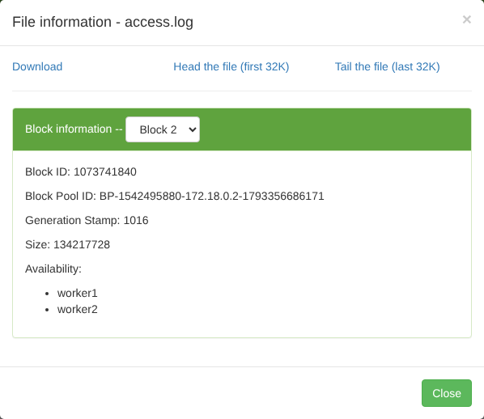
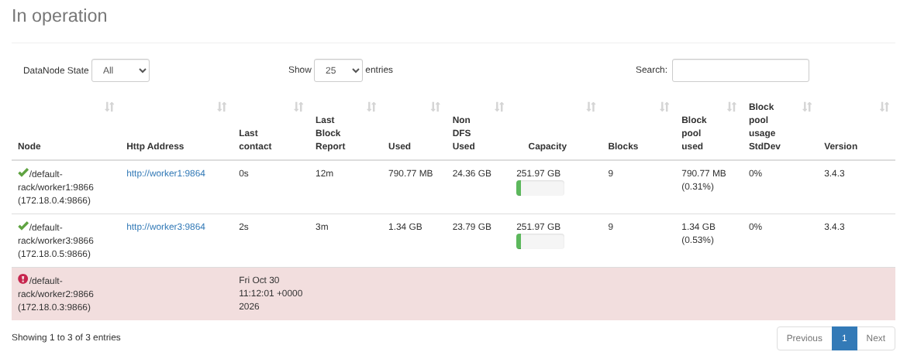
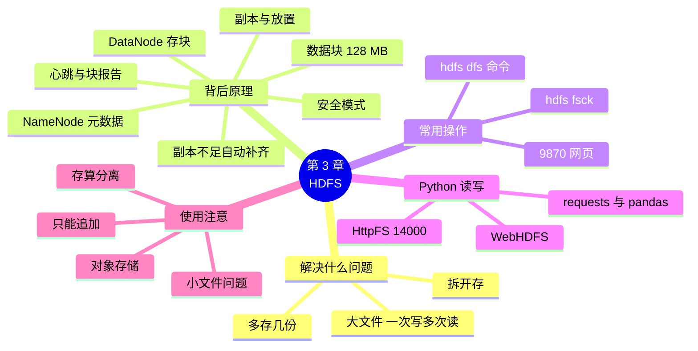

# 第 3 章 HDFS 分布式文件系统

!!! abstract "本章学时"
    理论 5 学时 · 实验 1 学时（本章共 3 个实验，教师可任选）

## 学习目标

学完本章，你应该能够：

1. **说出** NameNode 和 DataNode 的分工，以及数据块、副本、心跳的含义（记忆、理解）；
2. **计算**一个文件在 HDFS 中切成几块、占用多少存储空间，判断坏几台机器会丢数据（应用、分析）；
3. **使用** `hdfs dfs` 常用命令和 9870 网页完成上传、下载、查看、移动、删除和查看数据块等操作（应用）；
4. **编写** Python 程序，通过 HttpFS 读取 HDFS 上的文件，用 pandas 分析后把结果写回 HDFS（应用）；
5. **判断**一份数据适不适合放在 HDFS 上，以及该用 HDFS 还是云上的对象存储（评价）。

!!! info "先修要求"
    学习本章前，你需要掌握：

    - 用 Docker Compose 启动随书 Hadoop 集群，用 `docker compose exec master` 运行命令，打开 9870 网页（[第 2 章 实验环境：Docker 与 Hadoop 集群](../02-environment/index.md)）；
    - 第 1 章的横向扩展、集群、节点的概念（[第 1 章 大数据概述与技术生态](../01-overview/index.md)）；
    - Linux 的 `ls`、`cat`、`head`、`mkdir`、`rm` 命令（[2.1 节](../02-environment/index.md#21-linux-15)）；
    - 用 pandas 读取 CSV、分组统计（“Python 程序设计”课程）。

??? abstract "本章概念清单（17 个，点击查看定义和例子）"
    1. [HDFS](../../appendix/glossary.md#g-HDFS)
    2. [NameNode](../../appendix/glossary.md#g-NameNode)
    3. [DataNode](../../appendix/glossary.md#g-DataNode)
    4. [元数据](../../appendix/glossary.md#g-元数据)
    5. [数据块](../../appendix/glossary.md#g-数据块)
    6. [副本](../../appendix/glossary.md#g-副本)
    7. [心跳](../../appendix/glossary.md#g-心跳)
    8. [块报告](../../appendix/glossary.md#g-块报告)
    9. [副本不足](../../appendix/glossary.md#g-副本不足)
    10. [安全模式](../../appendix/glossary.md#g-安全模式)
    11. [hdfs dfs](../../appendix/glossary.md#g-hdfs-dfs)
    12. [hdfs fsck](../../appendix/glossary.md#g-hdfs-fsck)
    13. [WebHDFS](../../appendix/glossary.md#g-WebHDFS)
    14. [HttpFS](../../appendix/glossary.md#g-HttpFS)
    15. [小文件问题](../../appendix/glossary.md#g-小文件问题)
    16. [对象存储](../../appendix/glossary.md#g-对象存储)
    17. [存算分离](../../appendix/glossary.md#g-存算分离)

## 情景导入

小象优选数据组的存储服务器出了一次事故：一块硬盘坏了，上面存着最近三个月的访问日志，偏偏这块硬盘没有备份。运营部门要的季度报表做不出来了，数据组只好去各个网站服务器上翻找残留的日志，忙了一个星期也只找回一半。

事后复盘，组长在白板上写了两个问题：第一，日志越来越多，一台服务器的硬盘迟早装不下，怎么办？第二，几百块硬盘放在一起，每天坏一两块是常事，怎样才能坏了也不丢数据？

这两个问题，谷歌在 2003 年就遇到了，它的答案是 GFS 分布式文件系统；Hadoop 照着它实现了 [**HDFS**](../../appendix/glossary.md#g-HDFS "Hadoop 分布式文件系统，把集群中许多台机器的硬盘组织成一个大文件系统，文件切块、多副本存放"){ .term }。本章先从“HDFS 解决什么问题”说起，再看它背后的 NameNode 和 DataNode 怎样分工、文件怎样被切块和复制；然后练熟 `hdfs dfs` 的常用命令，把小象优选的数据存进 HDFS；接着亲手停掉一台机器，看数据是否还在；最后用 Python 把分析结果存进 HDFS，并讨论 HDFS 的适用场合。

## 3.1 HDFS 解决什么问题

### 3.1.1 把很多台机器的硬盘拼成一个“超级硬盘”

**HDFS**（Hadoop Distributed File System，Hadoop 分布式文件系统）把集群中许多台机器的硬盘组织起来，对用户来说就像一块容量巨大的硬盘：有目录、有文件，用 `/xiaoxiang/logs/access.log` 这样的路径访问，至于文件实际存在哪几台机器上，用户不用操心。

它做了两件事：

1. **拆开存。** 一个大文件被切成许多固定大小的“块”，分散存到不同的机器上。文件再大，只要加机器就能装下；读文件时，多台机器可以同时读各自的块，速度也随之提高。
2. **多存几份。** 每个块都在不同的机器上存好几份（默认 3 份，随书集群设为 2 份）。一台机器坏了，其他机器上还有副本；系统还会自动再复制一份，补足份数。

这样，小象优选的两个问题都解决了：装不下就加机器，硬盘坏了数据还在。

### 3.1.2 HDFS 的设计取舍

为了用便宜的普通机器存海量数据，HDFS 在设计时做了几个取舍，了解它们，才知道什么数据适合放进 HDFS：<sup class="cite">[[1]](#ref3-1)</sup><sup class="cite">[[2]](#ref3-2)</sup>

- **机器坏是常态。** 几千台机器的集群，每天都有硬盘或机器出故障，所以容错由软件自动完成，不依赖昂贵的可靠硬件。
- **为大文件设计。** 典型的文件是几百 MB 到几 TB 的日志和数据表。大量几 KB 的小文件反而会成为负担（3.5 节）。
- **一次写入、多次读取。** 文件写好后通常只读不改，可以在末尾追加，但不能修改中间的内容。日志、订单历史这类数据正好是这样使用的。
- **重吞吐、轻延迟。** 追求的是“一次把大量数据读完”的总速度，而不是“几毫秒内找到一条记录”。查询单条订单这类需求，应该交给数据库。

## 3.2 看懂背后发生了什么

### 3.2.1 NameNode 和 DataNode：一个记账，一群干活

HDFS 采用“主从结构”，由两种守护进程组成：<sup class="cite">[[3]](#ref3-3)</sup>

- [**NameNode**](../../appendix/glossary.md#g-NameNode "HDFS 的管理节点，保存元数据（目录树、文件由哪些块组成、每块在哪），不存文件内容"){ .term }（名称节点）：整个集群只有一个（生产环境会再配一个备用的），运行在主节点上。它不存文件内容，只管“账本”：目录树里有哪些文件、每个文件切成了哪些块、每个块存在哪几台机器上。这些关于数据的数据，叫作[**元数据**](../../appendix/glossary.md#g-元数据 "描述数据的数据，在 HDFS 中指目录结构、文件属性、文件与块的对应关系和块的位置"){ .term }。为了查得快，元数据都放在 NameNode 的内存里。
- [**DataNode**](../../appendix/glossary.md#g-DataNode "HDFS 的数据节点，在本机硬盘上存放数据块，定期向 NameNode 发送心跳和块报告"){ .term }（数据节点）：每台工作节点上一个，负责把数据块存在本机硬盘上，按要求读出或写入数据块。

打个比方：NameNode 像图书馆的总目录台，记着每本书分成几册、每册放在哪个书架；DataNode 是一排排书架，只管放书和取书。借书的人先到目录台问清位置，再直接去书架取书，目录台不经手书本身。

NameNode 怎么知道哪台机器还活着、上面有哪些块？靠 DataNode 主动报告：每台 DataNode 每 3 秒向 NameNode 发一次[**心跳**](../../appendix/glossary.md#g-心跳 "DataNode 每隔几秒向 NameNode 发送的“我还活着”的信号，长时间收不到就判定节点死亡"){ .term }，意思是“我还活着”；并定期发送一份[**块报告**](../../appendix/glossary.md#g-块报告 "DataNode 定期向 NameNode 报告本机存有哪些数据块的清单"){ .term }，列出本机存着的所有块。NameNode 根据这些报告，随时掌握每个块有几份可用。

在随书集群中，NameNode 运行在 master 容器里，DataNode 运行在每个 worker 容器里，第 2 章用 `jps` 已经看到过它们。

### 3.2.2 数据块：把大文件切成 128 MB 一块

HDFS 存文件的基本单位是[**数据块**](../../appendix/glossary.md#g-数据块 "HDFS 存储文件的基本单位，默认 128 MB，文件按顺序切块，最后一块按实际大小存放"){ .term }（Block），默认大小 128 MB（由 `hdfs-site.xml` 中的 `dfs.blocksize` 设置）。文件按顺序每 128 MB 切一块，最后不足 128 MB 的部分单独成一块，**而且只占用它实际大小的空间**，不会浪费。

块设得这么大，是为了让读写时间主要花在传输数据上，而不是花在寻找数据上，同时让 NameNode 要记的块数少一些。第 4 章还会看到，MapReduce 默认给每个块启动一个 Map 任务，块的大小决定了计算的并行度。

### 3.2.3 副本：一份数据存几份、放在哪

每个块会存成几份完全相同的[**副本**](../../appendix/glossary.md#g-副本 "同一个数据块在不同机器上保存的完全相同的几份拷贝，份数由副本数决定"){ .term }，份数叫副本数，默认 3（由 `dfs.replication` 设置，随书集群设为 2，因为只有 2 个工作节点）。同一个块的几份副本一定放在不同的机器上，这样坏一台机器最多丢一份。

在有多个机架的大集群中，HDFS 的默认放置规则是：第一份放在写入数据的那台机器上（如果它是 DataNode 的话），第二份放在另一个机架的某台机器上，第三份放在和第二份同一个机架的另一台机器上。这样既能防止整个机架断电，又不会让太多数据跨机架传输。<sup class="cite">[[3]](#ref3-3)</sup> 随书集群只有一个机架，副本会尽量均匀地放在各个 DataNode 上。

!!! example "算一算：上传 1 GB 的文件会发生什么"
    块大小 128 MB，副本数 3。

    - 切几块：1 GB = 1024 MB，1024 ÷ 128 = 8 块，正好整除；
    - 占多少空间：每块 3 份，共 8 × 3 = 24 个块副本，占用 1 GB × 3 = **3 GB** 的硬盘；
    - NameNode 要记几条：1 个文件 + 8 个块，每块记 3 个位置。

    换成小象优选的大日志 `access.log`（1000 万行，701.8 MB），副本数 2：701.8 ÷ 128 ≈ 5.48，切成 **6 块**，前 5 块各 128 MB，最后一块约 61.8 MB；占用空间约 701.8 × 2 ≈ 1.4 GB。实验 3-1 会用 `hdfs fsck` 验证这个结果。

    副本数为 N 时，同时坏掉 N − 1 台机器，每个块都至少还剩一份；坏 N 台就**可能**丢数据（正好坏的是同一个块所在的 N 台机器时）。

### 3.2.4 读写一个文件的过程

**写文件**（如 `hdfs dfs -put`）的过程：

1. 客户端请 NameNode 在目录树中建好文件，NameNode 检查文件是否已存在、有没有权限；
2. 客户端把数据按块切开，每写一个块，先问 NameNode：“这块放哪几台？”NameNode 按放置规则返回一组 DataNode，例如 worker1、worker2；
3. 客户端把数据传给 worker1，worker1 一边存一边转给 worker2，像流水线一样，所以写 2 份并不需要客户端传 2 遍；
4. 所有块写完，客户端通知 NameNode 文件完成。

**读文件**（如 `hdfs dfs -cat`）的过程：客户端先问 NameNode 文件有哪些块、每块在哪几台机器上，再直接到离自己最近的 DataNode 上按顺序读取各块，拼成完整的文件。**数据本身不经过 NameNode**，NameNode 只回答“在哪”，所以它不会成为传输数据的瓶颈。

**机器坏了**怎么办？如果 NameNode 很久没收到某台 DataNode 的心跳，就判定它“死亡”，不再把读写请求发给它。此时它上面的块都少了一份，成为[**副本不足**](../../appendix/glossary.md#g-副本不足 "某个块可用的副本数少于目标副本数的状态，NameNode 会安排复制补齐"){ .term }的块，NameNode 会安排其他 DataNode 互相复制，把副本数补回来。坏掉的机器修好重新加入后，多出来的副本会被删除。默认的判定时间是 10 分 30 秒，避免网络短暂抖动就引发大量复制；随书集群为了方便观察，把它缩短到了约 1.5 分钟（`hdfs-site.xml` 中的 `dfs.namenode.heartbeat.recheck-interval`）。

另外，NameNode 每次启动时，要先等各 DataNode 发来块报告、确认绝大多数块都可用，这段时间处于[**安全模式**](../../appendix/glossary.md#g-安全模式 "NameNode 启动时等待块报告的只读状态，确认绝大多数块可用后自动退出"){ .term }，只能读不能写。刚启动集群就上传文件，偶尔会遇到 `Name node is in safe mode` 的提示，等几十秒即可。

### 3.2.5 用动画看切块与副本

<iframe class="sim-frame" src="../../sims/hdfs-blocks/main.html" height="880" loading="lazy" title="HDFS 切块与副本"></iframe>

选好文件大小、块大小、副本数和 DataNode 台数，按“上传”看文件怎样被切块、副本放在哪里；停掉一台 DataNode，再按“NameNode 检查一次”，看副本怎样补齐；再停一台，看什么时候会丢数据。[全屏打开](../../sims/hdfs-blocks/main.html){ target=_blank }
{ .sim-caption }

建议做三个小实验：① 默认设置上传，核对 3.2.3 节“算一算”的块数和占用空间；② 副本数 2、3 台 DataNode，先停一台并检查，再停第二台并检查，看看何时出现“丢失的块”；③ 副本数 3、只有 2 台 DataNode，一上传就“副本不足”。

## 3.3 常用操作：hdfs dfs 命令和 9870 网页

### 3.3.1 15 条常用命令

操作 HDFS 最常用的是 [**hdfs dfs**](../../appendix/glossary.md#g-hdfs-dfs "操作 HDFS 文件的命令行工具，用法与 Linux 命令相似"){ .term } 命令，它的写法和 Linux 命令几乎一样，只是前面加上 `hdfs dfs -`。<sup class="cite">[[4]](#ref3-4)</sup> 在随书集群中，先进入 master 容器（`docker compose exec master bash`），再输入下列命令：

| 命令 | 作用 | 例子 |
|---|---|---|
| `-ls` | 列出目录，`-h` 显示 KB/MB，`-R` 递归列出子目录 | `hdfs dfs -ls -h /xiaoxiang/logs` |
| `-mkdir -p` | 新建目录，可以一次建多级 | `hdfs dfs -mkdir -p /xiaoxiang/logs` |
| `-put` | 从本地上传文件，`-f` 覆盖已有文件 | `hdfs dfs -put access.log /xiaoxiang/logs/` |
| `-get` | 下载文件到本地 | `hdfs dfs -get /xiaoxiang/raw/orders.csv ./` |
| `-cat` | 显示文件全部内容，大文件要配合管道使用 | `hdfs dfs -cat /a.log \| grep -c /cart` |
| `-head` / `-tail` | 显示文件开头或结尾 1 KB | `hdfs dfs -head /xiaoxiang/raw/orders.csv` |
| `-cp` | 在 HDFS 内复制 | `hdfs dfs -cp /a.csv /b.csv` |
| `-mv` | 在 HDFS 内移动或改名 | `hdfs dfs -mv /b.csv /tmp/` |
| `-rm` | 删除文件，`-r` 删除目录 | `hdfs dfs -rm -r /tmp/old` |
| `-du -h` | 查看每个目录占用的空间（含副本） | `hdfs dfs -du -h /xiaoxiang` |
| `-df -h` | 查看整个 HDFS 的容量和剩余空间 | `hdfs dfs -df -h` |
| `-count` | 统计目录数、文件数和总大小 | `hdfs dfs -count -h /xiaoxiang` |
| `-setrep` | 修改文件的副本数，`-w` 等待完成 | `hdfs dfs -setrep -w 3 /a.csv` |
| `-appendToFile` | 在文件末尾追加内容 | `hdfs dfs -appendToFile new.log /a.log` |
| `hdfs fsck` | 检查文件的块和副本是否健康（不属于 `dfs` 子命令） | `hdfs fsck /a.log -files -blocks -locations` |

几点要注意：

- **路径分两种。** `-put` 和 `-get` 中，一个是本地路径（容器里的，如 `/labs/data/...`），一个是 HDFS 路径；其他命令的路径都是 HDFS 上的。HDFS 路径以 `/` 开头，和本地的同名目录毫无关系。
- **HDFS 有自己的工作目录。** 不以 `/` 开头的相对路径，指的是 HDFS 上的 `/user/<用户名>` 目录。为避免混乱，本书一律写完整路径。
- [**hdfs fsck**](../../appendix/glossary.md#g-hdfs-fsck "检查 HDFS 文件健康状况的工具，可以列出文件的每个块和副本所在的位置"){ .term } 是检查 HDFS 健康状况的工具，`-files -blocks -locations` 三个参数依次显示文件、它的每个块、每个块所在的 DataNode，是观察“切块与副本”最直接的办法。

### 3.3.2 在 9870 网页上浏览文件和数据块

不习惯命令行的话，9870 网页的 Utilities → Browse the file system 提供了一个文件浏览器：可以进入目录、查看文件大小和副本数（Replication 列）、上传和删除文件。点击一个文件名，会弹出它的信息，从 Block information 下拉框选择第几块，可以看到这一块的编号、大小，以及存在哪几台机器上（Availability）：



网页上看到的和 `hdfs fsck` 输出的是同一份信息，网页显示主机名，`fsck` 显示 IP 地址。

## 3.4 用 Python 读写 HDFS

### 3.4.1 两种办法

数据分析通常用 Python 完成，分析结果也常常要存回 HDFS，供 Hive、Spark 或其他同事使用。Python 访问 HDFS 主要有两种办法：

| 办法 | 原理 | 优点 | 缺点 |
|---|---|---|---|
| pyarrow 等库直接连接 | 调用 Hadoop 的 Java 客户端库，像 `hdfs dfs` 一样直接和 NameNode、DataNode 通信 | 速度快 | 本机要装 Java 和 Hadoop 客户端，配置较复杂 |
| WebHDFS / HttpFS | 通过 HTTP 访问 HDFS，一个网址对应一个操作 | 只要能发 HTTP 请求就行，Python 用 `requests` 库即可 | 经过 HTTP，速度慢一些，适合中小文件 |

[**WebHDFS**](../../appendix/glossary.md#g-WebHDFS "HDFS 提供的 HTTP 接口，用网址加 `op=` 参数完成列目录、读写文件等操作"){ .term } 是 HDFS 自带的 HTTP 接口，网址的格式是 `http://<地址>/webhdfs/v1/<HDFS 路径>?op=<操作>`，例如 `op=LISTSTATUS` 列目录、`op=OPEN` 读文件、`op=CREATE` 写文件。<sup class="cite">[[5]](#ref3-5)</sup> 不过，直接访问 NameNode 的 WebHDFS 读文件时，NameNode 会让客户端“跳转”到存有数据的 DataNode，例如 `http://worker1:9864/...`。worker1 是集群内部的主机名，你的电脑不认识它，也访问不到 worker2。

[**HttpFS**](../../appendix/glossary.md#g-HttpFS "与 WebHDFS 接口相同的 HTTP 网关，由它代为转发全部数据，让集群外的程序只需访问一个地址"){ .term } 解决了这个问题。它是一个运行在 master 上的网关，接口和 WebHDFS 完全相同，但所有数据都由它代为转发，客户端只需要访问它一个地址。<sup class="cite">[[6]](#ref3-6)</sup> 随书集群在 master 上启动了 HttpFS，并把 14000 端口映射到了你的电脑。所以，在你电脑上运行的 Python 程序只要访问 `http://localhost:14000/webhdfs/v1/...` 就能读写 HDFS。

### 3.4.2 用 requests 读写 HDFS

在浏览器中打开下面的地址，就能看到 `/xiaoxiang/raw` 目录的内容（以 JSON 格式返回）：

```text
http://localhost:14000/webhdfs/v1/xiaoxiang/raw?op=LISTSTATUS&user.name=root
```

`user.name=root` 表示以 root 用户的身份访问。随书集群没有开启登录认证，生产环境中会使用 Kerberos 等方式验证身份，不能这样随便指定用户。

用 Python 访问，核心就是一个发请求的小函数（完整代码见 `labs/ch03/lab3_3_hdfs_python.py`）：

```python
import requests

BASE = "http://localhost:14000/webhdfs/v1"   # HttpFS 地址，后面直接接 HDFS 路径
USER = {"user.name": "root"}


def hdfs(method, path, op, data=None, **params):
    """向 HttpFS 发一个请求。op 是操作名，例如 LISTSTATUS、OPEN、CREATE。"""
    params = {"op": op, **USER, **params}
    headers = {"Content-Type": "application/octet-stream"} if data is not None else {}
    r = requests.request(method, BASE + path, params=params, data=data,
                         headers=headers, timeout=60)
    r.raise_for_status()                     # 出错（例如路径不存在）时直接报错
    return r
```

有了它，常用操作都是一行：

| 操作 | 相当于 | 代码 |
|---|---|---|
| 列目录 | `hdfs dfs -ls` | `hdfs("GET", "/xiaoxiang/raw", "LISTSTATUS").json()` |
| 读文件 | `hdfs dfs -cat` | `hdfs("GET", "/xiaoxiang/raw/orders.csv", "OPEN").content` |
| 建目录 | `hdfs dfs -mkdir -p` | `hdfs("PUT", "/xiaoxiang/result", "MKDIRS")` |
| 写文件 | `hdfs dfs -put -f` | `hdfs("PUT", "/xiaoxiang/result/a.csv", "CREATE", data=字节内容, overwrite="true")` |
| 删除 | `hdfs dfs -rm -r` | `hdfs("DELETE", "/xiaoxiang/result", "DELETE", recursive="true")` |

读到的内容是字节，用 `pd.read_csv(io.BytesIO(内容))` 就能变成 pandas 的表；写的时候，用 `df.to_csv(index=False).encode("utf-8")` 把表变成字节。实验 3-3 用这些操作完成一次“从 HDFS 读数据、用 pandas 分析、把结果写回 HDFS”的完整流程。

这种方式要把整个文件经过网络读进内存，适合几百 MB 以内的文件。更大的数据，就应该交给第 6 章起学习的 Spark，让计算在集群上完成。

## 3.5 使用注意：HDFS 适合存什么

### 3.5.1 不适合大量小文件

NameNode 把每个文件、目录和块都作为一个对象放在内存里，按经验每个对象大约占 150 字节。<sup class="cite">[[7]](#ref3-7)</sup> 算一笔账：

- 1 个 1 GB 的文件：1 个文件对象 + 8 个块对象，约 1.35 KB 内存；
- 同样 1 GB 的数据，拆成 100 万个 1 KB 的小文件：100 万个文件对象 + 100 万个块对象，约 300 MB 内存。

数据量一样，NameNode 的负担却差了 20 多万倍，这就是 HDFS 的[**小文件问题**](../../appendix/glossary.md#g-小文件问题 "大量远小于块大小的文件占用过多 NameNode 内存、产生过多计算任务，导致集群变慢的问题"){ .term }。小文件多了，NameNode 的内存先撑不住；而且第 4 章会看到，每个小文件至少对应一个 Map 任务，计算也会很慢。所以，**往 HDFS 存数据前，要把小文件合并成大文件**，例如把每分钟一个的日志文件合并成每天一个，或者用 Spark 把结果写成少数几个大文件。

### 3.5.2 不能修改文件中间的内容

HDFS 的文件写好后，只能在末尾追加（`-appendToFile`），不能修改中间的某几行。要修改，只能读出来、改好、再整个写一个新文件替换旧文件。这对日志、订单历史等“只增不改”的数据没有影响；需要频繁修改单条记录的数据，比如用户的账户余额，应该放在数据库里。

### 3.5.3 HDFS 和对象存储怎么选

在云上，还有另一种常用的海量存储：[**对象存储**](../../appendix/glossary.md#g-对象存储 "把每个文件当作一个对象、通过网址存取、容量几乎无限、按用量付费的云存储服务"){ .term }，如阿里云 OSS、华为云 OBS、腾讯云 COS。它把每个文件当作一个“对象”，通过网址存取，容量几乎没有上限，按实际用量付费，数据的多副本可靠性由云服务商保证。两者的对比如下：

| 对比项 | HDFS | 云对象存储（OSS、OBS 等） |
|---|---|---|
| 谁来维护 | 自己搭建和运维集群 | 云服务商负责，开箱即用 |
| 扩容 | 加机器 | 不用管，用多少算多少 |
| 价格 | 机器和硬盘一次性投入，存得越久越划算 | 按容量和流量付费，存储单价低 |
| 和计算的关系 | 数据和计算在同一批机器上，读数据快（移动计算） | 数据和计算分开，通过网络读取 |
| 适合 | 自建机房、数据量稳定、对性能要求高 | 上云的企业、数据量增长快、计算时多时少 |

简单地说：**自建集群用 HDFS，上云优先考虑对象存储**。两者的用法很接近，Hadoop、Spark 等工具都能直接读写对象存储，只是路径从 `hdfs://` 换成了 `oss://`、`obs://` 等。

## 3.6 前沿视窗

**存算分离：数据放对象存储，计算按需开关。**传统的 Hadoop 集群“存算一体”：每台机器既存数据又做计算，想多存数据就得多买机器，哪怕计算资源用不完；反过来也一样。越来越多的企业改用“[存算分离](../../appendix/glossary.md#g-存算分离 "数据统一存放在对象存储等共享存储中，计算集群按需开关、与存储各自扩展的架构"){ .term }”的架构：数据统一放在便宜、几乎无限扩展的对象存储里，计算集群需要时再开、用完就关，两者各自按需扩展。华为云 MRS 就支持把对象存储作为集群的存储，计算节点可以弹性增减。<sup class="cite">[[8]](#ref3-8)</sup>

**对象存储也学会了“说 HDFS 的话”。**存算分离的难点是兼容：大量现有程序是按 HDFS 写的。云服务商的做法是让对象存储直接提供 HDFS 接口，例如阿里云的 OSS-HDFS 服务，宣称完全兼容 HDFS 的文件系统接口，现有的 Hadoop、Spark 程序不用修改代码，只要把路径换成 `oss://...`，配置好访问密钥，就能像访问原生 HDFS 一样读写。<sup class="cite">[[9]](#ref3-9)</sup> 在这样的平台上，本章学的 `hdfs dfs -ls oss://...` 等命令照样能用。

**为什么 HDFS 仍然值得学？**无论底层是 HDFS 还是对象存储，“文件切块、多副本容错、元数据和数据分开管理、让计算靠近数据”这些思想都是相通的；很多企业仍在运行大量 HDFS 集群，大模型训练用的海量数据也常常存放在这类分布式存储中。理解了 HDFS，再学其他分布式存储就容易了。想进一步了解 HDFS 的原理和更多命令，可以阅读林子雨《大数据技术原理与应用》的第 3 章。<sup class="cite">[[10]](#ref3-10)</sup>

## 本章实验

!!! abstract "实验总览"
    | 实验 | 类型 | 建议时长 | 内容 |
    |---|---|---|---|
    | 实验 3-1 | ★ 基础 | 40 分钟 | 用 `hdfs dfs` 命令建目录、上传小象优选数据、查看、复制、移动、下载、删除，用 `fsck` 和网页查看大文件的数据块 |
    | 实验 3-2 | ★ 基础 | 30 分钟 | 停掉一个存有数据的 DataNode，验证文件照常可读，观察 NameNode 判定节点死亡并自动补齐副本 |
    | 实验 3-3 | ☆ 拓展 | 30 分钟 | 用 Python 通过 HttpFS 读取 HDFS 上的订单表，用 pandas 统计后把结果写回 HDFS |

    实验在第 2 章搭建的 Docker 小集群上进行。实验 3-2 需要 3 个工作节点（实验 2-3 加入的 worker3）。实验代码见配套资源 `labs/ch03/` 目录。编者的运行环境：4 核 CPU、16 GB 内存的 Linux 主机，Docker 29.9，Hadoop 3.4.3 镜像，Python 3.12。

### 实验 3-1 ★ HDFS 文件管理

**实验目的**

1. 熟练使用 `hdfs dfs` 的常用命令管理 HDFS 上的目录和文件；
2. 区分本地路径和 HDFS 路径，理解 `-du` 显示的“含副本占用空间”；
3. 用 `hdfs fsck` 和 9870 网页查看大文件的数据块和副本位置，验证 3.2.3 节的计算。

**实验环境**：第 2 章的 Hadoop 小集群（副本数 2）。

**实验数据**

- `labs/data/xiaoxiang/access.log`：小象优选一天的访问日志，100 万行、70.2 MB（实验 1-1 第 1 步已生成）；
- `labs/data/xiaoxiang_big/access.log`：1000 万行、701.8 MB 的大日志，本实验第 4 步生成，第 4 章实验 4-3 也要用。

**实验步骤与代码**

第 1 步，启动集群，进入 master 容器，切换到 `/labs` 目录（就是你电脑上的 `labs` 目录）：

```bash
cd labs/cluster
docker compose up -d
docker compose exec master bash
cd /labs
```

第 2 步，建目录、上传日志，查看文件和空间占用：

```bash
hdfs dfs -mkdir -p /xiaoxiang/logs
hdfs dfs -put data/xiaoxiang/access.log /xiaoxiang/logs/
hdfs dfs -ls -h /xiaoxiang/logs
hdfs dfs -ls -R /xiaoxiang
hdfs dfs -du -h /xiaoxiang
hdfs dfs -count -h /xiaoxiang
```

第 3 步，查看内容，复制、移动、删除、下载：

```bash
hdfs dfs -head /xiaoxiang/raw/orders.csv | head -3
hdfs dfs -tail /xiaoxiang/logs/access.log | tail -2
hdfs dfs -cat /xiaoxiang/logs/access.log | grep -c /cart       # 购物车页面被访问了多少次
hdfs dfs -cp /xiaoxiang/raw/users.csv /xiaoxiang/users_bak.csv
hdfs dfs -mv /xiaoxiang/users_bak.csv /tmp/
hdfs dfs -rm /tmp/users_bak.csv
hdfs dfs -get /xiaoxiang/raw/orders.csv /tmp/orders_from_hdfs.csv
ls -l /tmp/orders_from_hdfs.csv                                  # 这是容器本地的 ls，不是 HDFS
hdfs dfs -df -h
```

第 4 步，生成 1000 万行的大日志（约 80 秒）。容器里的 Python 没有安装 numpy，所以**另开一个命令行窗口**，在你电脑的 `labs` 目录下运行：

```bash
python data/make_data.py --only logs --logs 10000000 --out data/xiaoxiang_big
```

生成的文件在容器里的 `/labs/data/xiaoxiang_big/` 下同样能看到。回到 master 容器的窗口，上传并查看它的数据块：

```bash
hdfs dfs -mkdir -p /xiaoxiang/logs_big
hdfs dfs -put data/xiaoxiang_big/access.log /xiaoxiang/logs_big/
hdfs dfs -ls -h /xiaoxiang/logs_big
hdfs fsck /xiaoxiang/logs_big/access.log -files -blocks -locations
```

第 5 步，在 9870 网页的 Utilities → Browse the file system 中进入 `/xiaoxiang/logs_big`，点击 `access.log`，在 Block information 中依次选择 Block 0～5，记录每块的大小和所在机器。

**运行结果**

第 2 步的输出（时间会不同）：

```text
Found 1 items
-rw-r--r--   2 root supergroup     70.2 M 2026-10-30 19:10 /xiaoxiang/logs/access.log

drwxr-xr-x   - root supergroup          0 2026-10-30 19:10 /xiaoxiang/logs
-rw-r--r--   2 root supergroup   73586626 2026-10-30 19:10 /xiaoxiang/logs/access.log
drwxr-xr-x   - root supergroup          0 2026-10-30 18:42 /xiaoxiang/raw
-rw-r--r--   2 root supergroup    8383330 2026-10-30 18:39 /xiaoxiang/raw/orders.csv
-rw-r--r--   2 root supergroup    4837823 2026-10-30 18:42 /xiaoxiang/raw/users.csv

70.2 M  140.4 M  /xiaoxiang/logs
12.6 M  25.2 M   /xiaoxiang/raw

           3            3             82.8 M /xiaoxiang
```

上传 70 MB 只用了约 3 秒。`-du` 的第一列是文件本身的大小，第二列是算上副本后实际占用的空间，正好是 2 倍；`-count` 的三列依次是目录数、文件数和总大小。

第 3 步的输出（节选）：

```text
order_id,user_id,product_id,quantity,amount,order_time,province,pay_type,status
o000000001,u0071359,p01886,2,59.8,2026-09-01 00:00:50,山东,支付宝,已完成
o000000002,u0075719,p00876,3,2405.7,2026-09-01 00:01:16,福建,支付宝,已完成

2026-09-30T23:59:59 104.196.220.241 u0045285 GET /search 200 10782 iPhone
2026-09-30T23:59:59 131.202.84.218 u0046537 GET /coupon 200 18185 Android

59738

Deleted /tmp/users_bak.csv
-rw-r--r-- 1 root root 8383330 Oct 30 19:10 /tmp/orders_from_hdfs.csv

Filesystem             Size     Used  Available  Use%
hdfs://master:8020  503.9 G  176.3 M     31.0 G    0%
```

购物车页面一天被访问了 59738 次。下载回来的文件大小 8383330 字节，和上传前一模一样。`-df` 显示的 Size 是各 DataNode 所在磁盘的总容量，Available 是实际还能用的空间，都取决于你的电脑。

第 4 步，上传 701.8 MB 用了约 6 秒。`fsck` 的输出（长编号已省略）：

```text
-rw-r--r--   2 root supergroup    701.8 M 2026-10-30 19:10 /xiaoxiang/logs_big/access.log

/xiaoxiang/logs_big/access.log 735854548 bytes, replicated: replication=2, 6 block(s):  OK
0. blk_1073741838_1014 len=134217728 Live_repl=2  [DatanodeInfoWithStorage[172.18.0.3:9866], DatanodeInfoWithStorage[172.18.0.4:9866]]
1. blk_1073741839_1015 len=134217728 Live_repl=2  [DatanodeInfoWithStorage[172.18.0.4:9866], DatanodeInfoWithStorage[172.18.0.3:9866]]
2. blk_1073741840_1016 len=134217728 Live_repl=2  [DatanodeInfoWithStorage[172.18.0.4:9866], DatanodeInfoWithStorage[172.18.0.3:9866]]
3. blk_1073741841_1017 len=134217728 Live_repl=2  [DatanodeInfoWithStorage[172.18.0.3:9866], DatanodeInfoWithStorage[172.18.0.4:9866]]
4. blk_1073741842_1018 len=134217728 Live_repl=2  [DatanodeInfoWithStorage[172.18.0.3:9866], DatanodeInfoWithStorage[172.18.0.4:9866]]
5. blk_1073741843_1019 len=64765908 Live_repl=2  [DatanodeInfoWithStorage[172.18.0.4:9866], DatanodeInfoWithStorage[172.18.0.3:9866]]
Status: HEALTHY
```

和 3.2.3 节算的完全一致：6 个块，前 5 块各 134217728 字节（128 MB），最后一块 64765908 字节（约 61.8 MB）；每块 2 份副本（`Live_repl=2`）。编者此时只有 2 个工作节点，所以每块的两份副本只能分别放在这两台机器上（172.18.0.3 和 172.18.0.4，用 `getent hosts worker1` 可以查到 IP 对应的主机名，每次启动可能不同）。第 5 步网页上看到的就是 3.3.2 节的图。

**实验记录表**

| 观察内容 | 你的结果 |
|---|---|
| 70.2 MB 日志的 `-du` 两列数值，二者是什么关系 | |
| 购物车页面 `/cart` 的访问次数 | |
| 大日志切成几块，最后一块多大 | |
| Block 2 存在哪两台机器上 | |
| 你算出的块数、占用空间与实测是否一致 | |

**常见问题排查**

| 现象 | 原因 | 解决办法 |
|---|---|---|
| `put: '/xiaoxiang/logs/access.log': File exists` | HDFS 上已有同名文件 | 加 `-f` 覆盖，或先 `-rm` |
| `put: data/xiaoxiang/access.log: No such file or directory` | 不在 `/labs` 目录下，或数据还没生成 | `cd /labs`；在本机 `labs` 下运行 `python data/make_data.py` |
| `mkdir: '/xiaoxiang/logs': No such file or directory` | 上级目录不存在，又没加 `-p` | 用 `-mkdir -p` |
| `Name node is in safe mode` | 集群刚启动，NameNode 还在安全模式 | 等几十秒；用 `hdfs dfsadmin -safemode get` 查看 |
| `cat: Unable to write to output stream.` | 用 `-cat` 配合 `head` 时，`head` 读够行数就关闭了管道 | 不影响结果；看开头改用 `hdfs dfs -head` |
| `rm: ... Is a directory` | 删除目录没加 `-r` | 用 `-rm -r`，确认路径后再执行 |

**思考与练习**

1. 用 `hdfs dfs -cat` 加上 `grep` 和 `wc`，统计 9 月 30 日访问日志中状态码为 404 的请求有多少条。
2. 把块大小临时改成 64 MB 上传同一个大日志：`hdfs dfs -D dfs.blocksize=67108864 -put data/xiaoxiang_big/access.log /xiaoxiang/big64.log`。它会切成几块？先算，再用 `fsck` 验证。做完删除这个文件。

**实验报告要求**

提交第 2、4 步的输出截图、第 5 步网页上任意一块的截图和实验记录表。用 3～5 句话说明：`-du` 的两列数字为什么不同？如果副本数是 3，第二列会是多少？

### 实验 3-2 ★ 节点坏了数据还在吗

**实验目的**

1. 在集群上模拟一台机器故障，验证坏一台机器时文件仍能正常读取；
2. 观察 NameNode 通过心跳判定节点死亡的过程和所需时间；
3. 观察副本自动补齐，以及故障机器恢复后多余副本的处理。

**实验环境**：第 2 章的 Hadoop 小集群，加上实验 2-3 的 worker3，共 3 个工作节点，副本数 2。

**实验数据**：实验 3-1 上传的 `/xiaoxiang/logs_big/access.log`（6 块，每块 2 份）。

**实验步骤与代码**

本实验在你电脑的 `labs/cluster` 目录下运行命令，为了少打字，先定义一个变量（Windows PowerShell 中直接写完整命令即可）：

```bash
cd labs/cluster
C="docker compose -f docker-compose.yml -f docker-compose.worker3.yml"
```

第 1 步，启动包括 worker3 在内的集群，确认 3 个 DataNode 在线，副本全部正常：

```bash
$C up -d
$C exec master hdfs dfsadmin -report | grep -E "^Live|Under replicated"
$C exec master hdfs fsck /xiaoxiang/logs_big/access.log -files -blocks -locations
```

第 2 步，从 `fsck` 的输出中找一台存有数据块的机器（编者的大日志是在只有 worker1、worker2 时上传的，所以块都在这两台上），把它停掉，并记下时间：

```bash
date
$C stop worker2
```

第 3 步，马上读一遍整个文件，数一数以日期开头的日志行，看能否读出全部 1000 万行；再看看读取过程中客户端打印了什么提示：

```bash
$C exec master bash -c "time (hdfs dfs -cat /xiaoxiang/logs_big/access.log | grep -c '^2026-09')"
$C exec master bash -c "hdfs dfs -cat /xiaoxiang/logs_big/access.log | grep -E 'WARN|Successfully' | head -4"
```

第 4 步，每隔十几秒查看一次 DataNode 状态和副本不足的块数，直到出现 `Dead datanodes (1)`：

```bash
$C exec master hdfs dfsadmin -report | grep -E "^Live datanodes|^Dead datanodes|Under replicated"
```

同时刷新 9870 网页的 Datanodes 页，观察 worker2 一行的变化。

第 5 步，节点被判定死亡后，再次运行 `fsck`，看每个块现在存在哪两台机器上：

```bash
$C exec master hdfs fsck /xiaoxiang/logs_big/access.log -files -blocks -locations
```

第 6 步，让 worker2 “修好”回来，等待 30 秒后检查是否有多余的副本：

```bash
$C start worker2
$C exec master hdfs fsck / | grep -E "Over-replicated|Under-replicated|Status"
```

**运行结果**

第 1 步：`Live datanodes (3)`，`Under replicated blocks: 0`。

第 3 步，worker2 刚停掉，读取照样成功，1000 万行一行不少，用时约 4 秒：

```text
10000000
real	0m4.111s
```

第二条命令显示了背后发生的事（长编号已省略）：

```text
2026-10-30 19:20:26 WARN  DFSClient:667 - Failed to connect to worker2:9866 for file /xiaoxiang/logs_big/access.log for block ...:blk_1073741840_1016, add to deadNodes and continue.
2026-10-30 19:20:26 INFO  DFSClient:649 - Successfully connected to worker1/172.18.0.4:9866 for ...:blk_1073741840_1016
```

NameNode 此时还不知道 worker2 停了，仍然告诉客户端“这一块在 worker2 和 worker1 上”。客户端连 worker2 失败，就把它记进“坏节点”名单，自动改读 worker1 上的另一份副本。注意，这些提示和文件内容一起输出到了屏幕上（标准输出），如果直接用 `wc -l` 数行数，会把它们也算进去，多出几十行，所以这里用 `grep -c '^2026-09'` 只数日志行。

第 4 步，编者每 12 秒左右查一次，worker2 停止约 87 秒后被判定死亡：

```text
== +14s  Under replicated blocks: 0 Live datanodes (3):
== +74s  Under replicated blocks: 0 Live datanodes (3):
== +87s  Under replicated blocks: 0 Live datanodes (2): Dead datanodes (1):
```

和随书配置的“约 1.5 分钟”相符。9870 网页上 worker2 变成了红色的 Down 状态：



判定死亡后，NameNode 立即安排补副本。数据只有几百 MB，复制在十几秒内就完成了，所以编者下一次查看时 `Under replicated blocks` 已经回到 0（编者另一次实验中赶上了复制过程，看到副本不足的块数从 3 降到 0）。第 5 步的 `fsck` 输出显示，原来在 worker2 上的副本都已经复制到了 worker3（172.18.0.5）上：

```text
0. blk_1073741838_1014 len=134217728 Live_repl=2  [DatanodeInfoWithStorage[172.18.0.4:9866], DatanodeInfoWithStorage[172.18.0.5:9866]]
1. blk_1073741839_1015 len=134217728 Live_repl=2  [DatanodeInfoWithStorage[172.18.0.4:9866], DatanodeInfoWithStorage[172.18.0.5:9866]]
...
5. blk_1073741843_1019 len=64765908 Live_repl=2  [DatanodeInfoWithStorage[172.18.0.4:9866], DatanodeInfoWithStorage[172.18.0.5:9866]]
Status: HEALTHY
```

第 6 步，worker2 回来后，它上面的旧副本让一些块有了 3 份，NameNode 会删掉多余的。编者等待 40 秒后检查：

```text
Status: HEALTHY
 Over-replicated blocks:	0 (0.0 %)
 Under-replicated blocks:	0 (0.0 %)
```

整个过程不需要任何人工干预：**坏一台，读不受影响；判定死亡后自动补齐；修好回来自动去掉多余的。**

!!! warning "副本数比在线节点还多时补不齐"
    编者在实验 2-3 中把 `orders.csv` 和 `users.csv` 的副本数改成了 3。如果没有改回 2 就停掉一台，只剩 2 台 DataNode，这两个文件的块无论如何也凑不齐 3 份，`fsck` 会一直报告 `Target Replicas is 3 but found 2 live replica(s)`，`Under replicated blocks` 停在 2。数据并没有丢，只是“不够安全”，等节点恢复或加入新节点后会自动补齐。

**实验记录表**

| 观察内容 | 你的结果 |
|---|---|
| 停掉的是哪台机器，停止的时间 | |
| 停掉后立即读取：成功与否、日志行数、用时；WARN 提示说了什么 | |
| 多久后出现 `Dead datanodes (1)` | |
| 补副本后，原来在故障机器上的块被复制到了哪台 | |
| 故障机器恢复后，有没有多余的副本 | |

**常见问题排查**

| 现象 | 原因 | 解决办法 |
|---|---|---|
| 停掉节点几分钟了还是 `Live datanodes (3)` | 没有用随书的 `hdfs-site.xml`，判定时间是默认的 10 分 30 秒 | 检查 `hdfs getconf -confKey dfs.namenode.heartbeat.recheck-interval` 是否为 30000；或耐心等待 |
| 停掉节点后读取报 `BlockMissingException` | 某个块的所有副本都在已停止的机器上（例如同时停了两台，或副本数是 1） | 把停掉的机器重新启动；这正说明副本数为 1 时不能容错 |
| `Under replicated blocks` 一直不为 0 | 有文件的副本数大于在线的 DataNode 数 | 见上面的提示框，把这些文件的副本数改回 2 |
| `$C: command not found` | 关闭了命令行窗口，变量丢失；或在 PowerShell 中使用 | 重新定义变量，或写完整的 `docker compose -f ... -f ...` 命令 |

**思考与练习**

1. 只有 2 个工作节点、副本数为 2 时，停掉一台会发生什么？副本能补齐吗？用 3.2.5 节的动画先预测，再说明理由。
2. 为什么 HDFS 默认要等 10 分钟以上才判定节点死亡，而不是几秒钟没心跳就判定？如果判定得太快，可能带来什么问题？

**实验报告要求**

提交第 3、4、5 步的输出截图和第 4 步的网页截图，以及实验记录表。用一段话描述从“机器停止”到“副本补齐”的全过程，说明 NameNode 和 DataNode 各自做了什么。

### 实验 3-3 ☆ 用 Python 把分析结果存进 HDFS

**实验目的**

1. 理解 WebHDFS 接口，用浏览器和 Python 通过 HttpFS 访问 HDFS；
2. 用 Python 从 HDFS 读取订单表，用 pandas 统计各支付方式的订单数和销售额；
3. 把统计结果写回 HDFS，并用命令行核对。

**实验环境**：第 2 章的 Hadoop 小集群（master 上的 HttpFS 监听 14000 端口）；本机 Python 3.12，安装了 `requests` 和 `pandas`（`labs/requirements.txt` 已包含）。

**实验数据**：HDFS 上的 `/xiaoxiang/raw/orders.csv`（实验 2-2 上传，10 万笔订单）。

**实验步骤与代码**

第 1 步，在浏览器中打开下面的地址，看到 JSON 格式的目录信息，说明 HttpFS 正常：

```text
http://localhost:14000/webhdfs/v1/xiaoxiang/raw?op=LISTSTATUS&user.name=root
```

第 2 步，阅读程序。`hdfs()` 函数见 3.4.2 节，主程序如下（完整代码见 `labs/ch03/lab3_3_hdfs_python.py`）：

```python
# 1. 列目录：相当于 hdfs dfs -ls /xiaoxiang/raw
for f in hdfs("GET", "/xiaoxiang/raw", "LISTSTATUS").json()["FileStatuses"]["FileStatus"]:
    print(f"   {f['pathSuffix']:<12} {f['length'] / 1024 / 1024:6.2f} MB  副本数 {f['replication']}")

# 2. 读文件：相当于 hdfs dfs -cat，把内容直接交给 pandas
text = hdfs("GET", "/xiaoxiang/raw/orders.csv", "OPEN").content
orders = pd.read_csv(io.BytesIO(text))

# 3. 在本机用 pandas 统计：各支付方式的已完成订单数和金额
done = orders[orders["status"] == "已完成"]
result = (done.groupby("pay_type")
          .agg(订单数=("order_id", "count"), 销售额=("amount", "sum"))
          .round(2).sort_values("销售额", ascending=False).reset_index())

# 4. 写回 HDFS：先建目录，再上传（overwrite=true 表示已存在就覆盖）
hdfs("PUT", "/xiaoxiang/result", "MKDIRS")
csv_bytes = result.to_csv(index=False).encode("utf-8")
hdfs("PUT", "/xiaoxiang/result/pay_type.csv", "CREATE", data=csv_bytes,
     overwrite="true", replication=2)
```

第 3 步，在你电脑的 `labs` 目录下运行：

```bash
python ch03/lab3_3_hdfs_python.py
```

第 4 步，到集群里核对写入的文件：

```bash
cd labs/cluster
docker compose exec master hdfs dfs -cat /xiaoxiang/result/pay_type.csv
```

**运行结果**

第 3 步的输出，整个程序用时不到 3 秒：

```text
① /xiaoxiang/raw 下的文件：
   orders.csv     7.99 MB  副本数 2
   users.csv      4.61 MB  副本数 2
② 从 HDFS 读到订单 100,000 行
③ 统计结果：
pay_type   订单数        销售额
    微信支付 40476 63798187.8
     支付宝 34276 53680910.6
    花呗分期  8851 14225272.5
     银行卡  6305 10305675.5
④ 已写入 /xiaoxiang/result/pay_type.csv，读回的前两行：
   pay_type,订单数,销售额
   微信支付,40476,63798187.8
```

微信支付以 4 万多笔、6380 万元排在第一。第 4 步用命令行读到的内容和 Python 写入的一致：

```text
pay_type,订单数,销售额
微信支付,40476,63798187.8
支付宝,34276,53680910.6
花呗分期,8851,14225272.5
银行卡,6305,10305675.5
```

这个结果文件现在存在 HDFS 上，同事可以用 `hdfs dfs -get` 下载，第 5 章的 Hive 也可以直接把它当作一张表来查询。

**实验记录表**

| 观察内容 | 你的结果 |
|---|---|
| 浏览器中 LISTSTATUS 返回的 `orders.csv` 的 `blockSize` 和 `replication` | |
| 已完成订单最多的支付方式及其销售额 | |
| HDFS 上结果文件的路径和大小（`hdfs dfs -ls -h`） | |

**常见问题排查**

| 现象 | 原因 | 解决办法 |
|---|---|---|
| `requests.exceptions.ConnectionError: ... localhost:14000` | 集群没启动，或 HttpFS 没有运行 | `docker compose ps` 检查；`docker compose exec master jps` 中应有 HttpFSServerWebServer |
| `HTTPError: 404 Client Error` | HDFS 上没有这个路径 | 用 `hdfs dfs -ls` 确认文件存在，路径区分大小写 |
| `HTTPError: 401` 或 `403` | 网址中缺少 `user.name=root`，或用户没有权限 | 检查 `USER` 参数 |
| 浏览器访问 9870 端口的 WebHDFS 读文件时跳转到 `worker1:9864` 打不开 | NameNode 让客户端直接到 DataNode 读数据，集群内部的主机名在本机访问不到 | 改用 HttpFS 的 14000 端口（3.4.1 节） |
| `ModuleNotFoundError: No module named 'requests'` | 没装依赖 | `pip install -r requirements.txt` |

**思考与练习**

1. 修改程序，统计各省份已完成订单的销售额，结果写到 `/xiaoxiang/result/province.csv`，并用 `hdfs dfs -cat` 查看前 5 行。
2. 程序是把整个订单表读进本机内存再计算的。如果订单表有 50 GB，这种做法还行吗？应该怎么办？

**实验报告要求**

提交第 1 步的浏览器截图、第 3、4 步的输出截图和实验记录表，附上思考与练习第 1 题修改的代码。

## 本章小结

- **HDFS** 把集群中许多台机器的硬盘组织成一个大文件系统，解决“装不下”和“坏了丢”两个问题。它为大文件设计，一次写入、多次读取，追求吞吐量而不是低延迟。
- **NameNode** 管元数据（目录树、文件由哪些块组成、每块在哪），**DataNode** 存数据块。DataNode 每 3 秒发一次**心跳**，并定期发送**块报告**；读写数据时，客户端只向 NameNode 问位置，数据直接在客户端和 DataNode 之间传输。
- 文件被切成 128 MB 的**数据块**，最后一块按实际大小存；每块存成多份**副本**，放在不同的机器上。块数 = 文件大小 ÷ 块大小（向上取整），占用空间 = 文件大小 × 副本数；副本数为 N 时，同时坏 N − 1 台不会丢数据。
- 节点停止后，读取会自动改用其他副本；NameNode 一段时间收不到心跳就判定节点死亡（默认 10 分 30 秒，随书集群约 1.5 分钟），自动补齐**副本不足**的块；节点回来后删除多余的副本。
- 用 **hdfs dfs** 的十几条命令管理文件，用 **hdfs fsck** 查看块和副本，用 9870 网页浏览文件。在集群外用 Python 读写 HDFS，可以通过 **HttpFS**（14000 端口）调用 **WebHDFS** 接口。
- HDFS 不适合大量小文件，不能修改文件中间的内容。自建集群用 HDFS，上云优先考虑**对象存储**；存算分离、对象存储兼容 HDFS 接口是当前的发展方向。



**下一章预告**

数据已经安全地存进了 HDFS，接下来要让集群“一起算”。第 1 章说过，集群计算的核心思想是“分而治之、移动计算”：HDFS 已经把大日志切成了 6 块，分散在不同的机器上，能不能让每台机器就地统计自己那几块，最后再把结果汇总？下一章的 **MapReduce** 就是这样做的。我们会用 Python 写出 mapper 和 reducer，统计小象优选每小时的浏览量和热门页面，并认识负责分配计算资源的 **YARN**。

## 参考文献

正文中的上标编号（如<sup class="cite">[[1]](#ref3-1)</sup>）对应下面的文献。带链接的可以直接打开；书籍可在图书馆或电子书平台查阅。

<div class="refs" markdown>

**教材与专著**

- <span id="ref3-7"></span>[7] WHITE T. Hadoop: the definitive guide[M]. 4th ed. Sebastopol: O'Reilly Media, 2015.
    <span class="ref-note">第 3 章“The Hadoop Distributed Filesystem”讲数据块、NameNode 与 DataNode、命令行和读写流程，并给出“每个文件、目录、块约占 NameNode 150 字节内存”的经验值，对应 3.2、3.5.1 节。</span>
- <span id="ref3-10"></span>[10] 林子雨. 大数据技术原理与应用[M]. 3 版. 北京：人民邮电出版社，2021.
    <span class="ref-note">第 3 章“分布式文件系统 HDFS”介绍 HDFS 的体系结构、存储原理和常用命令，可作为本章的补充阅读。</span>

**经典论文**

- <span id="ref3-1"></span>[1] GHEMAWAT S, GOBIOFF H, LEUNG S T. The Google file system[C]//Proceedings of the 19th ACM Symposium on Operating Systems Principles (SOSP '03). New York: ACM, 2003: 29-43.
    <span class="ref-note">GFS 论文提出了“机器故障是常态、为大文件和追加写设计、主节点管元数据、数据块多副本”等设计，HDFS 照此实现，对应 3.1.2 节。</span>
- <span id="ref3-2"></span>[2] SHVACHKO K, KUANG H, RADIA S, et al. The Hadoop distributed file system[C]//2010 IEEE 26th Symposium on Mass Storage Systems and Technologies (MSST). Incline Village: IEEE, 2010: 1-10.
    <span class="ref-note">雅虎工程师介绍 HDFS 的论文，说明了 NameNode、DataNode、心跳、块报告、副本放置和读写流程，对应 3.1、3.2 节。</span>

**在线资源与数据**

- <span id="ref3-3"></span>[3] Apache Software Foundation. HDFS architecture (Apache Hadoop 3.4.3)[EB/OL]. [2026-10-30]. <https://hadoop.apache.org/docs/r3.4.3/hadoop-project-dist/hadoop-hdfs/HdfsDesign.html>.
    <span class="ref-note">HDFS 官方的架构说明，包括设计目标、NameNode 与 DataNode、副本放置策略、心跳、安全模式，对应 3.2 节。</span>
- <span id="ref3-4"></span>[4] Apache Software Foundation. FileSystem shell (Apache Hadoop 3.4.3)[EB/OL]. [2026-10-30]. <https://hadoop.apache.org/docs/r3.4.3/hadoop-project-dist/hadoop-common/FileSystemShell.html>.
    <span class="ref-note">`hdfs dfs` 全部命令的官方说明和参数，对应 3.3.1 节和实验 3-1。</span>
- <span id="ref3-5"></span>[5] Apache Software Foundation. WebHDFS REST API (Apache Hadoop 3.4.3)[EB/OL]. [2026-10-30]. <https://hadoop.apache.org/docs/r3.4.3/hadoop-project-dist/hadoop-hdfs/WebHDFS.html>.
    <span class="ref-note">WebHDFS 的网址格式和 LISTSTATUS、OPEN、CREATE、MKDIRS、DELETE 等操作的说明，对应 3.4 节。</span>
- <span id="ref3-6"></span>[6] Apache Software Foundation. Hadoop HDFS over HTTP: HttpFS (Apache Hadoop 3.4.3)[EB/OL]. [2026-10-30]. <https://hadoop.apache.org/docs/r3.4.3/hadoop-hdfs-httpfs/index.html>.
    <span class="ref-note">HttpFS 的官方说明：与 WebHDFS 接口兼容的 HTTP 网关，可以让防火墙外的客户端访问 HDFS，对应 3.4.1 节和实验 3-3。</span>
- <span id="ref3-8"></span>[8] 华为云. MapReduce 服务 MRS：产品优势[EB/OL]. [2026-10-30]. <https://support.huaweicloud.com/productdesc-mrs/mrs_08_0002.html>.
    <span class="ref-note">介绍 MRS 的存算分离：存储基于对象存储，计算资源弹性扩缩，对应 3.6 节。</span>
- <span id="ref3-9"></span>[9] 阿里云. 使用自建 Hadoop 访问 OSS-HDFS[EB/OL]. [2026-10-30]. <https://www.alibabacloud.com/help/zh/oss/user-guide/use-self-managed-hadoop-to-access-oss-hdfs-by-using-jindosdk>.
    <span class="ref-note">OSS-HDFS 服务的使用说明：兼容 HDFS 文件系统接口，用 `oss://` 路径和 `hdfs dfs` 命令访问，对应 3.6 节。</span>

</div>

## 课后练习

选择题和判断题可以直接点击选项作答，系统会马上告诉你对错，并展开答案与解析；多选题选好后点“提交答案”。简答和实操题请先自己作答，再点开“答案与解析”核对。每道题的解析下方都有“回看”链接，做错了可以直接跳回正文复习。

**一、单项选择题**

<div class="quiz" data-answer="A" markdown>

**1.** 在 HDFS 中，记录“每个文件由哪些块组成、每个块存在哪几台机器上”的是（　　）。

- A. NameNode
- B. DataNode
- C. ResourceManager
- D. HttpFS

</div>

??? tip "答案与解析"
    **答案：A**

    NameNode 管理元数据，相当于图书馆的总目录台；DataNode 只负责存取数据块。

    考查：NameNode · 认知层次：记忆 · [回看 3.2.1](#321-namenode-datanode)
    { .quiz-meta }

<div class="quiz" data-answer="C" markdown>

**2.** 块大小为 128 MB，一个 300 MB 的文件在 HDFS 中被切成（　　）。

- A. 2 块，每块 150 MB
- B. 3 块，每块 128 MB
- C. 3 块，前两块 128 MB，最后一块 44 MB
- D. 300 块

</div>

??? tip "答案与解析"
    **答案：C**

    300 ÷ 128 ≈ 2.34，向上取整为 3 块。前两块各 128 MB，最后一块 300 − 256 = 44 MB，只占用 44 MB 的空间。

    考查：数据块 · 认知层次：应用 · [回看 3.2.3](#323)
    { .quiz-meta }

<div class="quiz" data-answer="D" markdown>

**3.** 副本数为 3，上传一个 2 GB 的文件，大约占用 HDFS 多少存储空间？（　　）

- A. 2 GB
- B. 2.67 GB
- C. 5 GB
- D. 6 GB

</div>

??? tip "答案与解析"
    **答案：D**

    每个块存 3 份，占用空间 = 文件大小 × 副本数 = 2 × 3 = 6 GB。`hdfs dfs -du` 的第二列显示的就是含副本的占用空间。

    考查：副本 · 认知层次：应用 · [回看 3.2.3](#323)
    { .quiz-meta }

<div class="quiz" data-answer="B" markdown>

**4.** 客户端读取 HDFS 上的一个文件时，文件内容是（　　）。

- A. 先全部传给 NameNode，再由 NameNode 转给客户端
- B. 客户端问清位置后，直接从各个 DataNode 读取
- C. 从 ResourceManager 读取
- D. 只能从写入这个文件的那台机器读取

</div>

??? tip "答案与解析"
    **答案：B**

    NameNode 只回答“每块在哪”，数据直接在客户端和 DataNode 之间传输，所以 NameNode 不会成为数据传输的瓶颈。

    考查：读写流程 · 认知层次：理解 · [回看 3.2.4](#324)
    { .quiz-meta }

<div class="quiz" data-answer="A" markdown>

**5.** NameNode 判断一台 DataNode 是否还在正常工作，依靠的是（　　）。

- A. DataNode 定期发来的心跳
- B. 管理员每天人工检查
- C. 客户端的报告
- D. ResourceManager 的通知

</div>

??? tip "答案与解析"
    **答案：A**

    DataNode 每 3 秒发一次心跳，很久没收到（默认 10 分 30 秒）就判定它死亡。

    考查：心跳 · 认知层次：记忆 · [回看 3.2.1](#321-namenode-datanode)
    { .quiz-meta }

<div class="quiz" data-answer="C" markdown>

**6.** 要查看 `/xiaoxiang/logs_big/access.log` 被切成了几块、每块在哪些机器上，应使用（　　）。

- A. `hdfs dfs -ls -h /xiaoxiang/logs_big`
- B. `hdfs dfs -du -h /xiaoxiang/logs_big`
- C. `hdfs fsck /xiaoxiang/logs_big/access.log -files -blocks -locations`
- D. `hdfs dfs -count /xiaoxiang/logs_big`

</div>

??? tip "答案与解析"
    **答案：C**

    `fsck` 加上 `-files -blocks -locations` 依次显示文件、每个块和块所在的 DataNode。`-ls`、`-du`、`-count` 只显示文件和空间信息。

    考查：hdfs fsck · 认知层次：应用 · [回看 3.3.1](#331-15)
    { .quiz-meta }

<div class="quiz" data-answer="B" markdown>

**7.** 在 master 容器中执行 `hdfs dfs -get /xiaoxiang/raw/orders.csv /tmp/o.csv`，下列说法正确的是（　　）。

- A. 把 HDFS 上的文件复制到 HDFS 的 `/tmp` 目录
- B. 把 HDFS 上的文件下载到 master 容器本地的 `/tmp` 目录
- C. 把本地文件上传到 HDFS
- D. 把 HDFS 上的文件移动到 `/tmp`，原文件不再存在

</div>

??? tip "答案与解析"
    **答案：B**

    `-get` 的第一个路径是 HDFS 路径，第二个是本地路径。HDFS 内部的复制用 `-cp`，移动用 `-mv`。

    考查：hdfs dfs 命令 · 认知层次：理解 · [回看 3.3.1](#331-15)
    { .quiz-meta }

<div class="quiz" data-answer="D" markdown>

**8.** 在你电脑上运行的 Python 程序要读写随书集群的 HDFS，本书使用的方式是（　　）。

- A. 直接读取 worker1 容器的硬盘
- B. 访问 8088 端口的 ResourceManager
- C. 访问 9870 端口的 WebHDFS 读文件
- D. 访问 14000 端口的 HttpFS

</div>

??? tip "答案与解析"
    **答案：D**

    9870 端口的 WebHDFS 读文件时会让客户端跳转到 `worker1:9864` 等集群内部地址，本机访问不到；HttpFS 由 master 代为转发全部数据，只需访问 14000 一个端口。

    考查：HttpFS · 认知层次：理解 · [回看 3.4.1](#341)
    { .quiz-meta }

<div class="quiz" data-answer="C" markdown>

**9.** 下列数据中，最不适合直接存入 HDFS 的是（　　）。

- A. 每天一个、几 GB 的网站访问日志
- B. 每月归档一次的历史订单表
- C. 每秒都要修改的用户账户余额
- D. 用于训练模型的几百 GB 商品图片特征文件

</div>

??? tip "答案与解析"
    **答案：C**

    HDFS 的文件不能修改中间的内容，也不擅长毫秒级的单条查询。频繁修改单条记录的数据应该放在数据库中。

    考查：HDFS 的适用场合 · 认知层次：评价 · [回看 3.5.2](#352)
    { .quiz-meta }

**二、多项选择题**

<div class="quiz quiz-multi" data-answer="ABD" markdown>

**1.** 关于 HDFS 的副本，下列说法正确的有（　　）。

- A. 同一个块的几份副本放在不同的机器上
- B. 副本数越多，能同时承受损坏的机器越多，占用空间也越大
- C. 副本数可以设成任意大，不受 DataNode 台数限制
- D. 已有文件的副本数可以用 `hdfs dfs -setrep` 修改

</div>

??? tip "答案与解析"
    **答案：ABD**

    C 错：同一块的副本必须放在不同的机器上，副本数大于在线的 DataNode 台数时，块会一直处于“副本不足”状态。

    考查：副本 · 认知层次：理解 · [回看 3.2.3](#323)
    { .quiz-meta }

<div class="quiz quiz-multi" data-answer="ABC" markdown>

**2.** 一台 DataNode 突然停止后，HDFS 会发生的有（　　）。

- A. 客户端读到它上面的块时连接失败，自动改读其他副本
- B. 一段时间收不到心跳后，NameNode 判定它死亡
- C. NameNode 安排其他 DataNode 复制，补齐副本不足的块
- D. 它上面的所有文件立即被删除

</div>

??? tip "答案与解析"
    **答案：ABC**

    实验 3-2 完整地观察了 A、B、C 三步。文件不会被删除，节点恢复后多出来的副本才会被删掉。

    考查：容错 · 认知层次：理解 · [回看 实验 3-2](#3-2)
    { .quiz-meta }

<div class="quiz quiz-multi" data-answer="BCD" markdown>

**3.** HDFS 中存了 100 万个 1 KB 的小文件，可能带来的问题有（　　）。

- A. 每个小文件都要占满 128 MB 的硬盘空间
- B. NameNode 要为 100 万个文件和 100 万个块分配内存
- C. NameNode 内存可能成为整个集群的瓶颈
- D. 用 MapReduce 处理时会启动大量的 Map 任务，速度很慢

</div>

??? tip "答案与解析"
    **答案：BCD**

    A 错：不足一块的文件只占用实际大小的空间。小文件的问题在于元数据太多，而不是浪费硬盘。

    考查：小文件问题 · 认知层次：分析 · [回看 3.5.1](#351)
    { .quiz-meta }

<div class="quiz quiz-multi" data-answer="ACD" markdown>

**4.** 关于 HDFS 与云对象存储（如 OSS、OBS），下列说法正确的有（　　）。

- A. 对象存储由云服务商维护，用户不用管机器
- B. 对象存储只能在网页上手动上传，程序无法读写
- C. 存算分离架构中，数据放在对象存储里，计算资源按需开关
- D. 一些对象存储服务提供兼容 HDFS 的接口，现有 Hadoop、Spark 程序改一下路径就能用

</div>

??? tip "答案与解析"
    **答案：ACD**

    对象存储通过网址和接口读写，Hadoop、Spark 都能直接访问，路径写成 `oss://`、`obs://` 等。

    考查：对象存储与存算分离 · 认知层次：理解 · [回看 3.6](#36)
    { .quiz-meta }

**三、判断题**

<div class="quiz quiz-judge" data-answer="×" markdown>

**1.** NameNode 除了记录元数据，还负责保存所有文件的内容，所以它的硬盘必须特别大。

</div>

??? tip "答案与解析"
    **答案：×**

    文件内容存在 DataNode 上。NameNode 只保存元数据，而且为了查得快，元数据放在内存里，所以 NameNode 更需要的是大内存。

    考查：NameNode · 认知层次：理解 · [回看 3.2.1](#321-namenode-datanode)
    { .quiz-meta }

<div class="quiz quiz-judge" data-answer="√" markdown>

**2.** 一个 10 MB 的文件存入块大小为 128 MB 的 HDFS，只占用 10 MB（乘以副本数）的空间。

</div>

??? tip "答案与解析"
    **答案：√**

    不足一块的部分只占实际大小。实验 2-3 中 8 MB 的订单表就只有 1 个块，长度 8383330 字节。

    考查：数据块 · 认知层次：理解 · [回看 3.2.2](#322-128-mb)
    { .quiz-meta }

<div class="quiz quiz-judge" data-answer="×" markdown>

**3.** 可以用 `hdfs dfs` 命令直接修改 HDFS 上某个文件中间的第 100 行内容。

</div>

??? tip "答案与解析"
    **答案：×**

    HDFS 的文件只能在末尾追加（`-appendToFile`），不能修改中间的内容；要修改只能整个文件重写。

    考查：HDFS 的设计取舍 · 认知层次：理解 · [回看 3.5.2](#352)
    { .quiz-meta }

<div class="quiz quiz-judge" data-answer="√" markdown>

**4.** 副本数为 2 时，如果同时停掉两台存有同一个块副本的 DataNode，这个块就无法读取了。

</div>

??? tip "答案与解析"
    **答案：√**

    这个块的两份副本都不可用，读取时会报 `BlockMissingException`。可以用 3.2.5 节的动画验证。

    考查：容错 · 认知层次：分析 · [回看 3.2.3](#323)
    { .quiz-meta }

<div class="quiz quiz-judge" data-answer="×" markdown>

**5.** 集群刚启动时提示 `Name node is in safe mode`，说明 HDFS 的数据已经损坏，需要重新格式化。

</div>

??? tip "答案与解析"
    **答案：×**

    NameNode 启动时要等 DataNode 发来块报告，这段时间处于安全模式，只能读不能写，等几十秒就会自动退出。重新格式化会清空 HDFS 上的全部数据，千万不要随便做。

    考查：安全模式 · 认知层次：理解 · [回看 3.2.4](#324)
    { .quiz-meta }

**四、简答题**

**1.** 用图书馆打比方，说明 NameNode、DataNode、数据块、副本分别相当于什么，以及“借书”（读文件）的过程。

??? tip "答案与解析"
    **参考答案：** NameNode 相当于总目录台，记着每本书分成几册、每册放在哪个书架；DataNode 相当于一排排书架，只管放书和取书；数据块相当于一本书拆成的分册；副本相当于同一分册在不同书架上放了几本，一个书架倒了，别的书架上还有。借书时，读者先到目录台问清每一册在哪个书架，再自己去书架依次取书，目录台不经手书本身，就像客户端先问 NameNode 位置，再直接从 DataNode 读数据。

    **评分要点：** 四个概念的比喻各 1 分，读文件过程 2 分（共 6 分）。

    考查：NameNode 与 DataNode · 认知层次：理解 · [回看 3.2.1](#321-namenode-datanode)
    { .quiz-meta }

**2.** 小象优选有 6 台 DataNode、副本数 3，要存一个 5 GB 的日志文件，块大小 128 MB。请计算：切成几块？共有多少个块副本？占用多少空间？最多同时坏几台机器保证不丢数据？

??? tip "答案与解析"
    **参考答案：** 5 GB = 5120 MB，5120 ÷ 128 = 40 块；块副本 40 × 3 = 120 个；占用 5 × 3 = 15 GB；副本数 3，同时坏 2 台机器时每块至少还剩 1 份，不会丢数据。坏 3 台时，如果正好是同一块的 3 份所在的机器，就会丢失这一块。

    **评分要点：** 块数（1 分），块副本数（1 分），占用空间（2 分），容错台数及说明（2 分）。

    考查：数据块与副本 · 认知层次：应用 · [回看 3.2.3](#323)
    { .quiz-meta }

**3.** 某公司准备把业务迁移到云上，正在讨论大数据存储用自建 HDFS 还是云对象存储。请从维护、扩容、成本、性能几个方面帮他们比较，并给出建议。

??? tip "答案与解析"
    **参考答案：** 维护：HDFS 要自己搭建和运维集群，对象存储由云服务商负责。扩容：HDFS 要加机器，对象存储不用管容量。成本：HDFS 是一次性投入机器，数据量稳定、长期使用时划算；对象存储按用量付费，存储单价低，数据量变化大时更灵活。性能：HDFS 数据和计算在同一批机器上，读数据快；对象存储要通过网络读取。建议：既然要上云，优先采用对象存储加按需开启的计算集群（存算分离），选择兼容 HDFS 接口的服务，现有程序改动最小；对读写性能要求特别高的部分再考虑 HDFS。

    **评分要点：** 四个方面各 1 分，建议合理并有理由 2 分。

    考查：HDFS 与对象存储 · 认知层次：评价 · [回看 3.5.3](#353-hdfs)
    { .quiz-meta }

**五、实操题**

**1.** 在随书集群上完成：① 在 HDFS 上建立目录 `/xiaoxiang/backup/2026-09`；② 把 `users.csv` 和 `products.csv` 上传进去；③ 把 `products.csv` 的副本数改成 1；④ 用 `-du -h` 查看该目录的空间占用，说明两列数字是怎样算出来的；⑤ 删除整个 `backup` 目录。写出全部命令和关键输出。

??? tip "答案与解析"
    **参考答案：**

    ```bash
    hdfs dfs -mkdir -p /xiaoxiang/backup/2026-09
    hdfs dfs -put /labs/data/xiaoxiang/users.csv /labs/data/xiaoxiang/products.csv /xiaoxiang/backup/2026-09/
    hdfs dfs -setrep -w 1 /xiaoxiang/backup/2026-09/products.csv
    hdfs dfs -ls /xiaoxiang/backup/2026-09        # 副本数一列：users.csv 为 2，products.csv 为 1
    hdfs dfs -du -h /xiaoxiang/backup/2026-09
    hdfs dfs -rm -r /xiaoxiang/backup
    ```

    `-du` 第一列是文件大小：users.csv 约 4.6 MB，products.csv 约 96.6 KB；第二列是含副本的占用空间：users.csv 约 9.2 MB（2 份），products.csv 仍约 96.6 KB（1 份）。

    **评分要点：** 命令正确（4 分），对 `-du` 两列的解释（2 分）。

    考查：hdfs dfs 命令 · 认知层次：应用 · [回看 实验 3-1](#3-1-hdfs)
    { .quiz-meta }

**2.** 仿照实验 3-3，编写 Python 程序：从 HDFS 读取 `/xiaoxiang/raw/users.csv`，统计各会员等级（`level` 列）的用户数和平均年龄，把结果写到 HDFS 的 `/xiaoxiang/result/level.csv`，再用 `hdfs dfs -cat` 查看。

??? tip "答案与解析"
    **参考答案：** 复用实验 3-3 中的 `hdfs()` 函数，主程序如下：

    ```python
    users = pd.read_csv(io.BytesIO(hdfs("GET", "/xiaoxiang/raw/users.csv", "OPEN").content))
    result = (users.groupby("level")
              .agg(用户数=("user_id", "count"), 平均年龄=("age", "mean"))
              .round(1).reset_index())
    hdfs("PUT", "/xiaoxiang/result", "MKDIRS")
    hdfs("PUT", "/xiaoxiang/result/level.csv", "CREATE",
         data=result.to_csv(index=False).encode("utf-8"), overwrite="true")
    print(result)
    ```

    运行后用 `docker compose exec master hdfs dfs -cat /xiaoxiang/result/level.csv` 查看，各等级用户数之和应为 100000。

    **评分要点：** 读取正确（2 分），统计正确（2 分），写回并验证（2 分）。

    考查：用 Python 读写 HDFS · 认知层次：应用 · [回看 3.4.2](#342-requests-hdfs)
    { .quiz-meta }
