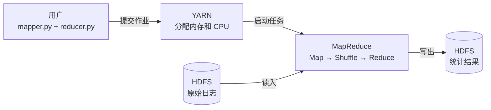
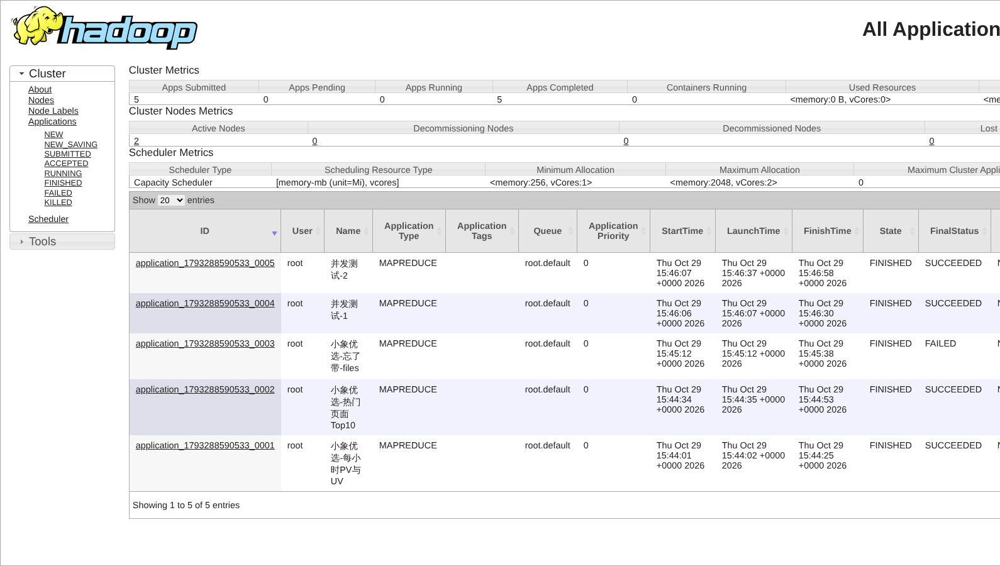
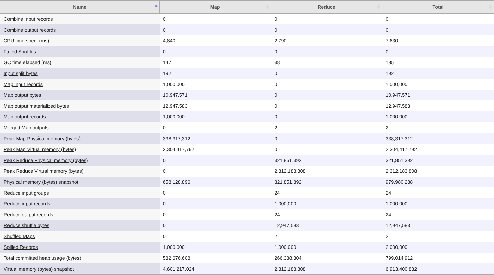
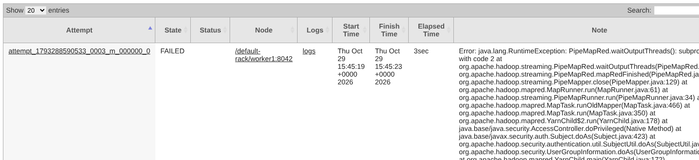
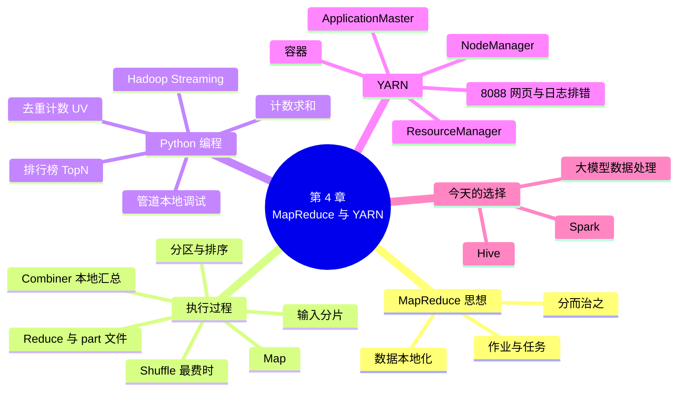

# 第 4 章 MapReduce 与 YARN

!!! abstract "本章学时"
    理论 5 学时 · 实验 1 学时（本章共 3 个实验，教师可任选）

## 学习目标

学完本章，你应该能够：

1. **说出** MapReduce 作业经过的 Map、Shuffle、Reduce 三个阶段，以及 YARN 中 ResourceManager、NodeManager、ApplicationMaster 和容器各自的职责（记忆）；
2. **解释**分区和 Combiner 的作用，说明 Shuffle 为什么是作业中最费时的一步（理解）；
3. **编写** Python 版的 mapper 和 reducer，先在本机用管道调试，再用 Hadoop Streaming 提交到集群，完成 PV、UV 和热门页面统计（应用）；
4. **判断**一个统计需求该用“计数求和”“去重计数”还是“排行榜”写法，以及能不能加 Combiner（分析）；
5. **排查**作业失败或卡住的原因：在 8088 网页和作业日志中找到出错的任务和错误信息，并提出解决办法（分析、评价）。

!!! info "先修要求"
    学习本章前，你需要掌握：

    - 用 Docker Compose 启动随书 Hadoop 集群，打开 9870 和 8088 网页（[第 2 章 实验环境：Docker 与 Hadoop 集群](../02-environment/index.md)）；
    - HDFS 的数据块与副本，用 `hdfs dfs` 命令上传、查看文件（[第 3 章 HDFS 分布式文件系统](../03-hdfs/index.md)）；
    - Linux 的管道 `|`、`cat`、`head`、`sort` 命令（“Linux 操作系统”课程，速查见[附录 A](../../appendix/a-linux-pyspark.md)）；
    - Python 的 `for` 循环、字典、集合，以及用 `sys.stdin` 逐行读入（“Python 程序设计”课程）。

??? abstract "本章概念清单（22 个，点击查看定义和例子）"
    1. [MapReduce](../../appendix/glossary.md#g-MapReduce)
    2. [分而治之](../../appendix/glossary.md#g-分而治之)
    3. [作业](../../appendix/glossary.md#g-作业)
    4. [任务](../../appendix/glossary.md#g-任务)
    5. [输入分片](../../appendix/glossary.md#g-输入分片)
    6. [键值对](../../appendix/glossary.md#g-键值对)
    7. [Map 阶段](../../appendix/glossary.md#g-Map-阶段)
    8. [Shuffle](../../appendix/glossary.md#g-Shuffle)
    9. [Reduce 阶段](../../appendix/glossary.md#g-Reduce-阶段)
    10. [分区](../../appendix/glossary.md#g-分区)
    11. [Combiner](../../appendix/glossary.md#g-Combiner)
    12. [Hadoop Streaming](../../appendix/glossary.md#g-Hadoop-Streaming)
    13. [计数器](../../appendix/glossary.md#g-计数器)
    14. [PV](../../appendix/glossary.md#g-PV)
    15. [UV](../../appendix/glossary.md#g-UV)
    16. [TopN](../../appendix/glossary.md#g-TopN)
    17. [YARN](../../appendix/glossary.md#g-YARN)
    18. [ResourceManager](../../appendix/glossary.md#g-ResourceManager)
    19. [NodeManager](../../appendix/glossary.md#g-NodeManager)
    20. [ApplicationMaster](../../appendix/glossary.md#g-ApplicationMaster)
    21. [容器](../../appendix/glossary.md#g-容器)
    22. [数据本地化](../../appendix/glossary.md#g-数据本地化)

## 情景导入

小周在“小象优选”电商平台的数据组工作。周一早上，运营主管发来一条消息：“国庆大促前想看看 9 月 30 日这一天的流量：每个小时有多少次浏览、多少个不同的用户来过？哪 10 个页面最热门？中午前给我。”

平台每天的网站访问日志有 100 万行左右，70 MB 出头。小周用 Python 写了几十行代码，在笔记本上跑了不到 10 秒就出了结果。可是数据组长提醒他：“大促那天日志会涨几百倍；我们还要把过去一年的日志拿出来做对比，加起来好几个 TB。你的笔记本光把这些数据从硬盘里读一遍，就要好几个小时。”

一台机器读不完、算不完，就把数据分散在很多台机器上，让每台机器各算各的那一份，最后把结果汇总起来。上一章的 HDFS 已经解决了“分散存”的问题，本章要解决“一起算”：先学 Hadoop 的计算模型 [**MapReduce**](../../appendix/glossary.md#g-MapReduce "Hadoop 的分布式计算模型：把一个大任务拆成许多 Map 任务在多台机器上并行处理，再由 Reduce 任务按键汇总结果"){ .term }，看懂一个统计任务怎样被拆开、数据怎样在机器之间流动；再用熟悉的 Python 写出 mapper 和 reducer，把小周的三个统计需求真正提交到集群上运行；最后认识集群的“调度中心” [**YARN**](../../appendix/glossary.md#g-YARN "Hadoop 的资源管理和作业调度系统，负责把集群的内存和 CPU 分给各个作业，MapReduce、Spark 都可以运行在它上面"){ .term }，学会在网页上查看作业的进度、找出作业失败的原因。

## 4.1 MapReduce 解决什么问题

### 4.1.1 一台机器数不过来怎么办

先看一个生活中的例子。全市有 2 万名考生参加同一场考试，要统计每道题的得分率。如果只请一位老师从第一份卷子看到最后一份，他要看好几个星期；实际的做法是把卷子分给 100 位老师，每人只批自己那 200 份，记下每道题的得分，最后由一个人把 100 张小统计表汇总成一张大表。这样做有两个前提：每位老师批卷时互不干扰，不用等别人；汇总只需要把“同一道题”的得分加在一起。

处理大数据也是这个思路，叫作[**分而治之**](../../appendix/glossary.md#g-分而治之 "把一个大问题拆成许多互不相干的小问题分别解决，再把小问题的答案合并起来的思路"){ .term }：把一个大问题拆成许多互不相干的小问题，分给很多台机器同时处理，再把小问题的答案合并起来。2004 年，谷歌的两位工程师 Jeffrey Dean 和 Sanjay Ghemawat 发表论文，把谷歌内部用了几年的这套做法总结为 **MapReduce**：用户只要写两个函数，一个叫 Map，负责“各算各的”；一个叫 Reduce，负责“按类汇总”；至于把数据切开、分给哪台机器、机器坏了怎么办，都由框架自动完成。<sup class="cite">[[1]](#ref4-1)</sup> 随后，开源社区照着论文实现了 Hadoop MapReduce，成为 Hadoop 最早的计算引擎。

为什么拆开算会快这么多？算一笔账。一块普通机械硬盘每秒大约能读 150 MB，把 1 TB 日志读一遍要将近 2 个小时，这还没算处理时间。如果这 1 TB 分散存在 100 台机器上，每台机器只读自己硬盘上的 10 GB，一分多钟就读完了。数据越大，靠一台机器“加配置”越不划算，靠“加机器”越划算，这就是第 1 章讲的横向扩展。

### 4.1.2 你写两个函数，剩下的交给框架

MapReduce 对数据的格式只有一个约定：所有中间数据都写成[**键值对**](../../appendix/glossary.md#g-键值对 "MapReduce 中数据的基本形式，由“键”和“值”两部分组成，同一个键的值会被送到一起汇总"){ .term }，也就是“键”和“值”两部分。统计词频时，键是词，值是 1；统计每小时浏览量时，键是小时，值是 1。框架保证一件事：**键相同的数据，最后一定会被送到同一个地方汇总。**

用户写的两个函数分工如下：

| 函数 | 输入 | 输出 | 在考试例子中 |
|---|---|---|---|
| Map | 一行原始数据 | 若干个键值对 | 一位老师批一份卷子，记下“第 3 题：8 分” |
| Reduce | 一个键和它的所有值 | 这个键的汇总结果 | 把所有老师记下的“第 3 题”的分数加起来求平均 |

用户提交给集群的一次完整计算叫一个[**作业**](../../appendix/glossary.md#g-作业 "用户提交给集群的一次完整计算，一个 MapReduce 作业包含若干个 Map 任务和 Reduce 任务"){ .term }，比如“统计 9 月 30 日每小时的浏览量”。作业会被拆成许多[**任务**](../../appendix/glossary.md#g-任务 "作业拆分出来、交给一台机器执行的最小工作单元，分为 Map 任务和 Reduce 任务；失败的任务会自动重试"){ .term }，交给不同的机器执行：每个 Map 任务处理一小段输入，每个 Reduce 任务汇总一部分键。有一台机器出了故障，框架只要把它上面的任务换一台机器重新跑一遍，不用整个作业从头再来。

框架还会尽量把 Map 任务安排到存有它要读的数据块的机器上，让“计算去找数据”，而不是通过网络把数据搬过来，这叫[**数据本地化**](../../appendix/glossary.md#g-数据本地化 "把计算任务安排到存有它要读的数据块的机器上运行，避免通过网络搬运数据"){ .term }。第 3 章讲过，HDFS 把文件切成 128 MB 的块分散存储，这正好为“就地计算”创造了条件。

### 4.1.3 MapReduce 在 Hadoop 中的位置

Hadoop 的三个核心组件各管一摊：HDFS 负责存，MapReduce 负责算，YARN 负责分配集群的内存和 CPU。一个 MapReduce 作业从 HDFS 读入数据，在 YARN 分给它的资源上运行，最后把结果写回 HDFS。<sup class="cite">[[2]](#ref4-2)</sup>



今天，直接手写 MapReduce 程序的人已经不多了，更常用的是第 5 章的 Hive 和第 6 章起的 Spark。但 Hive 把 SQL 语句翻译成的计算任务、Spark 的分组汇总，都要经过和 MapReduce 一样的“Map、Shuffle、Reduce”过程，第 11 章分析“作业为什么慢”时还会反复用到本章的知识。所以本章的重点不是背 API，而是**看懂数据在集群里是怎样流动的**。

## 4.2 看懂背后发生了什么：Map、Shuffle、Reduce

### 4.2.1 一个作业的三个阶段

一个 MapReduce 作业从输入到输出，经过下面几步：


1. **切分**：框架把输入文件切成若干个[**输入分片**](../../appendix/glossary.md#g-输入分片 "MapReduce 交给一个 Map 任务处理的那一段输入数据，默认和一个 HDFS 数据块一样大（128 MB）"){ .term }，一个分片交给一个 Map 任务。分片的大小一般和 HDFS 数据块一样，是 128 MB；700 MB 的日志大约切成 6 片，就启动 6 个 Map 任务。
2. [**Map 阶段**](../../appendix/glossary.md#g-Map-阶段 "MapReduce 的第一步：每个 Map 任务逐行读取自己的分片，把每行数据转换成若干个键值对"){ .term }：每个 Map 任务逐行读自己的分片，每读一行就调用一次用户写的 Map 函数，把这一行变成若干个键值对。所有 Map 任务同时运行，互不干扰。
3. [**Shuffle**](../../appendix/glossary.md#g-Shuffle "Map 和 Reduce 之间的数据重新分发过程：Map 输出按键分区、排序后，每个 Reduce 任务从所有 Map 任务那里拉取属于自己的数据"){ .term }（洗牌）：Map 的输出先按键分成几个分区，每个分区内按键排好序，写到本机磁盘；然后每个 Reduce 任务到所有 Map 任务那里，把属于自己分区的那部分数据拉过来，合并成一个按键排好序的大列表。
4. [**Reduce 阶段**](../../appendix/glossary.md#g-Reduce-阶段 "MapReduce 的最后一步：每个 Reduce 任务把同一个键的所有值汇总成结果，写到 HDFS"){ .term }：排好序以后，相同的键挨在一起。Reduce 任务每遇到一个键，就把它的所有值交给用户写的 Reduce 函数汇总，结果写到 HDFS，每个 Reduce 任务写一个文件，名字是 `part-00000`、`part-00001`……

Map 和 Reduce 两步都是“各干各的”，真正让很多台机器之间互相交换数据的只有 Shuffle。它要把 Map 的全部输出先写磁盘、再经网络传输、再排序合并，所以**通常是整个作业里最费时的一步**。实验 4-3 中，不做任何优化时，1000 万行日志的 Shuffle 要搬运 122 MB 数据。本章后面讲的 Combiner、第 11 章讲的“减少 Shuffle”，都是在想办法让这一步少搬点数据。

### 4.2.2 算一算：三位用户的搜索关键词

假设小象优选有三位用户在搜索框里输入了下面的关键词，每行是一位用户的输入（随书文件 `labs/data/search_words.txt`）：

```text
手机 耳机 充电宝
耳机 耳机 手机
充电宝 手机 鞋
```

要统计每个词被搜了几次，这就是大数据领域的“Hello World”——词频统计（WordCount）。假设每行是一个分片，设 2 个 Reduce 任务，请先在纸上推一遍，再对照下面的表格。

**第 1 步，Map**：每个 Map 任务把自己那一行拆成词，每个词输出一个 (词, 1)。

| Map 任务 | 输入 | 输出 |
|---|---|---|
| Map 0 | 手机 耳机 充电宝 | (手机, 1) (耳机, 1) (充电宝, 1) |
| Map 1 | 耳机 耳机 手机 | (耳机, 1) (耳机, 1) (手机, 1) |
| Map 2 | 充电宝 手机 鞋 | (充电宝, 1) (手机, 1) (鞋, 1) |

三个 Map 任务一共输出 9 个键值对。

**第 2 步，分区和排序**：框架按规则决定每个词交给哪个 Reduce 任务。这里“充电宝”“耳机”进分区 0，“手机”“鞋”进分区 1（下一小节讲规则）。每个 Map 任务在本机把输出分成两堆，每堆按键排序。

**第 3 步，Shuffle**：Reduce 0 到三个 Map 任务那里分别取走分区 0 的数据，Reduce 1 取走分区 1 的数据。

| Reduce 任务 | 拉取并合并排序后 | 按键分组 |
|---|---|---|
| Reduce 0 | (充电宝, 1) (充电宝, 1) (耳机, 1) (耳机, 1) (耳机, 1) | 充电宝 → [1, 1]；耳机 → [1, 1, 1] |
| Reduce 1 | (手机, 1) (手机, 1) (手机, 1) (鞋, 1) | 手机 → [1, 1, 1]；鞋 → [1] |

**第 4 步，Reduce**：把每组的 1 加起来。

```text
part-00000：充电宝 2，耳机 3
part-00001：手机 3，鞋 1
```

两个文件合起来就是完整的结果。注意两点：第一，每个词只出现在一个输出文件里，不会出现“耳机”在两个文件里各有一部分的情况；第二，结果被分成了两个文件，想要一张总表，就要把 `part-*` 合起来看。实验 4-1 的模拟程序和真实集群输出的结果，与这里手推的完全一致。

### 4.2.3 分区：同一个键只去一个 Reduce

有多个 Reduce 任务时，框架要决定每个键交给哪一个，这叫[**分区**](../../appendix/glossary.md#g-分区 "决定每个键交给哪个 Reduce 任务的规则，默认用键的哈希值对 Reduce 任务个数取余，保证同一个键只进一个 Reduce"){ .term }。Hadoop 默认的规则是：先用键算出一个整数（哈希值），再除以 Reduce 任务的个数取余数，余数是几就交给几号 Reduce。<sup class="cite">[[3]](#ref4-3)</sup> 例如“耳机”的哈希值除以 2 余 0，就进分区 0。

这条规则看起来简单，却保证了最重要的一点：**同一个键不管出现在哪个 Map 任务里，算出来的余数都一样，一定会被送到同一个 Reduce。**这样每个 Reduce 拿到的就是某些键的“全部”数据，汇总结果才是对的。

Reduce 任务的个数由用户指定（随书集群默认 1 个），它决定了输出文件的个数：

- 设 1 个 Reduce：所有键都进同一个分区，输出一个文件，适合结果不多、需要全局排序或全局取前几名的情况；
- 设多个 Reduce：汇总工作分摊到多台机器上，适合结果很多（比如按用户统计）的情况；但如果某个分区分到的键特别少，就会有 Reduce 任务“空转”，输出空文件。实验 4-1 把 Reduce 个数改成 3，就能看到这种情况。

### 4.2.4 Combiner：先在本地汇总一次

再看一遍 4.2.2 的 Map 1：它输出了两个 (耳机, 1)。这两条数据都要经过网络传给 Reduce 0，再在那里加起来。既然 Reduce 最终只关心总数，何不在 Map 端就先加成 (耳机, 2)，少传一条？

这就是 [**Combiner**](../../appendix/glossary.md#g-Combiner "在 Map 端先把相同键的值合并一次的“本地小 Reduce”，用来减少 Shuffle 传输的数据量，只适合求和、计数、求最大值这类可以分步合并的计算"){ .term } 的作用：在每个 Map 任务把数据交给 Shuffle 之前，先在本地按键汇总一次，相当于一个“本地的小 Reduce”。回到阅卷的例子，每位老师先把自己那 200 份卷子的得分汇总成一张小表再上交，汇总的人就不用一份一份地加了。

在三行关键词的例子里，加了 Combiner 以后，Shuffle 传输的键值对从 9 个变成 8 个，好像没省多少。但在真实日志里，同一个页面在一个分片中会出现成千上万次。实验 4-3 统计 1000 万行日志的页面访问量：不加 Combiner，Shuffle 要传约 900 万条记录、122 MB；加上 Combiner，只传约 1.2 万条、0.2 MB，减少了 99% 以上。

Combiner 不是什么时候都能加。它的结果会被 Reduce 再汇总一次，所以只适合“分几次算和一次算结果相同”的计算：

| 计算 | 能否直接用 Combiner | 原因 |
|---|---|---|
| 求和、计数 | 能 | 先分组加、再总加，结果不变 |
| 求最大值、最小值 | 能 | 各组最大值里的最大值就是总的最大值 |
| 求平均值 | 不能直接用 | 平均值的平均值不等于总平均值。(2+4)/2 = 3 和 6/1 = 6 再平均得 4.5，而三个数的真实平均是 4。要让 Map 端输出“和与个数”两项，最后再相除 |
| 去重计数（如 UV） | 不能直接用 | 两个分片里各有 10 个不同用户，合起来可能只有 15 个，不能简单相加 |

### 4.2.5 用动画把全过程走一遍

下面的动画把 4.2.2 的手推过程一步一步画了出来。键值对的颜色表示分区，同一种颜色的数据会被送到同一个 Reduce。可以改 Reduce 的个数、勾选 Combiner，或者直接在文本框里改输入。

<iframe class="sim-frame" src="../../sims/mapreduce-wordcount/main.html" height="900" loading="lazy" title="MapReduce 词频统计全流程"></iframe>

动画：MapReduce 词频统计全流程。按“下一步”逐个阶段播放，下方的计数器名称和 Hadoop 作业结束时打印的计数器相同。[全屏打开](../../sims/mapreduce-wordcount/main.html){ target=_blank } · [教学说明](../../sims/mapreduce-wordcount/index.md)
{ .sim-caption }

## 4.3 用 Python 写 MapReduce 程序

### 4.3.1 Hadoop Streaming：让 Python 当 mapper 和 reducer

Hadoop 本身是用 Java 写的，原生的 MapReduce 程序也要用 Java 写。对只会 Python 的同学来说，Hadoop 自带的 [**Hadoop Streaming**](../../appendix/glossary.md#g-Hadoop-Streaming "Hadoop 自带的工具，让用 Python 等任何语言编写、从标准输入读数据、向标准输出写结果的程序充当 mapper 和 reducer"){ .term } 工具提供了一条捷径：任何程序，只要能**从标准输入一行一行读数据、往标准输出一行一行写结果**，就能当 mapper 或 reducer 用。<sup class="cite">[[4]](#ref4-4)</sup>

Streaming 的工作方式可以这样理解：

1. 框架把一个分片的数据一行一行“喂”给 mapper 程序的标准输入；
2. mapper 每输出一行，框架就按第一个制表符（Tab）把它拆成键和值，制表符前面是键，后面是值；
3. 经过 Shuffle，框架把属于同一个 Reduce 的数据**按键排好序**，再一行一行喂给 reducer 程序；
4. reducer 输出的每一行就是最终结果的一行。

和 Java 版相比，Streaming 有一点不同要特别注意：Java 版的 Reduce 函数每次拿到的是“一个键和它的值列表”，而 Streaming 的 reducer 拿到的是**一行一行排好序的“键 Tab 值”**，要自己判断“键什么时候变了”。

### 4.3.2 mapper.py 和 reducer.py 的固定写法

下面是词频统计的 mapper（完整代码见 `labs/ch04/wc_mapper.py`）。它从标准输入逐行读入，把每个词输出成“词 Tab 1”：

```python
import re
import sys

for line in sys.stdin:                      # Hadoop 把输入分片一行一行地送到标准输入
    for word in re.split(r"[\s，,。！!]+", line.strip()):
        if word:
            print(f"{word}\t1")             # 输出到标准输出：键<TAB>值
```

reducer 收到的数据已经按词排好序，相同的词挨在一起，所以只要一边读一边累加，**一旦发现词变了，就把上一个词的结果输出**（`labs/ch04/wc_reducer.py`）：

```python
import sys

current_word, current_count = None, 0
for line in sys.stdin:
    word, count = line.rstrip("\n").split("\t")
    if word == current_word:                # 还是同一个词，继续累加
        current_count += int(count)
    else:                                   # 换了一个新词：先输出上一个词的结果
        if current_word is not None:
            print(f"{current_word}\t{current_count}")
        current_word, current_count = word, int(count)
if current_word is not None:                # 别忘了最后一个词
    print(f"{current_word}\t{current_count}")
```

这个“换键时输出”的写法是 Streaming reducer 的固定套路，本章后面的 PV、UV、TopN 都是在它的基础上改出来的。写的时候最容易漏掉的是最后两行：循环结束时最后一个键还没有输出。

### 4.3.3 先在本机用管道调试

把程序提交到集群之前，一定要先在本机调通。Linux 的管道正好可以模拟 Streaming 的过程：`cat` 相当于输入分片，`sort` 相当于 Shuffle 的排序：

```bash
cd labs
cat data/search_words.txt | python3 ch04/wc_mapper.py | sort | python3 ch04/wc_reducer.py
```

```text
充电宝	2
手机	3
耳机	3
鞋	1
```

结果和手推的一致。真实数据很大时，用 `head` 取前几万行先试：

```bash
head -20000 data/xiaoxiang/access.log | python3 ch04/pv_mapper.py | sort | python3 ch04/pv_reducer.py
```

本机调试有三个好处：一是出错时能直接看到 Python 的报错信息，而在集群上要到日志里去找（见 4.5.5 节）；二是几秒钟就能看到结果；三是本机的结果可以和集群的结果对照。**管道能跑通，集群上一般就能跑通。**

!!! warning "管道里的 sort 不能省"
    如果写成 `cat … | mapper | reducer`，漏掉中间的 `sort`，reducer 收到的数据没有排序，同一个键会被拆成好几段分别输出，结果就错了，但程序不会报错。集群上不会出这个问题，因为框架一定会排序。

### 4.3.4 提交到集群

调通以后，把日志上传到 HDFS，用 `mapred streaming` 命令提交作业（在 master 容器里运行）：

```bash
hdfs dfs -mkdir -p /xiaoxiang/logs
hdfs dfs -put -f /labs/data/xiaoxiang/access.log /xiaoxiang/logs/

mapred streaming \
  -D mapreduce.job.name="小象优选-每小时PV与UV" \
  -files pv_mapper.py,pv_reducer.py \
  -mapper "python3 pv_mapper.py" \
  -reducer "python3 pv_reducer.py" \
  -input /xiaoxiang/logs/access.log \
  -output /xiaoxiang/out/pv_uv
```

各个参数的含义：

| 参数 | 含义 | 注意 |
|---|---|---|
| `-D mapreduce.job.name=…` | 作业名，会显示在 8088 网页上 | 起一个看得懂的名字，方便在网页上找 |
| `-D mapreduce.job.reduces=N` | Reduce 任务个数 | 要求全局排名时设为 1 |
| `-files a.py,b.py` | 把本机的脚本分发到每台运行任务的机器上 | **最常漏掉的参数**，漏了作业会失败（见 4.5.5 节） |
| `-mapper`、`-reducer` | 运行 mapper、reducer 的命令 | 写 `python3 文件名`，不用写路径 |
| `-combiner` | 运行 Combiner 的命令 | 求和类的 reducer 可以直接拿来当 Combiner |
| `-input` | HDFS 上的输入文件或目录 | 可以是目录，目录下的文件都会被处理 |
| `-output` | HDFS 上的输出目录 | **必须不存在**，否则作业直接报错退出；重跑前先用 `hdfs dfs -rm -r` 删掉 |

作业运行时，屏幕上会滚动显示 `map 50% reduce 0%` 这样的进度，结束时打印一长串[**计数器**](../../appendix/glossary.md#g-计数器 "MapReduce 作业运行时自动统计的各种数量，如读入多少行、Map 输出多少条、Shuffle 传了多少字节，是判断作业是否正常的依据"){ .term }，例如读入了多少行、Map 输出了多少条记录、Shuffle 传了多少字节。计数器是判断作业是否正常的第一手依据：Map 读入的行数应该等于日志的行数；如果 Reduce 输出的行数是 0，多半是 mapper 的输出格式错了。看结果用：

```bash
hdfs dfs -ls /xiaoxiang/out/pv_uv            # 一个 _SUCCESS 标记文件 + 若干个 part 文件
hdfs dfs -cat /xiaoxiang/out/pv_uv/part-*    # 把所有 part 文件连起来显示
```

输出目录里那个空的 `_SUCCESS` 文件表示作业成功完成；后续程序（比如定时任务）常用它来判断上游的数据有没有准备好。

## 4.4 三种常用写法：计数、去重、排行榜

实际工作中的统计需求千变万化，但用 MapReduce 来写，绝大多数都可以归到下面三种写法中的一种。<sup class="cite">[[5]](#ref4-5)</sup> 动手写代码之前，先想清楚两个问题：**键是什么**（按什么分组），**值是什么**（每组要汇总什么）。

小象优选的访问日志每行有 8 个字段，用空格隔开：

```text
2026-09-30T08:00:03 183.6.12.34 u0001234 GET /item/p01024 200 5320 Android
时间                IP地址       用户      方法 页面         状态码 字节数 终端
```

用户字段是 `-` 表示没有登录的访客。

### 4.4.1 计数求和：热门页面的访问次数

需求：统计每个页面被成功访问（状态码 200）了多少次。

- 键：页面；值：1。
- mapper 只输出状态码为 200 的行，reducer 把同一页面的 1 加起来。

```python
# page_mapper.py：每条成功的访问输出“页面<TAB>1”
for line in sys.stdin:
    fields = line.split()
    if len(fields) == 8 and fields[5] == "200":   # 只统计成功返回的请求
        print(f"{fields[4]}\t1")
```

reducer 用的是通用的求和程序 `sum_reducer.py`，写法和 4.3.2 节的 `wc_reducer.py` 完全一样，只是把变量名从“词”换成了“键”。因为是求和，它还可以直接当 Combiner 用。

mapper 里的 `len(fields) == 8` 不是多余的：真实日志里总会混进几行格式不对的数据，比如被截断的半行。不检查就取 `fields[5]`，遇到一行坏数据程序就会报错退出，整个作业失败。**mapper 要对坏数据宽容，跳过它，而不是让作业崩掉。**

同样的写法可以统计各省的订单数（键是省份）、各品类的销售额（键是品类，值是金额）、每个终端的流量（键是终端，值是字节数）。

### 4.4.2 去重计数：每小时有多少个不同的用户

运营上常用两个流量指标：[**PV**](../../appendix/glossary.md#g-PV "页面浏览量，用户每打开一次页面算一次，同一个人打开多次算多次"){ .term } 是页面浏览量，用户每打开一次页面算一次；[**UV**](../../appendix/glossary.md#g-UV "独立访客数，一段时间内访问过网站的不同用户个数，同一个人访问多次只算一次"){ .term } 是独立访客数，一段时间内来过的不同用户有几个，同一个人来十次也只算一次。PV 是计数，UV 是“去重以后再计数”。

需求：统计 9 月 30 日每小时的 PV 和 UV。

- 键：小时；值：用户编号。
- mapper 从时间里取出小时，输出“小时 Tab 用户”；reducer 对每个小时，行数就是 PV，把用户放进一个集合（集合会自动去重），集合的大小就是 UV。

```python
# pv_mapper.py
for line in sys.stdin:
    fields = line.split()
    if len(fields) != 8:                 # 跳过格式不对的行
        continue
    hour = fields[0][11:13]              # 从“2026-09-30T08:00:03”中取出“08”
    print(f"{hour}\t{fields[2]}")
```

```python
# pv_reducer.py 的核心部分
current_hour, pv, users = None, 0, set()
for line in sys.stdin:
    hour, user = line.rstrip("\n").split("\t")
    if hour != current_hour:
        if current_hour is not None:
            emit(current_hour, pv, users)        # 输出“小时<TAB>PV<TAB>UV”
        current_hour, pv, users = hour, 0, set()
    pv += 1
    if user != "-":
        users.add(user)                  # 未登录访客不计入 UV
```

完整代码见 `labs/ch04/pv_mapper.py` 和 `pv_reducer.py`。这里有两点要注意：

1. 这个作业**不能加 Combiner**。PV 可以先在本地加，但 UV 不行：本地的集合大小加起来不等于总的不同用户数（见 4.2.4 节的表）。
2. reducer 把一小时内的所有不同用户都放进内存里的集合。一小时有几万个用户没有问题；如果键的范围很大（比如按“全年”统计 UV，有几亿个用户），集合就可能撑爆内存，这时要换成“两步走”：第一个作业先按“小时+用户”去重，第二个作业再按小时计数。第 8 章用 Spark SQL 的 `COUNT(DISTINCT …)` 会简单得多。

### 4.4.3 排行榜：最热门的 10 个页面

需求：找出访问次数最多的 10 个页面。这类“按某个指标取前 N 名”的统计叫 [**TopN**](../../appendix/glossary.md#g-TopN "按某个指标从大到小取前 N 名的统计，也叫排行榜"){ .term }。

在 4.4.1 节的基础上，只要把 reducer 改一改：一边累加每个页面的次数，一边维护一个只有 10 个位置的“排行榜”；新来一个页面，如果比榜上第 10 名多，就把第 10 名挤掉。Python 的 `heapq`（堆）正好能高效地做这件事（`labs/ch04/topn_reducer.py`）：

```python
def push(key, count):
    heapq.heappush(top, (count, key))    # top 是一个小顶堆，堆顶是榜上第 10 名
    if len(top) > N:
        heapq.heappop(top)               # 超过 10 个，就把最小的那个挤掉
```

TopN 有一个容易出错的地方：**必须只用 1 个 Reduce 任务**。如果用 2 个，每个 Reduce 只看到一半的页面，各自选出的前 10 名合在一起有 20 个，并不是全局的前 10 名。所以提交作业时要加 `-D mapreduce.job.reduces=1`。好在经过 Map 端筛选和汇总，进入 Reduce 的数据已经不多了，一个 Reduce 完全忙得过来。

### 4.4.4 遇到新需求怎样选写法

| 业务问题 | 写法 | 键 | 值 | Reduce 做什么 | 能加 Combiner 吗 |
|---|---|---|---|---|---|
| 每个页面的访问次数 | 计数求和 | 页面 | 1 | 求和 | 能 |
| 各品类的销售额 | 计数求和 | 品类 | 订单金额 | 求和 | 能 |
| 每个用户最近一次访问时间 | 计数求和的变形 | 用户 | 访问时间 | 取最大值 | 能 |
| 每小时 PV 和 UV | 去重计数 | 小时 | 用户编号 | 计数、集合去重 | 不能 |
| 每天下过单的不同用户数 | 去重计数 | 日期 | 用户编号 | 集合去重 | 不能 |
| 访问量前 10 的页面 | 排行榜 | 页面 | 1 | 求和后保留前 10 名 | 求和部分能，且只能 1 个 Reduce |
| 每个省份订单金额的平均值 | 计数求和的变形 | 省份 | 金额和 1 | 分别求和后相除 | 输出“和、个数”两项才能 |

可以看到，MapReduce 的套路很固定，难点在于把业务问题翻译成“键是什么、值是什么”。这个翻译的本领到了 Hive 和 Spark SQL 里同样用得上：键就是 `GROUP BY` 后面的列，Reduce 做的事就是 `SUM`、`COUNT`、`MAX` 这些聚合函数。

## 4.5 YARN：集群的调度中心

### 4.5.1 为什么需要 YARN

集群里有几十上百台机器，同时有很多作业要运行：数据组在跑日报，算法组在训练模型，还有人在临时查数据。谁先跑、每个作业能用多少内存、任务放到哪台机器上，需要有人统一安排。

早期的 Hadoop 由 MapReduce 自己管这些事，集群只能跑 MapReduce 作业，规模大了以后，那个“又管资源又管作业”的进程也成了瓶颈。2013 年起，Hadoop 把资源管理单独拿出来，做成了 **YARN**（Yet Another Resource Negotiator，直译为“另一个资源协调者”）。<sup class="cite">[[6]](#ref4-6)</sup> 从此 YARN 只管“分资源”，至于资源拿去跑 MapReduce、Spark 还是 Flink，由各个计算框架自己决定。今天很多企业的大数据平台都是“一个 YARN 集群，上面同时跑多种计算框架”，第 6 章就会把 Spark 作业提交到同一个 YARN 上。

### 4.5.2 四个角色

YARN 中有四个角色，可以用一家物流公司来类比：

| 角色 | 有几个 | 做什么 | 类比 |
|---|---|---|---|
| [**ResourceManager**](../../appendix/glossary.md#g-ResourceManager "YARN 的总管，整个集群只有一个，掌握所有机器的资源，决定把资源分给哪个作业"){ .term }（RM） | 整个集群一个 | 掌握所有机器的资源，接收作业，决定把资源分给谁 | 公司总部的调度中心 |
| [**NodeManager**](../../appendix/glossary.md#g-NodeManager "YARN 在每台工作机器上的管理员，向 ResourceManager 汇报本机资源，按指令启动和监控容器"){ .term }（NM） | 每台工作机器一个 | 向 RM 汇报本机还有多少内存和 CPU，按指令启动、监控和清理容器 | 每个仓库的管理员 |
| [**ApplicationMaster**](../../appendix/glossary.md#g-ApplicationMaster "每个作业专属的“项目经理”，运行在一个容器里，负责向 ResourceManager 申请资源、安排任务、跟踪进度、重试失败任务"){ .term }（AM） | 每个作业一个 | 作业专属的“项目经理”：向 RM 申请资源，安排任务到哪里运行，跟踪进度，任务失败时重新申请资源重试 | 每个项目的项目经理 |
| [**容器**](../../appendix/glossary.md#g-容器 "YARN 分配资源的单位，是某台机器上的一份内存和 CPU，任务就在容器里运行"){ .term }（Container） | 很多个 | 某台机器上的一份内存和 CPU，任务就在容器里运行 | 仓库里的一个工位 |

在随书集群上，RM 运行在 master 容器里（网页端口 8088）；worker1 和 worker2 上各运行一个 NM，每个拿出 2048 MB 内存给 YARN 分配。MapReduce 作业的 AM、每个 Map 任务、每个 Reduce 任务默认各占一个 512 MB 的容器（配置在 `labs/cluster/conf/` 下的 `yarn-site.xml` 和 `mapred-site.xml` 中）。<sup class="cite">[[7]](#ref4-7)</sup>

!!! note "这里的“容器”不是 Docker 容器"
    随书集群的每个节点都运行在一个 Docker 容器里，而 YARN 又在每个节点上分出若干个“YARN 容器”来运行任务。两者名字相同、层次不同：Docker 容器相当于一台机器，YARN 容器是这台机器上的一份资源。本书说“容器”时，如果指 YARN 容器，会在上下文中说清楚。

### 4.5.3 一个作业的一生

把一个 Streaming 作业提交到 YARN 以后，大致经过下面几步：

1. **提交**：客户端把作业交给 RM。这时在 8088 网页上，作业的状态是 ACCEPTED（已接受，等待资源）。
2. **启动 AM**：RM 找一台有空闲资源的机器，让它的 NM 启动一个容器，运行这个作业的 AM。AM 一启动，作业状态变成 RUNNING。
3. **申请资源**：AM 算出要几个 Map 任务（等于分片数），向 RM 申请同样多的容器；RM 根据各台机器的空闲情况分配，并尽量照顾数据本地化。
4. **运行任务**：AM 通知相应的 NM 在容器里启动 Map 任务；Map 全部完成后，再申请容器运行 Reduce 任务。哪个任务失败了，AM 会重新申请容器再试，默认最多试 4 次。
5. **结束**：所有任务完成后，AM 向 RM 报告并退出，作业状态变成 FINISHED，所有容器的资源被收回，可以分给别的作业。

**算一算**：随书集群一共有 2 × 2048 = 4096 MB 内存可分，每个容器 512 MB，最多同时运行 4096 ÷ 512 = 8 个容器。实验 4-3 的 1000 万行日志切成 6 个分片，作业需要 1 个 AM + 6 个 Map，一共 7 个容器，一批就能全部跑起来。如果日志有 2 GB，切成 16 片，除去 AM 只剩 7 个空位，16 个 Map 任务就要分三批运行，作业会明显变慢。这时加机器，或者给每台机器分更多内存，作业就能快起来，这正是“横向扩展”的含义。

下面的动画按随书集群的配置模拟了资源分配的过程。可以改节点数、内存和作业大小，看看作业是怎样一批一批运行的；再试试勾选“作业 B”，以及把节点改成 1 台、容器改成 2 GB，看看会出现什么问题。

<iframe class="sim-frame" src="../../sims/yarn-scheduling/main.html" height="820" loading="lazy" title="YARN 资源分配"></iframe>

动画：YARN 资源分配。深色块是 ApplicationMaster，蓝色、橙色块是两个作业的任务，斜纹表示 Reduce。[全屏打开](../../sims/yarn-scheduling/main.html){ target=_blank } · [教学说明](../../sims/yarn-scheduling/index.md)
{ .sim-caption }

### 4.5.4 在 8088 网页上查看作业

RM 的网页（随书集群为 <http://localhost:8088>）是了解集群和作业状态最直接的窗口。首页 Applications 列出所有作业：



最上方的 Cluster Metrics 一行是集群概况：提交了几个作业、正在运行几个、总共有多少资源（`<memory:4 GB, vCores:4>`）、已经用了多少。下面的表格每行是一个作业，常看的几列是：

| 列 | 含义 |
|---|---|
| ID | 作业编号，形如 `application_1793288590533_0001`，中间一串数字是 RM 启动的时间戳，最后是序号 |
| Name | 提交时 `-D mapreduce.job.name` 起的名字 |
| State | 作业所处阶段：ACCEPTED（等资源）、RUNNING（运行中）、FINISHED（已结束） |
| FinalStatus | 结束时的结果：SUCCEEDED（成功）、FAILED（失败）、KILLED（被手动终止） |
| Tracking UI | 运行中显示 ApplicationMaster，点进去看实时进度；结束后显示 History，点进去看作业历史 |

注意 State 和 FinalStatus 要一起看：上图中的 0003 号作业 State 是 FINISHED，FinalStatus 却是 FAILED，表示它“结束了，但失败了”。

点 History 进入作业历史服务器（端口 19888），左侧菜单的 Counters 就是作业结束时打印的那些计数器。下图是实验 4-2 第一个作业的 Map-Reduce Framework 组计数器，Map input records（读入行数）、Map output records（Map 输出记录数）、Reduce shuffle bytes（Shuffle 传输字节数）、Reduce output records（输出行数）这几项最常用：



!!! tip "点链接打不开？"
    8088 网页上的 History 链接写的是 `http://master:19888/…`，`master` 是集群内部的主机名，你的电脑不认识它，所以打不开。把地址里的 `master` 改成 `localhost` 就行了。也可以在电脑的 hosts 文件里加一行 `127.0.0.1 master`，方法见附录 C。

不想开网页时，也可以在 master 容器里用命令查看：

```bash
yarn application -list -appStates ALL       # 列出所有作业及状态
yarn logs -applicationId <作业编号>           # 查看作业所有容器的日志
yarn application -kill <作业编号>            # 终止一个卡住的作业
```

### 4.5.5 作业失败或卡住了怎么办

在集群上运行程序，出错是常态，关键是会找原因。下面用随书集群上真实出现过的两个问题，演示排查的思路。

**问题一：作业失败。**提交作业时漏写了 `-files` 参数，屏幕上出现了这样的信息：

```text
INFO  Job:1793 - Task Id : attempt_1793288590533_0003_m_000000_0, Status : FAILED
Error: java.lang.RuntimeException: PipeMapRed.waitOutputThreads(): subprocess failed with code 2
...
INFO  Job:1767 - Job job_1793288590533_0003 failed with state FAILED due to: Task failed task_1793288590533_0003_m_000000
ERROR StreamJob:1026 - Job not successful!
Streaming Command Failed!
```

排查分三步：

1. **找出失败的是哪个任务。**`attempt_…_m_000000_0` 中，`m` 表示 Map 任务（`r` 是 Reduce），`000000` 是任务编号，最后的 `_0` 是第几次尝试。同一个任务连续失败了 `_0`、`_1`、`_2`……几次尝试，说明不是偶然故障，而是程序本身有问题。在网页上，从 History 进入作业页面，点 Map 的 Failed 数字也能看到这些失败的尝试：

    

2. **看 Python 程序自己的报错。**`subprocess failed with code 2` 只说明 Python 程序非正常退出，真正的原因在 Python 打印的错误信息里，它被保存在任务的 stderr 日志中。点上图中的 logs 链接，或者用命令：

    ```bash
    yarn logs -applicationId application_1793288590533_0003 -log_files stderr
    ```

    输出按容器列出每个任务的 stderr，`LogLength:0` 表示这个容器没有报错，往下找长度不为 0 的（节选）：

    ```text
    Container: container_1793288590533_0003_01_000012 on worker1_39267
    LogType:stderr
    LogLength:206
    LogContents:
    /usr/bin/python3: can't open file '/data/hadoop/nm-local-dir/usercache/root/appcache/application_1793288590533_0003/container_1793288590533_0003_01_000012/pv_mapper.py': [Errno 2] No such file or directory
    ```

    原来工作节点上找不到 `pv_mapper.py`：脚本只在提交作业的机器上，没有用 `-files` 分发出去。

3. **改正后重新提交。**加上 `-files pv_mapper.py,pv_reducer.py`，先删除上次失败留下的输出目录（如果有），再提交。

“subprocess failed with code N” 中的数字是 Python 程序的退出码，可以帮助缩小范围：

| 退出码 | 常见原因 | 怎么查 |
|---|---|---|
| 1 | Python 程序运行时出了异常，如 `IndexError`（某行字段不够）、`ValueError`（把非数字转成 int） | 日志里有 Traceback，看最后一行；在 mapper 中跳过坏数据 |
| 2 | 找不到脚本文件 | 检查 `-files` 是否写全、文件名是否拼对 |
| 127 | 找不到命令，例如节点上没有安装 `python3` | 检查 `-mapper` 里的命令在工作节点上能不能运行 |

**问题二：作业一直停在 ACCEPTED。**在随书集群上同时提交两个作业，用 `yarn application -list` 每隔几秒看一次状态，会发现：

```text
t=6   并发测试-1 RUNNING   5%      并发测试-2 ACCEPTED 0%
t=12  并发测试-1 RUNNING  50%      并发测试-2 ACCEPTED 0%
t=18  并发测试-1 FINISHED 100%     并发测试-2 ACCEPTED 0%
t=24  并发测试-1 FINISHED 100%     并发测试-2 RUNNING  0%
```

第一个作业只用了 4 个 512 MB 的容器，集群明明还空着一半内存，第二个作业却一直等到第一个结束才启动。原因是 YARN 默认的容量调度器有一条规定：所有作业的 AM 加起来，最多只能占集群资源的 10%（参数 `yarn.scheduler.capacity.maximum-am-resource-percent`，默认 0.1），用来防止集群被一大堆只有 AM、没有任务的作业占满。<sup class="cite">[[8]](#ref4-8)</sup> 随书集群一共 4096 MB，10% 只有约 410 MB，连一个 512 MB 的 AM 都放不下（第一个作业总是被允许启动），所以第二个作业只能排队。在几百台机器的生产集群上，10% 足够同时运行几十上百个作业，这个问题就不明显了。

作业停在 ACCEPTED 的常见原因还有：集群里没有可用的 NodeManager（网页上 Active Nodes 为 0，或节点显示 UNHEALTHY，比如磁盘快满了）；申请的容器比任何一台机器的可用内存都大。如果作业已经 RUNNING、进度却一直是 0%，多半是 AM 占住了资源、任务分不到容器。上面的动画可以把这几种情况都演示出来。

## 4.6 MapReduce 的局限与今天的选择

MapReduce 让普通服务器组成的集群也能可靠地处理海量数据，但它的缺点也很明显：

- **慢**：每个作业启动时要申请资源、启动 AM 和一个个任务，光准备就要十几秒；中间结果要写磁盘，多个作业串起来时，上一个作业的结果写进 HDFS、下一个再读出来，反复读写磁盘。编者在随书集群上统计 100 万行日志的 PV、UV，作业耗时约 25 秒；同样的程序在本机用管道直接运行，只要不到 10 秒。**数据只有几十 MB 时，单机反而更快**，集群的优势要到数据大到单机处理不了时才显现出来。
- **写起来繁**：一个简单的分组统计要写两个程序，多表关联、多步加工要把好几个作业串起来，代码量大，也容易出错。
- **不适合迭代和实时计算**：机器学习要在同一份数据上反复计算几十上百轮，每一轮都读写一次磁盘，非常慢；MapReduce 一次处理一批已经存好的数据，也没法做到“数据一来就算”。

所以，今天的大数据平台一般这样分工：

| 场景 | 常用工具 | 本书章节 |
|---|---|---|
| 数据不超过几 GB，一台电脑处理得了 | Python、pandas | “Python 程序设计”课程 |
| 用 SQL 对 HDFS 上的大表做统计 | Hive | 第 5 章 |
| 批量清洗、统计、关联，需要较快的速度 | Spark | 第 6～8 章 |
| 数据一产生就要处理 | Kafka + Spark Structured Streaming 或 Flink | 第 9 章 |
| 在大数据上训练机器学习模型 | Spark MLlib | 第 10 章 |

手写 MapReduce 程序的场合越来越少，但 MapReduce 的思想并没有过时。Hive 把 SQL 翻译成计算任务（早期是 MapReduce，现在多用更快的 Tez），执行起来同样分为“Map、Shuffle、Reduce”几步；Spark 把中间结果尽量放在内存里，大大加快了速度，但分组汇总时同样要经过 Shuffle，第 11 章分析数据倾斜（某个分区数据特别多）时，用的还是本章的分区知识。**本章学会的“把业务问题翻译成键和值”“看计数器、看日志找问题”，到了后面每一章都用得上。**

## 4.7 前沿视窗

**大模型的训练数据也是“Map + Reduce”加工出来的。**训练一个大语言模型，要先从网页、书籍、代码中收集几十 TB 的原始文本，再经过过滤、清洗、去重，挑出高质量的部分。2024 年 Hugging Face 公开的 FineWeb 数据集，从 96 期 Common Crawl 网页快照中加工出约 15 万亿个词元的英文文本，团队同时开源了加工用的工具库 datatrove。<sup class="cite">[[9]](#ref4-9)</sup> 加工流程和本章讲的完全对得上：把海量网页切成许多份，每份独立地做语言识别、质量过滤、去掉个人信息，这是“Map”；要找出不同网页之间的重复内容，就得把“特征相同”的网页送到一起比较，这就需要按键分组，相当于“Shuffle + Reduce”。

**国产工具：Data-Juicer。**阿里巴巴团队开源的 Data-Juicer 是专门为大模型准备训练数据的系统，内置 50 多个数据处理算子（如过滤过短文本、去重、统计语言比例），可以像搭积木一样组合成一条处理流水线；数据量大时，它可以借助 Ray 等分布式框架在多台机器上并行处理，论文中的实验显示节点越多处理时间越短。<sup class="cite">[[10]](#ref4-10)</sup>

**“分段处理、再合并”也是大模型应用的常用套路。**一份几百页的合同或报告超出了大模型一次能读入的长度，常见的做法是先把文档切成若干段，让模型分别总结每一段（Map），再把各段的摘要交给模型合并成一份总摘要（Reduce）。不少大模型应用开发框架把这种做法直接命名为 “map-reduce”。可见，“分给很多人各做一份、最后汇总”的思想，在大模型时代依然好用。

## 本章实验

!!! abstract "实验总览"
    | 实验 | 类型 | 建议时长 | 内容 |
    |---|---|---|---|
    | 实验 4-1 | ★ 基础 | 30 分钟 | 用模拟程序看清 MapReduce 每个阶段的数据，再用 Linux 管道跑通词频统计 |
    | 实验 4-2 | ★ 基础 | 45 分钟 | 用 Hadoop Streaming 在集群上统计每小时 PV、UV 和最热门的 10 个页面，在 8088 网页上查看作业和计数器 |
    | 实验 4-3 | ☆ 拓展 | 30 分钟 | 对 1000 万行日志比较加不加 Combiner、用几个 Reduce 时，Shuffle 的数据量和耗时 |

    实验 4-1 只需要 Python，在任何电脑上都能做；实验 4-2、4-3 在第 2 章搭好的 Docker 小集群上运行（建议电脑内存 8 GB 以上）。实验代码见配套资源 `labs/ch04/` 目录，数据由 `labs/data/make_data.py` 生成。编者的运行环境：4 核 CPU、16 GB 内存的 Linux 主机，Docker 29.9，Hadoop 3.4.3 镜像（主节点 1 个、工作节点 2 个）。

### 实验 4-1 ★ 在本机“演”一遍 MapReduce

**实验目的**

1. 运行模拟程序，逐个阶段查看 Map、分区、Shuffle、Reduce 的中间数据，检验 4.2.2 节的手推结果；
2. 观察 Combiner 和 Reduce 个数对 Shuffle 数据量和输出文件的影响；
3. 用 Linux 管道模拟 Hadoop Streaming，跑通 Python 版的词频统计，并用它统计商品评价中的常见短语。

**实验环境**：本机 CPU。Python 3.10 以上，只用到标准库；Windows 同学在 WSL 或第 2 章的 master 容器里运行管道命令。

**实验数据**

- `labs/data/search_words.txt`：4.2.2 节的三行搜索关键词；
- `labs/data/xiaoxiang/reviews.csv`：小象优选的 2 万条商品评价（评价编号、商品、用户、评分、内容），由 `labs/data/make_data.py` 按固定随机种子生成，内容为虚构。

**实验步骤与代码**

第 1 步，生成实验数据（实验 4-2 也要用，只需生成一次，约 10 秒）：

```bash
cd labs
pip install -r requirements.txt -i https://pypi.tuna.tsinghua.edu.cn/simple
python data/make_data.py
```

第 2 步，运行模拟程序。`mr_simulate.py` 用几十行 Python 把 MapReduce 的各个阶段依次“演”出来，分区规则和 Hadoop 默认的完全相同。核心是下面两个函数（完整代码见 `labs/ch04/mr_simulate.py`）：

```python
def text_hash(key):
    """和 Hadoop 中 Text 类型的 hashCode 算法相同：h = 31 * h + 每个字节"""
    h = 1
    for b in key.encode("utf-8"):
        h = (31 * h + (b - 256 if b > 127 else b)) & 0xFFFFFFFF
    return h


def partition(key, n):
    """哈希值对 Reducer 个数取余，同一个键一定被送到同一个 Reducer"""
    return (text_hash(key) & 0x7FFFFFFF) % n
```

```bash
python ch04/mr_simulate.py                   # 默认：三行关键词，2 个 Reduce
python ch04/mr_simulate.py --combiner        # 加 Combiner
python ch04/mr_simulate.py --reducers 3      # 改成 3 个 Reduce
```

第 3 步，用管道跑词频统计：

```bash
cat data/search_words.txt | python ch04/wc_mapper.py | sort | python ch04/wc_reducer.py
```

第 4 步，统计商品评价中出现最多的短语。评价内容在第 5 列，短语之间用中文逗号隔开，`wc_mapper.py` 会按逗号、句号、感叹号和空格切开。`tail -n +2` 去掉表头，最后的 `sort -k2 -nr` 按次数从大到小排序：

```bash
tail -n +2 data/xiaoxiang/reviews.csv | cut -d, -f5 \
  | python ch04/wc_mapper.py | sort | python ch04/wc_reducer.py \
  | sort -t$'\t' -k2 -nr | head -10
```

**运行结果**

第 2 步默认参数的输出：

```text
输入共 3 行，切成 3 个分片，启动 3 个 Map 任务、2 个 Reduce 任务

[Map 0] 输入 ['手机 耳机 充电宝']
         输出 [('手机', 1), ('耳机', 1), ('充电宝', 1)]
         → 分区 0：[('充电宝', 1), ('耳机', 1)]
         → 分区 1：[('手机', 1)]
[Map 1] 输入 ['耳机 耳机 手机']
         输出 [('耳机', 1), ('耳机', 1), ('手机', 1)]
         → 分区 0：[('耳机', 1), ('耳机', 1)]
         → 分区 1：[('手机', 1)]
[Map 2] 输入 ['充电宝 手机 鞋']
         输出 [('充电宝', 1), ('手机', 1), ('鞋', 1)]
         → 分区 0：[('充电宝', 1)]
         → 分区 1：[('手机', 1), ('鞋', 1)]

Shuffle：共有 9 个键值对从 Map 端传到 Reduce 端

[Reduce 0] 拉取并归并 [('充电宝', 1), ('充电宝', 1), ('耳机', 1), ('耳机', 1), ('耳机', 1)]
           分组 {'充电宝': [1, 1], '耳机': [1, 1, 1]}
           输出 part-00000：[('充电宝', 2), ('耳机', 3)]
[Reduce 1] 拉取并归并 [('手机', 1), ('手机', 1), ('手机', 1), ('鞋', 1)]
           分组 {'手机': [1, 1, 1], '鞋': [1]}
           输出 part-00001：[('手机', 3), ('鞋', 1)]
```

加 `--combiner` 后，Map 1 的输出合并成 `[('手机', 1), ('耳机', 2)]`，最后一行变成“Shuffle：共有 8 个键值对”。改成 3 个 Reduce 后的输出（节选）：

```text
[Reduce 0] 拉取并归并 [('鞋', 1)]
           输出 part-00000：[('鞋', 1)]
[Reduce 1] 拉取并归并 []
           输出 part-00001：[]
[Reduce 2] 拉取并归并 [('充电宝', 1), ('充电宝', 1), ('手机', 1), ('手机', 1), ('手机', 1), ('耳机', 1), ('耳机', 1), ('耳机', 1)]
           输出 part-00002：[('充电宝', 2), ('手机', 3), ('耳机', 3)]
```

1 号 Reduce 一个键也没分到，只能输出一个空文件，而 2 号 Reduce 分到了大部分数据。键少的时候，哈希分区很难分得均匀。

第 3 步的结果与 4.3.3 节相同。第 4 步的结果：

```text
和描述一致	4229
做工精细	4165
质量很好	4159
物流很快	4135
会回购	4100
性价比高	4080
客服态度好	4038
包装完好	4014
客服不理人	1049
包装破损	1048
```

好评短语每个出现 4000 多次，差评短语中最多的“客服不理人”“包装破损”各约 1000 次，客服和包装是最值得改进的两个方面。整个管道处理 2 万条评价、4 万多个短语，用时不到 1 秒。

**实验记录表**

| 步骤 | 观察内容 | 你的结果 |
|---|---|---|
| 2 | 默认参数下 Map 输出几个键值对？“耳机”进了几号分区？ | |
| 2 | 加 Combiner 后 Shuffle 少了几个键值对？是哪个 Map 任务的输出变少了？ | |
| 2 | 3 个 Reduce 时，哪个 Reduce 的输出文件是空的？ | |
| 4 | 出现最多的 3 个差评短语和次数 | |

**常见问题排查**

| 现象 | 原因 | 解决办法 |
|---|---|---|
| `python: command not found` | 系统里的命令叫 `python3` | 把命令中的 `python` 换成 `python3` |
| 输出中同一个词出现了好几次 | 管道中漏了 `sort` | 在 mapper 和 reducer 之间加上 `sort` |
| `ValueError: not enough values to unpack` | mapper 输出的键和值之间不是制表符（Tab） | 检查 `print(f"{word}\t1")` 中是 `\t`，不是空格 |
| Windows 的 PowerShell 里中文乱码或命令不认识 | PowerShell 没有 `sort`、`cut` 等 Linux 命令，编码也不同 | 在 WSL 中运行，或进入 master 容器：`docker compose exec master bash`，在 `/labs` 目录下运行 |

**思考与练习**

1. 用 `--file data/search_words.txt --split 3` 把三行放进同一个分片，再加 `--combiner`，Shuffle 传输几个键值对？为什么比每行一个分片时更少？
2. 修改 `wc_mapper.py`，让它只统计评分为 1 或 2 的差评中的短语（提示：用 `cut -d, -f4,5` 同时取出评分和内容）。差评中排名前 3 的短语是什么？

**实验报告要求**

提交三个步骤的运行结果截图和实验记录表。用 3～5 句话说明：Combiner 在什么情况下能减少很多 Shuffle 数据，什么情况下几乎没有效果。

### 实验 4-2 ★ 统计网站访问日志

**实验目的**

1. 把 Python 写的 mapper 和 reducer 用 Hadoop Streaming 提交到集群运行；
2. 完成三种常用统计：每小时 PV（计数）、每小时 UV（去重计数）、最热门的 10 个页面（排行榜）；
3. 在 8088 和 19888 网页上查看作业的状态、计数器和日志，学会排查作业失败的原因。

**实验环境**：本机 CPU，第 2 章搭建的 Docker Hadoop 小集群（1 个主节点、2 个工作节点，YARN 可分配内存共 4 GB）。

**实验数据**：`labs/data/xiaoxiang/access.log`，小象优选 2026 年 9 月 30 日一天的网站访问日志，100 万行、70.2 MB，由 `make_data.py` 按固定随机种子生成（实验 4-1 第 1 步已生成）。日志格式见 4.4 节，其中约 15% 的访问来自未登录访客。

**实验步骤与代码**

第 1 步，启动集群，确认两个节点都正常：

```bash
cd labs/cluster
docker compose up -d
docker compose exec master yarn node -list        # 应显示 Total Nodes:2，两个节点都是 RUNNING
```

第 2 步，在本机用前 2 万行日志调试 PV、UV 程序：

```bash
cd labs
head -20000 data/xiaoxiang/access.log | python ch04/pv_mapper.py | sort | python ch04/pv_reducer.py
```

第 3 步，运行实验脚本。脚本依次完成：上传日志到 HDFS；提交作业一，统计每小时 PV 和 UV；提交作业二，统计热门页面前 10 名；列出刚才运行过的作业。作业二的提交命令如下（完整脚本见 `labs/ch04/lab4_2_log_analysis.sh`）：

```bash
mapred streaming \
  -D mapreduce.job.name="小象优选-热门页面Top10" \
  -D mapreduce.job.reduces=1 \
  -files page_mapper.py,topn_reducer.py \
  -mapper "python3 page_mapper.py" \
  -reducer "python3 topn_reducer.py" \
  -input /xiaoxiang/logs/access.log \
  -output /xiaoxiang/out/top_pages
```

```bash
cd labs/cluster
docker compose exec master bash /labs/ch04/lab4_2_log_analysis.sh
```

第 4 步，打开 <http://localhost:8088>，找到两个作业，点 History 进入作业历史（把地址中的 `master` 改成 `localhost`），查看 Counters 页面中的 Map input records、Map output records、Reduce shuffle bytes。

第 5 步，故意制造一次失败：把作业一的命令复制出来，删掉 `-files` 一行，输出目录改成 `/xiaoxiang/out/bug`，提交后按 4.5.5 节的方法找到错误原因。

**运行结果**

第 2 步本机调试的输出前两行是 `00	13631	9824` 和 `01	6369	4884`：前 2 万行日志覆盖了 0 点的全部和 1 点的一部分，所以 1 点的数字比集群上的结果小，这是正常的。第 3 步的输出（时间戳等日志信息有删节）：

```text
== 第 1 步：把访问日志上传到 HDFS
-rw-r--r--   2 root supergroup     70.2 M 2026-10-29 23:43 /xiaoxiang/logs/access.log
== 第 2 步：作业一，统计每小时的 PV 和 UV
INFO  Job:1726 - Running job: job_1793288590533_0001
INFO  Job:1765 - Job job_1793288590533_0001 completed successfully
		Map input records=1000000
		Reduce output records=24
小时  PV     UV
00	13631	9824
01	6696	5116
02	6681	5105
03	6800	5219
04	6881	5213
05	6749	5153
06	13415	9615
07	27155	17864
08	40140	24365
09	54224	30433
10	67148	36058
11	67571	35836
12	60695	33080
13	47531	27759
14	47244	27526
15	47139	27605
16	47324	27584
17	47522	27759
18	54132	30521
19	61272	33475
20	80678	40644
21	88286	43162
22	67371	35856
23	33715	21244
== 第 3 步：作业二，最热门的 10 个页面（TopN，只用 1 个 Reducer）
INFO  Job:1765 - Job job_1793288590533_0002 completed successfully
/search	108159
/	107489
/item/p01372	66234
/cart	53794
/item/p00523	33025
/order/submit	28752
/item/p01886	22146
/login	21758
/pay	21695
/coupon	17802
== 第 4 步：在 YARN 上查看刚才运行过的两个作业
application_1793288590533_0001	小象优选-每小时PV与UV	MAPREDUCE	root	root.default	FINISHED	SUCCEEDED	100%
application_1793288590533_0002	小象优选-热门页面Top10	MAPREDUCE	root	root.default	FINISHED	SUCCEEDED	100%
```

两个作业各用时 20～25 秒，整个脚本约 70 秒。结果可以这样解读：

- 流量的高峰在晚上 20～22 点，21 点 PV 最高（88286），是凌晨 2 点（6681）的 13 倍多；上午 10～11 点是第二个高峰。大促活动的推送和客服排班可以照着这个规律安排。
- UV 总比 PV 小，因为同一个用户一小时内会打开好几个页面；21 点约有 85% 的访问来自登录用户，平均每个登录用户打开约 1.7 个页面。
- 最热的页面是搜索页和首页；商品详情页中 p01372 一枝独秀（6.6 万次），是 p00523 的两倍。

第 4 步在 Counters 页面看到：作业一的 Map input records 为 1,000,000，Reduce shuffle bytes 为 12,947,583（约 12.9 MB），Data-local map tasks 为 2，说明 2 个 Map 任务读的都是本机上的数据块。日志只有 70.2 MB，不到一个数据块，为什么会有 2 个 Map 任务？因为 Streaming 默认把输入至少分成 2 片（参数 `mapreduce.job.maps` 的默认值是 2），文件很小时也是如此。第 5 步的报错信息见 4.5.5 节。

**实验记录表**

| 步骤 | 观察内容 | 你的结果 |
|---|---|---|
| 3 | PV 最高的小时、PV 和 UV | |
| 3 | 访问量第 1 名的商品详情页和次数 | |
| 4 | 作业一的 Map input records、Map output records、Reduce shuffle bytes | |
| 4 | 两个作业各用了几个 Map 任务、几个 Reduce 任务，各耗时多少秒 | |
| 5 | 失败任务的编号、尝试了几次、stderr 日志中的错误信息 | |

**常见问题排查**

| 现象 | 原因 | 解决办法 |
|---|---|---|
| `Output directory … already exists` | 输出目录已经存在，MapReduce 不会覆盖 | `hdfs dfs -rm -r /xiaoxiang/out/pv_uv` 后再提交；实验脚本已自动删除 |
| `subprocess failed with code 2` | 工作节点上找不到脚本，漏了 `-files` | 加上 `-files pv_mapper.py,pv_reducer.py`，并在脚本所在目录下提交 |
| `subprocess failed with code 1` | Python 程序出了异常 | 用 `yarn logs -applicationId …` 查看 Traceback；先用管道在本机调通 |
| 作业停在 ACCEPTED 不动 | 另一个作业还在运行（AM 资源上限），或 NodeManager 不健康 | 等前一个作业结束；在 8088 的 Nodes 页面检查节点是否 RUNNING，磁盘是否快满（附录 C） |
| 点 History 链接打不开 | 链接里是集群内部主机名 `master` | 把地址中的 `master` 改成 `localhost` |
| 网页上的时间比实际少 8 小时 | 部分页面按浏览器所在电脑的时区显示，电脑时区是世界协调时（UTC，+0000） | 加 8 小时就是北京时间，不影响结果 |

**思考与练习**

1. 把作业二的 `-D mapreduce.job.reduces=1` 改成 2，输出目录里有几个文件？把两个文件的内容合起来，还是正确的“前 10 名”吗？为什么？
2. 仿照作业一，统计每种终端（Android、iPhone、PC、MiniProgram 小程序，第 8 列）的 PV 和 UV。这个作业的键是什么？
3. 打开两个终端，几乎同时提交作业一和作业二，用 `yarn application -list` 观察两个作业的状态变化，并用 4.5.5 节的知识解释。

**实验报告要求**

提交运行结果、8088 作业列表和计数器页面截图、实验记录表。用一段话（150 字左右）向运营主管汇报 9 月 30 日的流量规律，要用到 PV、UV 和热门页面的数字。

### 实验 4-3 ☆ 加一个 Combiner 会快多少

**实验目的**

1. 在 1000 万行日志上对比加与不加 Combiner 时，Map 输出、Shuffle 数据量和作业耗时的变化；
2. 观察 Reduce 任务个数对耗时的影响；
3. 学会从作业计数器中读出数据并做对比分析。

**实验环境**：同实验 4-2。生成的数据约 700 MB，需要电脑有 2 GB 以上空闲磁盘空间。

**实验数据**：用 `make_data.py` 生成的 1000 万行访问日志（701.8 MB，生成约 80 秒），放在 `labs/data/xiaoxiang_big/`，不进仓库。

**实验步骤与代码**

第 1 步，生成 1000 万行日志：

```bash
cd labs
python data/make_data.py --only logs --logs 10000000 --out data/xiaoxiang_big
```

第 2 步，运行对比脚本。脚本第一次运行时把日志上传到 HDFS，然后依次提交 4 个统计页面访问次数的作业（mapper 都是 `page_mapper.py`，reducer 都是 `sum_reducer.py`），区别只在是否用 `sum_reducer.py` 当 Combiner、Reduce 任务有几个。每个作业结束后，脚本从输出的计数器里取出需要的几项。关键代码（完整代码见 `labs/ch04/lab4_3_combiner.py`）：

```python
CASES = [            # (名称, 是否用 Combiner, Reducer 个数)
    ("A 不用 Combiner，1 个 Reducer", False, 1),
    ("B 用 Combiner，1 个 Reducer", True, 1),
    ("C 用 Combiner，2 个 Reducer", True, 2),
    ("D 用 Combiner，4 个 Reducer", True, 4),
]
...
    if use_combiner:      # 在 -reducer 前面插入 -combiner 参数
        cmd[cmd.index("-reducer"):cmd.index("-reducer")] = ["-combiner", "python3 sum_reducer.py"]
    t = time.time()
    r = subprocess.run(cmd, capture_output=True, text=True)
    log = r.stdout + r.stderr                     # 计数器打印在输出里
    for c in COUNTERS:                            # 用正则表达式取出计数器的值
        m = re.search(rf"\b{c}=(\d+)", log)
```

```bash
cd labs/cluster
docker compose exec master python3 /labs/ch04/lab4_3_combiner.py
```

**运行结果**

编者电脑上的输出（4 个作业加上传共约 3 分钟）：

```text
正在上传 /labs/data/xiaoxiang_big/access.log 到 HDFS ……
正在运行：A 不用 Combiner，1 个 Reducer ……
正在运行：B 用 Combiner，1 个 Reducer ……
正在运行：C 用 Combiner，2 个 Reducer ……
正在运行：D 用 Combiner，4 个 Reducer ……

方案 | Map 输出记录 | Combine 输出记录 | Reduce 收到记录 | Shuffle 数据量(MB) | 耗时(秒)
A 不用 Combiner，1 个 Reducer | 8,998,786 | 0 | 8,998,786 | 122.4 | 47.4
B 用 Combiner，1 个 Reducer | 8,998,786 | 12,042 | 12,042 | 0.2 | 37.6
C 用 Combiner，2 个 Reducer | 8,998,786 | 12,042 | 12,042 | 0.2 | 39.0
D 用 Combiner，4 个 Reducer | 8,998,786 | 12,042 | 12,042 | 0.2 | 44.0
```

怎样读这张表：

- 1000 万行日志中约 900 万行是成功访问，所以 4 个方案的 Map 输出都是 8,998,786 条。
- 加了 Combiner，每个 Map 任务先把自己分片里相同页面的次数加起来。700 MB 日志切成 6 个分片，每个分片里大约有 2000 个不同的页面，6 × 2000 ≈ 1.2 万，所以 Reduce 只收到 12,042 条记录，Shuffle 的数据从 122.4 MB 降到 0.2 MB，**减少了 99.8%**。
- 耗时只从 47.4 秒降到 37.6 秒，远没有数据量降得那么多。原因是随书集群的三个节点都在同一台电脑上，所谓的“网络传输”其实是在本机内存里复制，非常快；作业中还有十几秒是启动和调度的固定开销。在真实的多机集群上，节点之间通过网络传输数据，Combiner 带来的提速会明显得多。
- Reduce 从 1 个加到 4 个，作业反而变慢了：结果只有两千多行，1 个 Reduce 就绰绰有余，多启动的 Reduce 任务只增加了调度开销。**Reduce 个数要看结果的数据量，不是越多越快。**

你的耗时会因电脑配置不同而不同，但记录数和 Shuffle 数据量应该和上表一致。

**实验记录表**

| 方案 | Map 输出记录 | Reduce 收到记录 | Shuffle 数据量（MB） | 耗时（秒） |
|---|---|---|---|---|
| A 不用 Combiner，1 个 Reduce | | | | |
| B 用 Combiner，1 个 Reduce | | | | |
| C 用 Combiner，2 个 Reduce | | | | |
| D 用 Combiner，4 个 Reduce | | | | |

**常见问题排查**

| 现象 | 原因 | 解决办法 |
|---|---|---|
| 上传时报 `No space left on device` 或 HDFS 写入失败 | 电脑磁盘空间不足（日志 700 MB，HDFS 存 2 个副本还要 1.4 GB） | 清理磁盘；或生成 500 万行（`--logs 5000000`）做实验 |
| 表格中全是 0 | 作业失败，没有打印计数器 | 单独运行一次实验 4-2，确认集群正常；查看 `docker compose logs master` |
| 作业运行时电脑很卡 | 3 个节点、7 个容器同时运行，占用较多内存和 CPU | 关闭其他程序；Docker Desktop 中给 Docker 分配至少 6 GB 内存 |

**思考与练习**

1. 根据计数器算一算：方案 A 中平均每条 Map 输出记录在 Shuffle 时占多少字节？和一行“页面 Tab 1”的长度比较，多出来的部分可能是什么？
2. 假设把同样的作业放到 20 台机器、通过网络连接的集群上运行，你认为方案 A 和方案 B 的耗时差距会变大还是变小？为什么？
3. 能不能给实验 4-2 的 PV、UV 作业加 Combiner？如果只统计 PV 呢？

**实验报告要求**

提交运行结果和实验记录表，用柱状图画出 4 个方案的 Shuffle 数据量和耗时（可以用 Excel 或 matplotlib）。写一段分析，回答：Combiner 节省了什么？为什么耗时没有同比例下降？Reduce 个数应该怎样选？

## 本章小结

- **MapReduce** 用“分而治之”的思路处理大数据：用户写 Map 和 Reduce 两个函数，切分数据、分配机器、失败重试由框架完成。
- 一个作业依次经过**输入分片 → Map → 分区与排序 → Shuffle → Reduce → 输出**。所有中间数据都是**键值对**，键相同的数据一定会被送到同一个 Reduce；Shuffle 要写磁盘、走网络、做排序，通常最费时。
- **分区**默认按键的哈希值对 Reduce 个数取余；Reduce 有几个，输出就有几个 part 文件。**Combiner** 在 Map 端先汇总一次，能大幅减少 Shuffle 数据，但只适合求和、计数、最大最小值这类可以分步计算的统计。
- 用 **Hadoop Streaming** 可以拿 Python 写 mapper 和 reducer：从标准输入读、向标准输出写，键和值用 Tab 隔开；reducer 收到的数据已按键排序，用“换键时输出”的套路汇总。提交前先用 `cat | mapper | sort | reducer` 在本机调通。
- 常见统计可以归为三种写法：**计数求和**、**去重计数**（如 UV）、**排行榜**（TopN，只能用 1 个 Reduce）。关键是想清楚“键是什么、值是什么”。
- **YARN** 是集群的调度中心：ResourceManager 管全局资源，NodeManager 管每台机器，每个作业有一个 ApplicationMaster，任务运行在**容器**里。在 8088 网页上看作业状态和计数器，用 `yarn logs` 看任务日志，是排查作业失败和卡住的基本功。
- MapReduce 慢、写起来繁，今天多被 Hive 和 Spark 代替，但它的思想和 Shuffle 的知识贯穿后面的每一章。



**下一章预告**

本章用 Python 写了好几个程序才统计出 PV、UV 和热门页面，其实用一句 SQL 就能说清楚：`SELECT hour, COUNT(*), COUNT(DISTINCT user_id) FROM logs GROUP BY hour`。下一章介绍的 **Hive** 就是干这件事的：它把 HDFS 上的文件“看成”一张张数据表，让你用熟悉的 SQL 查询海量数据，再自动翻译成本章学过的 Map、Shuffle、Reduce 去执行。我们还会学习数据仓库的分层方法，为小象优选做一张每日销售报表。

## 参考文献

正文中的上标编号（如<sup class="cite">[[1]](#ref4-1)</sup>）对应下面的文献。带链接的可以直接打开；书籍可在图书馆或电子书平台查阅。

<div class="refs" markdown>

**教材与专著**

- <span id="ref4-2"></span>[2] WHITE T. Hadoop: the definitive guide[M]. 4th ed. Sebastopol: O'Reilly Media, 2015.
    <span class="ref-note">Hadoop 领域最常用的参考书，第 2 章 MapReduce、第 4 章 YARN、第 7 章 How MapReduce Works 对应本章 4.1～4.5 节，书中也有 Hadoop Streaming 的 Python 例子。</span>
- <span id="ref4-5"></span>[5] 林子雨. 大数据技术原理与应用[M]. 3 版. 北京：人民邮电出版社，2021.
    <span class="ref-note">国内高校广泛使用的大数据教材，第 7 章“MapReduce”介绍工作流程和 WordCount 实例，第 8 章“Hadoop 架构再探讨”介绍 YARN，可作为本章的补充阅读。</span>

**经典论文**

- <span id="ref4-1"></span>[1] DEAN J, GHEMAWAT S. MapReduce: simplified data processing on large clusters[J]. Communications of the ACM, 2008, 51(1): 107-113.
    <span class="ref-note">谷歌提出 MapReduce 的论文（最早于 2004 年在 OSDI 会议上发表），讲了编程模型、执行过程、Combiner、分区函数和容错机制，对应 4.1、4.2 节。</span>
- <span id="ref4-6"></span>[6] VAVILAPALLI V K, MURTHY A C, DOUGLAS C, et al. Apache Hadoop YARN: yet another resource negotiator[C]//Proceedings of the 4th Annual Symposium on Cloud Computing (SoCC '13). Santa Clara: ACM, 2013. DOI: 10.1145/2523616.2523633.
    <span class="ref-note">YARN 的设计论文，说明了为什么要把资源管理从 MapReduce 中分离出来，以及 ResourceManager、ApplicationMaster 的分工，对应 4.5 节。</span>
- <span id="ref4-9"></span>[9] PENEDO G, KYDLÍČEK H, BEN ALLAL L, et al. The FineWeb datasets: decanting the web for the finest text data at scale[C]//Advances in Neural Information Processing Systems 37 (NeurIPS 2024), Datasets and Benchmarks Track. 2024.
    <span class="ref-note">介绍从 96 期 Common Crawl 快照加工出 15 万亿词元的 FineWeb 数据集，以及过滤、去重的做法和开源工具 datatrove，对应 4.7 节。</span>
- <span id="ref4-10"></span>[10] CHEN D, HUANG Y, MA Z, et al. Data-Juicer: a one-stop data processing system for large language models[C]//Companion of the 2024 International Conference on Management of Data (SIGMOD-Companion '24). New York: ACM, 2024: 120-134.
    <span class="ref-note">阿里巴巴团队的大模型数据处理系统，内置 50 多个算子，可借助 Ray 分布式运行，对应 4.7 节。</span>

**在线资源与数据**

- <span id="ref4-3"></span>[3] Apache Software Foundation. MapReduce tutorial (Apache Hadoop 3.4.3)[EB/OL]. [2026-10-29]. <https://hadoop.apache.org/docs/r3.4.3/hadoop-mapreduce-client/hadoop-mapreduce-client-core/MapReduceTutorial.html>.
    <span class="ref-note">Hadoop 官方的 MapReduce 教程，说明了 Mapper、Reducer、Combiner、Partitioner（默认 HashPartitioner）和计数器，对应 4.2 节。</span>
- <span id="ref4-4"></span>[4] Apache Software Foundation. Hadoop streaming (Apache Hadoop 3.4.3)[EB/OL]. [2026-10-29]. <https://hadoop.apache.org/docs/r3.4.3/hadoop-streaming/HadoopStreaming.html>.
    <span class="ref-note">Hadoop Streaming 的官方说明，列出了 -files、-mapper、-reducer、-combiner 等全部参数，对应 4.3 节和实验 4-2。</span>
- <span id="ref4-7"></span>[7] Apache Software Foundation. Apache Hadoop YARN (Apache Hadoop 3.4.3)[EB/OL]. [2026-10-29]. <https://hadoop.apache.org/docs/r3.4.3/hadoop-yarn/hadoop-yarn-site/YARN.html>.
    <span class="ref-note">YARN 架构的官方说明，介绍 ResourceManager、NodeManager、ApplicationMaster 和容器，对应 4.5.2 节。</span>
- <span id="ref4-8"></span>[8] Apache Software Foundation. Hadoop: capacity scheduler (Apache Hadoop 3.4.3)[EB/OL]. [2026-10-29]. <https://hadoop.apache.org/docs/r3.4.3/hadoop-yarn/hadoop-yarn-site/CapacityScheduler.html>.
    <span class="ref-note">容量调度器的官方说明，其中 yarn.scheduler.capacity.maximum-am-resource-percent 默认为 10%，对应 4.5.5 节。</span>

</div>

## 课后练习

选择题和判断题可以直接点击选项作答，系统会马上告诉你对错，并展开答案与解析；多选题选好后点“提交答案”。简答和实操题请先自己作答，再点开“答案与解析”核对。每道题的解析下方都有“回看”链接，做错了可以直接跳回正文复习。

**一、单项选择题**

<div class="quiz" data-answer="B" markdown>

**1.** 在词频统计作业中，Map 函数处理“耳机 耳机 手机”这一行，输出的是（　　）。

- A. (耳机, 2) (手机, 1)
- B. (耳机, 1) (耳机, 1) (手机, 1)
- C. (耳机 耳机 手机, 1)
- D. (1, 耳机) (1, 耳机) (1, 手机)

</div>

??? tip "答案与解析"
    **答案：B**

    Map 只负责“拆”，每遇到一个词就输出一个 (词, 1)，相同的词由 Reduce 汇总。A 是加了 Combiner 以后的结果；C 把整行当成了一个键；D 把键和值写反了。

    考查：Map 阶段 · 认知层次：理解 · [回看 4.2.2](#422)
    { .quiz-meta }

<div class="quiz" data-answer="C" markdown>

**2.** 一个 MapReduce 作业中，通常最费时、也最值得优化的阶段是（　　）。

- A. 切分输入分片
- B. Map 阶段
- C. Shuffle 阶段
- D. 把结果写成 part 文件

</div>

??? tip "答案与解析"
    **答案：C**

    Shuffle 要把 Map 的全部输出写磁盘、经网络传给 Reduce、再排序合并，是唯一需要机器之间大量交换数据的步骤。实验 4-3 中，不加 Combiner 时 Shuffle 要搬运 122.4 MB。

    考查：Shuffle · 认知层次：理解 · [回看 4.2.1](#421)
    { .quiz-meta }

<div class="quiz" data-answer="D" markdown>

**3.** 小周提交了一个设置 `-D mapreduce.job.reduces=3` 的作业，作业成功后，输出目录中的 part 文件有（　　）。

- A. 1 个
- B. 2 个
- C. 和 Map 任务一样多
- D. 3 个

</div>

??? tip "答案与解析"
    **答案：D**

    每个 Reduce 任务写一个 part 文件，3 个 Reduce 就有 part-00000～part-00002 三个文件（有的可能是空文件），此外还有一个 `_SUCCESS` 标记文件。

    考查：分区与输出文件 · 认知层次：应用 · [回看 4.2.3](#423-reduce)
    { .quiz-meta }

<div class="quiz" data-answer="C" markdown>

**4.** HDFS 块大小为 128 MB，用 Hadoop Streaming 处理一个 700 MB 的日志文件，大约会启动几个 Map 任务？（　　）

- A. 1 个
- B. 2 个
- C. 6 个
- D. 700 个

</div>

??? tip "答案与解析"
    **答案：C**

    一个输入分片对应一个 Map 任务，分片大小一般等于块大小，700 ÷ 128 ≈ 5.5，向上取整为 6 个。实验 4-3 的 701.8 MB 日志正是 6 个 Map 任务。

    考查：输入分片 · 认知层次：应用 · [回看 4.2.1](#421)
    { .quiz-meta }

<div class="quiz" data-answer="C" markdown>

**5.** 下列统计中，**不能**直接把 reducer 程序拿来当 Combiner 用的是（　　）。

- A. 每个页面的访问次数
- B. 每个品类的销售总额
- C. 每小时的独立访客数（UV）
- D. 每个用户最近一次访问的时间

</div>

??? tip "答案与解析"
    **答案：C**

    Combiner 的结果会被 Reduce 再汇总一次，只适合分步计算结果不变的统计。求和（A、B）、取最大值（D）都可以；去重计数不行，两个分片里各有 10 个不同用户，合起来可能只有 15 个，不能相加。

    考查：Combiner 的适用条件 · 认知层次：分析 · [回看 4.2.4](#424-combiner)
    { .quiz-meta }

<div class="quiz" data-answer="A" markdown>

**6.** 重新运行实验 4-2 的作业一时，屏幕上出现 `Output directory hdfs://master:8020/xiaoxiang/out/pv_uv already exists`，正确的处理方法是（　　）。

- A. 用 `hdfs dfs -rm -r /xiaoxiang/out/pv_uv` 删除旧的输出目录后重新提交
- B. 重启集群
- C. 给 `-files` 加上输出目录
- D. 把 Reduce 个数改成 0

</div>

??? tip "答案与解析"
    **答案：A**

    MapReduce 规定输出目录必须不存在，以免覆盖已有结果。删掉旧目录，或者换一个新的输出目录名即可。重启集群不会删除 HDFS 中的数据。

    考查：提交作业 · 认知层次：应用 · [回看 4.3.4](#434)
    { .quiz-meta }

<div class="quiz" data-answer="B" markdown>

**7.** 一个 Streaming 作业失败，报错为 `subprocess failed with code 2`，任务的 stderr 日志中显示 `python3: can't open file '…/pv_mapper.py'`。最可能的原因是（　　）。

- A. 日志中有格式不对的行
- B. 提交命令中漏写了 `-files`，脚本没有分发到工作节点
- C. Reduce 个数设得太多
- D. 集群内存不足

</div>

??? tip "答案与解析"
    **答案：B**

    “can't open file”说明工作节点上找不到脚本文件。A 会导致 Python 抛出异常，退出码一般是 1，日志里有 Traceback；C、D 不会让 Python 找不到文件。

    考查：作业失败排查 · 认知层次：分析 · [回看 4.5.5](#455)
    { .quiz-meta }

<div class="quiz" data-answer="D" markdown>

**8.** 在 YARN 中，每个作业各有一个，负责向 ResourceManager 申请容器、安排任务运行、跟踪进度并重试失败任务的角色是（　　）。

- A. ResourceManager
- B. NodeManager
- C. 容器
- D. ApplicationMaster

</div>

??? tip "答案与解析"
    **答案：D**

    ApplicationMaster 是作业专属的“项目经理”。ResourceManager 整个集群只有一个，管全局资源；NodeManager 每台机器一个，管本机的容器；容器是资源单位，不负责管理。

    考查：YARN 的四个角色 · 认知层次：记忆 · [回看 4.5.2](#452)
    { .quiz-meta }

<div class="quiz" data-answer="B" markdown>

**9.** 某集群有 3 台 NodeManager，每台给 YARN 分配 4096 MB 内存，每个容器 1024 MB。只考虑内存，这个集群最多能同时运行多少个容器？（　　）

- A. 4 个
- B. 12 个
- C. 3 个
- D. 1024 个

</div>

??? tip "答案与解析"
    **答案：B**

    3 × 4096 ÷ 1024 = 12。注意其中每个作业还要占 1 个容器运行 ApplicationMaster，所以只有一个作业时，最多同时运行 11 个任务。

    考查：容器与资源分配 · 认知层次：应用 · [回看 4.5.3](#453)
    { .quiz-meta }

**二、多项选择题**

<div class="quiz quiz-multi" data-answer="ABC" markdown>

**1.** 关于 MapReduce 默认的分区方式，下列说法正确的有（　　）。

- A. 用键的哈希值对 Reduce 个数取余，决定交给哪个 Reduce
- B. 同一个键不管出现在哪个 Map 任务里，都会被送到同一个 Reduce
- C. Reduce 任务的个数决定了输出 part 文件的个数
- D. Reduce 个数设得越多，作业一定越快

</div>

??? tip "答案与解析"
    **答案：ABC**

    D 错：实验 4-3 中结果只有两千多行，Reduce 从 1 个加到 4 个，耗时从 37.6 秒变成 44.0 秒，多出来的 Reduce 只增加了调度开销。

    考查：分区 · 认知层次：理解 · [回看 4.2.3](#423-reduce)
    { .quiz-meta }

<div class="quiz quiz-multi" data-answer="ABD" markdown>

**2.** 用 Python 编写 Hadoop Streaming 的 reducer 时，下列说法正确的有（　　）。

- A. 从标准输入一行一行读入“键 Tab 值”
- B. 读入的数据已经按键排好序，相同的键挨在一起
- C. 每次读入一个键和它的全部值组成的列表
- D. 循环结束后要记得输出最后一个键的结果

</div>

??? tip "答案与解析"
    **答案：ABD**

    C 是 Java 版 Reduce 函数的输入方式。Streaming 的 reducer 拿到的是一行一行的数据，要自己判断“键什么时候变了”，并在循环结束后补上最后一个键。

    考查：Hadoop Streaming · 认知层次：理解 · [回看 4.3.2](#432-mapperpy-reducerpy)
    { .quiz-meta }

<div class="quiz quiz-multi" data-answer="ABC" markdown>

**3.** 作业提交后长时间停在 ACCEPTED 状态，可能的原因有（　　）。

- A. 前面的作业还在运行，ApplicationMaster 已经用满了集群的 AM 资源上限
- B. 集群里没有健康的 NodeManager，比如节点磁盘快满了
- C. 作业申请的容器比任何一台机器的可用内存都大
- D. mapper 程序中有一处 Python 语法错误

</div>

??? tip "答案与解析"
    **答案：ABC**

    ACCEPTED 表示作业在等 ApplicationMaster 的容器，原因都和资源有关。D 的问题要等任务真正运行起来才会暴露，表现为任务失败（退出码 1），而不是停在 ACCEPTED。

    考查：作业卡住的排查 · 认知层次：分析 · [回看 4.5.5](#455)
    { .quiz-meta }

<div class="quiz quiz-multi" data-answer="ABD" markdown>

**4.** 下列场景中，**不适合**用手写 MapReduce 程序处理的有（　　）。

- A. 训练一个需要在同一份数据上迭代 100 轮的机器学习模型
- B. 每笔订单一产生，就实时更新大屏上的成交额
- C. 对存了一年、共 5 TB 的历史日志做一次批量统计
- D. 分析一个 30 MB 的 Excel 导出表，希望几秒内出结果

</div>

??? tip "答案与解析"
    **答案：ABD**

    MapReduce 每一轮都要读写磁盘，不适合迭代（A，用 Spark MLlib）；一次处理一批存好的数据，不适合实时（B，用 Kafka 和流处理）；启动开销十几秒，小数据单机更快（D，用 pandas）。C 是 MapReduce 擅长的海量批处理，当然今天更常用 Hive 或 Spark 来写。

    考查：MapReduce 的局限 · 认知层次：评价 · [回看 4.6](#46-mapreduce)
    { .quiz-meta }

**三、判断题**

<div class="quiz quiz-judge" data-answer="×" markdown>

**1.** Combiner 的输出还会被 Reduce 再处理一次，所以任何 reducer 程序都可以直接拿来当 Combiner。

</div>

??? tip "答案与解析"
    **答案：×**

    只有“分几次算和一次算结果相同”的计算（求和、计数、最大最小值）才能直接当 Combiner；求平均、去重计数都不行。

    考查：Combiner · 认知层次：理解 · [回看 4.2.4](#424-combiner)
    { .quiz-meta }

<div class="quiz quiz-judge" data-answer="√" markdown>

**2.** 某个 Map 任务所在的机器出了故障，框架会把这个任务换到别的容器重新运行，不需要整个作业从头再来。

</div>

??? tip "答案与解析"
    **答案：√**

    任务是失败重试的单位，ApplicationMaster 会重新申请容器运行失败的任务，默认最多尝试 4 次。

    考查：作业与任务 · 认知层次：理解 · [回看 4.5.3](#453)
    { .quiz-meta }

<div class="quiz quiz-judge" data-answer="×" markdown>

**3.** 在本机用 `cat 文件 | mapper | reducer` 调试时，省略中间的 `sort` 也能得到正确结果。

</div>

??? tip "答案与解析"
    **答案：×**

    Streaming 的 reducer 依赖“相同的键挨在一起”。不排序，同一个键会被拆成好几段分别输出，结果错误，而且程序不会报错。

    考查：管道调试 · 认知层次：应用 · [回看 4.3.3](#433)
    { .quiz-meta }

<div class="quiz quiz-judge" data-answer="√" markdown>

**4.** YARN 不只能运行 MapReduce 作业，Spark 作业也可以提交到 YARN 上运行。

</div>

??? tip "答案与解析"
    **答案：√**

    YARN 把资源管理从 MapReduce 中分离出来，只负责分配资源，MapReduce、Spark、Flink 等计算框架都可以运行在它上面。第 6 章会把 Spark 作业提交到随书集群的 YARN 上。

    考查：YARN 的作用 · 认知层次：记忆 · [回看 4.5.1](#451-yarn)
    { .quiz-meta }

<div class="quiz quiz-judge" data-answer="×" markdown>

**5.** 在 8088 网页上，State 列显示 FINISHED 的作业一定是成功执行完的。

</div>

??? tip "答案与解析"
    **答案：×**

    State 只表示作业所处的阶段，FINISHED 是“已经结束”；结果要看 FinalStatus 列，可能是 SUCCEEDED、FAILED 或 KILLED。

    考查：在 8088 网页上查看作业 · 认知层次：理解 · [回看 4.5.4](#454-8088)
    { .quiz-meta }

**四、简答题**

**1.** 用自己的话说明 Shuffle 阶段做了哪些事，为什么它通常是作业中最费时的一步，以及 Combiner 怎样减轻它的负担。

??? tip "答案与解析"
    **参考答案：** Shuffle 位于 Map 和 Reduce 之间：每个 Map 任务把输出按键分区、在分区内排序后写到本机磁盘；每个 Reduce 任务再到所有 Map 任务那里拉取属于自己分区的数据，合并排序，让相同的键挨在一起。它费时是因为要把 Map 的全部输出写磁盘、通过网络在机器之间传输、再排序合并，数据量往往很大。Combiner 在 Map 端先把相同键的值汇总一次，减少要写和要传的记录数；实验 4-3 中，Shuffle 数据从 122.4 MB 降到 0.2 MB。

    **评分要点：** 分区排序写磁盘（1 分），Reduce 拉取合并（1 分），费时原因（2 分），Combiner 的作用并举例（2 分）。

    考查：Shuffle 与 Combiner · 认知层次：理解 · [回看 4.2.1](#421)
    { .quiz-meta }

**2.** 运营主管想知道“9 月份每个商品分别有多少个不同的用户购买过”。如果用 Hadoop Streaming 实现，请说明：键和值分别是什么？reducer 怎样计算？能不能加 Combiner？Reduce 任务可以设几个？

??? tip "答案与解析"
    **参考答案：** 这是“去重计数”。mapper 读订单表，输出“商品编号 Tab 用户编号”，键是商品，值是用户。reducer 按“换键时输出”的写法，把同一商品的用户放进集合，换键时输出集合的大小。不能直接加 Combiner，因为各分片中不同用户的个数不能相加（如果一定要减少 Shuffle，可以让 Combiner 只去掉同一分片中重复的“商品-用户”对，仍输出用户编号）。结果有 2000 个商品，不要求全局排名，Reduce 可以设 1 个或多个，多个时结果分散在几个 part 文件中。

    **评分要点：** 键值正确（2 分），reducer 思路（2 分），Combiner 判断及理由（1 分），Reduce 个数（1 分）。

    考查：三种常用写法 · 认知层次：分析 · [回看 4.4.4](#444)
    { .quiz-meta }

**3.** 同事提交的 Streaming 作业失败了，他只看到屏幕上的 `Job not successful!`，不知道该怎么办。请写出你帮他排查的步骤。

??? tip "答案与解析"
    **参考答案：** ① 在屏幕输出或 8088 网页（History → 失败的 Map/Reduce 尝试）中找到失败的任务编号，看它是 Map 还是 Reduce、尝试了几次、退出码是多少。② 用 `yarn logs -applicationId <作业编号> -log_files stderr` 或网页上的 logs 链接，找到失败任务的 stderr，看 Python 打印的错误信息。③ 根据错误判断原因：退出码 2、“can't open file”是漏了 `-files`；退出码 1、有 Traceback 是程序异常，常见于坏数据，要在 mapper 中跳过格式不对的行；127 是找不到命令。④ 用 `head` 取一部分数据，用 `cat | mapper | sort | reducer` 在本机复现并修改。⑤ 删除旧的输出目录后重新提交，检查计数器是否合理。

    **评分要点：** 定位任务（1 分），查看日志（2 分），根据错误分析原因（2 分），本机复现、重新提交（1 分）。

    考查：作业失败排查 · 认知层次：评价 · [回看 4.5.5](#455)
    { .quiz-meta }

**五、实操题**

**1.** 仿照实验 4-2 的作业一，统计 9 月 30 日全天每种终端（日志第 8 列）的 PV 和 UV。写出 mapper 程序、提交命令和运行结果。

??? tip "答案与解析"
    **参考答案：** 只需把 mapper 的键从“小时”换成“终端”，reducer 直接用 `pv_reducer.py`：

    ```python
    import sys

    for line in sys.stdin:
        fields = line.split()
        if len(fields) != 8:
            continue
        print(f"{fields[7]}\t{fields[2]}")      # 键：终端，值：用户
    ```

    ```bash
    mapred streaming -D mapreduce.job.name="小象优选-终端PV与UV" \
      -files device_mapper.py,pv_reducer.py \
      -mapper "python3 device_mapper.py" -reducer "python3 pv_reducer.py" \
      -input /xiaoxiang/logs/access.log -output /xiaoxiang/out/device
    ```

    编者的运行结果（终端、PV、UV）：

    ```text
    Android	481809	47652
    MiniProgram	100568	9779
    PC	117200	11814
    iPhone	300423	29801
    ```

    安卓端的流量接近一半，小程序最少。

    **评分要点：** mapper 正确（3 分），命令参数完整（2 分），结果正确（1 分）。

    考查：去重计数 · 认知层次：应用 · [回看 4.4.2](#442)
    { .quiz-meta }

**2.** 用 Hadoop Streaming 统计 `orders.csv` 中各省份“已完成”订单的订单数和销售额，按销售额从高到低列出前 5 名。提示：订单表用逗号分隔，第 5 列是金额，第 7 列是省份，第 9 列是订单状态。

??? tip "答案与解析"
    **参考答案：** mapper 只输出已完成的订单，键是省份、值是金额（表头那一行的状态列不是“已完成”，会被一起跳过）：

    ```python
    import sys

    for line in sys.stdin:
        fields = line.rstrip("\n").split(",")
        if len(fields) != 9 or fields[8] != "已完成":   # 跳过表头、坏行和未完成的订单
            continue
        print(f"{fields[6]}\t{fields[4]}")       # 键：省份，值：订单金额
    ```

    reducer 用“换键时输出”的写法同时累加订单数和金额，输出“省份 Tab 订单数 Tab 销售额”。作业结束后用 `hdfs dfs -cat /xiaoxiang/out/province/part-* | sort -t$'\t' -k3 -nr | head -5` 排序。编者的运行结果：

    ```text
    广东	8400	13021535.20
    河南	6669	10427730.10
    山东	6422	10097487.30
    四川	5435	8536911.90
    江苏	5135	8167535.90
    ```

    这个 reducer 同时输出两个数，不能直接当 Combiner；只有 31 个省份，排序放在作业之后用 `sort` 完成即可，也可以仿照 TopN 在 reducer 中取前 5 名（这时只能用 1 个 Reduce）。

    **评分要点：** mapper 过滤和键值正确（2 分），reducer 正确（2 分），排序和结果（2 分）。

    考查：计数求和、排行榜 · 认知层次：应用 · [回看 4.4.4](#444)
    { .quiz-meta }
