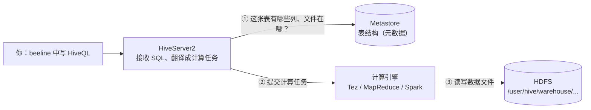
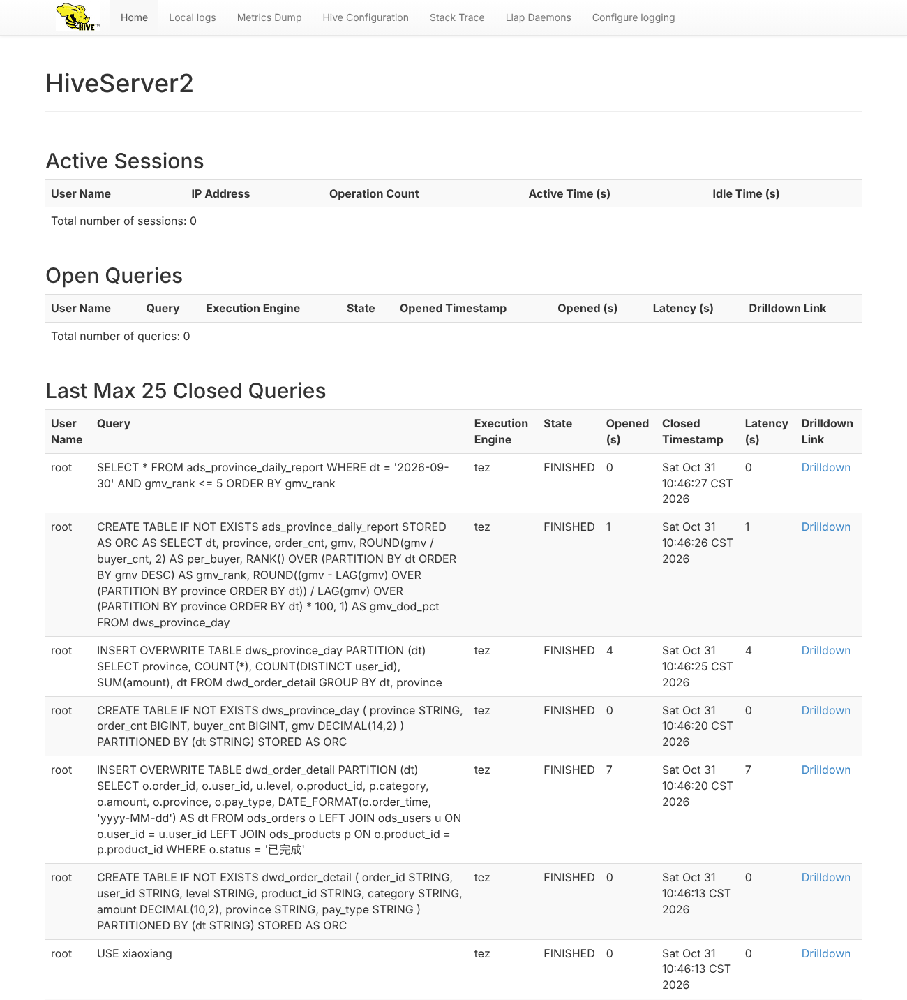
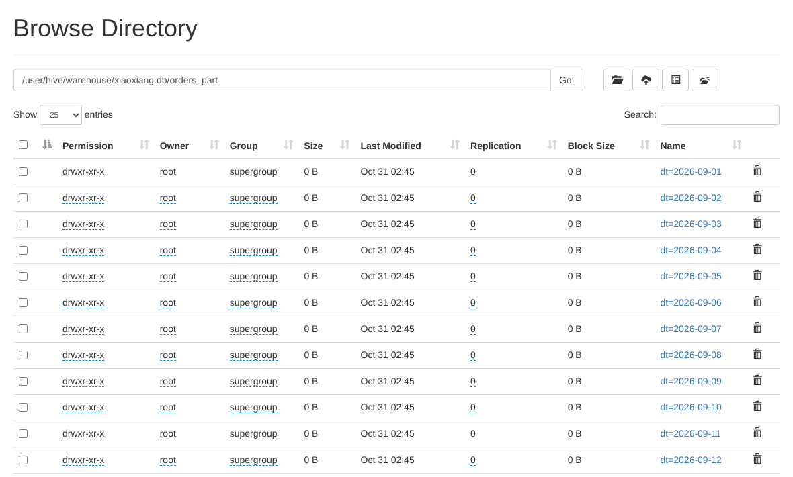
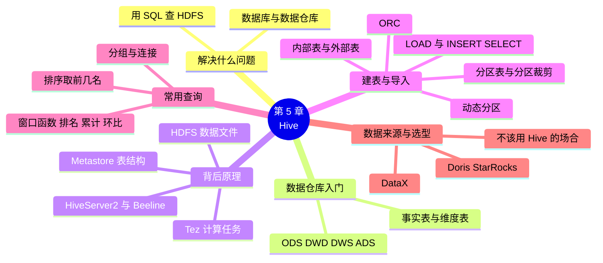

# 第 5 章 Hive 数据仓库

!!! abstract "本章学时"
    理论 6 学时 · 实验 1 学时（本章共 3 个实验，教师可任选）

## 学习目标

学完本章，你应该能够：

1. **说出** Hive 解决的问题，以及 Metastore、HDFS、计算引擎在执行一条 HiveQL 时各做什么（记忆、理解）；
2. **区分**数据库和数据仓库、事实表和维度表，说出 ODS、DWD、DWS、ADS 四层各放什么数据（理解）；
3. **编写** HiveQL 建内部表、外部表和分区表，用 LOAD 和 INSERT…SELECT 导入数据（应用）；
4. **编写**分组统计、多表连接、排序取前几名和窗口函数（排名、累计、环比）查询，完成小象优选的销售统计（应用）；
5. **判断**一条查询能否用上分区，以及一项任务适不适合用 Hive 来做（分析、评价）。

!!! info "先修要求"
    学习本章前，你需要掌握：

    - 用 `hdfs dfs` 命令上传、查看文件，知道 HDFS 上的文件是怎样存放的（[第 3 章 HDFS 分布式文件系统](../03-hdfs/index.md)）；
    - MapReduce 把一个计算拆成 Map 和 Reduce 两步、分组统计要经过 Shuffle（[第 4 章 MapReduce 与 YARN](../04-mapreduce-yarn/index.md)）；
    - SQL 的 `SELECT`、`WHERE`、`GROUP BY`、`JOIN`、`ORDER BY`（“数据库应用基础”课程）。

??? abstract "本章概念清单（21 个，点击查看定义和例子）"
    1. [Hive](../../appendix/glossary.md#g-Hive)
    2. [HiveQL](../../appendix/glossary.md#g-HiveQL)
    3. [数据仓库](../../appendix/glossary.md#g-数据仓库)
    4. [ODS](../../appendix/glossary.md#g-ODS)
    5. [DWD](../../appendix/glossary.md#g-DWD)
    6. [DWS](../../appendix/glossary.md#g-DWS)
    7. [ADS](../../appendix/glossary.md#g-ADS)
    8. [事实表](../../appendix/glossary.md#g-事实表)
    9. [维度表](../../appendix/glossary.md#g-维度表)
    10. [Metastore](../../appendix/glossary.md#g-Metastore)
    11. [HiveServer2](../../appendix/glossary.md#g-HiveServer2)
    12. [Beeline](../../appendix/glossary.md#g-Beeline)
    13. [Tez](../../appendix/glossary.md#g-Tez)
    14. [内部表](../../appendix/glossary.md#g-内部表)
    15. [外部表](../../appendix/glossary.md#g-外部表)
    16. [分区表](../../appendix/glossary.md#g-分区表)
    17. [分区裁剪](../../appendix/glossary.md#g-分区裁剪)
    18. [动态分区](../../appendix/glossary.md#g-动态分区)
    19. [ORC](../../appendix/glossary.md#g-ORC)
    20. [窗口函数](../../appendix/glossary.md#g-窗口函数)
    21. [DataX](../../appendix/glossary.md#g-DataX)

## 情景导入

运营部的小林每周都要找数据组要报表：“上周各品类卖了多少？”“哪个省的客单价最高？”数据组的同事每次都得写一段 MapReduce 程序，从几百 MB 的订单文件里统计，改一个统计口径就要改代码、重新提交作业，一来一回要大半天。

小林学过一点 SQL，忍不住问：“数据要是在 MySQL 里，我自己写一句 `GROUP BY` 不就出来了？”数据组长说：“订单和日志一个月就是几亿行，MySQL 装不下，所以才放在 HDFS 上。不过有个工具叫 Hive，能让你直接用 SQL 查 HDFS 上的文件，它在背后替你生成计算任务。”

本章就来学 Hive。我们先弄清 Hive 解决什么问题、数据仓库是什么；再看一条 SQL 在 Hive 里经历了什么；然后学习建表、导入和常用查询，把小象优选的订单、用户、商品三张表搬进 Hive，统计各品类的销售额；最后按企业数据仓库的分层方法，加工出一张“每日各省销售日报”。

## 5.1 Hive 解决什么问题

### 5.1.1 用 SQL 查询 HDFS 上的大数据

第 4 章统计每小时浏览量，要写 mapper 和 reducer 两个程序，还要想清楚 Map 输出什么、Reduce 怎样汇总。同样的问题，如果数据在一张表里，一句 SQL 就够了：

```sql
SELECT HOUR(log_time) AS h, COUNT(*) AS pv
FROM access_log
GROUP BY HOUR(log_time);
```

会写 SQL 的人远比会写 MapReduce 的人多。2008 年前后，Facebook 每天新增的数据已经到了 TB 级，分析师们需要一个用 SQL 就能查 Hadoop 数据的工具，于是开发了 [**Hive**](../../appendix/glossary.md#g-Hive "建立在 Hadoop 上的数据仓库工具，把 HDFS 上的文件看成表，用类似 SQL 的语言查询，在背后把 SQL 翻译成分布式计算任务"){ .term }，后来捐给了 Apache 基金会。<sup class="cite">[[1]](#ref5-1)</sup> Hive 的做法是：

- 把 HDFS 上的文件“看成”一张表，表有哪些列、每列什么类型、文件在哪个目录，单独记录下来；
- 提供一种和 SQL 几乎一样的查询语言 [**HiveQL**](../../appendix/glossary.md#g-HiveQL "Hive 的查询语言，写法和标准 SQL 几乎一样，另有分区、存储格式等 Hive 特有的语法"){ .term }，你写 SQL，Hive 把它翻译成分布式计算任务，交给集群执行。

这样，数据还是那些文件，存在 HDFS 上，不用搬家；会 SQL 的人就能直接分析，不用写一行 Java 或 Python。

### 5.1.2 数据库和数据仓库

学过 MySQL 的同学可能会问：Hive 也用 SQL，它和 MySQL 有什么区别？这要从数据库和[**数据仓库**](../../appendix/glossary.md#g-数据仓库 "汇集多个业务系统的历史数据、专门用于统计分析和决策支持的数据存储，以批量读取和汇总为主，很少修改"){ .term }的区别说起。

| 比较项 | 数据库（如 MySQL） | 数据仓库（如 Hive） |
|---|---|---|
| 主要用途 | 支撑业务系统运行：下单、付款、改地址 | 支撑分析决策：报表、统计、挖掘 |
| 典型操作 | 频繁地增删改单条记录，要求毫秒级响应 | 一次扫描几百万、几亿行做汇总，几秒到几分钟出结果都可以 |
| 数据范围 | 当前的业务数据 | 多个系统汇集来的、几年的历史数据 |
| 数据会不会改 | 经常修改 | 基本只追加，很少修改 |
| 小象优选的例子 | 下单时写入一条订单记录 | 统计 9 月各品类、各省的销售额 |

一句话：数据库管“做生意”，数据仓库管“看生意”。Hive 是建立在 Hadoop 上的数据仓库工具，它擅长对海量历史数据做批量统计，但**不适合**做单条记录的实时增删改，一条最简单的查询也要几秒钟。所以企业通常两者都用：业务系统用 MySQL，每天夜里把数据同步到 Hive 里做分析。

## 5.2 数据仓库入门

### 5.2.1 数据仓库为什么要分层

数据组长打开公司的 Hive，里面有几百张表，表名都带着 `ods_`、`dwd_`、`dws_`、`ads_` 这样的前缀。这是数据仓库的**分层**。直接拿原始数据做报表看似省事，但每张报表都要从头清洗一遍，口径还容易不一致；分层之后，每一层只做一件事，下一层在上一层的基础上加工，清洗好的数据可以被很多张报表共用。

国内企业最常见的是四层：<sup class="cite">[[2]](#ref5-2)</sup>

| 层 | 全称 | 放什么 | 小象优选的例子 |
|---|---|---|---|
| [**ODS**](../../appendix/glossary.md#g-ODS "数据仓库的操作数据层，原样存放从业务系统同步来的数据"){ .term } 层 | 操作数据层（Operational Data Store） | 从业务系统原样同步来的数据，不做修改 | `ods_orders`：订单表的原始 CSV |
| [**DWD**](../../appendix/glossary.md#g-DWD "数据仓库的明细数据层，存放清洗、统一格式并补充常用字段后的明细数据"){ .term } 层 | 明细数据层（Data Warehouse Detail） | 清洗过的明细数据：去掉无效记录、统一格式、补上常用的字段 | `dwd_order_detail`：只留已完成订单，补上品类和会员等级 |
| [**DWS**](../../appendix/glossary.md#g-DWS "数据仓库的汇总数据层，存放按常用维度汇总好、供多张报表共用的数据"){ .term } 层 | 汇总数据层（Data Warehouse Summary） | 按常用维度汇总好的数据，供多张报表共用 | `dws_province_day`：每天每省的订单数、买家数、销售额 |
| [**ADS**](../../appendix/glossary.md#g-ADS "数据仓库的应用数据层，存放直接给报表、大屏或接口使用的结果"){ .term } 层 | 应用数据层（Application Data Service） | 直接给报表、大屏、接口用的结果 | `ads_province_daily_report`：每日各省销售日报 |

可以用做菜来理解：ODS 是从菜市场买回来的原材料，DWD 是洗好切好的净菜，DWS 是配好的半成品，ADS 是端上桌的菜。实验 5-3 会按这四层，一步步加工出日报。

### 5.2.2 事实表和维度表

数据仓库里的表还分两类：<sup class="cite">[[3]](#ref5-3)</sup>

- [**事实表**](../../appendix/glossary.md#g-事实表 "记录业务事件的表，一行是一次事件，带有金额、数量等可累加的数字，行数增长快"){ .term }记录发生过的业务事件，一行就是一次事件，带有可以累加的数字（金额、数量）。订单表就是事实表，每下一单多一行，行数增长很快。
- [**维度表**](../../appendix/glossary.md#g-维度表 "描述业务事件的角度（谁、什么、在哪）的表，行数相对少、变化慢"){ .term }记录描述这些事件的“角度”：谁买的、买的什么、在哪里。用户表、商品表是维度表，行数相对少，变化也慢。

统计时，通常是“事实表关联维度表，再按维度分组汇总”。例如“各品类的销售额”，就是订单（事实表）按 `product_id` 关联商品表（维度表），按商品表的 `category` 分组，对订单的 `amount` 求和。记住这个套路，大部分报表的 SQL 都能写出来。

## 5.3 看懂背后发生了什么

### 5.3.1 一张 Hive 表 = 表结构 + HDFS 上的文件

在 Hive 里执行 `SELECT * FROM ods_orders`，看起来和 MySQL 没有区别，背后却是三个部分在配合：



- [**Metastore**](../../appendix/glossary.md#g-Metastore "Hive 的元数据服务，保存库、表、列、类型、分区和数据所在目录等表结构信息"){ .term }（元数据服务）保存表结构：库名、表名、每列的名字和类型、数据文件在 HDFS 的哪个目录、用什么分隔符。它本身用一个关系数据库来存这些信息，随书环境用的是 Hive 自带的 Derby，企业里一般用 MySQL。
- **数据**就是 HDFS 上的普通文件。Hive 默认把表放在 `/user/hive/warehouse/库名.db/表名/` 目录下，也可以指定放在别的目录。用 `hdfs dfs -cat` 能直接看到文件内容。
- [**HiveServer2**](../../appendix/glossary.md#g-HiveServer2 "Hive 的服务端，接收客户端发来的 SQL，向 Metastore 查询表结构，再交给计算引擎执行"){ .term } 接收你的 SQL，问 Metastore 要表结构，把 SQL 翻译成计算任务交给**计算引擎**执行。早期的 Hive 只能翻译成 MapReduce 作业；现在的 Hive 默认用更快的 [**Tez**](../../appendix/glossary.md#g-Tez "Hive 默认使用的计算引擎，把一条 SQL 编排成由多个 Map、Reducer 步骤组成的计算图执行，比 MapReduce 少写中间结果"){ .term }，也可以配置成用 Spark。

所以 Hive 本身并不存数据，也不做计算，它是一个“翻译”：把 SQL 翻译成在 HDFS 数据上运行的分布式计算。理解了这一点，很多现象就好解释了：比如往表目录里直接放一个格式相同的文件，再查询时就能查到新数据；删掉 Metastore 里的表结构，HDFS 上的文件可能还在。

### 5.3.2 随书环境：在集群上加两个 Hive 容器

随书集群加了一个配置文件 `labs/cluster/docker-compose.hive.yml`，它在第 2 章的 Hadoop 集群旁边再启动两个容器，用的是 Apache 官方的 `apache/hive:4.2.1` 镜像：<sup class="cite">[[4]](#ref5-4)</sup>

| 容器 | 运行什么 | 端口 |
|---|---|---|
| metastore | Metastore 服务，表结构存在 Derby 数据库里（放在数据卷中，删掉容器也不丢） | 9083 |
| hiveserver2 | HiveServer2，接收 SQL，用 Tez 计算，读写集群 HDFS 上的数据 | 10000（连接）、10002（网页） |

启动和连接的方法：

```bash
cd labs/cluster
docker compose -f docker-compose.yml -f docker-compose.hive.yml up -d
# 等一分钟左右，HiveServer2 启动后，用 beeline 连上去
docker compose -f docker-compose.yml -f docker-compose.hive.yml exec hiveserver2 beeline -u jdbc:hive2://localhost:10000 -n root
```

[**Beeline**](../../appendix/glossary.md#g-Beeline "Hive 自带的命令行客户端，通过 JDBC 连接 HiveServer2 执行 HiveQL"){ .term } 是 Hive 自带的命令行客户端，出现 `0: jdbc:hive2://localhost:10000>` 提示符后就可以输入 HiveQL，每条语句以分号结尾。把写好的 SQL 放在文件里，可以用 `source /labs/ch05/文件名.sql;` 一次执行，输入 `!quit` 退出。

!!! note "随书环境做的两点简化"
    1. **Tez 在 hiveserver2 容器里以本地模式运行。**SQL 翻译成的计算任务在 hiveserver2 容器里执行，数据仍然从集群的 HDFS 读写。这样只多占一个容器的内存，学生的笔记本也跑得动；代价是这些任务不会出现在 8088 网页上。在企业的集群里，Tez 任务会提交给 YARN，在各个 NodeManager 上运行，原理和第 4 章一样。
    2. **两个配置文件。**本章起需要 Hive 的命令都要带上 `-f docker-compose.yml -f docker-compose.hive.yml`。为了减少内存占用，本章不需要实验 2-3 加入的 worker3。

执行一条需要计算的查询时，Beeline 会显示一个进度表：

```text
        VERTICES      MODE        STATUS  TOTAL  COMPLETED  RUNNING  PENDING  FAILED  KILLED
----------------------------------------------------------------------------------------------
Map 1 .......... container     SUCCEEDED      1          1        0        0       0       0
Reducer 2 ...... container     SUCCEEDED      1          1        0        0       0       0
----------------------------------------------------------------------------------------------
VERTICES: 02/02  [==========================>>] 100%  ELAPSED TIME: 1.27 s
```

`Map 1`、`Reducer 2` 是 Tez 把这条 SQL 拆成的计算步骤：先由 Map 读文件、筛选、分组，再由 Reducer 汇总，和第 4 章的 MapReduce 是同一个思路。`TOTAL` 是每一步的任务数，数据越大任务越多。在浏览器打开 `http://localhost:10002`，HiveServer2 的网页上列出了最近执行过的 SQL、所用的引擎和耗时：



上图是编者完成实验 5-3 后的截图，最上面几行就是实验 5-3 加工日报的几条 SQL，耗时都在几秒以内。完成时间显示为 CST（中国标准时间），因为这个页面是服务器生成的，用的是容器设置的上海时区。

## 5.4 建表与导入

### 5.4.1 常用数据类型

Hive 的数据类型和 MySQL 差不多，本书用到的有这几种：<sup class="cite">[[5]](#ref5-5)</sup>

| 类型 | 存什么 | 小象优选的例子 |
|---|---|---|
| `STRING` | 文字，不用指定长度 | 订单号、省份、支付方式 |
| `INT` / `BIGINT` | 整数 / 很大的整数 | 购买数量、年龄 / 订单总数 |
| `DECIMAL(10,2)` | 精确小数，10 位数字中 2 位是小数 | 金额。不要用 `DOUBLE` 存钱，会有误差 |
| `DATE` / `TIMESTAMP` | 日期 / 日期加时间 | 注册日期 / 下单时间 `2026-09-01 00:00:50` |

### 5.4.2 内部表和外部表

建表时写不写 `EXTERNAL`，决定了这张表“管不管”数据文件：

```sql
-- 外部表：数据已经在 HDFS 上，表只是“指向”这个目录
CREATE EXTERNAL TABLE ods_orders (
  order_id STRING, user_id STRING, product_id STRING, quantity INT,
  amount DECIMAL(10,2), order_time TIMESTAMP, province STRING,
  pay_type STRING, status STRING
)
ROW FORMAT DELIMITED FIELDS TERMINATED BY ','   -- 文件中各列用逗号分隔
LOCATION '/xiaoxiang/ods/orders'                -- 数据文件所在的 HDFS 目录
TBLPROPERTIES ('skip.header.line.count'='1');   -- 跳过第一行表头
```

| 比较项 | [**内部表**](../../appendix/glossary.md#g-内部表 "由 Hive 管理数据的表，数据默认放在 warehouse 目录，删表时数据一起删除"){ .term }（也叫管理表） | [**外部表**](../../appendix/glossary.md#g-外部表 "用 `LOCATION` 指向已有 HDFS 目录的表，删表时只删表结构，数据文件保留"){ .term } |
|---|---|---|
| 建表 | `CREATE TABLE` | `CREATE EXTERNAL TABLE ... LOCATION '目录'` |
| 数据放哪 | 默认在 `/user/hive/warehouse/库名.db/表名/` | `LOCATION` 指定的目录，一般是已有的数据 |
| `DROP TABLE` 时 | 表结构和数据文件**一起删除** | 只删表结构，**数据文件还在** |
| 适合 | Hive 自己加工出来的中间表、结果表 | ODS 层的原始数据，或者别的程序也要用的数据 |

实验 5-1 第 5 步会亲手验证：两张表都删掉以后，外部表的文件还在，内部表的目录不见了。原始数据用外部表，就不怕误删表时把数据也删掉。

!!! note "Hive 4 里内部表显示为 EXTERNAL_TABLE"
    在 Hive 4 中执行 `DESCRIBE FORMATTED` 查看一张用 `CREATE TABLE` 建的文本格式表，“Table Type”一栏显示的是 `EXTERNAL_TABLE`，同时多了一个属性 `external.table.purge = TRUE`。这是因为 Hive 4 规定真正的“管理表”必须支持事务，不支持事务的表会被自动转成“删表时连数据一起清除（purge）”的外部表。效果和内部表一样：编者实测，`DROP TABLE` 后它在 warehouse 下的目录被删除了。判断删表会不会删数据，看 `external.table.purge` 就行。

### 5.4.3 分区表

小象优选每天新增几万条订单，一年下来几千万行。可是大多数报表只看某一天或某一周，如果每次都把一年的数据全部读一遍，又慢又浪费。[**分区表**](../../appendix/glossary.md#g-分区表 "按某个字段的值把数据存放在表目录下不同子目录中的表，每个值一个分区"){ .term }的办法是：按某个字段（通常是日期）把数据分开存放，每个值一个子目录。

```sql
CREATE TABLE orders_part ( ...和 ods_orders 相同的 9 列... )
PARTITIONED BY (dt STRING);       -- 分区字段 dt 不写在上面的括号里
```

写入数据后，HDFS 上的目录是这样的：



每个 `dt=日期` 子目录就是一个分区，存着这一天的订单。查询时如果 `WHERE` 条件里有分区字段，例如 `WHERE dt = '2026-09-15'`，Hive 只读这一个目录，其他目录直接跳过，这叫[**分区裁剪**](../../appendix/glossary.md#g-分区裁剪 "查询条件中有分区字段时，只读取符合条件的分区目录、跳过其余分区"){ .term }。实验 5-2 中，编者对 300 万行订单做了对比：

| 查询 | 读了多少行 | 耗时 |
|---|---|---|
| 不分区的表，查 9 月 15 日 | 3,000,000（全部） | 约 7.2 秒 |
| 分区表，查 9 月 15 日 | 99,888（1 个分区） | 约 1.0 秒 |
| 分区表，查整个月 | 约 300 万（30 个分区） | 约 3.7 秒 |

用好分区，要注意三点：

1. **按最常用的查询条件分区。**报表大多按日期查，就按日期分区。如果条件里没有分区字段（比如只按省份筛选），分区帮不上忙，照样要读全部目录。
2. **分区不能太细。**按“日期 + 用户”分区会产生几百万个小目录和小文件，又回到了第 3 章说的小文件问题。一般按天分区就够了。
3. **分区字段是“虚拟”的列。**`dt` 的值不存在数据文件里，而是从目录名得来的，查询时可以像普通列一样使用。

下面的动画用实验 5-2 的真实数据，比较带不带分区条件时要读的数据量：

<iframe class="sim-frame" src="../../sims/partition-query/main.html" height="760" loading="lazy" title="分区表查询"></iframe>

选“某一天”和分区表，按“执行查询”，只有一个格子变蓝；换成不分区的表，整个文件都要读；再试试“只按省份筛选”，看分区为什么帮不上忙。[全屏打开](../../sims/partition-query/main.html){ target=_blank }

### 5.4.4 把数据导入表

往 Hive 表里放数据，常用三种办法：

| 办法 | 写法 | 说明 |
|---|---|---|
| 建外部表指向已有目录 | `CREATE EXTERNAL TABLE ... LOCATION '/目录'` | 数据不动，最常用于 ODS 层 |
| `LOAD DATA` | `LOAD DATA INPATH '/tmp/products.csv' INTO TABLE 表名;` | 把 HDFS 上的文件**移动**到表的目录（原位置的文件就没有了）；写 `LOCAL INPATH` 则从 HiveServer2 所在机器的本地磁盘复制 |
| `INSERT … SELECT` | `INSERT OVERWRITE TABLE 新表 SELECT ... FROM 旧表;` | 把一条查询的结果写进另一张表，DWD、DWS、ADS 层都这样加工。`OVERWRITE` 覆盖原有数据，`INTO` 追加 |

往分区表里写数据时，可以让 Hive 按每行的日期自动放进对应的分区，这叫[**动态分区**](../../appendix/glossary.md#g-动态分区 "写入分区表时，按每行数据中分区字段的值自动把它放进对应分区"){ .term }：

```sql
SET hive.exec.dynamic.partition.mode=nonstrict;   -- 允许全部分区都动态决定
INSERT OVERWRITE TABLE orders_part PARTITION (dt)
SELECT order_id, user_id, product_id, quantity, amount, order_time,
       province, pay_type, status,
       DATE_FORMAT(order_time, 'yyyy-MM-dd') AS dt   -- 分区字段放在最后
FROM ods_orders_big;
```

编者运行这条语句，300 万行用了约 34 秒，自动建出 30 个分区。

**存储格式。**ODS 层的 CSV 是文本格式，便于查看，但又大又慢。加工后的表一般用列式存储格式 [**ORC**](../../appendix/glossary.md#g-ORC "一种列式存储文件格式，按列压缩存放，查询时只读需要的列，Hive 加工表常用"){ .term }（建表时加 `STORED AS ORC`），它按列压缩存放，查询时只读用到的列。实验 5-3 中，10 万行订单的 CSV 约 8 MB，加工成 ORC 格式的 DWD 表只有约 1.1 MB（列也少了一些）。

## 5.5 常用查询

HiveQL 的查询写法和 MySQL 基本一样，本节用小象优选的数据把最常用的几种写一遍。

### 5.5.1 分组统计和多表连接

“事实表关联维度表，再分组汇总”是最常见的统计。各品类的已完成订单销售额：

```sql
SELECT p.category,
       COUNT(*)      AS order_cnt,
       SUM(o.amount) AS gmv
FROM ods_orders o
JOIN ods_products p ON o.product_id = p.product_id
WHERE o.status = '已完成'
GROUP BY p.category
ORDER BY gmv DESC;
```

编者的运行结果（2 秒多出结果）：

```text
+-------------+------------+--------------+
| p.category  | order_cnt  |     gmv      |
+-------------+------------+--------------+
| 手机数码     | 18587      | 97860811.40  |
| 家用电器     | 13056      | 22053946.80  |
| 服饰鞋包     | 13338      | 10461943.70  |
| 家居日用     | 10563      | 3221405.30   |
| 美妆个护     | 7556       | 3093701.20   |
| 母婴玩具     | 4858       | 2821223.50   |
| 食品生鲜     | 17062      | 2027059.00   |
| 图书文具     | 4888       | 469955.50    |
+-------------+------------+--------------+
```

手机数码订单不到两成，销售额却占了七成多；食品生鲜订单多，但单价低。这就是分析的价值。

`JOIN` 默认是内连接，两边都匹配上的行才保留；`LEFT JOIN` 保留左表的全部行，右表匹配不上的列为 `NULL`。加工 DWD 层时常用 `LEFT JOIN`，避免因为维度表缺数据而丢了订单。

### 5.5.2 排序取前几名

“销售额前 10 的商品”这类排行榜，用 `ORDER BY ... LIMIT`：

```sql
SELECT product_id, SUM(amount) AS gmv
FROM ods_orders WHERE status = '已完成'
GROUP BY product_id
ORDER BY gmv DESC
LIMIT 10;
```

`ORDER BY` 要把所有数据汇总到一个 Reducer 里排序，数据很大时会很慢，所以一定要配合 `LIMIT` 使用。Hive 还有一个 `SORT BY`，它只在每个 Reducer 内部排序，结果整体是无序的，做排行榜时不要用错。

### 5.5.3 窗口函数：排名、累计和环比

“每天销售额前 3 的省份”“截至每天的累计销售额”“和前一天比增长了多少”，这类问题要在**保留每一行**的同时，看到同组其他行的数据。`GROUP BY` 做不到，因为它把每组压成一行；这时要用[**窗口函数**](../../appendix/glossary.md#g-窗口函数 "在保留每一行的同时，对同一组的若干行做计算的函数，写成 `函数() OVER (PARTITION BY ... ORDER BY ...)`"){ .term }：<sup class="cite">[[6]](#ref5-6)</sup>

```sql
函数() OVER (PARTITION BY 分组列 ORDER BY 排序列)
```

`PARTITION BY` 说明在哪个范围内计算（注意它和分区表的“分区”是两回事），`ORDER BY` 说明按什么顺序。常用的有三类：

| 用途 | 写法 | 含义 |
|---|---|---|
| 排名 | `RANK() OVER (PARTITION BY dt ORDER BY gmv DESC)` | 每天内按销售额从高到低排名，并列时跳号（1、1、3）；`DENSE_RANK` 不跳号（1、1、2）；`ROW_NUMBER` 不并列（1、2、3） |
| 累计 | `SUM(gmv) OVER (PARTITION BY province ORDER BY dt)` | 每个省从月初到当天的累计销售额 |
| 环比 | `LAG(gmv) OVER (PARTITION BY province ORDER BY dt)` | 同一个省前一天的销售额；再算 (当天 − 前一天) ÷ 前一天，就是日环比 |

实验 5-3 用这三种函数做出了 9 月 30 日的各省销售日报，前 5 名是：

```text
+-------------+-----------+------------+------------+------------+-----------+--------------+
|     dt      | province  | order_cnt  |    gmv     | per_buyer  | gmv_rank  | gmv_dod_pct  |
+-------------+-----------+------------+------------+------------+-----------+--------------+
| 2026-09-30  | 广东       | 282        | 417412.70  | 1569.22    | 1         | 2.1          |
| 2026-09-30  | 山东       | 230        | 396579.00  | 1827.55    | 2         | 37.4         |
| 2026-09-30  | 河南       | 229        | 346879.40  | 1683.88    | 3         | -3.8         |
| 2026-09-30  | 四川       | 156        | 256527.60  | 1793.90    | 4         | -31.3        |
| 2026-09-30  | 河北       | 151        | 243988.50  | 1718.23    | 5         | -8.4         |
+-------------+-----------+------------+------------+------------+-----------+--------------+
```

`gmv_dod_pct` 是比前一天增长的百分比：山东比 9 月 29 日涨了 37.4%，四川跌了 31.3%。第 8 章会在 Spark SQL 中更系统地练习窗口函数，并配有动画演示每一行的结果是怎样算出来的。

!!! example "算一算：并列时排第几"
    某天四个省的销售额是：广东 50 万、山东 40 万、河南 40 万、四川 30 万。分别用 `RANK`、`DENSE_RANK`、`ROW_NUMBER` 排名，四川排第几？

    **答：**`RANK` 时广东 1、山东和河南都是 2、四川 4；`DENSE_RANK` 时四川 3；`ROW_NUMBER` 时山东和河南按数据中的先后排成 2 和 3，四川 4。要取“前 3 名”时，三种写法的结果可能不同，要根据业务要求选择。

## 5.6 数据从哪来，什么时候不该用 Hive

### 5.6.1 用 DataX 从 MySQL 导数据进 Hive

前面的数据是 CSV 文件，直接上传到 HDFS 就行。实际工作中，订单、用户数据在业务系统的 MySQL 里，每天要同步到数据仓库的 ODS 层。这类同步工具中，国内用得最多的是阿里巴巴开源的 [**DataX**](../../appendix/glossary.md#g-DataX "阿里巴巴开源的离线数据同步工具，用读插件和写插件在 MySQL、HDFS、Hive 等数据源之间搬运数据"){ .term }。它是一个离线数据同步工具，用“读插件（Reader）+ 写插件（Writer）”的方式，在 MySQL、Oracle、HDFS、Hive 等几十种数据源之间搬运数据。<sup class="cite">[[7]](#ref5-7)</sup>

一个同步任务用一个 JSON 配置文件描述，大致是这样（省略了列定义、写入方式等参数）：

```json
{
  "job": {
    "content": [{
      "reader": { "name": "mysqlreader",
                  "parameter": { "username": "...", "password": "...",
                                 "connection": [{ "jdbcUrl": ["jdbc:mysql://业务库:3306/shop"],
                                                  "querySql": ["SELECT * FROM orders WHERE DATE(order_time) = '2026-09-30'"] }] } },
      "writer": { "name": "hdfswriter",
                  "parameter": { "defaultFS": "hdfs://master:8020",
                                 "path": "/xiaoxiang/ods/orders/dt=2026-09-30",
                                 "fileType": "text", "fieldDelimiter": "," } }
    }]
  }
}
```

读插件从 MySQL 查出 9 月 30 日的订单，写插件把它写成 HDFS 上 ODS 表的一个分区目录，再执行 `ALTER TABLE ods_orders ADD PARTITION (dt='2026-09-30')` 让 Hive 知道多了一个分区。每天凌晨由调度系统自动运行一次，数据仓库就每天都有前一天的数据。本书不要求动手搭 DataX，知道数据是这样“流进”数据仓库的就可以了。

### 5.6.2 什么时候不该用 Hive

Hive 很方便，但不是什么都适合：

| 场合 | 适合用 Hive 吗 | 更好的选择 |
|---|---|---|
| 每天对几千万、几亿行历史数据跑报表 | 适合 | — |
| 只有几万、几十万行数据 | 不必要，每条查询都要几秒的启动时间 | MySQL 或 pandas |
| 查一个用户的订单、毫秒级返回 | 不适合 | MySQL 等数据库 |
| 频繁修改、删除单条记录 | 不适合（Hive 4 的事务表能做，但很慢） | 数据库 |
| 业务人员在大屏上点来点去，要求一两秒内出结果 | 不太适合 | Doris、StarRocks 等分析型数据库（见 5.7 节） |
| 复杂的清洗、机器学习 | 能写，但很难写 | Spark（第 6～10 章） |

## 5.7 前沿视窗

**更快的查询引擎。**Hive 把 SQL 翻译成批处理任务，适合“跑一夜出报表”，却很难做到“点一下马上出结果”。为此出现了一批专门为交互式分析设计的引擎，它们大多采用 MPP（大规模并行处理）架构，各节点同时计算、数据在内存中流转，常见查询能在一秒以内返回。

- **Spark SQL**：第 8 章要学的 Spark SQL，也能直接读 Hive 的表，速度通常比 Hive on MapReduce 快得多，是目前离线数据处理的主力。
- **Apache Doris**：最早由百度为广告报表开发，2018 年捐给 Apache 基金会。它兼容 MySQL 协议，用 MySQL 客户端就能连接，还能直接查询 Hive 等数据湖中的数据。<sup class="cite">[[8]](#ref5-8)</sup>
- **StarRocks**：同样是兼容 MySQL 协议的 MPP 分析型数据库，现为 Linux 基金会旗下的开源项目，可以通过外部 Catalog 直接分析数据湖中的数据。<sup class="cite">[[9]](#ref5-9)</sup>

这两个国产开源项目在国内互联网、金融企业中应用很广，常见的组合是：Hive 或 Spark 负责夜间的批量加工，把 ADS 层的结果导入 Doris 或 StarRocks，供报表和大屏实时查询。无论用哪个引擎，本章学的建表、分区、分层和窗口函数都是相通的。想在虚拟机中从零安装 Hive、练习更多 HiveQL，可以参考林子雨编写的实验教程中 Hive 一章。<sup class="cite">[[10]](#ref5-10)</sup>

## 本章实验

!!! abstract "实验总览"
    | 实验 | 类型 | 建议时长 | 内容 |
    |---|---|---|---|
    | 实验 5-1 | ★ 基础 | 45 分钟 | 启动 Hive，为订单、用户、商品建外部表，统计各品类销售额和各会员等级的人均消费；比较内部表和外部表删表时的区别 |
    | 实验 5-2 | ★ 基础 | 30 分钟 | 把 300 万行订单按日期写入分区表，比较查询一天时分区表和不分区的表读的行数和耗时 |
    | 实验 5-3 | ☆ 拓展 | 40 分钟 | 按 ODS → DWD → DWS → ADS 加工“每日各省销售日报”，用窗口函数排名、算环比 |

    实验在第 2 章的 Docker 小集群（1 主 2 从）加上本章的两个 Hive 容器上进行，Docker 至少分配 8 GB 内存。实验代码见配套资源 `labs/ch05/` 目录。编者的运行环境：4 核 CPU、16 GB 内存的 Linux 主机，Docker 29.9，Hadoop 3.4.3 和 Hive 4.2.1 镜像。

### 实验 5-1 ★ 建表、导入与统计

**实验目的**

1. 在随书集群上启动 Hive，用 Beeline 连接并执行 HiveQL；
2. 为 HDFS 上的 CSV 文件建外部表，学会 `skip.header.line.count` 等常用的建表写法；
3. 用分组统计和多表连接完成小象优选的销售统计；
4. 验证内部表和外部表删表时对数据文件的不同影响。

**实验环境**：随书 Hadoop 集群 + `docker-compose.hive.yml` 中的 metastore、hiveserver2 两个容器。

**实验数据**：`labs/data/xiaoxiang/` 下的 `orders.csv`（10 万行）、`users.csv`（10 万行）、`products.csv`（2000 行）。

**实验步骤与代码**

第 1 步，启动集群和 Hive。第一次启动 Hive 时要初始化元数据库，大约需要 1 分钟：

```bash
cd labs/cluster
docker compose -f docker-compose.yml -f docker-compose.hive.yml up -d
docker compose -f docker-compose.yml -f docker-compose.hive.yml ps
```

5 个容器（master、worker1、worker2、metastore、hiveserver2）都是 `Up` 状态后，在浏览器打开 `http://localhost:10002`，能看到 HiveServer2 的网页就说明启动好了。

第 2 步，把三张表的数据放到 HDFS 上，每张表一个目录（外部表的 `LOCATION` 必须是目录）：

```bash
docker compose exec master bash
hdfs dfs -mkdir -p /xiaoxiang/ods/orders /xiaoxiang/ods/users /xiaoxiang/ods/products
hdfs dfs -put -f /labs/data/xiaoxiang/orders.csv /xiaoxiang/ods/orders/
hdfs dfs -put -f /labs/data/xiaoxiang/users.csv /xiaoxiang/ods/users/
hdfs dfs -put -f /labs/data/xiaoxiang/products.csv /xiaoxiang/ods/products/
hdfs dfs -put -f /labs/data/xiaoxiang/products.csv /tmp/      # 第 5 步要用
exit
```

第 3 步，用 Beeline 连接 Hive，执行建表脚本 `lab5_1_create.sql`（建库、建三张外部表，并查看表结构和前 3 行）：

```bash
docker compose -f docker-compose.yml -f docker-compose.hive.yml exec hiveserver2 beeline -u jdbc:hive2://localhost:10000 -n root
```

```sql
source /labs/ch05/lab5_1_create.sql;
```

脚本中订单表的建表语句见 5.4.2 节，用户表和商品表写法相同。屏幕上会滚过很多以 `INFO` 开头的日志，看表格形式的输出即可。

第 4 步，执行统计脚本 `lab5_1_query.sql`，它包含三条查询：各订单状态的订单数、各品类的已完成订单销售额（5.5.1 节）、各会员等级的人均消费：

```sql
source /labs/ch05/lab5_1_query.sql;
```

第 5 步，比较内部表和外部表。脚本 `lab5_1_tabletype.sql` 用 `LOAD DATA` 把 `/tmp/products.csv` 装进一张内部表 `products_managed`，再建一张指向 `/xiaoxiang/ods/products` 的外部表 `products_ext`，最后把两张表都删掉：

```sql
source /labs/ch05/lab5_1_tabletype.sql;
!quit
```

退出 Beeline 后，到 HDFS 上看文件还在不在：

```bash
docker compose exec master hdfs dfs -ls /tmp/products.csv
docker compose exec master hdfs dfs -ls /user/hive/warehouse/xiaoxiang.db/
docker compose exec master hdfs dfs -ls /xiaoxiang/ods/products
```

**运行结果**

第 3 步，三张表建好，订单表共 100000 行，前 3 行如下（时间后面的 `.0` 是 `TIMESTAMP` 类型的显示方式）：

```text
+--------------+-----------+-------------+-----------+---------+------------------------+-----------+-----------+---------+
| order_id     | user_id   | product_id  | quantity  | amount  | order_time             | province  | pay_type  | status  |
+--------------+-----------+-------------+-----------+---------+------------------------+-----------+-----------+---------+
| o000000001   | u0071359  | p01886      | 2         | 59.80   | 2026-09-01 00:00:50.0  | 山东       | 支付宝     | 已完成   |
| o000000002   | u0075719  | p00876      | 3         | 2405.70 | 2026-09-01 00:01:16.0  | 福建       | 支付宝     | 已完成   |
| o000000003   | u0091699  | p01073      | 2         | 95.80   | 2026-09-01 00:05:53.0  | 湖南       | 支付宝     | 已完成   |
+--------------+-----------+-------------+-----------+---------+------------------------+-----------+-----------+---------+
```

（实际显示的列名带有表名前缀，如 `ods_orders.order_id`，这里省略了。）

第 4 步，三条查询各用 2 秒左右。各品类销售额见 5.5.1 节；订单状态和会员等级的结果如下：

```text
+---------+--------+        +----------+---------+------------+
| status  |  cnt   |        | u.level  | buyers  | per_buyer  |
+---------+--------+        +----------+---------+------------+
| 已取消   | 7046   |        | 黄金      | 7217    | 2949.37    |
| 已完成   | 89908  |        | 白银      | 12181   | 2921.11    |
| 已退款   | 3046   |        | 普通      | 26925   | 2905.68    |
+---------+--------+        | 钻石      | 2402    | 2875.48    |
                            +----------+---------+------------+
```

近九成订单已完成。四个会员等级的人均消费都在 2900 元上下，差别不大，说明会员等级和消费金额关系不明显（这是模拟数据的特点，真实业务中值得进一步分析）。

第 5 步，`LOAD DATA` 后 `products_managed` 有 2000 行，`DESCRIBE FORMATTED` 显示它的位置是 `hdfs://master:8020/user/hive/warehouse/xiaoxiang.db/products_managed`，类型为 `EXTERNAL_TABLE`、`external.table.purge` 为 `TRUE`（见 5.4.2 节的说明）。删表后在 HDFS 上查看：

```text
ls: `/tmp/products.csv': No such file or directory          ← LOAD DATA 把文件移走了
（warehouse/xiaoxiang.db/ 下没有 products_managed 目录）       ← 内部表删表时数据一起删了
-rw-r--r--   2 root supergroup  98932 ... /xiaoxiang/ods/products/products.csv   ← 外部表删了，文件还在
```

**实验记录表**

| 观察内容 | 你的结果 |
|---|---|
| 订单表总行数、已完成订单数 | |
| 销售额最高的品类和金额；订单数最多的品类 | |
| 人均消费最高的会员等级 | |
| 删表后 `/tmp/products.csv`、内部表目录、外部表目录是否存在 | |

**常见问题排查**

| 现象 | 原因 | 解决办法 |
|---|---|---|
| `Could not open client transport ... Connection refused` | HiveServer2 还没启动好 | 等一两分钟再连；`docker compose ... logs hiveserver2` 查看日志 |
| hiveserver2 容器不断重启，日志中有 `schemaTool failed` | 元数据库初始化失败，常见于上次异常退出 | `docker compose -f docker-compose.yml -f docker-compose.hive.yml down`，再 `docker volume rm bigdata_hive-meta` 后重新启动（表结构会清空，HDFS 上的数据还在） |
| 查询结果全是 `NULL` | 分隔符写错，整行被当成了第一列 | 检查 `FIELDS TERMINATED BY ','` |
| 第一行是 `order_id`、`user_id` 这样的表头 | 没有跳过表头 | 建表时加 `TBLPROPERTIES ('skip.header.line.count'='1')` |
| `Table not found` | 没有 `USE xiaoxiang;`，或表没建成功 | 先 `USE xiaoxiang;`，再 `SHOW TABLES;` 确认 |
| 一条 SQL 末尾的注释导致下一条语句没执行 | `source` 执行文件时，分号后同一行的注释会影响解析 | 注释单独占一行 |

**思考与练习**

1. 写一条 SQL，统计各省份已完成订单的订单数和销售额，取销售额前 5 名。
2. 如果直接用 `hdfs dfs -put` 往 `/xiaoxiang/ods/orders/` 再放一个格式相同的 CSV 文件，`SELECT COUNT(*) FROM ods_orders` 的结果会变吗？为什么？

**实验报告要求**

提交第 4 步三条查询的结果截图、第 5 步删表后 HDFS 查看结果的截图和实验记录表，附上思考与练习第 1 题的 SQL 和结果。

### 实验 5-2 ★ 分区表

**实验目的**

1. 建分区表，用动态分区把数据按日期写入各个分区；
2. 在 HDFS 上查看分区的目录结构；
3. 比较查询一天的数据时，分区表和不分区的表读的行数和耗时，理解分区裁剪。

**实验环境**：同实验 5-1。

**实验数据**：实验 1-1 生成的 300 万行订单 `labs/data/scale/orders_3000000.csv`（240 MB）。如果没有这个文件，在 `labs` 目录下运行 `python ch01/lab1_1_data_size.py --max 3000000` 生成。

**实验步骤与代码**

第 1 步，把 300 万行订单放到 HDFS 上：

```bash
cd labs/cluster
docker compose exec master hdfs dfs -mkdir -p /xiaoxiang/ods/orders_big
docker compose exec master hdfs dfs -put -f /labs/data/scale/orders_3000000.csv /xiaoxiang/ods/orders_big/
```

第 2 步，连接 Beeline，执行 `lab5_2_partition.sql`。它为这个文件建一张不分区的外部表 `ods_orders_big`，再建分区表 `orders_part`，用动态分区写入（写法见 5.4.4 节），最后列出全部分区：

```sql
source /labs/ch05/lab5_2_partition.sql;
```

第 3 步，在 9870 网页上浏览 `/user/hive/warehouse/xiaoxiang.db/orders_part`，点开一个分区目录，看里面的文件和大小。

第 4 步，执行比较脚本 `lab5_2_compare.sql`。它先跑一个小查询“热身”（第一次查询要启动计算引擎，会多花几秒），然后依次执行三条查询：不分区的表查 9 月 15 日、分区表查 9 月 15 日、分区表查整个月：

```sql
source /labs/ch05/lab5_2_compare.sql;
```

每条查询执行完，日志中有一张统计表，找到 `INPUT_RECORDS`（读入的行数）一列；查询结果下方的 `1 row selected (x seconds)` 是耗时。建议把脚本执行两遍，记录第二遍的数字。

**运行结果**

第 2 步，`INSERT OVERWRITE` 用时约 34 秒，`SHOW PARTITIONS` 列出 `dt=2026-09-01` 到 `dt=2026-09-30` 共 30 个分区，日志中显示每个分区约 10 万行、8.1 MB，例如：

```text
Partition {dt=2026-09-30} stats: [numFiles=1, numRows=100021, totalSize=8484529, ...]
3,000,000 rows affected (34.446 seconds)
```

第 3 步的网页见 5.4.3 节的截图。

第 4 步，编者连续执行两遍，结果如下：

| 查询 | 结果（订单数 / 销售额） | Map 1 读入行数 | 第一遍耗时 | 第二遍耗时 |
|---|---|---|---|---|
| 不分区，查 9 月 15 日 | 99888 / 156773137.80 | 3,000,000 | 7.5 秒 | 7.2 秒 |
| 分区表，查 9 月 15 日 | 99888 / 156773137.80 | 99,888 | 1.4 秒 | 1.0 秒 |
| 分区表，查整个月 | 3000000 / 4747212188.00 | 约 298 万 | 3.9 秒 | 3.7 秒 |

两种表查同一天，结果完全一样，但分区表只读了 1 个分区，读入的行数是不分区表的约 3%，耗时只有约七分之一。查整个月时，分区表也要读全部 30 个分区。（读入行数显示约 298 万而不是 300 万，是计算引擎统计口径造成的，查询结果仍是 300 万行。）

**实验记录表**

| 观察内容 | 你的结果 |
|---|---|
| 分区个数；任选一个分区的文件大小 | |
| 不分区表查一天：读入行数、耗时 | |
| 分区表查一天：读入行数、耗时 | |
| 分区表查全月：读入行数、耗时 | |

**常见问题排查**

| 现象 | 原因 | 解决办法 |
|---|---|---|
| `Dynamic partition strict mode requires at least one static partition column` | 没有打开非严格模式 | 先执行 `SET hive.exec.dynamic.partition.mode=nonstrict;` |
| 分区值是一串时间或 `NULL` | `SELECT` 的最后一列不是日期 | 动态分区按 `SELECT` 的**最后一列**决定分区，检查 `DATE_FORMAT(...) AS dt` 是否在最后 |
| 写入时报内存不足、hiveserver2 容器退出 | Docker 分配的内存太少 | Docker Desktop 中把内存调到 8 GB 以上，关掉不用的程序 |
| 两种表的耗时差不多 | 数据量太小，或第一条查询包含了引擎启动时间 | 用 300 万行的数据；先执行“热身”查询，记录第二遍的耗时 |

**思考与练习**

1. 用分区表统计 9 月 15 日到 21 日这一周每天的订单数，看 `INPUT_RECORDS` 是多少，和你的估算一致吗？
2. 运营部最常查的是“某个省某个月的数据”，日期筛选反而很少用。这时应该按什么字段分区？按省份分区会有多少个分区？

**实验报告要求**

提交第 3 步的网页截图、第 4 步的输出截图（包含 `INPUT_RECORDS` 和耗时）和实验记录表，回答思考与练习的两个问题。

### 实验 5-3 ☆ 做一张销售日报

**实验目的**

1. 按 ODS → DWD → DWS → ADS 的分层方法加工数据，体会每一层的作用；
2. 用 `INSERT OVERWRITE ... SELECT` 和 `CREATE TABLE ... AS SELECT` 生成新表，使用 ORC 存储格式；
3. 用窗口函数 `RANK` 和 `LAG` 计算每天的排名和日环比。

**实验环境**：同实验 5-1，需要先完成实验 5-1 的建表。

**实验数据**：实验 5-1 的三张 ODS 表 `ods_orders`、`ods_users`、`ods_products`。

**实验步骤与代码**

第 1 步，打开 `labs/ch05/lab5_3_report.sql`，读懂每一段的作用。核心部分如下：

```sql
-- DWD：只留已完成的订单，补上品类和会员等级，按日期分区，存成 ORC
INSERT OVERWRITE TABLE dwd_order_detail PARTITION (dt)
SELECT o.order_id, o.user_id, u.level, o.product_id, p.category,
       o.amount, o.province, o.pay_type,
       DATE_FORMAT(o.order_time, 'yyyy-MM-dd') AS dt
FROM ods_orders o
LEFT JOIN ods_users u    ON o.user_id = u.user_id
LEFT JOIN ods_products p ON o.product_id = p.product_id
WHERE o.status = '已完成';

-- DWS：每天每省汇总成一行
INSERT OVERWRITE TABLE dws_province_day PARTITION (dt)
SELECT province, COUNT(*), COUNT(DISTINCT user_id), SUM(amount), dt
FROM dwd_order_detail
GROUP BY dt, province;

-- ADS：日报 = 当天排名 + 客单价 + 日环比
CREATE TABLE IF NOT EXISTS ads_province_daily_report STORED AS ORC AS
SELECT dt, province, order_cnt, gmv,
       ROUND(gmv / buyer_cnt, 2)                                   AS per_buyer,
       RANK() OVER (PARTITION BY dt ORDER BY gmv DESC)              AS gmv_rank,
       ROUND((gmv - LAG(gmv) OVER (PARTITION BY province ORDER BY dt))
             / LAG(gmv) OVER (PARTITION BY province ORDER BY dt) * 100, 1) AS gmv_dod_pct
FROM dws_province_day;
```

第 2 步，在 Beeline 中执行整个脚本，最后会显示 9 月 30 日销售额前 5 的省份：

```sql
source /labs/ch05/lab5_3_report.sql;
```

第 3 步，看各层数据在 HDFS 上占多大：

```bash
docker compose exec master hdfs dfs -du -h /user/hive/warehouse/xiaoxiang.db
```

**运行结果**

第 2 步，DWD 层写入 89,908 行（只有已完成的订单），用时约 8 秒；DWS 层写入 930 行（30 天 × 31 个省），约 6 秒；ADS 层 930 行，约 2 秒。日报结果见 5.5.3 节：9 月 30 日广东销售额第一（41.7 万元），山东环比增长 37.4%。

第 3 步，各层的大小（第一列是数据大小，第二列含副本）：

```text
10.6 K   21.2 K   /user/hive/warehouse/xiaoxiang.db/ads_province_daily_report
1.1 M    2.1 M    /user/hive/warehouse/xiaoxiang.db/dwd_order_detail
29.5 K   58.9 K   /user/hive/warehouse/xiaoxiang.db/dws_province_day
242.7 M  485.4 M  /user/hive/warehouse/xiaoxiang.db/orders_part
```

越往上层，数据越少、越接近报表：ODS 的订单 CSV 约 8 MB，DWD 层的 ORC 文件约 1.1 MB，DWS 层不到 30 KB，ADS 层只有约 10 KB。`orders_part` 是实验 5-2 的分区表（文本格式，300 万行）。

**实验记录表**

| 观察内容 | 你的结果 |
|---|---|
| DWD、DWS、ADS 三层各有多少行 | |
| 9 月 30 日销售额前 3 的省份和销售额 | |
| 9 月 30 日环比增长最多的省份（提示：按 `gmv_dod_pct` 排序） | |
| 各层在 HDFS 上的大小 | |

**常见问题排查**

| 现象 | 原因 | 解决办法 |
|---|---|---|
| `Table not found 'ods_orders'` | 没做实验 5-1，或不在 `xiaoxiang` 库中 | 先完成实验 5-1 第 2、3 步 |
| `ads_province_daily_report` 已存在，结果没更新 | `CREATE TABLE IF NOT EXISTS ... AS SELECT` 表已存在时不会重建 | 先 `DROP TABLE ads_province_daily_report;` 再执行 |
| 9 月 1 日的 `gmv_dod_pct` 是 `NULL` | 9 月 1 日没有“前一天”，`LAG` 返回 `NULL` | 正常现象 |
| 列名很长，带着表名前缀 | Hive 默认显示 `表名.列名` | 执行 `SET hive.resultset.use.unique.column.names=false;` |

**思考与练习**

1. 在 ADS 层再加一列“月初至今累计销售额”，用 `SUM(gmv) OVER (PARTITION BY province ORDER BY dt)` 实现，看广东 9 月 30 日的累计值是多少。
2. 运营部又要一张“每日各品类销售日报”。要从哪一层开始加工？需要新建哪些表？

**实验报告要求**

提交第 2 步的日报结果截图、第 3 步各层大小的截图和实验记录表，附上思考与练习第 1 题的 SQL 和结果，并用一两句话说明四层各做了什么。

## 本章小结

- **Hive** 把 HDFS 上的文件看成表，让人用和 SQL 几乎一样的 **HiveQL** 查询，在背后把 SQL 翻译成分布式计算任务。它是**数据仓库**工具，适合对海量历史数据做批量统计，不适合单条记录的实时增删改。
- 一张 Hive 表 = **Metastore** 中的表结构 + HDFS 上的数据文件。**HiveServer2** 接收 SQL、问 Metastore 要表结构，再交给计算引擎（随书环境用 **Tez**）执行。用 **Beeline** 连接 HiveServer2，`source 文件;` 可以一次执行一个 SQL 文件。
- 数据仓库常分四层：**ODS** 原样存放同步来的数据，**DWD** 存清洗后的明细，**DWS** 存按常用维度汇总的数据，**ADS** 存直接给报表用的结果。订单这类记录业务事件的是**事实表**，用户、商品这类描述角度的是**维度表**。
- **外部表**删表时只删表结构，适合原始数据；**内部表**删表时连数据一起删，适合加工出来的表（Hive 4 中显示为带 `external.table.purge=TRUE` 的外部表）。导入数据用外部表指向目录、`LOAD DATA` 或 `INSERT … SELECT`；加工后的表常用列式格式 **ORC**。
- **分区表**按字段值（通常是日期）把数据存在不同的子目录里，查询条件中有分区字段时只读需要的分区（分区裁剪）。实验中查一天的数据，读入行数从 300 万降到约 10 万，耗时从约 7 秒降到约 1 秒。**动态分区**按每行的值自动写入对应分区。
- 常用查询：分组统计、事实表关联维度表、`ORDER BY ... LIMIT` 取前几名；**窗口函数** `RANK`、`SUM ... OVER`、`LAG` 在保留每一行的同时做排名、累计和环比。
- 数据用 **DataX** 等工具每天从业务库同步进 ODS 层。小数据、单条查询、交互式大屏不必用 Hive；Spark SQL、Doris、StarRocks 等引擎查询更快。



**下一章预告**

Hive 让我们用 SQL 统计了海量数据，但它把 SQL 翻译成一步步的批处理任务，中间结果要反复写进磁盘，一条查询动辄几秒到几分钟；遇到复杂的数据清洗和机器学习，SQL 也很难写。下一章的 **Spark** 把中间数据放在内存里计算，速度快得多，而且同一个工具既能写 SQL，又能用 Python 写任意的处理逻辑。我们会在随书集群上加一个 Spark 容器，用 RDD 重新统计第 4 章的访问日志，比一比代码有多短。

## 参考文献

正文中的上标编号（如<sup class="cite">[[1]](#ref5-1)</sup>）对应下面的文献。带链接的可以直接打开；书籍可在图书馆或电子书平台查阅。

<div class="refs" markdown>

**教材与专著**

- <span id="ref5-3"></span>[3] KIMBALL R, ROSS M. The data warehouse toolkit: the definitive guide to dimensional modeling[M]. 3rd ed. Indianapolis: Wiley, 2013.
    <span class="ref-note">维度建模的经典著作，第 1 章讲事实表和维度表的区别及“事实表关联维度表再汇总”的星型模型，对应 5.2.2 节。</span>
- <span id="ref5-10"></span>[10] 林子雨. 大数据基础编程、实验和案例教程：第 8 章 数据仓库 Hive 的安装和使用[EB/OL]. 厦门大学数据库实验室，2020. [2026-10-31]. <https://dblab.xmu.edu.cn/wp-content/uploads/2020/09/Chapter8-厦门大学-林子雨-大数据基础编程、实验和案例教程-第8章-数据仓库Hive的安装和使用（2020年12月版本）.pdf>.
    <span class="ref-note">在虚拟机中安装 Hive、配置 MySQL 作为元数据库，并练习 HiveQL 的教程，可作为本章的补充练习，对应 5.7 节。</span>

**经典论文**

- <span id="ref5-1"></span>[1] THUSOO A, SARMA J S, JAIN N, et al. Hive: a warehousing solution over a map-reduce framework[J]. Proceedings of the VLDB Endowment, 2009, 2(2): 1626-1629.
    <span class="ref-note">Facebook 工程师介绍 Hive 的论文：把 HDFS 上的数据组织成表、用类 SQL 语言查询、编译成 MapReduce 作业执行，元数据存在 Metastore 中，对应 5.1、5.3 节。</span>

**在线资源与数据**

- <span id="ref5-2"></span>[2] 阿里云. DataWorks：数仓分层[EB/OL]. [2026-10-31]. <https://help.aliyun.com/zh/dataworks/data-layer-1>.
    <span class="ref-note">阿里云对数据仓库分层的说明：ODS 存放原始数据，公共层的 DWD 存放明细事实、DWS 存放汇总指标，ADS 存放面向具体应用的数据，对应 5.2.1 节。</span>
- <span id="ref5-4"></span>[4] Apache Software Foundation. Apache Hive: quickstart[EB/OL]. [2026-10-31]. <https://hive.apache.org/development/quickstart>.
    <span class="ref-note">用官方 `apache/hive` Docker 镜像启动 HiveServer2 和独立 Metastore、用 Beeline 连接的方法，随书的 `docker-compose.hive.yml` 据此编写，对应 5.3.2 节。</span>
- <span id="ref5-5"></span>[5] Apache Software Foundation. Apache Hive: LanguageManual DDL[EB/OL]. [2026-10-31]. <https://hive.apache.org/docs/latest/language/languagemanual-ddl/>.
    <span class="ref-note">建库、建表（内部表、外部表、分区表）、数据类型、行格式和表属性的官方说明，对应 5.4 节。</span>
- <span id="ref5-6"></span>[6] Apache Software Foundation. Apache Hive: LanguageManual WindowingAndAnalytics[EB/OL]. [2026-10-31]. <https://hive.apache.org/docs/latest/language/languagemanual-windowingandanalytics/>.
    <span class="ref-note">窗口函数（LAG、LEAD 等）、OVER 子句和分析函数（RANK、DENSE_RANK、ROW_NUMBER 等）的官方说明，对应 5.5.3 节。</span>
- <span id="ref5-7"></span>[7] 阿里巴巴. DataX[CP/OL]. GitHub. [2026-10-31]. <https://github.com/alibaba/DataX>.
    <span class="ref-note">DataX 的开源项目主页：阿里云 DataWorks 数据集成的开源版本，用 Reader、Writer 插件在 MySQL、HDFS、Hive 等数据源之间同步数据，对应 5.6.1 节。</span>
- <span id="ref5-8"></span>[8] Apache Software Foundation. What is Apache Doris[EB/OL]. [2026-10-31]. <https://doris.apache.org/docs/gettingStarted/what-is-apache-doris>.
    <span class="ref-note">Doris 的官方介绍：基于 MPP 架构的实时数据仓库，兼容 MySQL 协议，可以查询 Hive 等数据湖中的数据，最早由百度开发、2018 年捐给 Apache 基金会，对应 5.7 节。</span>
- <span id="ref5-9"></span>[9] StarRocks. StarRocks 简介[EB/OL]. [2026-10-31]. <https://docs.starrocks.io/zh/docs/introduction/>.
    <span class="ref-note">StarRocks 的官方介绍：兼容 MySQL 协议的 MPP 分析型数据库，可通过外部 Catalog 分析数据湖，是 Linux 基金会的开源项目，对应 5.7 节。</span>

</div>

## 课后练习

选择题和判断题可以直接点击选项作答，系统会马上告诉你对错，并展开答案与解析；多选题选好后点“提交答案”。简答和实操题请先自己作答，再点开“答案与解析”核对。每道题的解析下方都有“回看”链接，做错了可以直接跳回正文复习。

**一、单项选择题**

<div class="quiz" data-answer="B" markdown>

**1.** 关于 Hive，下列说法正确的是（　　）。

- A. Hive 是一种新的分布式文件系统，用来代替 HDFS
- B. Hive 让人用类似 SQL 的语言查询 HDFS 上的数据，在背后把 SQL 翻译成计算任务
- C. Hive 适合处理“查一个用户的订单、毫秒级返回”这类请求
- D. 用 Hive 之前必须把数据从 HDFS 导出到 MySQL

</div>

??? tip "答案与解析"
    **答案：B**

    Hive 本身不存数据，数据仍是 HDFS 上的文件；它适合批量统计，不适合毫秒级的单条查询。

    考查：Hive · 认知层次：理解 · [回看 5.1.1](#511-sql-hdfs)
    { .quiz-meta }

<div class="quiz" data-answer="C" markdown>

**2.** 在 Hive 中，保存“表有哪些列、每列什么类型、数据文件在哪个目录”的是（　　）。

- A. HiveServer2
- B. DataNode
- C. Metastore
- D. Beeline

</div>

??? tip "答案与解析"
    **答案：C**

    Metastore 保存表结构等元数据；HiveServer2 接收和翻译 SQL；Beeline 是客户端；DataNode 存 HDFS 的数据块。

    考查：Metastore · 认知层次：记忆 · [回看 5.3.1](#531-hive-hdfs)
    { .quiz-meta }

<div class="quiz" data-answer="A" markdown>

**3.** 小象优选从业务库原样同步过来、没有做任何修改的订单数据，应该放在数据仓库的（　　）。

- A. ODS 层
- B. DWD 层
- C. DWS 层
- D. ADS 层

</div>

??? tip "答案与解析"
    **答案：A**

    ODS 层原样存放同步来的数据；清洗后的明细在 DWD 层，汇总数据在 DWS 层，给报表的结果在 ADS 层。

    考查：数仓分层 · 认知层次：理解 · [回看 5.2.1](#521)
    { .quiz-meta }

<div class="quiz" data-answer="D" markdown>

**4.** 下列表中，属于事实表的是（　　）。

- A. 用户表（用户编号、性别、年龄、省份）
- B. 商品表（商品编号、名称、品类、价格）
- C. 省份表（省份、所属大区）
- D. 订单表（订单编号、用户、商品、数量、金额、下单时间）

</div>

??? tip "答案与解析"
    **答案：D**

    订单表记录发生过的业务事件，每下一单多一行，带有可以累加的金额和数量，是事实表；其他三张是描述“谁、什么、在哪”的维度表。

    考查：事实表与维度表 · 认知层次：理解 · [回看 5.2.2](#522)
    { .quiz-meta }

<div class="quiz" data-answer="B" markdown>

**5.** 对一张外部表执行 `DROP TABLE` 后，会发生的是（　　）。

- A. 表结构和 HDFS 上的数据文件都被删除
- B. 只删除 Metastore 中的表结构，HDFS 上的数据文件还在
- C. 只删除数据文件，表结构还在
- D. 什么都不删，外部表不能删除

</div>

??? tip "答案与解析"
    **答案：B**

    外部表只“指向”数据目录，删表不删数据；内部表删表时连数据一起删除。实验 5-1 第 5 步验证过。

    考查：外部表 · 认知层次：理解 · [回看 5.4.2](#542)
    { .quiz-meta }

<div class="quiz" data-answer="C" markdown>

**6.** 订单表按 `dt`（日期）分区，下列查询中能用上分区裁剪、只读少量数据的是（　　）。

- A. `SELECT SUM(amount) FROM orders_part;`
- B. `SELECT SUM(amount) FROM orders_part WHERE province = '广东';`
- C. `SELECT SUM(amount) FROM orders_part WHERE dt = '2026-09-15';`
- D. `SELECT SUM(amount) FROM orders_part ORDER BY dt;`

</div>

??? tip "答案与解析"
    **答案：C**

    只有 `WHERE` 条件中有分区字段 `dt`，Hive 才能跳过其他分区目录；按省份筛选、不加条件或只按 `dt` 排序，都要读全部分区。

    考查：分区表 · 认知层次：应用 · [回看 5.4.3](#543)
    { .quiz-meta }

<div class="quiz" data-answer="A" markdown>

**7.** 执行 `LOAD DATA INPATH '/tmp/products.csv' INTO TABLE products_managed;` 后，HDFS 上的 `/tmp/products.csv`（　　）。

- A. 不见了，被移动到了表的目录下
- B. 还在，Hive 复制了一份
- C. 被删除，数据只存在 Metastore 中
- D. 被改名为 products_managed.csv

</div>

??? tip "答案与解析"
    **答案：A**

    `LOAD DATA INPATH` 把 HDFS 上的文件移动到表的目录；用 `LOCAL INPATH` 从本地磁盘导入时才是复制。实验 5-1 中删表后 `/tmp/products.csv` 已不存在。

    考查：LOAD DATA · 认知层次：理解 · [回看 5.4.4](#544)
    { .quiz-meta }

<div class="quiz" data-answer="D" markdown>

**8.** 某天四个省的销售额是 50 万、40 万、40 万、30 万，用 `DENSE_RANK() OVER (ORDER BY gmv DESC)` 排名，30 万的省份排第（　　）名。

- A. 1
- B. 2
- C. 4
- D. 3

</div>

??? tip "答案与解析"
    **答案：D**

    `DENSE_RANK` 并列时不跳号：50 万第 1，两个 40 万并列第 2，30 万第 3。用 `RANK` 则是第 4。

    考查：窗口函数 · 认知层次：应用 · [回看 5.5.3](#553)
    { .quiz-meta }

<div class="quiz" data-answer="B" markdown>

**9.** 下列任务中，最适合用 Hive 完成的是（　　）。

- A. 用户在 App 上查询自己的一笔订单，要求立即返回
- B. 每天凌晨统计前一天几千万条订单的各品类、各省销售额
- C. 用户修改收货地址，更新订单表中的一条记录
- D. 对一个 2 万行的 Excel 表格做分组汇总

</div>

??? tip "答案与解析"
    **答案：B**

    Hive 适合对海量历史数据做批量统计。A、C 是数据库的工作；D 数据量很小，用 Excel 或 pandas 更快更简单。

    考查：Hive 的适用场合 · 认知层次：评价 · [回看 5.6.2](#562-hive)
    { .quiz-meta }

**二、多项选择题**

<div class="quiz quiz-multi" data-answer="ABD" markdown>

**1.** 关于数据库和数据仓库，下列说法正确的有（　　）。

- A. 数据库主要支撑业务系统运行，数据仓库主要支撑分析决策
- B. 数据仓库通常保存多个系统汇集来的历史数据
- C. 数据仓库要求每条查询在毫秒级返回
- D. 企业常常两者都用，定期把业务库的数据同步到数据仓库

</div>

??? tip "答案与解析"
    **答案：ABD**

    C 错：数据仓库一次扫描大量数据做汇总，几秒到几分钟出结果都可以接受，毫秒级响应是数据库的要求。

    考查：数据仓库 · 认知层次：理解 · [回看 5.1.2](#512)
    { .quiz-meta }

<div class="quiz quiz-multi" data-answer="ACD" markdown>

**2.** 执行一条 HiveQL 查询时，参与工作的有（　　）。

- A. HiveServer2：接收 SQL，翻译成计算任务
- B. ResourceManager：保存表结构
- C. Metastore：提供表结构和数据所在的目录
- D. 计算引擎（如 Tez）：从 HDFS 读取数据并计算

</div>

??? tip "答案与解析"
    **答案：ACD**

    B 错：表结构在 Metastore 中。ResourceManager 负责分配集群资源，企业集群中 Tez 任务会向它申请资源，但它不保存表结构。

    考查：Hive 的工作过程 · 认知层次：理解 · [回看 5.3.1](#531-hive-hdfs)
    { .quiz-meta }

<div class="quiz quiz-multi" data-answer="ABC" markdown>

**3.** 关于分区表，下列做法或说法正确的有（　　）。

- A. 报表大多按日期查询时，按日期分区
- B. 每个分区在 HDFS 上是表目录下的一个子目录
- C. 分区字段的值不存在数据文件中，而是从目录名得来
- D. 分区越细越好，可以按“日期 + 用户编号”分区

</div>

??? tip "答案与解析"
    **答案：ABC**

    D 错：分区太细会产生大量小目录和小文件，加重 NameNode 和 Metastore 的负担，一般按天分区即可。

    考查：分区表 · 认知层次：分析 · [回看 5.4.3](#543)
    { .quiz-meta }

<div class="quiz quiz-multi" data-answer="BCD" markdown>

**4.** 下列问题中，适合用窗口函数解决的有（　　）。

- A. 统计每个品类的订单总数
- B. 每天销售额排名前 3 的省份
- C. 每个省从月初到当天的累计销售额
- D. 每个省每天销售额比前一天增长了多少

</div>

??? tip "答案与解析"
    **答案：BCD**

    A 用 `GROUP BY` 就能完成；B 用 `RANK`，C 用 `SUM ... OVER`，D 用 `LAG`，都需要在保留每一行的同时看到同组其他行。

    考查：窗口函数 · 认知层次：分析 · [回看 5.5.3](#553)
    { .quiz-meta }

**三、判断题**

<div class="quiz quiz-judge" data-answer="×" markdown>

**1.** Hive 把表的数据存放在 Metastore 的数据库里，所以 Metastore 需要很大的硬盘。

</div>

??? tip "答案与解析"
    **答案：×**

    Metastore 只存表结构等元数据，数据是 HDFS 上的文件。

    考查：Metastore · 认知层次：理解 · [回看 5.3.1](#531-hive-hdfs)
    { .quiz-meta }

<div class="quiz quiz-judge" data-answer="√" markdown>

**2.** 往外部表指向的 HDFS 目录中再放一个格式相同的文件，不用改表结构，再查询时就能查到新文件中的数据。

</div>

??? tip "答案与解析"
    **答案：√**

    Hive 查询时读取表目录下的全部文件，表结构只说明“怎样解读这些文件”。

    考查：Hive 表与 HDFS 文件 · 认知层次：理解 · [回看 5.3.1](#531-hive-hdfs)
    { .quiz-meta }

<div class="quiz quiz-judge" data-answer="×" markdown>

**3.** 金额字段用 `DOUBLE` 类型和 `DECIMAL(10,2)` 类型存储，计算结果完全一样，没有区别。

</div>

??? tip "答案与解析"
    **答案：×**

    `DOUBLE` 是近似的浮点数，大量金额累加时会出现分以下的误差；`DECIMAL` 是精确小数，存金额应该用它。

    考查：数据类型 · 认知层次：理解 · [回看 5.4.1](#541)
    { .quiz-meta }

<div class="quiz quiz-judge" data-answer="√" markdown>

**4.** 用动态分区写入时，`SELECT` 的最后一列决定每一行进入哪个分区。

</div>

??? tip "答案与解析"
    **答案：√**

    动态分区按 `SELECT` 列表最后的一列（多个分区字段时是最后几列）的值决定分区，所以 `DATE_FORMAT(...) AS dt` 要放在最后。

    考查：动态分区 · 认知层次：记忆 · [回看 5.4.4](#544)
    { .quiz-meta }

<div class="quiz quiz-judge" data-answer="×" markdown>

**5.** 有了 Doris、StarRocks 这样更快的查询引擎，企业已经不再使用 Hive。

</div>

??? tip "答案与解析"
    **答案：×**

    常见的组合是 Hive 或 Spark 负责夜间的批量加工，把结果导入 Doris、StarRocks 供交互式查询，两者分工合作。

    考查：查询引擎 · 认知层次：理解 · [回看 5.7](#57)
    { .quiz-meta }

**四、简答题**

**1.** 用“做菜”打比方，说明 ODS、DWD、DWS、ADS 四层各放什么数据，并以小象优选为例各举一张表。

??? tip "答案与解析"
    **参考答案：** ODS 像从菜市场买回的原材料，原样存放从业务系统同步来的数据，如 `ods_orders`；DWD 像洗好切好的净菜，存清洗后的明细，如只留已完成订单、补上品类和会员等级的 `dwd_order_detail`；DWS 像配好的半成品，存按常用维度汇总的数据，如每天每省一行的 `dws_province_day`；ADS 像端上桌的菜，存直接给报表用的结果，如 `ads_province_daily_report` 日报。分层后，清洗好的数据可以被多张报表共用，口径一致。

    **评分要点：** 四层含义各 1 分，例子合理 1 分，分层的好处 1 分（共 6 分）。

    考查：数仓分层 · 认知层次：理解 · [回看 5.2.1](#521)
    { .quiz-meta }

**2.** 比较内部表和外部表，说明小象优选的原始订单数据应该建成哪一种，为什么。

??? tip "答案与解析"
    **参考答案：** 内部表的数据默认放在 Hive 的 warehouse 目录下，删表时表结构和数据一起删除；外部表用 `LOCATION` 指向已有目录，删表时只删表结构，数据文件还在。原始订单数据应建成外部表：它是从业务系统同步来的，别的程序可能也要用，误删表时数据不会丢，重新建表就能恢复。Hive 自己加工出来的 DWD、DWS、ADS 表可以用内部表。

    **评分要点：** 两者区别（3 分），选择及理由（3 分）。

    考查：内部表与外部表 · 认知层次：评价 · [回看 5.4.2](#542)
    { .quiz-meta }

**3.** 小象优选的订单表一年有 3600 万行，按天分区，每天约 10 万行。运营人员查询“上周七天的销售额”，用分区表大约要读多少行？如果不分区呢？请说明分区裁剪的原理。

??? tip "答案与解析"
    **参考答案：** 分区表只读 7 个分区，约 7 × 10 万 = 70 万行；不分区要读全年的 3600 万行，是前者的 50 多倍。原理：分区表每个分区是一个子目录，查询条件中有分区字段时，Hive 根据条件只读符合条件的目录，其余目录直接跳过。实验 5-2 中，分区表查一周（9 月 15 日至 21 日）共读 700,587 行。

    **评分要点：** 两种情况的计算各 2 分，原理 2 分。

    考查：分区裁剪 · 认知层次：应用 · [回看 5.4.3](#543)
    { .quiz-meta }

**五、实操题**

**1.** 在随书 Hive 中，统计各省份已完成订单的订单数和销售额，取销售额前 5 名。写出 SQL 和结果。

??? tip "答案与解析"
    **参考答案：**

    ```sql
    USE xiaoxiang;
    SELECT province, COUNT(*) AS cnt, SUM(amount) AS gmv
    FROM ods_orders
    WHERE status = '已完成'
    GROUP BY province
    ORDER BY gmv DESC
    LIMIT 5;
    ```

    编者的结果：广东 8400 单、13021535.20 元；河南 6669 单、10427730.10 元；山东 6422 单、10097487.30 元；四川 5435 单、8536911.90 元；江苏 5135 单、8167535.90 元。

    **评分要点：** 筛选已完成（1 分），分组和聚合（2 分），排序取前 5（2 分），结果正确（1 分）。

    考查：分组统计与排序 · 认知层次：应用 · [回看 5.5](#55)
    { .quiz-meta }

**2.** 在实验 5-3 的基础上，查询 9 月 30 日广东省的销售额和“月初至今累计销售额”，并找出这一天日环比增长最多的 3 个省份。写出 SQL 和结果。

??? tip "答案与解析"
    **参考答案：**

    ```sql
    USE xiaoxiang;
    -- ① 广东的当天和累计销售额
    SELECT dt, province, gmv,
           SUM(gmv) OVER (PARTITION BY province ORDER BY dt) AS cum_gmv
    FROM dws_province_day
    WHERE province = '广东'
    ORDER BY dt DESC
    LIMIT 1;
    -- ② 9 月 30 日日环比增长最多的 3 个省
    SELECT province, gmv_dod_pct
    FROM ads_province_daily_report
    WHERE dt = '2026-09-30'
    ORDER BY gmv_dod_pct DESC
    LIMIT 3;
    ```

    编者的结果：广东 9 月 30 日销售额 417412.70 元，累计 13021535.20 元（与第 1 题广东全月的销售额相同）；日环比增长最多的是西藏 229.6%、上海 151.1%、贵州 102.4%。销售额小的省份，几单大额订单就能让环比大幅波动，看环比时要同时看金额。

    **评分要点：** 累计写法正确（2 分），环比排序正确（2 分），结果正确并有合理解读（2 分）。

    考查：窗口函数 · 认知层次：应用 · [回看 5.5.3](#553)
    { .quiz-meta }
