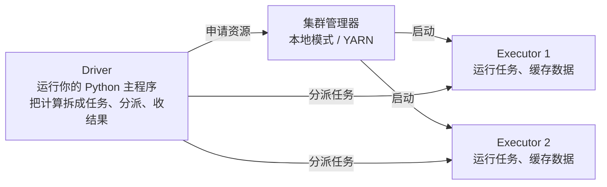
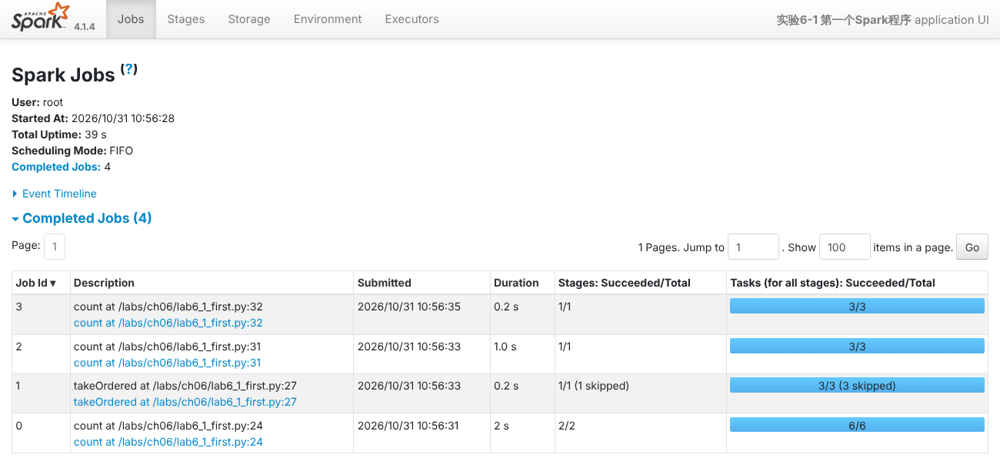
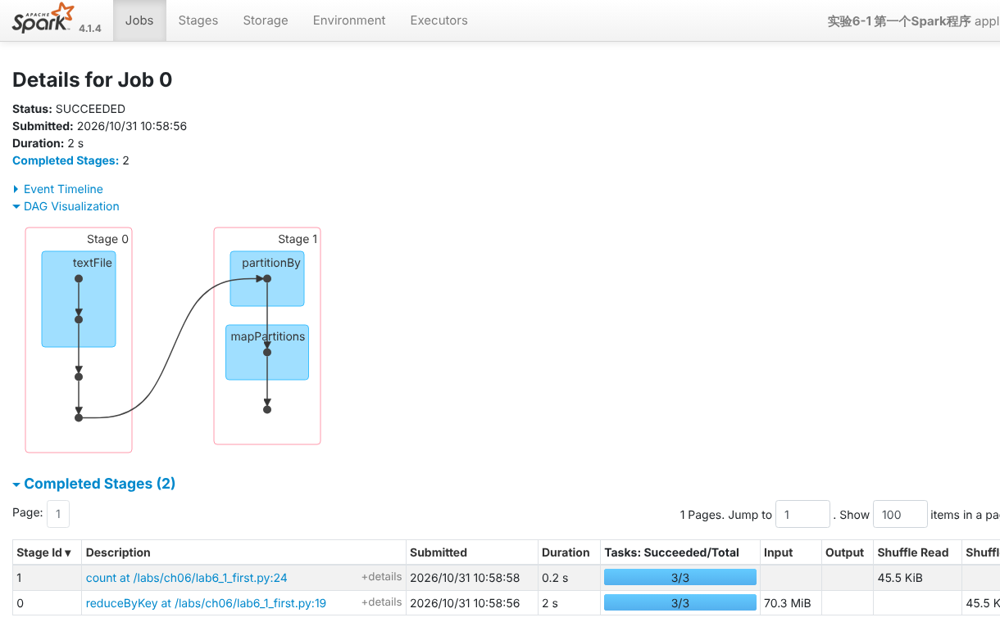
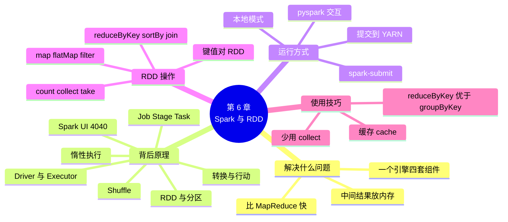

# 第 6 章 Spark 入门与 RDD 编程

!!! abstract "本章学时"
    理论 5 学时 · 实验 1 学时（本章共 3 个实验，教师可任选）

## 学习目标

学完本章，你应该能够：

1. **说出** Spark 比 MapReduce 快的原因，以及 Driver、Executor、集群管理器的分工（记忆、理解）；
2. **区分**转换和行动，解释惰性执行，看懂 Spark UI 上的 Job、Stage、Task（理解、分析）；
3. **使用** pyspark 交互环境和 spark-submit 运行 Spark 程序，在本地模式和 YARN 上提交作业（应用）；
4. **编写** RDD 程序，用 map、filter、reduceByKey、sortBy、join 等操作完成日志统计（应用）；
5. **判断**什么时候该用缓存，以及一个作业该在本地运行还是提交到集群（评价）。

!!! info "先修要求"
    学习本章前，你需要掌握：

    - MapReduce 的 Map、Shuffle、Reduce 三个阶段，YARN 的 ResourceManager 和容器（[第 4 章 MapReduce 与 YARN](../04-mapreduce-yarn/index.md)）；
    - 用 `hdfs dfs` 上传和查看文件（[第 3 章 HDFS 分布式文件系统](../03-hdfs/index.md)）；
    - Python 的列表、元组、`lambda` 函数（“Python 程序设计”课程）。

??? abstract "本章概念清单（16 个，点击查看定义和例子）"
    1. [Spark](../../appendix/glossary.md#g-Spark)
    2. [Driver](../../appendix/glossary.md#g-Driver)
    3. [Executor](../../appendix/glossary.md#g-Executor)
    4. [RDD](../../appendix/glossary.md#g-RDD)
    5. [转换](../../appendix/glossary.md#g-转换)
    6. [行动](../../appendix/glossary.md#g-行动)
    7. [惰性执行](../../appendix/glossary.md#g-惰性执行)
    8. [Job](../../appendix/glossary.md#g-Job)
    9. [Stage](../../appendix/glossary.md#g-Stage)
    10. [Task](../../appendix/glossary.md#g-Task)
    11. [Spark UI](../../appendix/glossary.md#g-Spark-UI)
    12. [pyspark](../../appendix/glossary.md#g-pyspark)
    13. [spark-submit](../../appendix/glossary.md#g-spark-submit)
    14. [键值对 RDD](../../appendix/glossary.md#g-键值对-RDD)
    15. [缓存](../../appendix/glossary.md#g-缓存)
    16. [Serverless Spark](../../appendix/glossary.md#g-Serverless-Spark)

## 情景导入

上一章，小林用 Hive 写 SQL 做出了销售报表，很是满意。可没过几天，数据组接到一个新任务：从访问日志里找出“加购物车后 30 分钟内没有下单”的用户，发优惠券提醒。这要把每个用户的访问记录按时间排好，一条条往下看，用 SQL 写起来非常绕；用 MapReduce 写，又要好几个程序串起来，每一步都把中间结果写进 HDFS，跑一次十几分钟。

组长说：“试试 Spark。它把中间数据放在内存里，比 MapReduce 快得多；用 Python 写，几十行就够了；以后的数据清洗、SQL 分析、实时处理、机器学习，也都能在 Spark 里做。”

本章是 Spark 的入门。我们先看 Spark 解决了 MapReduce 的哪些问题，再弄清一个 Spark 程序运行时背后发生了什么；然后在随书集群上加一个 Spark 容器，用 RDD 重新统计第 4 章的访问日志，比一比代码量和速度；最后把作业提交到 YARN 集群上运行。

## 6.1 Spark 解决什么问题

### 6.1.1 比 MapReduce 快在哪

第 4 章做过的实验已经暴露了 MapReduce 的几个短处：一个作业只能有一个 Map 和一个 Reduce，复杂的计算要串好几个作业；每个作业的结果都写进 HDFS，下一个作业再从 HDFS 读出来；每次启动作业都要十几秒。

[**Spark**](../../appendix/glossary.md#g-Spark "通用的分布式计算引擎，把多步计算组织成一个流程、中间结果尽量放在内存中，并提供 SQL、流处理、机器学习等组件"){ .term } 是加州大学伯克利分校 2009 年开始研发、后来捐给 Apache 基金会的计算引擎。它的核心思想是把数据抽象成可以放在内存里、可以并行处理的数据集，一个程序里的多个步骤连成一条流水线，中间结果尽量留在内存中，不必反复读写磁盘。<sup class="cite">[[1]](#ref6-1)</sup> 对比一下：

| 比较项 | MapReduce | Spark |
|---|---|---|
| 一个程序能有几步 | 固定的 Map + Reduce，复杂计算要串多个作业 | 任意多步，自动组织成一个计算流程 |
| 中间结果放哪 | 每个作业的输出都写进 HDFS | 尽量放在内存里，只在必要时写本地磁盘 |
| 反复使用同一份数据 | 每次都从 HDFS 重新读 | 可以缓存在内存里，后面直接用 |
| 写程序 | mapper 和 reducer 分开写，要考虑键值对的格式 | 像写普通 Python 一样串起一个个操作 |

数据要反复使用的场合，比如机器学习要把同一份数据迭代计算几十遍，Spark 的速度优势最明显。

### 6.1.2 一个工具做四件事

Spark 不只是“更快的 MapReduce”，它在同一个引擎上提供了几套组件，覆盖了大数据处理的主要场景：<sup class="cite">[[2]](#ref6-2)</sup>

| 组件 | 做什么 | 本书在哪一章 |
|---|---|---|
| Spark Core（RDD） | 最基础的分布式数据处理 | 本章 |
| Spark SQL（DataFrame） | 用表格和 SQL 处理结构化数据 | 第 7、8 章 |
| Structured Streaming | 实时数据处理 | 第 9 章 |
| MLlib | 机器学习 | 第 10 章 |

学会一个 Spark，就能用同一种编程方式完成清洗、分析、实时和机器学习，不用在好几个系统之间来回搬数据，这是 Spark 成为大数据计算主力的重要原因。

## 6.2 看懂背后发生了什么

### 6.2.1 Driver 和 Executor

一个 Spark 程序运行时，有两种角色：<sup class="cite">[[3]](#ref6-3)</sup>



- [**Driver**](../../appendix/glossary.md#g-Driver "Spark 程序的驱动进程，运行主程序，把计算拆成任务分派给 Executor 并收集结果"){ .term }（驱动程序）运行你写的主程序。它创建 `SparkSession`，把计算拆成一个个任务，分派给 Executor，并收集结果。`print` 出来的内容、`collect()` 拿回来的数据都在 Driver 这边。
- [**Executor**](../../appendix/glossary.md#g-Executor "在工作节点上为某个 Spark 程序启动的进程，运行任务、缓存数据，可以接连运行很多个任务"){ .term }（执行器）是在工作节点上启动的进程，真正读取数据、运行任务，还可以把数据缓存在自己的内存里。
- **集群管理器**负责分配资源、启动 Executor。在本地模式下，Driver 和 Executor 都在同一个进程里，用本机的几个 CPU 核并行计算；提交到集群时，常用的集群管理器就是第 4 章的 YARN，Executor 运行在 NodeManager 分配的容器中。

和第 4 章对照：Driver 相当于 MapReduce 的 ApplicationMaster 加上你的主程序，Executor 相当于运行 Map、Reduce 任务的容器。区别是 MapReduce 每个任务都要启动一个新容器，而 Spark 的 Executor 启动一次，可以接连运行很多个任务。

### 6.2.2 RDD：分成很多块的数据集

[**RDD**](../../appendix/glossary.md#g-RDD "弹性分布式数据集，Spark 最基础的数据抽象：分成多个分区、分布在各 Executor 上、只读，丢失的分区可按由来重算"){ .term }（弹性分布式数据集）是 Spark 最基础的数据抽象。可以把它想成一个“分成很多块、分散在各个 Executor 上的大列表”：

- **分布式**：RDD 被切成若干个分区，每个分区由一个任务处理，分区越多、CPU 核越多，并行度越高。读 HDFS 文件时一般一个数据块一个分区，读本地文件时约 32 MB 一个分区。
- **弹性**：RDD 记得自己是由哪个 RDD 经过什么操作得来的。某个分区丢了（比如一台机器坏了），Spark 按照记录重新计算这一个分区就行，不用把整个数据集都存好几份。

例如 `sc.textFile("access.log")` 得到一个 RDD，每个元素是日志的一行；对它 `map(lambda line: line.split())`，得到一个新的 RDD，每个元素是切好的字段列表。RDD 一旦生成就不能修改，每次操作都产生一个新的 RDD。

### 6.2.3 转换和行动：惰性执行

RDD 的操作分两类，这是学 Spark 最重要的一个概念：

| 类别 | 作用 | 例子 | 什么时候执行 |
|---|---|---|---|
| [**转换**](../../appendix/glossary.md#g-转换 "由一个 RDD 生成新 RDD 的操作，惰性执行，只记录要怎样计算"){ .term } | 由一个 RDD 生成新的 RDD | `map`、`filter`、`flatMap`、`reduceByKey`、`sortBy`、`join`、`distinct` | **不马上执行**，只记下“要怎样算” |
| [**行动**](../../appendix/glossary.md#g-行动 "要求返回具体结果或写出文件的操作，会触发前面所有转换的实际计算"){ .term } | 要一个具体结果：返回给 Driver，或写进文件 | `count`、`collect`、`take`、`reduce`、`saveAsTextFile` | 立刻触发计算 |

转换不马上执行，等遇到行动才把前面记下的所有转换一起执行，这叫[**惰性执行**](../../appendix/glossary.md#g-惰性执行 "转换不马上执行，等遇到行动时才把整个计算流程一起执行"){ .term }。实验 6-1 中，编者定义三个转换只用了 0.6 秒（其实还没有读文件），执行 `count()` 时才真正读了 70 MB 的日志，用时 2.1 秒。

惰性执行的好处是 Spark 能看到“全局”：比如 `map` 之后紧跟 `filter`，它会让每一行读进来后接连做完两步，不必先把 `map` 的结果全部存下来；如果最后只要 `take(10)`，它可能只读一小部分数据就够了。

### 6.2.4 Job、Stage 和 Task

一个行动提交给 Spark，会经历三层拆分：

- [**Job**](../../appendix/glossary.md#g-Job "由一个行动触发的一次完整计算"){ .term }（作业）：每个行动触发一个 Job。程序里有 4 个行动，就有 4 个 Job。
- [**Stage**](../../appendix/glossary.md#g-Stage "Job 在 Shuffle 处切开后得到的计算阶段，同一 Stage 内的操作在每个分区上连续执行"){ .term }（阶段）：Job 在需要 **Shuffle** 的地方被切开。`reduceByKey`、`distinct`、`sortBy`、`join`、`groupByKey` 这些操作要把相同 key 的数据汇集到一起，和第 4 章 MapReduce 的 Shuffle 是一回事。Shuffle 之前的步骤是一个 Stage，之后是另一个 Stage；`map`、`filter` 这类各分区自己就能做完的操作，留在同一个 Stage 里连续执行。
- [**Task**](../../appendix/glossary.md#g-Task "Stage 在一个分区上的执行单元，一个分区一个 Task，由 Executor 的 CPU 核运行"){ .term }（任务）：每个 Stage 对每个分区运行一个 Task。3 个分区就有 3 个 Task，由 Executor 的 CPU 核并行运行。

这些在 [**Spark UI**](../../appendix/glossary.md#g-Spark-UI "Spark 程序运行时提供的网页，显示 Job、Stage、Task、缓存和 Executor 的情况，默认端口 4040"){ .term } 上都看得到。程序运行时，在浏览器打开 `http://localhost:4040`，Jobs 页面列出了每个行动触发的 Job：<sup class="cite">[[4]](#ref6-4)</sup>



这是编者运行实验 6-1 时的截图。Job 0 是第一次 `count`，有 2 个 Stage、共 6 个 Task，用了 2 秒；Job 1 的 `takeOrdered` 复用了 Job 0 的 Shuffle 结果，跳过（skipped）了第一个 Stage。点开 Job 0，“DAG Visualization”画出了它的计算流程：



Stage 0 读入 70.3 MiB 的日志，做完两次 `map` 和本地预聚合后，只写出 45.5 KiB 的 Shuffle 数据，Stage 1 再把它读进来完成汇总。`reduceByKey` 会先在每个分区内合并一次，相当于第 4 章的 Combiner，所以 Shuffle 的数据量很小。

下面的动画可以自己拼一个 RDD 程序，看它被切成几个 Stage、Task 怎样分批运行：

<iframe class="sim-frame" src="../../sims/spark-stages/main.html" height="720" loading="lazy" title="Spark 作业怎样拆成 Stage 和 Task"></iframe>

先不加行动按“运行”，体会惰性执行；再选“每小时 UV”，数一数两次 Shuffle 切出了几个 Stage；把分区数改成 6、核数改成 2，看 Task 怎样分批。[全屏打开](../../sims/spark-stages/main.html){ target=_blank }

## 6.3 运行 Spark 程序的几种方式

### 6.3.1 随书环境：再加一个 Spark 容器

随书集群新增了配置文件 `labs/cluster/docker-compose.spark.yml`，用 Apache 官方的 `apache/spark:4.1.4-scala2.13-java21-python3-ubuntu` 镜像启动一个名为 spark 的容器。它就像一台装好了 Spark 的“客户端电脑”，`labs` 目录同样挂载在 `/labs`：

```bash
cd labs/cluster
docker compose -f docker-compose.yml -f docker-compose.spark.yml up -d
docker compose -f docker-compose.yml -f docker-compose.spark.yml exec spark bash
```

这个容器的配置放在 `labs/cluster/spark-conf/` 下：`spark-defaults.conf` 设定内存等默认值，`log4j2.properties` 让屏幕上只显示警告和错误。Spark 4 需要 Java 17 以上，而 Hadoop 镜像中是 Java 11，所以配置文件还让 worker1、worker2 共享 spark 容器中的 Java 21，提交到 YARN 时使用。Spark 官方文档中介绍了这种为 YARN 容器单独指定 `JAVA_HOME` 的做法。<sup class="cite">[[5]](#ref6-5)</sup>

!!! tip "为什么不直接在本机装 PySpark"
    第 1 章实验 1-2 在本机用 `pip install pyspark` 运行过本地模式，这样也可以学本章的大部分内容。但在 Windows 上，PySpark 写文件还需要额外的 Hadoop 工具，常常出错；本机也访问不到集群内部的 HDFS 数据节点（第 3 章 3.4.1 节）。在 spark 容器里运行，环境和集群一致，所以本书第 6～8 章的实验都在 spark 容器中进行。

### 6.3.2 pyspark：边写边看

在 spark 容器中输入 `pyspark`，进入 Spark 的 Python 交互环境 [**pyspark**](../../appendix/glossary.md#g-pyspark "Spark 的 Python 交互环境，启动时已创建好 `spark` 和 `sc` 两个对象"){ .term }。它已经替你创建好了 `spark`（SparkSession）和 `sc`（SparkContext）两个对象，可以一行行输入、马上看结果，适合学习和试验：

```text
root@spark:/labs# pyspark
Welcome to
      ____              __
     / __/__  ___ _____/ /__
    _\ \/ _ \/ _ `/ __/  '_/
   /__ / .__/\_,_/_/ /_/\_\   version 4.1.4
      /_/

Using Python version 3.10.12 (main, Aug 31 2026 10:18:17)
Spark context Web UI available at http://spark:4040
Spark context available as 'sc' (master = local[*], app id = local-1793415745591).
SparkSession available as 'spark'.
>>> sc.parallelize([1, 2, 3, 4, 5]).map(lambda x: x * x).collect()
[1, 4, 9, 16, 25]
```

`master = local[*]` 表示本地模式，`*` 表示使用全部 CPU 核；Spark UI 的地址写的是容器名 `spark`，在本机浏览器中要换成 `localhost:4040`。按 `Ctrl + D` 或输入 `exit()` 退出。在 Jupyter Notebook 中使用 PySpark 也是同样的写法，只是要自己用 `SparkSession.builder...getOrCreate()` 创建 `spark`。

### 6.3.3 spark-submit：运行写好的程序

写好的程序保存成 `.py` 文件，用 [**spark-submit**](../../appendix/glossary.md#g-spark-submit "提交 Spark 程序运行的命令，用 `--master` 指定本地模式或集群"){ .term } 命令提交运行，程序中要自己创建 SparkSession：

```python
from pyspark.sql import SparkSession

spark = SparkSession.builder.appName("作业名").getOrCreate()
sc = spark.sparkContext
# ……处理数据……
spark.stop()
```

```bash
spark-submit /labs/ch06/lab6_2_log_rdd.py                       # 本地模式
spark-submit --master yarn --num-executors 2 /labs/ch06/lab6_3_yarn_pages.py   # 提交到 YARN
```

### 6.3.4 本地模式还是提交到集群

同一个程序，只需改 `--master` 参数，就能从本地模式换到集群运行，代码一行都不用改。路径的写法要注意：`file:///labs/...` 是容器里的本地文件，不写 `file://` 的路径（如 `/xiaoxiang/logs/access.log`）指的是 HDFS 上的文件。提交到 YARN 时，Executor 在各个 worker 上运行，只能读 HDFS 上的数据。

| 方式 | 写法 | 适合 |
|---|---|---|
| 本地模式 | 不写 `--master`，或 `--master local[*]` | 学习、调试、数据量在一台机器能处理的范围内 |
| YARN | `--master yarn` | 数据在 HDFS 上、量大，需要多台机器一起算 |

实验 6-3 中，编者把同一个程序分别用两种方式运行在 1000 万行日志上：本地模式（4 个核）计算用了 10.6 秒，提交到 YARN（2 个 Executor，各 1 个核）反而用了 32.1 秒，再加上申请资源、启动 Executor 的时间，总共 53 秒。这和第 4 章的结论一样：随书集群的几个节点挤在一台电脑上，并不能带来更多的计算能力，集群的优势要在真正的多台机器、单机处理不了的数据量上才能体现。

## 6.4 RDD 常用操作

### 6.4.1 创建 RDD

| 写法 | 得到什么 |
|---|---|
| `sc.textFile("file:///labs/data/xiaoxiang/access.log")` | 容器中本地文件的每一行 |
| `sc.textFile("/xiaoxiang/logs/access.log")` | HDFS 文件的每一行；路径也可以是目录或通配符，如 `/xiaoxiang/logs/*.log` |
| `sc.parallelize([1, 2, 3])` | 把 Driver 中的一个 Python 列表变成 RDD，常用于试验 |

### 6.4.2 常用的转换和行动

下面用一个很小的例子演示常用操作。设 `words = sc.parallelize(["手机 耳机", "耳机 充电器 耳机"])`，它有两个元素，每个元素是一行文字。<sup class="cite">[[6]](#ref6-6)</sup>

| 操作 | 类别 | 写法 | 结果（用 `collect()` 取回） |
|---|---|---|---|
| `map` | 转换 | `words.map(lambda s: s.split())` | `[['手机', '耳机'], ['耳机', '充电器', '耳机']]`：一进一出 |
| `flatMap` | 转换 | `w = words.flatMap(lambda s: s.split())` | `['手机', '耳机', '耳机', '充电器', '耳机']`：一进多出，结果被“压平” |
| `filter` | 转换 | `w.filter(lambda x: x != "手机")` | `['耳机', '耳机', '充电器', '耳机']`：只留条件为真的 |
| `distinct` | 转换（Shuffle） | `w.distinct()` | `['充电器', '手机', '耳机']`：去重，顺序不固定 |
| `reduceByKey` | 转换（Shuffle） | `kv = w.map(lambda x: (x, 1))`<br>`kv.reduceByKey(lambda a, b: a + b)` | `[('充电器', 1), ('手机', 1), ('耳机', 3)]`：同一个键的值两两合并 |
| `sortBy` | 转换（Shuffle） | `....sortBy(lambda t: t[1], ascending=False)` | `[('耳机', 3), ('手机', 1), ('充电器', 1)]`：按次数从大到小 |
| `join` | 转换（Shuffle） | 次数 `.join(sc.parallelize([("手机", 2999), ("耳机", 199)]))` | `[('手机', (1, 2999)), ('耳机', (3, 199))]`：按键把两个 RDD 拼起来，两边都有的键才保留 |
| `count` | 行动 | `w.count()` | `5` |
| `collect` | 行动 | `w.collect()` | 把全部元素取回 Driver，变成 Python 列表 |
| `take` | 行动 | `w.take(2)` | `['手机', '耳机']`：取前 2 个 |
| `takeOrdered` | 行动 | `kv2.takeOrdered(10, key=lambda t: -t[1])` | 按次数从大到小取前 10 个 |
| `reduce` | 行动 | `sc.parallelize([1, 2, 3, 4]).reduce(lambda a, b: a + b)` | `10` |
| `saveAsTextFile` | 行动 | `rdd.saveAsTextFile("/xiaoxiang/result/pages")` | 写成一个目录，每个分区一个 `part-` 文件 |

元素是二元组 `(键, 值)` 的 RDD 叫[**键值对 RDD**](../../appendix/glossary.md#g-键值对-RDD "元素是 `(键, 值)` 二元组的 RDD，可以使用 reduceByKey、join 等按键操作"){ .term }，`reduceByKey`、`join`、`groupByKey`、`sortByKey` 等按键操作的函数只能用在它上面。这和第 4 章 mapper 输出的“键<TAB>值”是同一个思路：`map(lambda x: (x, 1))` 就是 Map 阶段，`reduceByKey` 就是 Shuffle 加 Reduce 阶段。

!!! warning "两个常见的坑"
    1. **`collect()` 会把全部数据拉回 Driver。**数据有几 GB 时，Driver 的内存会被撑爆。查看数据用 `take(10)`，要全部结果就用 `saveAsTextFile` 写进文件。
    2. **能用 `reduceByKey` 就别用 `groupByKey`。**`groupByKey` 把同一个键的所有值原样传过 Shuffle 再合并；`reduceByKey` 会先在每个分区内合并一次（相当于 Combiner），Shuffle 的数据少得多。

## 6.5 用 RDD 改写访问日志统计

第 4 章实验 4-2 用 MapReduce 统计了每小时的 PV、UV 和最热门的 10 个页面。用 RDD 写，同样的三个统计放在一个程序里（`labs/ch06/lab6_2_log_rdd.py`，节选）：

```python
lines = sc.textFile("file:///labs/data/xiaoxiang/access.log")
fields = lines.map(lambda line: line.split()).filter(lambda f: len(f) == 8)
fields.cache()                                            # 下面要用三次，先缓存

# ① 每小时 PV：(小时, 1) → 按小时求和
pv = fields.map(lambda f: (f[0][11:13], 1)).reduceByKey(lambda a, b: a + b)

# ② 每小时 UV：只要登录用户，(小时, 用户) 去重后再按小时计数
uv = (fields.filter(lambda f: f[2] != "-")
            .map(lambda f: (f[0][11:13], f[2]))
            .distinct()
            .map(lambda kv: (kv[0], 1))
            .reduceByKey(lambda a, b: a + b))

# ③ 热门页面：状态码 200 的访问，按页面计数，取前 10
top10 = (fields.filter(lambda f: f[5] == "200")
               .map(lambda f: (f[4], 1))
               .reduceByKey(lambda a, b: a + b)
               .sortBy(lambda kv: kv[1], ascending=False)
               .take(10))

for hour, (p, u) in sorted(pv.join(uv).collect()):       # join：按小时把 PV 和 UV 拼在一起
    print(f"{hour}\t{p}\t{u}")
```

编者运行的结果，24 个小时的 PV、UV 和热门页面前 10，与第 4 章实验 4-2 的结果**完全相同**（21 点 PV 88286、UV 43162，`/search` 108159 次……），整个程序用时约 11 秒。对比两种写法：

| 比较项 | 第 4 章 MapReduce | 本章 RDD |
|---|---|---|
| 文件 | 5 个 Python 文件 + 1 个 Shell 脚本 | 1 个 Python 文件 |
| 有效代码（不含注释和空行） | 约 104 行 | 约 27 行 |
| 作业数 | 2 个作业，各 20～25 秒 | 1 个程序，约 11 秒 |
| 要操心的事 | mapper 输出的格式、reducer 怎样判断键变了、TopN 只能用 1 个 Reducer | 想清楚每一步把数据变成什么样 |

代码短，是因为 Spark 替我们做了排序、分组、判断“键变了没有”这些琐事；速度快，是因为三个统计共用一次读入的数据，中间结果不写 HDFS。

## 6.6 缓存什么时候用

前面说过，RDD 是惰性的，每个行动都会从头把转换执行一遍。上面的程序中，`fields` 被 PV、UV、热门页面三处使用，如果不缓存，日志文件就要读三遍、切三遍。`fields.cache()` 告诉 Spark：第一次算出 `fields` 后，把它留在 Executor 的内存里，后面直接用，这就是[**缓存**](../../appendix/glossary.md#g-缓存 "把计算出的 RDD 留在 Executor 内存中，供后续多次使用，避免重复读取和计算"){ .term }。

实验 6-1 中，编者对 100 万行的 `pages` 连续执行两次 `count()`：第一次要读文件并放进缓存，用时 1.1 秒；第二次直接用缓存，只要 0.17 秒，快了 6 倍多。

用缓存要记住三点：

1. **同一个 RDD 被用两次以上才值得缓存**，只用一次时缓存反而多占内存。
2. **`cache()` 本身也是惰性的**，要等第一次行动时才真正放进内存。
3. **用完了可以 `unpersist()` 释放**。缓存的 RDD 在 Spark UI 的 Storage 页面能看到，内存放不下的分区会被丢掉，下次用时重新计算，结果不会错，只是慢一些。

第 10 章的机器学习要把同一份数据反复迭代几十遍，缓存的作用更大。

## 6.7 前沿视窗

**Serverless Spark：只交作业，不管集群。**本章我们自己搭了 Spark 容器，提交到 YARN 前还要配置 Java、内存、Executor 个数。在云上，越来越多的企业改用 [**Serverless Spark**](../../appendix/glossary.md#g-Serverless-Spark "云上无需管理集群的 Spark 服务，按作业临时启动资源、用完释放、按量计费"){ .term }（无服务器形式的 Spark）：用户只提交程序，云平台按作业需要临时启动计算资源，作业结束立即释放，按实际用量计费，不用自己维护集群。阿里云的 EMR Serverless Spark 就是这样的服务，它兼容开源 Spark，提供与 `spark-submit` 兼容的提交工具，本章写的程序不用修改就能运行。<sup class="cite">[[7]](#ref6-7)</sup>

**从 RDD 到 DataFrame。**RDD 灵活，但 Spark 不知道每个元素里面是什么，没法替你优化。今天的 Spark 程序大多使用 DataFrame 和 SQL（第 7、8 章），Spark 能看懂“要哪些列、按什么条件”，自动选择最省事的执行方式，速度通常比手写 RDD 更快。不过 DataFrame 在底层仍然变成 RDD 的 Job、Stage 和 Task 来执行，本章学的这些概念是看懂 Spark UI、排查慢作业（第 11 章）的基础。想系统学习 Spark 的设计，可以读 Spark 主要作者编写的《Spark 权威指南》；<sup class="cite">[[8]](#ref6-8)</sup> 想看更多 RDD 编程的例子，可以参考林子雨《Spark 编程基础（Python 版）》中 RDD 编程一章的课件。<sup class="cite">[[9]](#ref6-9)</sup>

## 本章实验

!!! abstract "实验总览"
    | 实验 | 类型 | 建议时长 | 内容 |
    |---|---|---|---|
    | 实验 6-1 | ★ 基础 | 35 分钟 | 启动 Spark 容器，在 pyspark 中试验 RDD 操作；运行第一个程序，体会惰性执行和缓存，在 Spark UI 上查看 Job、Stage、Task |
    | 实验 6-2 | ★ 基础 | 30 分钟 | 用 RDD 统计访问日志的每小时 PV、UV 和热门页面，与第 4 章的结果对照 |
    | 实验 6-3 | ☆ 拓展 | 30 分钟 | 把统计 1000 万行日志的程序提交到 YARN 集群，与本地模式比较 |

    实验在随书 Docker 小集群（1 主 2 从）加上本章的 spark 容器上进行，Docker 至少分配 6 GB 内存。实验代码见配套资源 `labs/ch06/` 目录。编者的运行环境：4 核 CPU、16 GB 内存的 Linux 主机，Docker 29.9，Hadoop 3.4.3 和 Spark 4.1.4 镜像。

### 实验 6-1 ★ PySpark 本地模式与 Spark UI

**实验目的**

1. 启动随书的 spark 容器，在 pyspark 交互环境中试验常用的 RDD 操作；
2. 用 spark-submit 运行程序，通过计时体会转换的惰性执行和缓存的作用；
3. 在 Spark UI 上找到 Job、Stage、Task，说出它们和程序代码的对应关系。

**实验环境**：随书 Hadoop 集群 + `docker-compose.spark.yml` 中的 spark 容器（本实验只用本地模式）。

**实验数据**：`labs/data/xiaoxiang/access.log`，100 万行、70.2 MB 的访问日志。

**实验步骤与代码**

第 1 步，启动集群和 spark 容器，进入容器：

```bash
cd labs/cluster
docker compose -f docker-compose.yml -f docker-compose.spark.yml up -d
docker compose -f docker-compose.yml -f docker-compose.spark.yml exec spark bash
```

第 2 步，输入 `pyspark` 进入交互环境，逐行输入 6.4.2 节表格中的例子，核对结果。再试试读日志：

```python
lines = sc.textFile("file:///labs/data/xiaoxiang/access.log")
lines.getNumPartitions()          # 分区数
lines.take(2)                     # 前两行
lines.count()                     # 总行数
```

在浏览器打开 `http://localhost:4040`，看 Jobs 页面多了几个 Job。输入 `exit()` 退出 pyspark。

第 3 步，运行 `lab6_1_first.py`。它定义三个转换后计时，再执行行动计时；然后对 `pages` 缓存前后各 `count()` 一次：

```bash
spark-submit /labs/ch06/lab6_1_first.py
```

第 4 步，程序最后会暂停 60 秒。趁这时打开 `http://localhost:4040`：在 Jobs 页面看有几个 Job、各由哪一行代码触发；点开 Job 0，展开“DAG Visualization”，看它分成几个 Stage；在 Stages 页面看每个 Stage 的 Task 数、Input 和 Shuffle Write。

**运行结果**

第 2 步，`getNumPartitions()` 返回 3（70 MB 的本地文件约 32 MB 一个分区），`count()` 返回 1000000。

第 3 步的输出（警告信息已删去）：

```text
Spark 版本 4.1.4 ，运行方式 local[*] ，默认并行度 4
定义三个转换用时 0.574 秒（还没有读文件）
不同页面的个数： 2007
第一次 count 用时 2.1 秒
访问最多的 3 个页面： [('/search', 120210), ('/', 119485), ('/item/p01372', 73749)]
pages 共 1000000 行：缓存前 count 用时 1.0 秒，缓存后 0.23 秒
现在打开 http://localhost:4040 查看 Jobs 和 Stages，60 秒后程序结束……
```

定义转换几乎不花时间，第一个行动才真正计算；缓存后再 `count()` 快了 4 倍多（再运行一次，编者得到 1.1 秒和 0.17 秒，每次略有不同）。这里的页面次数比 6.5 节的多，因为本程序统计了全部请求，没有只留状态码 200 的。

第 4 步的 Jobs 页面和 Job 0 的 DAG 图见 6.2.4 节：共 4 个 Job，Job 0 有 2 个 Stage、各 3 个 Task。

**实验记录表**

| 观察内容 | 你的结果 |
|---|---|
| 日志 RDD 的分区数；默认并行度 | |
| 定义转换的用时；第一次 `count` 的用时 | |
| 缓存前后 `count` 的用时 | |
| Job 个数；Job 0 的 Stage 数和每个 Stage 的 Task 数 | |
| Stage 0 的 Input 和 Shuffle Write | |

**常见问题排查**

| 现象 | 原因 | 解决办法 |
|---|---|---|
| `pyspark: command not found` | 不在 spark 容器里 | 先 `docker compose ... exec spark bash` |
| `Path does not exist: file:/labs/...` | 数据文件没有生成 | 在本机 `labs` 目录运行 `python data/make_data.py` |
| `Path does not exist: hdfs://master:8020/labs/...` | 本地文件忘了加 `file://` | 本地文件写 `file:///labs/...`（三个斜杠） |
| `localhost:4040` 打不开 | 程序已经结束，Spark UI 随之关闭 | 在程序运行期间打开；或在 pyspark 中操作，退出前一直可以访问 |
| 端口 4040 被占用，程序改用 4041 | 同时运行了两个 Spark 程序 | 关掉另一个，或在 spark 容器的端口映射中加上 4041 |

**思考与练习**

1. 把第 3 步程序中的 `pages.cache()` 删掉，再运行一次，两次 `count` 的用时还有差别吗？为什么？
2. 在 pyspark 中执行 `sc.textFile("file:///labs/data/xiaoxiang/access.log").filter(lambda l: "/cart" in l)`，Spark UI 上会多出 Job 吗？再加上 `.count()` 呢？

**实验报告要求**

提交第 3 步的输出截图、Spark UI 的 Jobs 页面和 Job 0 的 DAG 图截图、实验记录表，回答思考与练习的两个问题。

### 实验 6-2 ★ 用 RDD 统计访问日志

**实验目的**

1. 用 map、filter、distinct、reduceByKey、sortBy、join 等操作完成每小时 PV、UV 和热门页面的统计；
2. 理解键值对 RDD 和 MapReduce 键值对的对应关系；
3. 和第 4 章实验 4-2 对照结果、代码量和耗时。

**实验环境**：同实验 6-1。

**实验数据**：同实验 6-1。

**实验步骤与代码**

第 1 步，打开 `labs/ch06/lab6_2_log_rdd.py`，对照 6.5 节读懂代码。画出每个变量（`fields`、`pv`、`uv`、`top10`）中一个元素的样子，例如 `pv` 的一个元素是 `('21', 88286)`。

第 2 步，在 spark 容器中运行：

```bash
spark-submit /labs/ch06/lab6_2_log_rdd.py
```

第 3 步，把输出和第 4 章实验 4-2 的结果逐项对照。

**运行结果**

```text
小时  PV     UV
00	13631	9824
01	6696	5116
……（中间 19 行略）
21	88286	43162
22	67371	35856
23	33715	21244
热门页面前 10：
/search	108159
/	107489
/item/p01372	66234
/cart	53794
/item/p00523	33025
/order/submit	28752
/item/p01886	22146
/login	21758
/pay	21695
/coupon	17802
日志总行数 1000000，用时 11.4 秒
```

24 小时的 PV、UV 和热门页面前 10 与第 4 章实验 4-2 完全一致。第 4 章两个 MapReduce 作业各用 20～25 秒，这里一个程序约 11 秒全部完成。

**实验记录表**

| 观察内容 | 你的结果 |
|---|---|
| PV 最高的小时及其 PV、UV | |
| 与第 4 章结果是否一致（不一致的写出差别） | |
| 程序用时；第 4 章两个作业的用时 | |
| 本程序有效代码行数；第 4 章的代码行数 | |

**常见问题排查**

| 现象 | 原因 | 解决办法 |
|---|---|---|
| `IndexError: list index out of range` | 有的行字段不足 8 个 | 先 `filter(lambda f: len(f) == 8)` 再取字段 |
| UV 比 PV 还大或与第 4 章不同 | 没有去掉未登录的 `-`，或先计数后去重 | 先 `filter` 掉 `-`，对 `(小时, 用户)` 去重后再计数 |
| 结果的小时顺序是乱的 | `collect()` 回来的顺序不固定 | 用 Python 的 `sorted()` 排序，或 `sortByKey()` |
| `TypeError: 'PipelinedRDD' object is not iterable` | 对 RDD 直接用了 `for` 循环 | 先用 `collect()` 或 `take()` 取回 Driver |

**思考与练习**

1. 修改程序，统计每种终端（最后一个字段：Android、iPhone、PC、MiniProgram）的访问次数和占比。
2. 把 `fields.cache()` 去掉后程序会慢多少？用 Spark UI 的 Jobs 页面解释原因。

**实验报告要求**

提交运行结果截图和实验记录表，附上思考与练习第 1 题的代码和结果，用两三句话比较 MapReduce 和 RDD 两种写法。

### 实验 6-3 ☆ 把作业提交到 YARN 集群

**实验目的**

1. 用 `spark-submit --master yarn` 把程序提交到随书集群，读取 HDFS 上的数据；
2. 在 8088 网页上找到 Spark 应用，理解 Driver、ApplicationMaster 和 Executor 在 YARN 上的位置；
3. 比较本地模式和 YARN 模式的耗时，分析原因。

**实验环境**：同实验 6-1，YARN 上运行 Spark 用的是从 spark 容器共享给 worker1、worker2 的 Java 21（见 6.3.1 节）。

**实验数据**：第 3 章实验 3-1 上传到 HDFS 的 1000 万行日志 `/xiaoxiang/logs_big/access.log`（701.8 MB）。如果 HDFS 上没有，先完成实验 3-1 第 4 步。

**实验步骤与代码**

第 1 步，确认 HDFS 上有数据：

```bash
docker compose exec master hdfs dfs -ls -h /xiaoxiang/logs_big
```

第 2 步，在 spark 容器中把 `lab6_3_yarn_pages.py` 提交到 YARN，用 2 个 Executor：

```bash
spark-submit --master yarn --num-executors 2 /labs/ch06/lab6_3_yarn_pages.py
```

运行期间打开 `http://localhost:8088`，在应用列表中找到名为“实验6-3 热门页面(YARN)”、类型为 SPARK 的应用。

第 3 步，不写 `--master`，以本地模式运行同一个程序，比较耗时：

```bash
spark-submit /labs/ch06/lab6_3_yarn_pages.py
```

**运行结果**

第 2 步的输出（YARN 的状态报告有删节）：

```text
INFO Client: Application report for application_1793413458800_0004 (state: RUNNING)
	 tracking URL: http://master:8088/proxy/application_1793413458800_0004/
运行方式： yarn ，应用编号： application_1793413458800_0004
分区数（= 第一阶段的任务数）： 6
/	1079097
/search	1078747
/item/p01372	661281
/cart	539777
/item/p00523	330696
/order/submit	288740
/item/p01886	220325
/pay	215672
/login	215419
/coupon	179559
计算用时 32.1 秒
```

从敲下命令到结束共约 53 秒。本地模式结果完全相同，计算用时 10.6 秒，总共约 17 秒。HDFS 上的大日志有 6 个数据块，所以第一个 Stage 有 6 个 Task。

| 运行方式 | 并行的 Task 数 | 计算用时 | 总耗时 |
|---|---|---|---|
| YARN，2 个 Executor × 1 核 | 2 | 32.1 秒 | 约 53 秒 |
| 本地模式 `local[*]` | 4 | 10.6 秒 | 约 17 秒 |
| 第 4 章实验 4-3：MapReduce 加 Combiner | — | — | 37.6 秒（作业耗时） |

YARN 模式反而慢，原因有三：每个 Executor 默认只用 1 个核，同时只能跑 2 个 Task，本地模式能跑 4 个；申请容器、启动 Executor 要十几秒；随书集群的“多台机器”其实是一台电脑上的几个容器，并没有更多的 CPU。在真实的集群上，可以用 `--executor-cores`、`--num-executors` 申请几十上百个核，数据也分散在各台机器的硬盘上就地读取，这时提交到集群才有意义。

**实验记录表**

| 观察内容 | 你的结果 |
|---|---|
| YARN 模式的应用编号；8088 网页上的应用类型 | |
| 第一个 Stage 的 Task 数，与 HDFS 文件的块数是否一致 | |
| YARN 模式的计算用时和总耗时 | |
| 本地模式的计算用时和总耗时 | |

**常见问题排查**

| 现象 | 原因 | 解决办法 |
|---|---|---|
| 一直停在 `state: ACCEPTED` | YARN 上有别的作业占着资源，或内存不够 | 在 8088 网页上结束其他应用；确认 NodeManager 都在运行 |
| 日志中有 `UnsupportedClassVersionError` 或 `java: not found` | 工作节点没有 Java 21 | 用 `docker compose -f docker-compose.yml -f docker-compose.spark.yml up -d` 重新启动，让 worker 挂上 spark-jdk 数据卷；不要启动 worker3 |
| `Path does not exist: hdfs://master:8020/xiaoxiang/logs_big` | HDFS 上没有大日志 | 先完成实验 3-1 第 4 步 |
| `Path does not exist: file:/labs/...`（在 YARN 上） | Executor 在 worker 上运行，读不到 spark 容器的本地文件 | 提交到 YARN 时只读 HDFS 上的数据 |
| 看 Python 的报错 | 报错在 Executor 的日志里 | `docker compose exec master yarn logs -applicationId <应用编号>` |

**思考与练习**

1. 加上 `--executor-cores 2` 再提交一次，计算用时有变化吗？为什么不能无限加大？（提示：每个 NodeManager 只有 2 个核，见第 4 章。）
2. 什么样的数据和任务适合提交到集群，什么样的在本地模式运行就够了？结合本实验的数字说明。

**实验报告要求**

提交第 2 步的输出截图、8088 网页上 Spark 应用的截图和实验记录表，回答思考与练习的两个问题。

## 本章小结

- **Spark** 把一个程序的多个步骤组织成一个计算流程，中间结果尽量放在内存中，比 MapReduce 快、代码短；同一个引擎还提供 Spark SQL、Structured Streaming、MLlib，覆盖分析、实时和机器学习。
- 程序运行时，**Driver** 运行主程序、拆分和分派任务、收集结果；**Executor** 在工作节点上运行任务、缓存数据；集群管理器（本地模式或 YARN）负责启动 Executor。
- **RDD** 是分成多个**分区**、分布在各 Executor 上的只读数据集，丢了的分区可以按“由谁、经过什么操作得来”的记录重新计算。
- RDD 的操作分**转换**和**行动**：转换只记下要做什么，遇到行动才一起执行，这叫**惰性执行**。每个行动触发一个 **Job**，Job 在 **Shuffle** 处切成多个 **Stage**，每个 Stage 对每个分区运行一个 **Task**，这些都能在 **Spark UI**（4040 端口）上看到。
- 常用操作：`map`、`flatMap`、`filter`、`distinct`、`reduceByKey`、`sortBy`、`join`（转换），`count`、`collect`、`take`、`takeOrdered`、`saveAsTextFile`（行动）。**键值对 RDD** 上的 `reduceByKey` 对应 MapReduce 的 Shuffle 加 Reduce，并自带 Combiner 的效果。
- 用 **pyspark** 交互试验，用 **spark-submit** 运行程序；改 `--master` 就能在本地模式和 YARN 之间切换。随书集群上 YARN 模式反而更慢，集群的优势要在真正的多台机器和大数据量上体现。
- 同一个 RDD 被多次使用时用 `cache()` **缓存**，实验中第二次 `count` 快了 4～6 倍。云上的 **Serverless Spark** 让用户只提交作业、不管集群。



**下一章预告**

本章的日志每行都很规整，`split()` 一下就能拿到字段。可是真实的数据往往很“脏”：订单重复上报、金额缺失、日期一会儿是 `2026/9/1` 一会儿是 `2026-09-01`、省份写成“广东省”和“广东”两种。数据组的同事说，他们 80% 的时间都花在清洗数据上。下一章学习 Spark 的 **DataFrame**，它把数据看成带列名和类型的表，用几行代码就能完成去重、填补缺失、统一格式、多表合并，并把清洗好的数据存成 Parquet 文件。

## 参考文献

正文中的上标编号（如<sup class="cite">[[1]](#ref6-1)</sup>）对应下面的文献。带链接的可以直接打开；书籍可在图书馆或电子书平台查阅。

<div class="refs" markdown>

**教材与专著**

- <span id="ref6-8"></span>[8] CHAMBERS B, ZAHARIA M. Spark: the definitive guide: big data processing made simple[M]. Sebastopol: O'Reilly Media, 2018.
    <span class="ref-note">Spark 作者参与编写的全面介绍，第 2 章讲 Driver、Executor、分区、转换与行动、惰性执行，第 12～13 章讲 RDD，对应 6.2、6.4 节。</span>

**经典论文**

- <span id="ref6-1"></span>[1] ZAHARIA M, CHOWDHURY M, DAS T, et al. Resilient distributed datasets: a fault-tolerant abstraction for in-memory cluster computing[C]//Proceedings of the 9th USENIX Symposium on Networked Systems Design and Implementation (NSDI 12). San Jose: USENIX, 2012: 15-28.
    <span class="ref-note">提出 RDD 的论文：把数据保存在内存中供多次计算复用，通过记录数据的由来（血统）重算丢失的分区来容错，对应 6.1.1、6.2.2 节。</span>
- <span id="ref6-2"></span>[2] ZAHARIA M, XIN R S, WENDELL P, et al. Apache Spark: a unified engine for big data processing[J]. Communications of the ACM, 2016, 59(11): 56-65.
    <span class="ref-note">介绍 Spark 如何在同一个引擎上支持 SQL、流处理、机器学习和图计算，以及它从 2009 年在伯克利起步的历史，对应 6.1 节。</span>

**在线资源与数据**

- <span id="ref6-3"></span>[3] Apache Software Foundation. Cluster mode overview (Spark 4.1.4)[EB/OL]. [2026-10-31]. <https://spark.apache.org/docs/4.1.4/cluster-overview.html>.
    <span class="ref-note">Driver、Executor、集群管理器的分工，以及 Job、Stage、Task 等术语的官方定义，对应 6.2.1、6.2.4 节。</span>
- <span id="ref6-4"></span>[4] Apache Software Foundation. Web UI (Spark 4.1.4)[EB/OL]. [2026-10-31]. <https://spark.apache.org/docs/4.1.4/web-ui.html>.
    <span class="ref-note">Spark UI 的 Jobs、Stages、Storage 等页面和 DAG 图的说明，对应 6.2.4 节和实验 6-1。</span>
- <span id="ref6-5"></span>[5] Apache Software Foundation. Running Spark on YARN (Spark 4.1.4)[EB/OL]. [2026-10-31]. <https://spark.apache.org/docs/4.1.4/running-on-yarn.html>.
    <span class="ref-note">用 `--master yarn` 提交作业、`HADOOP_CONF_DIR` 的作用，以及 YARN 节点的 Java 版本与 Spark 不同时用 `spark.yarn.appMasterEnv.JAVA_HOME`、`spark.executorEnv.JAVA_HOME` 指定 Java 的方法，对应 6.3 节和实验 6-3。</span>
- <span id="ref6-6"></span>[6] Apache Software Foundation. RDD programming guide (Spark 4.1.4)[EB/OL]. [2026-10-31]. <https://spark.apache.org/docs/4.1.4/rdd-programming-guide.html>.
    <span class="ref-note">RDD 的创建、转换与行动、惰性执行、键值对操作、Shuffle 和缓存的官方说明，对应 6.4～6.6 节。</span>
- <span id="ref6-7"></span>[7] 阿里云. 什么是 EMR Serverless Spark[EB/OL]. [2026-10-31]. <https://help.aliyun.com/zh/emr/emr-serverless-spark/product-overview/what-is-emr-serverless-spark>.
    <span class="ref-note">EMR Serverless Spark 的产品介绍：无需管理集群，按任务动态启动和释放资源、按量计费，兼容开源 Spark 和 spark-submit，对应 6.7 节。</span>
- <span id="ref6-9"></span>[9] 林子雨. Spark 编程基础（Python 版）：第 4 章 RDD 编程[EB/OL]. 厦门大学数据库实验室，2019. [2026-10-31]. <https://dblab.xmu.edu.cn/wp-content/uploads/2019/02/Chapter4-厦门大学-林子雨-Spark编程基础Python版-第4章-RDD编程（2019年春季学期）.pdf>.
    <span class="ref-note">RDD 编程的中文课件，有更多转换、行动和键值对 RDD 的例子，可作为本章的补充练习，对应 6.7 节。</span>

</div>

## 课后练习

选择题和判断题可以直接点击选项作答，系统会马上告诉你对错，并展开答案与解析；多选题选好后点“提交答案”。简答和实操题请先自己作答，再点开“答案与解析”核对。每道题的解析下方都有“回看”链接，做错了可以直接跳回正文复习。

**一、单项选择题**

<div class="quiz" data-answer="C" markdown>

**1.** Spark 比 MapReduce 快，最主要的原因是（　　）。

- A. Spark 只能处理很小的数据
- B. Spark 不需要读取 HDFS 上的数据
- C. 多个步骤连成一个流程，中间结果尽量放在内存中，不必每一步都写进 HDFS
- D. Spark 用 Python 编写，Python 比 Java 快

</div>

??? tip "答案与解析"
    **答案：C**

    MapReduce 每个作业的结果都要写进 HDFS，下一个作业再读出来；Spark 把多个步骤组织在一个流程中，中间数据尽量留在内存里。Spark 本身主要用 Scala 编写，与 Python 快慢无关。

    考查：Spark 与 MapReduce · 认知层次：理解 · [回看 6.1.1](#611-mapreduce)
    { .quiz-meta }

<div class="quiz" data-answer="A" markdown>

**2.** 在 Spark 程序中，运行你写的主程序、把计算拆成任务并收集结果的是（　　）。

- A. Driver
- B. Executor
- C. NameNode
- D. NodeManager

</div>

??? tip "答案与解析"
    **答案：A**

    Driver 运行主程序、拆分和分派任务；Executor 在工作节点上运行任务。NameNode、NodeManager 是 HDFS 和 YARN 的角色。

    考查：Driver · 认知层次：记忆 · [回看 6.2.1](#621-driver-executor)
    { .quiz-meta }

<div class="quiz" data-answer="D" markdown>

**3.** 下列 RDD 操作中，属于行动的是（　　）。

- A. `map`
- B. `filter`
- C. `reduceByKey`
- D. `count`

</div>

??? tip "答案与解析"
    **答案：D**

    `count` 要返回一个具体的数，是行动；`map`、`filter`、`reduceByKey` 都生成新的 RDD，是转换。

    考查：转换与行动 · 认知层次：理解 · [回看 6.2.3](#623)
    { .quiz-meta }

<div class="quiz" data-answer="B" markdown>

**4.** 执行 `rdd2 = sc.textFile("access.log").map(lambda l: l.split())` 后，Spark（　　）。

- A. 立刻读完整个文件，把结果存在 rdd2 中
- B. 只记下要做的操作，还没有读文件
- C. 读了文件的第一行
- D. 报错，因为没有行动

</div>

??? tip "答案与解析"
    **答案：B**

    `textFile` 和 `map` 都是转换，惰性执行，要等行动（如 `count()`）出现时才真正读文件。实验 6-1 中定义三个转换只用了 0.6 秒。

    考查：惰性执行 · 认知层次：理解 · [回看 6.2.3](#623)
    { .quiz-meta }

<div class="quiz" data-answer="C" markdown>

**5.** 一个 Job 中依次有 `textFile`、`map`、`filter`、`reduceByKey`、`sortBy`、`take`，它会被切成（　　）个 Stage。

- A. 1
- B. 2
- C. 3
- D. 6

</div>

??? tip "答案与解析"
    **答案：C**

    `reduceByKey` 和 `sortBy` 各需要一次 Shuffle，Job 被切成 3 个 Stage：读入、map、filter 一个；reduceByKey 一个；sortBy 之后一个。可以在“Spark 作业怎样拆成 Stage 和 Task”动画中验证。

    考查：Stage · 认知层次：分析 · [回看 6.2.4](#624-jobstage-task)
    { .quiz-meta }

<div class="quiz" data-answer="A" markdown>

**6.** `sc.parallelize(["a b", "c"]).flatMap(lambda s: s.split()).collect()` 的结果是（　　）。

- A. `['a', 'b', 'c']`
- B. `[['a', 'b'], ['c']]`
- C. `['a b', 'c']`
- D. `3`

</div>

??? tip "答案与解析"
    **答案：A**

    `flatMap` 把每个元素变成多个元素并“压平”；用 `map` 则得到 B。`collect()` 返回列表，不是个数。

    考查：flatMap · 认知层次：应用 · [回看 6.4.2](#642)
    { .quiz-meta }

<div class="quiz" data-answer="D" markdown>

**7.** 在 spark 容器中，要读取 HDFS 上的 `/xiaoxiang/logs/access.log`，正确的写法是（　　）。

- A. `sc.textFile("file:///xiaoxiang/logs/access.log")`
- B. `sc.textFile("/labs/xiaoxiang/logs/access.log")`
- C. `sc.textFile("http://localhost:9870/xiaoxiang/logs/access.log")`
- D. `sc.textFile("/xiaoxiang/logs/access.log")`

</div>

??? tip "答案与解析"
    **答案：D**

    不写 `file://` 的路径默认指 HDFS（由 `fs.defaultFS` 决定）；`file:///` 表示容器的本地文件。

    考查：读取数据 · 认知层次：应用 · [回看 6.3.4](#634)
    { .quiz-meta }

<div class="quiz" data-answer="B" markdown>

**8.** 某个 RDD 在程序中被三个不同的行动使用，为了避免重复读文件和计算，应该（　　）。

- A. 每次都用 `collect()` 取回 Driver
- B. 对它调用 `cache()`
- C. 改用 `groupByKey`
- D. 把分区数改成 1

</div>

??? tip "答案与解析"
    **答案：B**

    缓存后，第一次行动算出的结果留在 Executor 内存中，后面的行动直接使用。`collect()` 会把数据拉回 Driver，数据大时会撑爆内存。

    考查：缓存 · 认知层次：应用 · [回看 6.6](#66)
    { .quiz-meta }

<div class="quiz" data-answer="C" markdown>

**9.** 实验 6-3 中，提交到随书 YARN 集群反而比本地模式慢，下列解释中**不正确**的是（　　）。

- A. 每个 Executor 默认只用 1 个核，同时运行的 Task 比本地模式少
- B. 申请容器、启动 Executor 需要额外的时间
- C. YARN 模式读到的数据比本地模式多一倍
- D. 随书集群的节点都在同一台电脑上，没有更多的 CPU

</div>

??? tip "答案与解析"
    **答案：C**

    两种模式读的是同一个 HDFS 文件、结果相同，数据量一样。慢的原因是 A、B、D。

    考查：本地模式与 YARN · 认知层次：分析 · [回看 实验 6-3](#6-3-yarn)
    { .quiz-meta }

**二、多项选择题**

<div class="quiz quiz-multi" data-answer="ABD" markdown>

**1.** 下列 Spark 组件与用途对应正确的有（　　）。

- A. Spark SQL：用表格和 SQL 处理结构化数据
- B. Structured Streaming：实时数据处理
- C. MLlib：管理集群的资源
- D. Spark Core（RDD）：最基础的分布式数据处理

</div>

??? tip "答案与解析"
    **答案：ABD**

    MLlib 是机器学习库；管理集群资源的是 YARN 等集群管理器。

    考查：Spark 组件 · 认知层次：记忆 · [回看 6.1.2](#612)
    { .quiz-meta }

<div class="quiz quiz-multi" data-answer="ACD" markdown>

**2.** 下列 RDD 操作中，需要 Shuffle 的有（　　）。

- A. `reduceByKey`
- B. `filter`
- C. `distinct`
- D. `join`

</div>

??? tip "答案与解析"
    **答案：ACD**

    这三个操作都要把相同键（或相同元素）的数据汇集到一起；`filter` 每个分区自己就能完成，不需要 Shuffle。

    考查：Shuffle · 认知层次：分析 · [回看 6.2.4](#624-jobstage-task)
    { .quiz-meta }

<div class="quiz quiz-multi" data-answer="ABC" markdown>

**3.** 关于 RDD，下列说法正确的有（　　）。

- A. RDD 被分成多个分区，每个分区由一个 Task 处理
- B. RDD 生成后不能修改，每次操作都产生新的 RDD
- C. 某个分区丢失时，Spark 可以按照它的由来重新计算
- D. RDD 的全部数据都保存在 Driver 的内存里

</div>

??? tip "答案与解析"
    **答案：ABC**

    D 错：RDD 的分区分布在各个 Executor 上；只有 `collect()` 等行动才把数据取回 Driver。

    考查：RDD · 认知层次：理解 · [回看 6.2.2](#622-rdd)
    { .quiz-meta }

<div class="quiz quiz-multi" data-answer="BD" markdown>

**4.** 处理一个几十 GB 的 RDD 时，下列做法合理的有（　　）。

- A. 用 `collect()` 把结果全部取回来再打印
- B. 用 `take(10)` 查看前几条数据
- C. 统计每个键的个数时用 `groupByKey` 再求长度
- D. 把最终结果用 `saveAsTextFile` 写到 HDFS

</div>

??? tip "答案与解析"
    **答案：BD**

    A 会把几十 GB 数据拉回 Driver，内存撑爆；C 应该用 `reduceByKey`，它先在分区内合并，Shuffle 的数据少得多。

    考查：RDD 使用技巧 · 认知层次：评价 · [回看 6.4.2](#642)
    { .quiz-meta }

**三、判断题**

<div class="quiz quiz-judge" data-answer="√" markdown>

**1.** 程序中有 4 个行动，运行时 Spark UI 上就会出现 4 个 Job。

</div>

??? tip "答案与解析"
    **答案：√**

    每个行动触发一个 Job。实验 6-1 的程序有 4 个行动，Jobs 页面列出 4 个 Job。

    考查：Job · 认知层次：理解 · [回看 6.2.4](#624-jobstage-task)
    { .quiz-meta }

<div class="quiz quiz-judge" data-answer="×" markdown>

**2.** 调用 `rdd.cache()` 的那一刻，Spark 就把 rdd 的数据全部放进了内存。

</div>

??? tip "答案与解析"
    **答案：×**

    `cache()` 也是惰性的，要等第一次行动计算出 rdd 时才放进内存。

    考查：缓存 · 认知层次：理解 · [回看 6.6](#66)
    { .quiz-meta }

<div class="quiz quiz-judge" data-answer="√" markdown>

**3.** 同一个 Spark 程序，只要改 `spark-submit` 的 `--master` 参数，就能从本地模式改为在 YARN 上运行。

</div>

??? tip "答案与解析"
    **答案：√**

    代码不用改，但要注意提交到 YARN 时只能读 HDFS 等各节点都能访问的数据。

    考查：运行方式 · 认知层次：理解 · [回看 6.3.4](#634)
    { .quiz-meta }

<div class="quiz quiz-judge" data-answer="×" markdown>

**4.** `reduceByKey` 只能用在元素是普通数字的 RDD 上。

</div>

??? tip "答案与解析"
    **答案：×**

    `reduceByKey` 要用在元素是 `(键, 值)` 二元组的键值对 RDD 上，对同一个键的值两两合并。

    考查：键值对 RDD · 认知层次：理解 · [回看 6.4.2](#642)
    { .quiz-meta }

<div class="quiz quiz-judge" data-answer="×" markdown>

**5.** 有了 DataFrame 和 SQL，RDD 的 Job、Stage、Task 等概念就不用再学了。

</div>

??? tip "答案与解析"
    **答案：×**

    DataFrame 在底层仍以 Job、Stage、Task 的方式执行，看懂 Spark UI、排查慢作业都离不开这些概念。

    考查：RDD 与 DataFrame · 认知层次：理解 · [回看 6.7](#67)
    { .quiz-meta }

**四、简答题**

**1.** 用“食堂做饭”打比方，说明 Driver、Executor、分区、Task 分别相当于什么。

??? tip "答案与解析"
    **参考答案：** Driver 像食堂经理，拿着菜单（程序）把做饭拆成一道道工序，分配给厨师，最后把做好的菜收上来；Executor 像各个灶台前的厨师，真正动手干活，还能把备好的料（缓存）留在手边；分区像把一大筐菜分成的若干小筐；Task 像“处理一小筐菜的一道工序”，一筐菜一个 Task，厨师越多、同时处理的小筐越多。

    **评分要点：** 四个概念各 1 分，比喻合理、说出它们之间的关系 2 分（共 6 分）。

    考查：Driver 与 Executor · 认知层次：理解 · [回看 6.2.1](#621-driver-executor)
    { .quiz-meta }

**2.** 什么是惰性执行？它有什么好处？举一个例子说明。

??? tip "答案与解析"
    **参考答案：** 转换操作不马上执行，只记下要怎样计算，等到遇到行动时才把前面的转换一起执行，这叫惰性执行。好处：Spark 能看到整个计算流程，把 map、filter 等合并在一次读数据中连续完成，不必保存中间结果；只需要部分结果时（如 `take(10)`），可以只算一小部分数据。例如实验 6-1 中定义三个转换只用 0.6 秒，`count()` 时才读了 70 MB 的日志、用时 2.1 秒。

    **评分要点：** 定义 2 分，好处 2 分，例子 2 分。

    考查：惰性执行 · 认知层次：理解 · [回看 6.2.3](#623)
    { .quiz-meta }

**3.** 小象优选数据组有两个任务：① 每天对 300 MB 的日志做一次统计；② 每天对 2 TB 的全站日志做统计，数据在 HDFS 上。分别应该用本地模式还是提交到 YARN 集群？说明理由。

??? tip "答案与解析"
    **参考答案：** ① 用本地模式即可：300 MB 一台机器几十秒就能处理完，提交到集群还要额外花十几秒申请资源、启动 Executor，实验 6-3 中 YARN 模式反而更慢。② 提交到 YARN：2 TB 的数据一台机器读一遍就要很长时间，内存也放不下；集群有多台机器、几十上百个核并行计算，而且数据就在各节点的 HDFS 上，可以就地读取。

    **评分要点：** 两个判断各 2 分，理由各 1 分。

    考查：本地模式与 YARN · 认知层次：评价 · [回看 6.3.4](#634)
    { .quiz-meta }

**五、实操题**

**1.** 在 spark 容器的 pyspark 中，统计访问日志中每种终端（最后一个字段）的访问次数，按次数从大到小输出。写出代码和结果。

??? tip "答案与解析"
    **参考答案：**

    ```python
    lines = sc.textFile("file:///labs/data/xiaoxiang/access.log")
    result = (lines.map(lambda l: l.split())
                   .filter(lambda f: len(f) == 8)
                   .map(lambda f: (f[7], 1))
                   .reduceByKey(lambda a, b: a + b)
                   .sortBy(lambda kv: kv[1], ascending=False)
                   .collect())
    for dev, n in result:
        print(dev, n)
    ```

    编者的结果：Android 481809、iPhone 300423、PC 117200、MiniProgram 100568，共 4 种终端，次数之和为 1000000。终端只有几种，结果很小，这里用 `collect()` 没有问题。

    **评分要点：** 取对字段（2 分），计数（2 分），排序输出（2 分）。

    考查：RDD 常用操作 · 认知层次：应用 · [回看 6.4.2](#642)
    { .quiz-meta }

**2.** 编写程序 `my_status.py`：读取 HDFS 上的 `/xiaoxiang/logs/access.log`，统计每种状态码的访问次数，把结果用 `saveAsTextFile` 写到 HDFS 的 `/xiaoxiang/result/status`，然后分别以本地模式和 YARN 模式提交，记录两次的耗时，并用 `hdfs dfs -cat` 查看结果。

??? tip "答案与解析"
    **参考答案：**

    ```python
    from pyspark.sql import SparkSession
    spark = SparkSession.builder.appName("状态码统计").getOrCreate()
    sc = spark.sparkContext
    (sc.textFile("/xiaoxiang/logs/access.log")
       .map(lambda l: l.split())
       .filter(lambda f: len(f) == 8)
       .map(lambda f: (f[5], 1))
       .reduceByKey(lambda a, b: a + b)
       .map(lambda kv: f"{kv[0]}\t{kv[1]}")
       .saveAsTextFile("/xiaoxiang/result/status"))
    spark.stop()
    ```

    ```bash
    spark-submit /labs/my_status.py
    docker compose exec master hdfs dfs -rm -r /xiaoxiang/result/status   # 输出目录已存在会报错，先删除
    spark-submit --master yarn --num-executors 2 /labs/my_status.py
    docker compose exec master hdfs dfs -cat /xiaoxiang/result/status/part-*
    ```

    各状态码次数之和应为 1000000；输出目录中每个分区一个 `part-` 文件。在随书集群上，YARN 模式的总耗时通常比本地模式长。

    **评分要点：** 程序正确（3 分），两种模式都运行成功并记录耗时（2 分），处理“输出目录已存在”（1 分）。

    考查：spark-submit 与 YARN · 认知层次：应用 · [回看 实验 6-3](#6-3-yarn)
    { .quiz-meta }
