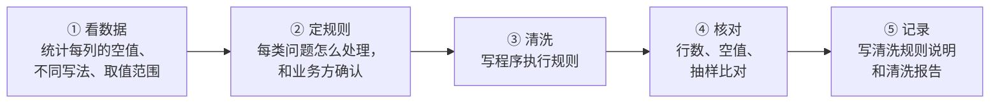
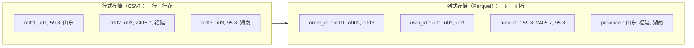
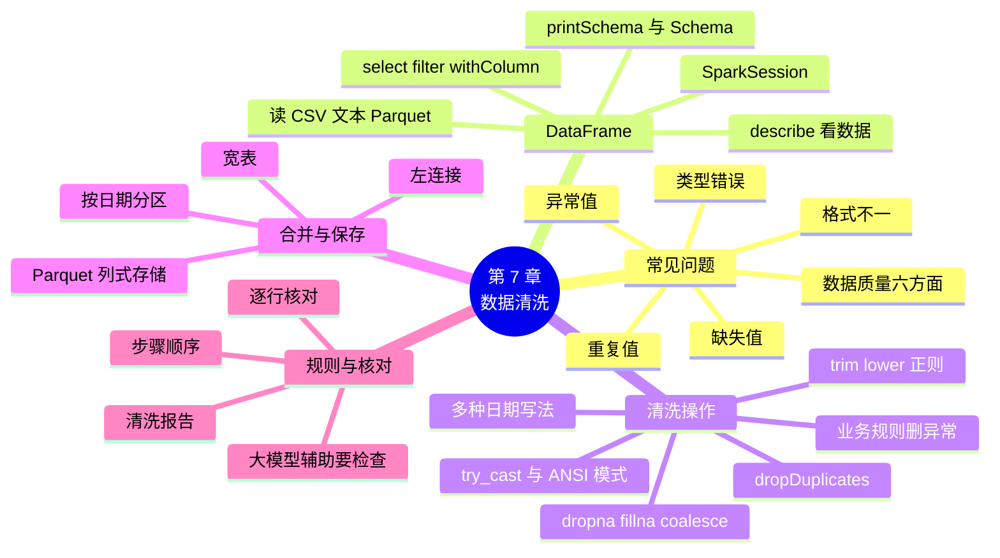

# 第 7 章 用 Spark 做数据清洗

!!! abstract "本章学时"
    理论 5 学时 · 实验 1 学时（本章共 3 个实验，教师可任选）

## 学习目标

学完本章，你应该能够：

1. **说出**真实数据中常见的数据质量问题（重复、缺失、格式不一、类型错误、异常值），以及评价数据质量的几个方面（记忆、理解）；
2. **使用** DataFrame 读入 CSV、文本和 Parquet 数据，完成查看结构、选列、过滤、新增列等基本操作（应用）；
3. **运用**去重、补缺失值、类型转换、字符串处理、日期解析、删异常值等操作，把一份脏数据清洗干净（应用）；
4. **完成**订单表与用户表、商品表的合并，把清洗结果按日期分区存成 Parquet（应用）；
5. **核对**清洗结果，写出别人能照着复现的清洗规则说明（评价）。

!!! info "先修要求"
    学习本章前，你需要掌握：

    - 启动 spark 容器，用 pyspark 和 spark-submit 运行程序，理解转换、行动和惰性执行（[第 6 章 Spark 入门与 RDD 编程](../06-spark-rdd/index.md)）；
    - 用 HiveQL 写 `SELECT`、`WHERE`、`GROUP BY`、`JOIN`，知道事实表和维度表（[第 5 章 Hive 数据仓库](../05-hive/index.md)）；
    - Python 的字符串和字典（“Python 程序设计”课程）。

??? abstract "本章概念清单（16 个，点击查看定义和例子）"
    1. [数据清洗](../../appendix/glossary.md#g-数据清洗)
    2. [脏数据](../../appendix/glossary.md#g-脏数据)
    3. [数据质量](../../appendix/glossary.md#g-数据质量)
    4. [缺失值](../../appendix/glossary.md#g-缺失值)
    5. [重复值](../../appendix/glossary.md#g-重复值)
    6. [异常值](../../appendix/glossary.md#g-异常值)
    7. [DataFrame](../../appendix/glossary.md#g-DataFrame)
    8. [SparkSession](../../appendix/glossary.md#g-SparkSession)
    9. [Schema](../../appendix/glossary.md#g-Schema)
    10. [ANSI 模式](../../appendix/glossary.md#g-ANSI-模式)
    11. [try_cast](../../appendix/glossary.md#g-try_cast)
    12. [正则表达式](../../appendix/glossary.md#g-正则表达式)
    13. [左连接](../../appendix/glossary.md#g-左连接)
    14. [宽表](../../appendix/glossary.md#g-宽表)
    15. [Parquet](../../appendix/glossary.md#g-Parquet)
    16. [列式存储](../../appendix/glossary.md#g-列式存储)

## 情景导入

国庆前，运营部要一份“9 月各省销售额”。小林从订单系统导出了 9 月的订单，几行代码一跑，结果交了上去。第二天财务打来电话：你的销售额比我们对账的多了两百多万；表里“广东”和“广东省”分成了两行；还有几百个订单的省份是空的。

小林打开原始文件一看，问题真不少：有的订单整行重复了，是网络重试时 APP 重复上报的；金额有的写成 `¥233.8`；下单时间有 `2026-09-05 07:08:36`、`2026/9/9 17:17:09`、`20260914 193753` 好几种写法；还有数量为 0、金额为负、日期是去年的订单。组长说：“拿到数据先别急着算，先洗干净。我们组八成的时间都花在这件事上。”

本章学习用 Spark 的 DataFrame 清洗数据。我们先看脏数据有哪些常见问题，再学 DataFrame 的基本操作；然后用随书脚本“弄脏”一份订单，一步步把它洗干净，与原始数据逐行核对；最后把订单和用户、商品合成一张宽表，存成 Parquet，并写一份清洗报告。

## 7.1 数据清洗做什么

### 7.1.1 脏数据长什么样

[**数据清洗**](../../appendix/glossary.md#g-数据清洗 "发现并改正数据中的重复、缺失、格式不一、类型错误和异常值，使数据可以直接用于分析"){ .term }就是发现并改正数据中的错误和不一致，让数据可以直接用来分析。需要清洗的数据叫[**脏数据**](../../appendix/glossary.md#g-脏数据 "含有重复、缺失、格式不一、错误或异常值的数据"){ .term }。研究者把数据质量问题分成两大类：一类是单个数据源内部的问题，比如缺失、拼写错误、重复记录、违反业务规则的值；另一类是把多个数据源合在一起时才出现的问题，比如同一个东西在两个系统里写法不同。<sup class="cite">[[1]](#ref7-1)</sup> 小象优选的订单来自 APP、小程序和老系统，两类问题都有。下表的例子全部取自实验 7-1 用的脏订单文件：

| 问题 | 例子 | 不处理会怎样 |
|---|---|---|
| [**重复值**](../../appendix/glossary.md#g-重复值 "同一条记录出现了多次，会让统计结果偏大"){ .term } | 同一个订单 `o000058356` 出现两次，每一列都一样 | 订单数和销售额偏大 |
| [**缺失值**](../../appendix/glossary.md#g-缺失值 "应该有值却为空的字段，Spark 中显示为 NULL"){ .term } | 省份、金额、支付方式为空 | 按省份统计时多出一个“空”省份，销售额偏小 |
| 格式不一 | 省份写成“广东”和“广东省”；用户编号 `U0090022` 和 `u0090022`；支付方式前后带空格 | 同一个东西被当成几个，分组统计被拆散 |
| 类型错误 | 金额写成 `¥233.8`；时间有 4 种写法 | 无法求和、无法按日期统计，转换时报错 |
| [**异常值**](../../appendix/glossary.md#g-异常值 "不符合业务规则或明显偏离正常范围的值"){ .term } | 数量为 0、金额为负、下单时间在 2025 年 | 拉低或拉高统计结果 |
| 编码乱码、截断 | 日志中只有半行的记录、乱码行 | 解析出错或得到错误字段 |

### 7.1.2 数据质量的几个方面

怎样算“干净”？国家标准 GB/T 36344—2018《信息技术 数据质量评价指标》从六个方面评价[**数据质量**](../../appendix/glossary.md#g-数据质量 "数据满足使用要求的程度，国家标准 GB/T 36344 从规范性、完整性、准确性、一致性、时效性、可访问性六个方面评价"){ .term }：<sup class="cite">[[2]](#ref7-2)</sup>

| 方面 | 意思 | 小象优选订单中的例子 |
|---|---|---|
| 规范性 | 数据符合标准、格式和业务规则 | 时间统一为 `yyyy-MM-dd HH:mm:ss`，省份用统一的简称 |
| 完整性 | 应该有值的字段都有值 | 省份、金额、支付方式不为空 |
| 准确性 | 数据真实反映实际情况 | 金额 = 单价 × 数量，不能为负 |
| 一致性 | 同一事物在不同地方不矛盾 | 订单表的省份和用户表的省份一致 |
| 时效性 | 数据在需要时是新的 | 日报的数据当天能清洗好 |
| 可访问性 | 需要的人能方便地取用 | 清洗结果存成 Parquet，放在约定的目录 |

数据清洗主要解决前四个方面的问题。动手之前要记住一个工作顺序：



最容易犯的错误是跳过第 ② 步：拿到数据直接删掉“看着不对”的行。比如金额为空的订单，是删掉还是按单价 × 数量补上？省份为空，是填“未知”还是按用户表补？这些规则决定了最后的数字，要和用数据的人商量好，并写下来。

## 7.2 DataFrame 入门

### 7.2.1 DataFrame：带列名和类型的表

第 6 章的 RDD 像一个“大列表”，每个元素是什么 Spark 并不知道，只能按你写的函数一行行处理。清洗和分析的数据大多是表格，Spark 为此提供了 [**DataFrame**](../../appendix/glossary.md#g-DataFrame "带列名和类型的分布式数据表，Spark SQL 的核心数据结构，Spark 能据此自动优化计算"){ .term }：一张分布在各个 Executor 上、带列名和类型的表。<sup class="cite">[[3]](#ref7-3)</sup> 用过 pandas 的同学会觉得很熟悉，区别是 pandas 的表必须整个放进一台电脑的内存，而 DataFrame 可以分成很多分区、放在集群上。

| 比较项 | RDD | DataFrame |
|---|---|---|
| 数据长什么样 | 任意 Python 对象 | 有列名、有类型的行 |
| 怎么写 | `map`、`filter` 里写 lambda 函数 | 用列名和现成的函数，也可以直接写 SQL |
| Spark 能否优化 | 看不懂函数内容，按原样执行 | 知道要哪些列、什么条件，自动选择更快的执行方式 |
| 本书用在哪里 | 第 6 章 | 第 7～12 章 |

使用 DataFrame 的入口是 [**SparkSession**](../../appendix/glossary.md#g-SparkSession "使用 DataFrame 和 SQL 的入口对象，负责读数据、建表和执行 SQL"){ .term }。在 pyspark 中它已经建好，变量名就是 `spark`（第 6 章用的 `sc` 也是从它来的）；用 spark-submit 运行的程序里要自己创建：

```python
from pyspark.sql import SparkSession
from pyspark.sql import functions as F      # 常用函数都在这里，习惯上简写为 F

spark = SparkSession.builder.appName("实验7-1 清洗订单").getOrCreate()
```

### 7.2.2 读入数据

`spark.read` 能读多种格式的数据，常用的有：

| 格式 | 读 | 说明 |
|---|---|---|
| CSV | `spark.read.csv(路径, header=True, inferSchema=True)` | `header=True`：第一行是列名；`inferSchema=True`：自动推断每列类型 |
| JSON | `spark.read.json(路径)` | 每行一个 JSON 对象 |
| 文本 | `spark.read.text(路径)` | 每行一条记录，只有一列 `value`，日志常用 |
| Parquet | `spark.read.parquet(路径)` | 自带列名和类型，不用再指定 |
| Hive 表 | `spark.table("库名.表名")` | 第 8 章介绍 |

和第 6 章一样，`file:///labs/...` 表示 spark 容器里的本地文件，不带 `file://` 的路径表示 HDFS。读入原始订单，用 `printSchema()` 看它的 [**Schema**](../../appendix/glossary.md#g-Schema "DataFrame 的结构，即每一列的列名、类型和能否为空"){ .term }（表结构，即每列的名字、类型、能否为空）：

```python
orders = spark.read.csv("file:///labs/data/xiaoxiang/orders.csv", header=True, inferSchema=True)
orders.printSchema()
```

```text
root
 |-- order_id: string (nullable = true)
 |-- user_id: string (nullable = true)
 |-- product_id: string (nullable = true)
 |-- quantity: integer (nullable = true)
 |-- amount: double (nullable = true)
 |-- order_time: timestamp (nullable = true)
 |-- province: string (nullable = true)
 |-- pay_type: string (nullable = true)
 |-- status: string (nullable = true)
```

干净的数据，`inferSchema` 推断得很准：数量是整数，金额是小数，时间是时间戳。可是脏数据中只要有一个 `¥233.8`，整列金额就只能被推断成字符串。<sup class="cite">[[4]](#ref7-4)</sup> 所以**读脏数据时，先不推断类型，全部当字符串读进来**，清洗时再自己转换，这样读入这一步不会出错，也不会悄悄丢数据。实验 7-1 就是这样做的。

### 7.2.3 查看、选列、过滤、新增列

DataFrame 的操作和 RDD 一样分转换和行动。下面这些是最常用的，左边是 DataFrame 写法，右边是意思相同的 SQL：

| 操作 | DataFrame 写法 | 对应的 SQL | 类别 |
|---|---|---|---|
| 看前几行 | `df.show(5)` | `SELECT * ... LIMIT 5` | 行动 |
| 行数 | `df.count()` | `SELECT COUNT(*)` | 行动 |
| 列名 | `df.columns` | — | 不触发计算 |
| 数值列概况 | `df.describe("amount").show()` | — | 行动 |
| 选列 | `df.select("order_id", "amount")` | `SELECT order_id, amount` | 转换 |
| 过滤 | `df.filter(F.col("amount") > 5000)` | `WHERE amount > 5000` | 转换 |
| 新增或改写列 | `df.withColumn("unit", F.col("amount") / F.col("quantity"))` | `SELECT *, amount / quantity AS unit` | 转换 |
| 删除列 | `df.drop("status")` | — | 转换 |
| 分组统计 | `df.groupBy("province").count()` | `GROUP BY province` | 转换 |

`F.col("amount")` 表示“amount 这一列”，可以拿它做比较和计算；多个条件用 `&`（并且）、`|`（或者）、`~`（不是）连接，每个条件要加括号。编者在 pyspark 中试了几个：

```python
orders.select("order_id", "amount", "province").filter(F.col("amount") > 5000).show(3)
orders.withColumn("unit", F.round(F.col("amount") / F.col("quantity"), 2)) \
      .select("order_id", "quantity", "amount", "unit").show(3)
orders.describe("amount", "quantity").show()
```

```text
+----------+-------+--------+
|  order_id| amount|province|
+----------+-------+--------+
|o000000045| 6045.8|    四川|
|o000000049| 6045.8|    福建|
|o000000051|15114.5|    福建|
+----------+-------+--------+
only showing top 3 rows

+----------+--------+------+-----+
|  order_id|quantity|amount| unit|
+----------+--------+------+-----+
|o000000001|       2|  59.8| 29.9|
|o000000002|       3|2405.7|801.9|
|o000000003|       2|  95.8| 47.9|
+----------+--------+------+-----+
only showing top 3 rows

+-------+-----------------+------------------+
|summary|           amount|          quantity|
+-------+-----------------+------------------+
|  count|           100000|            100000|
|   mean|1577.554851999838|           2.00593|
| stddev|3059.887716344616|1.3265189149138845|
|    min|              5.0|                 1|
|    max|          34384.5|                 5|
+-------+-----------------+------------------+
```

`describe()` 给出数值列的个数、平均值、标准差、最小值和最大值，是“看数据”的好帮手：干净订单的数量在 1～5 之间，金额在 5～34384.5 元之间；如果看到最小值是负数，就知道有异常值了。

!!! tip "DataFrame 也是惰性的"
    `select`、`filter`、`withColumn` 都是转换，只有遇到 `show`、`count`、写文件这样的行动才真正计算。每个 `withColumn` 都会返回一个新的 DataFrame，原来的不变，所以要写成 `df = df.withColumn(...)` 把结果接住。

## 7.3 常用清洗操作

本节的例子都用实验 7-1 的脏订单 `labs/data/xiaoxiang_dirty/orders_dirty.csv`。它由随书脚本 `labs/ch07/make_dirty.py` 从 10 万行原始订单“弄脏”而来，共 102000 行，全部按字符串读入：

```python
dirty = spark.read.csv("file:///labs/data/xiaoxiang_dirty/orders_dirty.csv", header=True)
```

### 7.3.1 去重

去重用 `dropDuplicates()`：<sup class="cite">[[5]](#ref7-5)</sup>

| 写法 | 什么算重复 | 用在哪里 |
|---|---|---|
| `df.dropDuplicates()` | 所有列都相同 | 系统重复上报的完全相同的行 |
| `df.dropDuplicates(["order_id"])` | 指定的列相同（只留其中一行） | 订单号是唯一的，同一个订单号只能有一行 |

编者统计：完全重复的行有 2000 行，按订单号重复的也是 2000 行，说明重复全部来自整行重复上报。

```python
dirty.count() - dirty.dropDuplicates().count()                # 2000
dirty.count() - dirty.dropDuplicates(["order_id"]).count()    # 2000
```

实验 7-1 先做整行去重，在统一格式之后再按订单号去重一次：因为有些重复行可能只是写法不同（比如一行省份写“广东”，另一行写“广东省”），统一格式之前看起来不一样。

### 7.3.2 缺失值

先统计每列有多少空值。下面这一行对每一列数一下 `isNull()` 为真的行数：

```python
dirty.select([F.sum(F.col(c).isNull().cast("int")).alias(c) for c in dirty.columns]).show()
```

```text
+--------+-------+----------+--------+------+----------+--------+--------+------+
|order_id|user_id|product_id|quantity|amount|order_time|province|pay_type|status|
+--------+-------+----------+--------+------+----------+--------+--------+------+
|       0|      0|         0|       0|   405|         0|     607|     307|     0|
+--------+-------+----------+--------+------+----------+--------+--------+------+
```

金额、省份、支付方式都有空值（去重后分别是 400、600、300 行，多出来的是重复行带来的）。处理缺失值有三种办法：

| 办法 | 写法 | 适合 |
|---|---|---|
| 删除 | `df.dropna()` 删除任何一列为空的行；`df.dropna(subset=["amount"])` 只看指定列 | 缺失很少、又无法补上的关键字段 |
| 填固定值 | `df.fillna({"pay_type": "未知"})` | 不影响主要统计的字段，填一个说明性的值 |
| 按规则补 | 用 `F.coalesce(列1, 列2)` 取第一个不为空的值 | 能从别的列或别的表算出来的字段 |

直接 `dropna()` 很省事，但代价大：编者试了一下，102000 行只剩 100681 行，删掉的 1319 行里有 1300 个是真实成交的订单，它们的销售额也跟着没了。实验 7-1 的规则是：

- **金额**为空：按“商品单价 × 数量”补，单价来自商品表；
- **省份**为空：用户表里有每个用户的省份，按用户编号补；
- **支付方式**为空：不影响销售额统计，填“未知”。

`F.coalesce(a, b)` 的意思是“a 不为空就用 a，否则用 b”，补缺失值时非常常用：

```python
df = (df.join(users, "user_id", "left")              # users 只取 user_id 和 u_province 两列
        .withColumn("province", F.coalesce("province", "u_province")))
```

### 7.3.3 类型转换：cast 和 try_cast

金额读进来是字符串，要转成数值才能求和。转换类型用 `cast`。不过，Spark 4 默认开启 [**ANSI 模式**](../../appendix/glossary.md#g-ANSI-模式 "Spark 4 默认开启的 SQL 规则：类型转换失败、除以 0 等直接报错而不是悄悄返回空值"){ .term }：转换失败、除以 0 这类错误会直接报错，而不是像老版本那样悄悄变成空值。<sup class="cite">[[6]](#ref7-6)</sup> 对脏数据直接 `cast`，编者得到：

```text
org.apache.spark.SparkNumberFormatException: [CAST_INVALID_INPUT] The value '¥59.80' of the type "STRING" cannot be cast to "DECIMAL(10,2)" because it is malformed. Correct the value as per the syntax, or change its target type. Use `try_cast` to tolerate malformed input and return NULL instead. SQLSTATE: 22018
```

报错信息说得很清楚：值 `'¥59.80'` 不能转成 `DECIMAL(10,2)`，可以改用 [**try_cast**](../../appendix/glossary.md#g-try_cast "与 cast 相同的类型转换，但转换失败时返回 NULL 而不报错"){ .term }，它在转换失败时返回 NULL 而不报错。正确的做法是先去掉 ¥，再用 `try_cast` 转换：

```python
df = df.withColumn("amount", F.regexp_replace("amount", "¥", "").try_cast("decimal(10,2)"))
```

`decimal(10,2)` 表示最多 10 位数字、其中 2 位小数，是存金额的常用类型；用 `double` 存金额，计算时可能出现 0.1 + 0.2 = 0.30000000000000004 这样的误差。

!!! warning "try_cast 不是万能的"
    `try_cast` 把转不了的值变成 NULL，程序不报错了，可是数据也悄悄丢了。如果先 `try_cast` 再去 ¥，800 个带 ¥ 的金额都会变成空值。所以转换之后一定要再统计一次空值，和转换前比一比，多出来的空值就是转换失败的。

### 7.3.4 字符串处理与正则表达式

统一格式靠字符串函数：

| 函数 | 作用 | 例子 |
|---|---|---|
| `F.trim(列)` | 去掉前后空格 | `" 微信支付  "` → `"微信支付"` |
| `F.lower(列)`、`F.upper(列)` | 转小写、大写 | `"U0090022"` → `"u0090022"` |
| `F.regexp_replace(列, 模式, 替换)` | 把符合模式的部分替换掉 | 去掉 ¥、去掉省份后缀 |
| `F.regexp_extract(列, 模式, 组号)` | 取出符合模式的某一部分 | 从 `/item/p01948` 取出 `p01948` |
| `列.rlike(模式)` | 判断是否符合模式 | 找出格式不对的日志行 |

先看看支付方式有几种写法：

```python
dirty.select("pay_type").distinct().show()
```

```text
+-----------+
|   pay_type|
+-----------+
|     支付宝|
|   花呗分期|
| 花呗分期  |
|   支付宝  |
| 微信支付  |
|     银行卡|
|   银行卡  |
|   微信支付|
|       NULL|
+-----------+
```

4 种支付方式变成了 8 种写法加空值，就是因为有的值前后带了空格，`trim` 之后就合并了。省份更麻烦，“广东”和“广东省”、“广西”和“广西壮族自治区”都有：

```text
+--------------+-----+
|      province|count|
+--------------+-----+
|          广东| 9317|
|        广东省|  161|
|          广西| 3490|
|广西壮族自治区|   64|
+--------------+-----+
```

这时要用[**正则表达式**](../../appendix/glossary.md#g-正则表达式 "描述文本模式的小语言，用来查找、提取或替换符合某种模式的字符串"){ .term }：一种描述“什么样的文字”的小语言。清洗中常用的几个符号：

| 符号 | 意思 | 例子 |
|---|---|---|
| `\d` | 一个数字 | `\d{3}` 匹配 3 位数字，如状态码 `200` |
| `\S` | 一个非空白字符 | `\S+` 匹配一段不含空格的文字 |
| `+`、`{n}` | 前面的内容重复 1 次以上、正好 n 次 | `\d+` 匹配 `5320` |
| <code>a&#124;b</code> | a 或 b | <code>(GET&#124;POST)</code> |
| `^`、`$` | 开头、结尾 | `省$` 只匹配结尾的“省” |
| `( )` | 分组，`regexp_extract` 按组号取出 | `/item/(p\d+)` 的第 1 组是商品编号 |

把省份后缀去掉的写法：

```python
F.regexp_replace(F.trim("province"), "(省|市|壮族自治区|回族自治区|维吾尔自治区|自治区)$", "")
```

注意 `$` 不能省：没有它，“内蒙古自治区”中间的字也可能被误删。实验 7-1 清洗后，省份从 63 种写法（含空值）变成 31 种，正好是 31 个省级行政区。

### 7.3.5 日期解析

下单时间有 4 种写法，每种要用对应的格式去解析。格式由字母组成：`yyyy` 年、`M` 或 `MM` 月、`d` 或 `dd` 日、`HH` 时、`mm` 分、`ss` 秒；`'T'` 表示字面上的字母 T。<sup class="cite">[[7]](#ref7-7)</sup>

| 写法 | 例子 | 解析格式 |
|---|---|---|
| 标准 | `2026-09-05 07:08:36` | `yyyy-MM-dd HH:mm:ss` |
| 斜杠 | `2026/9/9 17:17:09` | `yyyy/M/d HH:mm:ss` |
| 带 T | `2026-09-05T23:37:51` | `yyyy-MM-dd'T'HH:mm:ss` |
| 紧凑 | `20260914 193753` | `yyyyMMdd HHmmss` |

`F.try_to_timestamp(列, 格式)` 能解析就返回时间，不能就返回 NULL（和 `try_cast` 一样不报错）。把 4 种格式都试一遍，再用 `coalesce` 取第一个成功的：

```python
F.coalesce(
    F.try_to_timestamp("order_time", F.lit("yyyy-MM-dd HH:mm:ss")),
    F.try_to_timestamp("order_time", F.lit("yyyy/M/d HH:mm:ss")),
    F.try_to_timestamp("order_time", F.lit("yyyy-MM-dd'T'HH:mm:ss")),
    F.try_to_timestamp("order_time", F.lit("yyyyMMdd HHmmss")))
```

```text
+-------------------+-------------------+
|order_time         |parsed             |
+-------------------+-------------------+
|2026/9/9 17:17:09  |2026-09-09 17:17:09|
|2026/9/28 11:58:28 |2026-09-28 11:58:28|
|2026-09-05T23:37:51|2026-09-05 23:37:51|
|2026/9/22 10:21:26 |2026-09-22 10:21:26|
+-------------------+-------------------+
```

解析完再统计一下仍为空的行，实验 7-1 中是 0，说明 4 种写法都覆盖到了。如果不为 0，就把这些行 `show()` 出来，看看还有什么写法没想到。

### 7.3.6 异常值

格式对、类型也对，值却不合理，这就是异常值。识别异常值有两种思路：

- **按业务规则**：数量必须大于 0，金额必须大于 0，下单时间必须在统计的月份内。规则清楚，结果确定，订单这类数据首选。
- **按统计规律**：用 `describe()` 看最小值、最大值，或者把远远偏离平均值的值找出来。比如一笔金额是平时的几百倍，可能是录入错误，也可能是真的大客户，要找业务人员确认，不能直接删。

实验 7-1 按业务规则把三类异常各找出 100 行，然后删掉：

```python
bad_qty = F.col("quantity") <= 0
bad_amt = F.col("amount") <= 0
bad_time = ~F.col("order_time").between("2026-09-01 00:00:00", "2026-09-30 23:59:59")
df = df.filter(~(bad_qty | bad_amt | bad_time))
```

!!! warning "空值会让 filter 悄悄删行"
    如果金额是 NULL，`amount <= 0` 的结果既不是真也不是假，而是 NULL，整个条件也就是 NULL；`filter` 只保留条件为真的行，这一行就被删掉了。所以**要先补缺失值，再删异常值**。下面的动画可以试一试顺序弄反会少多少行。

下面的动画用实验 7-1 的真实数据，把本节的五个步骤串成一条流水线：

<iframe class="sim-frame" src="../../sims/cleaning-pipeline/main.html" height="920" loading="lazy" title="数据清洗流水线"></iframe>

先不勾任何步骤，找找样例中的橙色格子；然后全部勾选，看 102000 行怎样变成 99700 行；再只勾 ③ 和 ⑤，看行数为什么变成了 100470。[全屏打开](../../sims/cleaning-pipeline/main.html){ target=_blank }

## 7.4 多表合并

订单表只有用户编号和商品编号，分析时还要用户的性别、会员等级，商品的名称、品类。把它们合在一起要用 `join`，这和第 5 章 HiveQL 的 `JOIN` 是一回事：

```python
wide = (clean
        .join(users.select("user_id", "gender", "age", "level"), "user_id", "left")
        .join(products.select("product_id", "product_name", "category", "price"), "product_id", "left"))
```

`join` 的第二个参数是关联的列名，第三个参数是连接方式：

| 连接方式 | 结果 | 清洗中的用法 |
|---|---|---|
| `"inner"`（默认） | 只留两边都能匹配上的行 | 确认每个订单都有对应的用户时 |
| `"left"` | 保留左表全部行，右表匹配不上的列为 NULL | 用维度表补充信息，不能丢订单 |
| `"left_anti"` | 只留左表中匹配不上的行 | 找出“用户表里没有这个用户”的问题订单 |

清洗和合并时一般用[**左连接**](../../appendix/glossary.md#g-左连接 "保留左表的全部行，右表能匹配上的补充列、匹配不上的填 NULL"){ .term }：订单是主体，一个都不能少；如果用默认的内连接，用户表里查不到的订单会被悄悄删掉。合并后要检查一下有多少行没有关联上，实验 7-3 中是 0。

订单表（事实表）和用户表、商品表（维度表）合在一起，得到一张有 16 列的[**宽表**](../../appendix/glossary.md#g-宽表 "把事实表和多张维度表合并在一起、列很多的表，便于直接分析"){ .term }。后面做分析时直接用这张宽表，不用每次都重新关联。

还有一个细节：实验 7-1 按用户表补省份之前，先把用户编号统一成了小写。用户表中都是小写的 `u0090022`，订单中的 `U0090022` 如果不先转小写，就关联不上：要补的省份补不了，宽表里这个订单的性别、会员等级也都是空的。**统一格式要放在合并之前**。

## 7.5 保存清洗结果：Parquet

清洗好的数据要存下来给后面的分析用。存成 CSV 当然可以，但每次读都要重新解析文本、推断类型。Spark 默认、也是最常用的格式是 [**Parquet**](../../appendix/glossary.md#g-Parquet "开源的列式存储文件格式，自带表结构、压缩率高，是 Spark 默认的文件格式"){ .term }，它是一种开源的[**列式存储**](../../appendix/glossary.md#g-列式存储 "把同一列的数据连续存放，查询时只读用到的列，同列数据相似也更容易压缩"){ .term }格式：<sup class="cite">[[8]](#ref7-8)</sup>



列式存储有三个好处：

1. **只读用到的列**。只统计金额时，只读 `amount` 那一列，其他列不用读；
2. **压缩得更小**。同一列的值类型相同、往往很相似（比如省份只有 31 种），压缩效果好。实验 7-2 中，70.2 MB 的日志文本存成 Parquet 只有 19.1 MB；
3. **自带表结构**。列名和类型都保存在文件里，读进来就是清洗好的类型，不用再转换。<sup class="cite">[[9]](#ref7-9)</sup>

第 5 章 Hive 用的 ORC 也是列式存储，两者思路相同。写 Parquet 时还可以像 Hive 分区表一样按日期分区：

```python
clean.write.mode("overwrite").partitionBy("dt").parquet("file:///labs/data/xiaoxiang_clean/orders")
```

`mode("overwrite")` 表示目录已存在就覆盖（默认是报错），`partitionBy("dt")` 让每一天的数据存在 `dt=2026-09-01` 这样的子目录下。以后只查某几天时，Spark 只读对应的目录，这就是第 5 章讲的分区裁剪。

## 7.6 写一份清洗规则说明

清洗规则如果只存在于程序里，过半年连自己都说不清“金额为空的订单是怎么处理的”。数据组的做法是每份清洗好的数据都配一份**清洗规则说明**，让别人照着能复现同样的结果。它至少包括：

| 内容 | 实验 7-1 的写法 |
|---|---|
| 数据来源与去向 | `xiaoxiang_dirty/orders_dirty.csv` → `xiaoxiang_clean/orders/`（Parquet，按 dt 分区） |
| 每个字段的规则 | 省份：去前后空格，去掉“省”“市”“自治区”等后缀，为空时按用户表补 |
| 处理顺序 | 去重 → 统一格式 → 类型转换 → 补缺失值 → 删异常值 → 按订单号去重 |
| 每一步影响的行数 | 去重删 2000 行，异常值删 300 行，补省份 600 行…… |
| 核对方法与结果 | 与原始订单逐行比对金额、省份、支付方式，不一致 0 行 |
| 程序与版本 | `labs/ch07/lab7_1_clean_orders.py`，Spark 4.1.4 |

“每一步影响的行数”最好由程序自动统计、自动生成报告，而不是手抄。实验 7-3 就用程序生成一份 Markdown 格式的清洗报告。

## 7.7 前沿视窗

**用大模型辅助写清洗代码。**本章的清洗程序，现在很多人会先让大模型写个初稿：把字段名和几行样例数据贴进去，说清楚“金额去掉 ¥ 转成两位小数，省份去掉省市后缀，时间有这几种写法”，大模型几秒钟就能写出 PySpark 代码。研究者也发现，大模型在识别错误值、统一写法、匹配记录等数据清洗任务上，不需要专门训练就能达到很好的效果。<sup class="cite">[[10]](#ref7-10)</sup>

不过，用大模型写清洗代码时要特别注意几件事：

1. **不要把真实数据发出去。**订单里有用户编号、地址、手机号，只给字段名和编造的样例行，或者使用公司内部部署的模型（第 12 章讲数据合规）。
2. **它可能用旧版写法。**大模型学过的大量代码是 Spark 2、3 时代的，可能直接用 `cast` 而不是 `try_cast`，在 Spark 4 的 ANSI 模式下会报错；也可能用已经过时的函数。
3. **边界情况要自己想。**“金额为空先补还是先删”“`$` 要不要加”，大模型不一定替你考虑到，生成的代码要用 7.3 节的方法逐步统计空值、行数来检查。
4. **结果要核对。**像实验 7-1 那样与可信的数据逐行比对，或者至少抽查几十行。程序能运行，不等于结果是对的。

一句话：大模型可以帮你写代码，但清洗规则要你来定，结果要你来核对。

## 本章实验

!!! abstract "实验总览"
    | 实验 | 类型 | 建议时长 | 内容 |
    |---|---|---|---|
    | 实验 7-1 | ★ 基础 | 40 分钟 | 用随书脚本生成脏订单，按规则去重、统一格式、转换类型、补缺失值、删异常值，存成 Parquet，并与原始数据逐行核对 |
    | 实验 7-2 | ★ 基础 | 30 分钟 | 用正则表达式把带坏行的访问日志拆成字段，整理成表，保存为 Parquet，比较文件大小 |
    | 实验 7-3 | ☆ 拓展 | 25 分钟 | 把清洗好的订单与用户表、商品表合成宽表，用程序生成清洗前后的对比报告 |

    实验用第 6 章的 spark 容器，只用本地模式，不需要 Hive；Docker 至少分配 6 GB 内存。实验代码见配套资源 `labs/ch07/` 目录。编者的运行环境：4 核 CPU、16 GB 内存的 Linux 主机，Docker 29.9，Spark 4.1.4 镜像。

### 实验 7-1 ★ 清洗小象优选的“脏”订单数据

**实验目的**

1. 用随书脚本生成一份带有重复、缺失、格式不一、类型错误和异常值的订单数据，先统计问题再动手清洗；
2. 用 DataFrame 完成去重、统一格式、类型转换、日期解析、补缺失值、删异常值，把结果按日期分区存成 Parquet；
3. 与原始数据逐行核对，确认清洗规则正确。

**实验环境**：第 6 章的 spark 容器（`docker-compose.spark.yml`），本地模式。

**实验数据**：`labs/data/xiaoxiang/` 下的订单、用户、商品表（实验 1-1 生成），以及本实验生成的 `labs/data/xiaoxiang_dirty/orders_dirty.csv`。

**实验步骤与代码**

第 1 步，在本机（不是容器里）的 `labs` 目录下生成脏数据。脚本用固定的随机种子，每个人生成的数据完全一样（输出中路径的前半段随本机位置不同，这里用“…”代替）：

```bash
cd labs
python ch07/make_dirty.py
```

```text
已生成 …/labs/data/xiaoxiang_dirty/orders_dirty.csv：102000 行（原始 100000 行）
  下单时间格式不统一：3000 行
  省份写成全称（广东省、广西壮族自治区）：1500 行
  支付方式前后有空格：1000 行
  金额带 ¥ 符号：800 行
  用户编号大写 U：500 行
  省份缺失（可按用户表补）：600 行
  金额缺失（可按商品单价×数量补）：400 行
  支付方式缺失（填“未知”）：300 行
  数量为 0：100 行
  金额为负：100 行
  下单时间不在 2026 年 9 月：100 行
  完全重复的行：2000 行
已生成 …/labs/data/xiaoxiang_dirty/access_dirty.log：1001000 行（原始 1000000 行，加入截断 500 行、乱码 300 行、空行 200 行）
```

第 2 步，启动集群和 spark 容器，进入 pyspark，先“看数据”。按 7.3 节的写法统计每列空值、支付方式和省份的不同写法：

```bash
cd labs/cluster
docker compose -f docker-compose.yml -f docker-compose.spark.yml up -d
docker compose -f docker-compose.yml -f docker-compose.spark.yml exec spark pyspark
```

```python
from pyspark.sql import functions as F
dirty = spark.read.csv("file:///labs/data/xiaoxiang_dirty/orders_dirty.csv", header=True)
dirty.select([F.sum(F.col(c).isNull().cast("int")).alias(c) for c in dirty.columns]).show()
dirty.select("pay_type").distinct().show()
dirty.groupBy("province").count().orderBy("province").show(70)
```

第 3 步，打开 `labs/ch07/lab7_1_clean_orders.py` 读一遍，对照 7.3 节找到每一步清洗对应的代码，然后运行：

```bash
docker compose -f docker-compose.yml -f docker-compose.spark.yml exec spark spark-submit /labs/ch07/lab7_1_clean_orders.py
```

第 4 步，在本机查看输出目录 `labs/data/xiaoxiang_clean/orders/`，数一数有几个 `dt=` 子目录、每个子目录里有几个 `.parquet` 文件。

**运行结果**

第 3 步的输出（警告信息和表结构已删去），用时约 30 秒：

```text
① 原始行数 102000
② 去掉完全重复的行后 100000
③ 时间无法解析的行 0
④ 缺失情况： {'province': 600, 'amount': 400, 'pay_type': 300}
⑤ 异常：数量不大于 0 100
⑤ 异常：金额不大于 0 100
⑤ 异常：时间不在 9 月 100
⑥ 清洗后行数 99700
已保存到 data/xiaoxiang_clean/orders/
⑦ 与原始数据核对：能对上的行 99700 ，金额、省份或支付方式不一致的行 0
+--------+-----+
|pay_type|count|
+--------+-----+
|微信支付|44709|
|  支付宝|37884|
|花呗分期| 9783|
|  银行卡| 7024|
|    未知|  300|
+--------+-----+
```

逐行核对：102000 行去掉 2000 行重复、300 行异常，剩 99700 行，正好是原始 10 万行减去被故意改成异常值的 300 行；补上的 400 个金额、600 个省份全部和原始数据一致，补不回来的 300 个支付方式记为“未知”。

第 4 步：`orders/` 下有 30 个 `dt=` 子目录（9 月 1 日到 30 日），每个子目录里有 4 个 Parquet 文件（本地模式默认 4 个分区，每个分区各写一个文件），整个目录约 3.9 MB，而脏数据 CSV 是 8.2 MB。

**实验记录表**

| 观察内容 | 你的结果 |
|---|---|
| 脏数据中金额、省份、支付方式的空值数 | |
| 支付方式有几种写法；省份有几种写法 | |
| 清洗每一步之后的行数（①②⑥） | |
| 三类异常值各有多少行 | |
| 核对结果：不一致的行数 | |
| Parquet 输出：子目录数、每个子目录的文件数、总大小 | |

**常见问题排查**

| 现象 | 原因 | 解决办法 |
|---|---|---|
| `Path does not exist: file:/labs/data/xiaoxiang_dirty/...` | 没有生成脏数据 | 在本机 `labs` 目录运行 `python ch07/make_dirty.py` |
| `[CAST_INVALID_INPUT] The value '¥...' ... cannot be cast` | 用了 `cast`，Spark 4 的 ANSI 模式遇到转不了的值就报错 | 先去掉 ¥，再用 `try_cast` |
| 清洗后金额多了几百个空值 | 先转换类型、后去 ¥，带 ¥ 的值转换失败变成 NULL | 调整顺序：先统一格式，再转换类型 |
| 清洗后行数比 99700 少 | 先删异常值、后补缺失值，金额为空的行被 `filter` 删掉 | 先补缺失值，再删异常值 |
| `[PATH_ALREADY_EXISTS]` | 输出目录已存在，默认不覆盖 | 写出时加 `.mode("overwrite")` |
| `[UNRESOLVED_COLUMN...]` | 列名写错，或者这一列已经被 `drop`、改名 | 用 `df.columns` 查看当前的列名 |

**思考与练习**

1. 把程序中“统一格式”的 `F.lower(F.trim("user_id"))` 删掉再运行，省份还能全部补上吗？核对结果有变化吗？说说为什么。
2. 如果业务方要求“金额为空的订单直接删掉，不要补”，程序要改哪几行？清洗后会剩多少行？

**实验报告要求**

提交第 2 步的统计截图、第 3 步的输出截图、实验记录表，回答思考与练习的两个问题。

### 实验 7-2 ★ 解析访问日志

**实验目的**

1. 用 `spark.read.text` 读入日志，用正则表达式找出格式不对的行；
2. 用 `regexp_extract` 把日志拆成字段，转换类型，整理成一张表；
3. 把结果存成 Parquet，比较与原始文本的大小，体会列式存储的好处。

**实验环境**：同实验 7-1。

**实验数据**：实验 7-1 第 1 步生成的 `labs/data/xiaoxiang_dirty/access_dirty.log`，在 100 万行原始日志中加入了 500 行截断、300 行乱码和 200 行空行。

**实验步骤与代码**

第 1 步，看一行正常的日志，对照正则表达式的每一组：

```text
2026-09-30T08:00:03 183.6.12.34 u0001234 GET /item/p01024 200 5320 Android
```

```python
PATTERN = r"^(\S+T\S+) (\d+\.\d+\.\d+\.\d+) (\S+) (GET|POST) (\S+) (\d{3}) (\d+) (PC|Android|iPhone|MiniProgram)$"
```

8 个括号依次取出时间、IP、用户编号、请求方法、网址、状态码、字节数、终端，`^` 和 `$` 要求整行都符合格式。

第 2 步，运行程序：

```bash
docker compose -f docker-compose.yml -f docker-compose.spark.yml exec spark spark-submit /labs/ch07/lab7_2_parse_log.py
```

程序先用 `rlike` 筛掉不符合格式的行并显示几行坏行；再用 `regexp_extract` 取出 8 个字段，把时间转成时间戳、状态码和字节数转成整数，未登录用户的 `-` 改成空值，并新增小时 `hour` 和商品编号 `product_id` 两列；最后存成 Parquet，再读回来按终端统计 PV 和 UV。

**运行结果**

输出如下（警告信息已删去），用时约 22 秒：

```text
① 原始行数 1001000
② 不符合格式的行 1000
+----------------------------------------+
|                                   value|
+----------------------------------------+
|                     2026-09-30T20:59:21|
|2026-09-30T03:47:21 176.4.212.189 u00844|
|                              2026-09-30|
|                            2026-09-30T2|
|                2026-09-30T14:46:11 191.|
+----------------------------------------+
only showing top 5 rows
root
 |-- ts: timestamp (nullable = true)
 |-- ip: string (nullable = true)
 |-- user_id: string (nullable = true)
 |-- method: string (nullable = true)
 |-- url: string (nullable = true)
 |-- status: integer (nullable = true)
 |-- bytes: integer (nullable = true)
 |-- device: string (nullable = true)
 |-- hour: integer (nullable = true)
 |-- product_id: string (nullable = true)

+-------------------+---------------+--------+------+------------+------+-----+-----------+----+----------+
|ts                 |ip             |user_id |method|url         |status|bytes|device     |hour|product_id|
+-------------------+---------------+--------+------+------------+------+-----+-----------+----+----------+
|2026-09-30 00:00:00|102.142.254.243|u0018381|GET   |/           |404   |10091|MiniProgram|0   |NULL      |
|2026-09-30 00:00:00|32.232.242.36  |u0058620|GET   |/item/p01948|200   |16531|Android    |0   |p01948    |
|2026-09-30 00:00:00|21.182.7.90    |u0068166|GET   |/cart       |200   |11319|PC         |0   |NULL      |
|2026-09-30 00:00:01|236.203.227.33 |NULL    |GET   |/item/p01372|304   |11269|Android    |0   |p01372    |
|2026-09-30 00:00:02|51.135.211.51  |u0043396|GET   |/item/p01753|500   |8150 |iPhone     |0   |p01753    |
+-------------------+---------------+--------+------+------------+------+-----+-----------+----+----------+
only showing top 5 rows
③ 解析后行数 1000000 ，其中登录用户的访问 849653 ，商品详情页的访问 600620
④ 原始文本 70.2 MB，Parquet 19.1 MB
+-----------+------+-----+
|     device|    pv|   uv|
+-----------+------+-----+
|    Android|481809|47652|
|     iPhone|300423|29801|
|         PC|117200|11814|
|MiniProgram|100568| 9779|
+-----------+------+-----+
```

1000 行坏行（截断、乱码、空行）全部被筛掉，解析出的 100 万行与原始日志一致；各终端的 PV 与第 6 章实操题的结果相同。存成 Parquet 后只有原来的 27%。

**实验记录表**

| 观察内容 | 你的结果 |
|---|---|
| 原始行数、坏行数、解析后行数 | |
| 坏行的几种样子 | |
| 登录用户的访问数；商品详情页的访问数 | |
| 原始文本和 Parquet 的大小 | |
| 访问量最大的终端及其 PV、UV | |

**常见问题排查**

| 现象 | 原因 | 解决办法 |
|---|---|---|
| 所有行都被当成坏行 | 正则中少了空格，或 `^`、`$` 位置不对 | 先用 `lines.select(F.regexp_extract("value", PATTERN, 1)).show()` 逐组检查 |
| 正则中的 `\d` 不起作用 | 字符串没有加 `r` 前缀，`\` 被 Python 当成转义符 | 正则写成 `r"..."` |
| `ts` 一列全是 NULL | 时间格式里的 T 没有加引号 | 格式写成 `yyyy-MM-dd'T'HH:mm:ss` |
| 统计结果中多了一个 NULL 用户 | 未登录用户记为空值，`countDistinct` 不计空值但 `groupBy` 会单独成组 | 按需要先 `filter(F.col("user_id").isNotNull())` |

**思考与练习**

1. 如果正则表达式去掉开头的 `^` 和结尾的 `$`，坏行数会变吗？用 pyspark 试一试。
2. 用 `spark.read.parquet` 读回结果，只统计每小时的 PV。和读文本日志相比，Spark 少读了哪些数据？

**实验报告要求**

提交程序输出截图、实验记录表，回答思考与练习的两个问题。

### 实验 7-3 ☆ 多表合并与清洗报告

**实验目的**

1. 用左连接把清洗好的订单与用户表、商品表合成一张宽表；
2. 用程序统计清洗前后的行数、空值、写法种类，自动生成清洗报告；
3. 学会用报告向别人说明“数据做了哪些处理”。

**实验环境**：同实验 7-1。

**实验数据**：实验 7-1 的输出 `labs/data/xiaoxiang_clean/orders/`，以及脏数据和用户表、商品表。

**实验步骤与代码**

第 1 步，确认实验 7-1 已经运行成功，然后运行：

```bash
docker compose -f docker-compose.yml -f docker-compose.spark.yml exec spark spark-submit /labs/ch07/lab7_3_merge_report.py
```

第 2 步，在本机打开生成的 `labs/ch07/output/清洗报告.md`（用 VS Code 或 Typora 可以看到表格），对照 7.6 节，看报告里缺少哪些内容。

**运行结果**

程序用时约 20 秒，先输出：

```text
宽表行数 99700 ，列数 16
关联不上用户或商品的订单 0
```

生成的清洗报告如下：

```markdown
# 小象优选订单数据清洗报告

数据：`data/xiaoxiang_dirty/orders_dirty.csv` → `data/xiaoxiang_clean/orders/`（Parquet，按 dt 分区）

## 一、行数变化

| 项目 | 行数 |
|---|---|
| 清洗前 | 102000 |
| 完全重复的行（删除） | 2000 |
| 数量、金额或时间异常的行（删除） | 300 |
| 清洗后 | 99700 |

## 二、各列缺失值

| 列 | 清洗前 | 清洗后 | 处理办法 |
|---|---|---|---|
| user_id | 0 | 0 | — |
| quantity | 0 | 0 | — |
| amount | 405 | 0 | 单价 × 数量 |
| order_time | 0 | 0 | — |
| province | 607 | 0 | 按用户表补 |
| pay_type | 307 | 0 | 填“未知” |

## 三、格式统一

- 省份的不同写法：清洗前 63 种（含空值），清洗后 31 种
- 下单时间：4 种写法统一为 `yyyy-MM-dd HH:mm:ss`；金额去掉 ¥；用户编号统一小写；支付方式去掉前后空格

## 四、清洗后概况

- 已完成订单销售额：141,636,638.80 元
- 与用户表、商品表合并后的宽表：99700 行、16 列
```

清洗前的空值（405、607、307）比实验 7-1 去重后统计的（400、600、300）多一些，因为重复的 2000 行里也有空值。宽表有 16 列：订单的 10 列（含分区列 `dt`），加上用户的性别、年龄、会员等级，商品的名称、品类、单价。

**实验记录表**

| 观察内容 | 你的结果 |
|---|---|
| 宽表的行数、列数；关联不上的订单数 | |
| 清洗前后各列的空值 | |
| 省份写法：清洗前、清洗后 | |
| 已完成订单的销售额 | |
| 你认为报告还应补充的内容 | |

**常见问题排查**

| 现象 | 原因 | 解决办法 |
|---|---|---|
| `Path does not exist: .../xiaoxiang_clean/orders` | 没有先完成实验 7-1 | 先运行 `lab7_1_clean_orders.py` |
| 宽表行数比 99700 少 | 把 `"left"` 写成了默认的内连接，关联不上的订单被删掉 | 用 `"left"`，再统计关联不上的行数 |
| 宽表行数比 99700 多 | 用户表或商品表中同一个编号有多行，关联后订单被“复制” | 先检查维度表的编号是否唯一，必要时去重 |
| 报告里的中文显示为乱码 | 用了不支持 UTF-8 的编辑器打开 | 用 VS Code 打开，或在记事本中选 UTF-8 编码 |

**思考与练习**

1. 修改程序，在报告“四、清洗后概况”中增加“各品类的销售额”一张表。
2. 宽表把用户和商品的信息复制到了每一行订单上，比三张表分开存多占了多少空间？什么时候值得这样做？

**实验报告要求**

提交生成的清洗报告、实验记录表，以及思考与练习第 1 题修改后的报告。

## 本章小结

- **数据清洗**是发现并改正**脏数据**中的重复、缺失、格式不一、类型错误和异常值。**数据质量**可以从规范性、完整性、准确性、一致性、时效性、可访问性六个方面评价。清洗按“看数据 → 定规则 → 清洗 → 核对 → 记录”的顺序进行，规则要和用数据的人商量好。
- **DataFrame** 是带列名和类型的分布式表，入口是 **SparkSession**。`spark.read` 读 CSV、JSON、文本、Parquet；`printSchema()` 看 **Schema**，`show`、`count`、`describe` 看数据，`select`、`filter`、`withColumn` 选列、过滤、新增列。读脏数据时先全部当字符串读入。
- 去重用 `dropDuplicates()`，可以指定列；**缺失值**可以删除（`dropna`）、填固定值（`fillna`）或按规则补（`coalesce`），能补的尽量补。
- Spark 4 默认开启 **ANSI 模式**，`cast` 遇到转不了的值会报错；**try_cast**、`try_to_timestamp` 转换失败时返回 NULL，用完要再数一次空值。
- 统一格式用 `trim`、`lower`、`regexp_replace`；**正则表达式**用 `^`、`$`、`\d`、`\S`、`( )` 等描述文本模式，`regexp_extract` 按组取出字段。多种日期写法用多个 `try_to_timestamp` 加 `coalesce` 解析。
- **异常值**优先按业务规则识别。步骤顺序很重要：先统一格式再转换类型，先补缺失值再删异常值，统一格式要在合并之前。
- 多表合并用 `join`，补充信息时用**左连接**，合并后检查关联不上的行数。订单与用户、商品合成的**宽表**便于后续分析。
- 清洗结果存成 **Parquet**。这是一种**列式存储**格式，只读用到的列、压缩率高、自带表结构，还可以按日期分区；实验中日志从 70.2 MB 变成 19.1 MB。
- 每份清洗结果都要配一份清洗规则说明，最好由程序自动生成清洗报告。大模型可以帮忙写清洗代码，但规则要自己定、结果要自己核对，不要把真实数据发给外部模型。



**下一章预告**

数据洗干净了，接下来该回答业务问题了：9 月哪个品类卖得最好？每个省的客单价是多少？多少用户在一个月里买了两次以上？哪些用户最值得维护？下一章用 DataFrame 和 Spark SQL 做多维分析，学习分组聚合、透视表、窗口函数和常用的电商指标，并用 RFM 模型给用户分层；还会让 Spark 直接读写 Hive 表、把结果写进 MySQL，并比较 pandas 和 Spark 在不同数据量下的速度。

## 参考文献

正文中的上标编号（如<sup class="cite">[[1]](#ref7-1)</sup>）对应下面的文献。带链接的可以直接打开；标准可在国家标准全文公开系统或图书馆查阅。

<div class="refs" markdown>

**经典论文**

- <span id="ref7-1"></span>[1] RAHM E, DO H H. Data cleaning: problems and current approaches[J]. IEEE Data Engineering Bulletin, 2000, 23(4): 3-13.
    <span class="ref-note">数据清洗领域被广泛引用的综述，把数据质量问题分为单数据源和多数据源、模式层和实例层四类，并给出“分析 → 定义规则 → 验证 → 转换 → 回写”的清洗流程，对应 7.1 节。</span>
- <span id="ref7-10"></span>[10] NARAYAN A, CHAMI I, ORR L, et al. Can foundation models wrangle your data?[J]. Proceedings of the VLDB Endowment, 2022, 16(4): 738-746.
    <span class="ref-note">研究大模型在错误检测、数据填补、实体匹配等数据清洗任务上的表现，发现只用提示词、不做专门训练也能达到很好的效果，同时指出私有数据和专业领域数据带来的问题，对应 7.7 节。</span>

**标准**

- <span id="ref7-2"></span>[2] 全国信息技术标准化技术委员会. 信息技术 数据质量评价指标：GB/T 36344—2018[S]. 北京：中国标准出版社，2018.
    <span class="ref-note">我国的数据质量评价国家标准，从规范性、完整性、准确性、一致性、时效性、可访问性六个方面评价数据质量，对应 7.1.2 节。</span>

**在线资源与数据**

- <span id="ref7-3"></span>[3] Apache Software Foundation. Spark SQL getting started (Spark 4.1.4)[EB/OL]. [2026-10-31]. <https://spark.apache.org/docs/4.1.4/sql-getting-started.html>.
    <span class="ref-note">SparkSession 的创建，DataFrame 的 `printSchema`、`select`、`filter`、`groupBy` 等基本操作的官方示例，对应 7.2 节。</span>
- <span id="ref7-4"></span>[4] Apache Software Foundation. CSV files (Spark 4.1.4)[EB/OL]. [2026-10-31]. <https://spark.apache.org/docs/4.1.4/sql-data-sources-csv.html>.
    <span class="ref-note">读写 CSV 的全部选项，包括 `header`、`inferSchema`、`nullValue`，以及处理格式错误行的 `PERMISSIVE`、`DROPMALFORMED`、`FAILFAST` 三种模式，对应 7.2.2 节。</span>
- <span id="ref7-5"></span>[5] Apache Software Foundation. PySpark API reference: DataFrame (Spark 4.1.4)[EB/OL]. [2026-10-31]. <https://spark.apache.org/docs/4.1.4/api/python/reference/pyspark.sql/dataframe.html>.
    <span class="ref-note">`dropDuplicates`、`dropna`、`fillna`、`withColumn`、`join` 等 DataFrame 方法的说明和例子，对应 7.3、7.4 节。</span>
- <span id="ref7-6"></span>[6] Apache Software Foundation. ANSI compliance (Spark 4.1.4)[EB/OL]. [2026-10-31]. <https://spark.apache.org/docs/4.1.4/sql-ref-ansi-compliance.html>.
    <span class="ref-note">说明 Spark 4 默认开启 ANSI 模式、`cast` 遇到非法输入时报 CAST_INVALID_INPUT，以及 `try_cast` 等返回 NULL 而不报错的函数，对应 7.3.3 节。</span>
- <span id="ref7-7"></span>[7] Apache Software Foundation. Datetime patterns (Spark 4.1.4)[EB/OL]. [2026-10-31]. <https://spark.apache.org/docs/4.1.4/sql-ref-datetime-pattern.html>.
    <span class="ref-note">解析和格式化日期时间用的模式字母（y、M、d、H、m、s 等）及字母个数的含义，对应 7.3.5 节。</span>
- <span id="ref7-8"></span>[8] Apache Software Foundation. Parquet overview[EB/OL]. [2026-10-31]. <https://parquet.apache.org/docs/overview/>.
    <span class="ref-note">Parquet 官方介绍：开源的列式数据文件格式，提供高效的压缩和编码，对应 7.5 节。</span>
- <span id="ref7-9"></span>[9] Apache Software Foundation. Parquet files (Spark 4.1.4)[EB/OL]. [2026-10-31]. <https://spark.apache.org/docs/4.1.4/sql-data-sources-parquet.html>.
    <span class="ref-note">Spark 读写 Parquet 时自动保存表结构，以及按目录名自动发现分区的说明，对应 7.5 节。</span>

</div>

## 课后练习

选择题和判断题可以直接点击选项作答，系统会马上告诉你对错，并展开答案与解析；多选题选好后点“提交答案”。简答和实操题请先自己作答，再点开“答案与解析”核对。每道题的解析下方都有“回看”链接，做错了可以直接跳回正文复习。

**一、单项选择题**

<div class="quiz" data-answer="B" markdown>

**1.** 订单表中同一个省份既有“广东”又有“广东省”，这属于哪类数据质量问题？（　　）

- A. 缺失值
- B. 格式不一
- C. 重复值
- D. 异常值

</div>

??? tip "答案与解析"
    **答案：B**

    同一个东西有两种写法，是格式不一，会让分组统计把一个省份拆成两行，影响数据的一致性和规范性。

    考查：脏数据 · 认知层次：理解 · [回看 7.1.1](#711)
    { .quiz-meta }

<div class="quiz" data-answer="C" markdown>

**2.** 按 GB/T 36344—2018，“应该有值的字段都有值”是在评价数据质量的（　　）。

- A. 准确性
- B. 一致性
- C. 完整性
- D. 时效性

</div>

??? tip "答案与解析"
    **答案：C**

    完整性看必填的字段是否都有值；准确性看数据是否反映真实情况，一致性看同一事物在不同地方是否矛盾，时效性看数据是否及时。

    考查：数据质量 · 认知层次：记忆 · [回看 7.1.2](#712)
    { .quiz-meta }

<div class="quiz" data-answer="A" markdown>

**3.** 读入一份含有 `¥233.8` 这类金额的脏订单 CSV，推荐的做法是（　　）。

- A. `spark.read.csv(路径, header=True)`，先全部当字符串读入，清洗时再转换类型
- B. `spark.read.csv(路径, header=True, inferSchema=True)`，让 Spark 把金额推断成小数
- C. 先用记事本把 ¥ 全部手工删掉
- D. 用 `spark.read.text` 读入，再自己按逗号切分

</div>

??? tip "答案与解析"
    **答案：A**

    列里只要有一个 `¥233.8`，`inferSchema` 就只能把整列推断成字符串，推断也没有意义；先全部按字符串读入，读入这一步不会出错，再按规则清洗和转换。手工修改无法复现，也不适合大数据。

    考查：DataFrame 读入 · 认知层次：应用 · [回看 7.2.2](#722)
    { .quiz-meta }

<div class="quiz" data-answer="D" markdown>

**4.** 下列 DataFrame 操作中，属于行动的是（　　）。

- A. `df.select("amount")`
- B. `df.filter(F.col("amount") > 0)`
- C. `df.withColumn("unit", F.col("amount") / F.col("quantity"))`
- D. `df.count()`

</div>

??? tip "答案与解析"
    **答案：D**

    `count` 要返回一个数，是行动；`select`、`filter`、`withColumn` 都返回新的 DataFrame，是转换。DataFrame 和 RDD 一样是惰性执行的。

    考查：DataFrame · 认知层次：理解 · [回看 7.2.3](#723)
    { .quiz-meta }

<div class="quiz" data-answer="B" markdown>

**5.** 订单号是唯一的，要保证每个订单号只留一行，应该写（　　）。

- A. `df.dropDuplicates()`
- B. `df.dropDuplicates(["order_id"])`
- C. `df.dropna(subset=["order_id"])`
- D. `df.distinct()`

</div>

??? tip "答案与解析"
    **答案：B**

    `dropDuplicates(["order_id"])` 按订单号去重，订单号相同的只留一行；不带参数的 `dropDuplicates()` 和 `distinct()` 要求所有列都相同才算重复；`dropna` 是删除空值。

    考查：重复值 · 认知层次：应用 · [回看 7.3.1](#731)
    { .quiz-meta }

<div class="quiz" data-answer="C" markdown>

**6.** 实验 7-1 中，金额为空的订单按“商品单价 × 数量”补上，用到的关键函数是（　　）。

- A. `F.trim`
- B. `F.lower`
- C. `F.coalesce`
- D. `F.regexp_extract`

</div>

??? tip "答案与解析"
    **答案：C**

    `F.coalesce(金额, 单价 × 数量)` 取第一个不为空的值：金额不为空就用原值，为空就用计算出的值。

    考查：缺失值 · 认知层次：应用 · [回看 7.3.2](#732)
    { .quiz-meta }

<div class="quiz" data-answer="A" markdown>

**7.** 在 Spark 4 中执行 `F.col("amount").cast("decimal(10,2)")`，遇到值 `¥59.80` 时会（　　）。

- A. 报错 CAST_INVALID_INPUT，因为默认开启了 ANSI 模式
- B. 自动去掉 ¥，得到 59.80
- C. 得到 NULL，程序继续运行
- D. 得到 0

</div>

??? tip "答案与解析"
    **答案：A**

    Spark 4 默认开启 ANSI 模式，`cast` 遇到无法转换的值直接报错，错误信息还提示可以改用 `try_cast`。得到 NULL 的是 `try_cast`。

    考查：ANSI 模式 · 认知层次：理解 · [回看 7.3.3](#733-cast-try_cast)
    { .quiz-meta }

<div class="quiz" data-answer="D" markdown>

**8.** 要把省份结尾的“省”“市”“自治区”去掉，下列正则表达式最合适的是（　　）。

- A. `省|市|自治区`
- B. `^(省|市|自治区)`
- C. `(省|市|自治区)+`
- D. `(省|市|自治区)$`

</div>

??? tip "答案与解析"
    **答案：D**

    `$` 表示结尾，只去掉末尾的后缀；不加 `$` 的写法会把中间出现的字也替换掉；`^` 表示开头，用错了位置。

    考查：正则表达式 · 认知层次：应用 · [回看 7.3.4](#734)
    { .quiz-meta }

<div class="quiz" data-answer="B" markdown>

**9.** 用订单表关联用户表补充会员等级时，应该用左连接而不是默认的内连接，原因是（　　）。

- A. 左连接速度更快
- B. 内连接会把用户表中查不到的订单删掉，左连接保留全部订单
- C. 内连接会让订单行数变多
- D. 左连接能自动去掉重复的订单

</div>

??? tip "答案与解析"
    **答案：B**

    左连接保留左表（订单）的全部行，匹配不上的列为 NULL；内连接只保留两边都能匹配上的行，会悄悄丢掉订单。合并后还要统计关联不上的行数。

    考查：左连接 · 认知层次：理解 · [回看 7.4](#74)
    { .quiz-meta }

**二、多项选择题**

<div class="quiz quiz-multi" data-answer="ABD" markdown>

**1.** 与 CSV 相比，Parquet 格式的优点有（　　）。

- A. 列式存储，查询时只读用到的列
- B. 同一列的数据放在一起，压缩率高
- C. 可以直接用记事本打开查看
- D. 自带列名和类型，读进来不用再转换

</div>

??? tip "答案与解析"
    **答案：ABD**

    Parquet 是二进制的列式存储格式，不能用记事本查看；实验 7-2 中 70.2 MB 的日志存成 Parquet 只有 19.1 MB。

    考查：Parquet · 认知层次：理解 · [回看 7.5](#75-parquet)
    { .quiz-meta }

<div class="quiz quiz-multi" data-answer="ACD" markdown>

**2.** 下列清洗步骤的先后顺序中，正确的有（　　）。

- A. 先去掉金额中的 ¥，再用 `try_cast` 转换类型
- B. 先删异常值，再补缺失值
- C. 先把用户编号统一成小写，再关联用户表
- D. 先补缺失值，再删异常值

</div>

??? tip "答案与解析"
    **答案：ACD**

    先转换再去 ¥，带 ¥ 的金额会变成 NULL；先删异常值，金额为空的行会因为条件结果为 NULL 被 `filter` 一起删掉；用户编号不统一，大写编号的订单关联不上用户表。

    考查：清洗顺序 · 认知层次：分析 · [回看 7.3.6](#736)
    { .quiz-meta }

<div class="quiz quiz-multi" data-answer="ABC" markdown>

**3.** 处理缺失值的常用办法有（　　）。

- A. 用 `dropna` 删除关键字段为空的行
- B. 用 `fillna` 填一个说明性的值，如“未知”
- C. 按规则从别的列或别的表补上
- D. 一律填 0，最省事

</div>

??? tip "答案与解析"
    **答案：ABC**

    处理办法要按字段和业务定：能补的尽量补，不影响统计的填说明性的值，无法补的关键字段才删除。金额一律填 0 会让销售额偏小，是错误的做法。

    考查：缺失值 · 认知层次：理解 · [回看 7.3.2](#732)
    { .quiz-meta }

<div class="quiz quiz-multi" data-answer="ABD" markdown>

**4.** 用大模型辅助写清洗代码时，正确的做法有（　　）。

- A. 只提供字段名和编造的样例行，不发送真实的用户数据
- B. 检查生成的代码是否用了 Spark 4 中会报错的旧写法，如对脏数据直接 `cast`
- C. 程序能运行就说明结果正确，不必再核对
- D. 运行后统计行数、空值，并与可信数据抽样比对

</div>

??? tip "答案与解析"
    **答案：ABD**

    大模型可以写初稿，但清洗规则要自己定，结果要自己核对；程序能运行不等于结果正确。真实数据含有个人信息，不能随便发给外部模型。

    考查：大模型辅助清洗 · 认知层次：评价 · [回看 7.7](#77)
    { .quiz-meta }

**三、判断题**

<div class="quiz quiz-judge" data-answer="×" markdown>

**1.** 数据清洗就是把看着不对的行都删掉，删得越多，数据越干净。

</div>

??? tip "答案与解析"
    **答案：×**

    清洗要先定规则：能补的补，能改的改，只有确实错误又无法修复的才删。直接 `dropna()` 会让 102000 行只剩 100681 行，删掉了 1300 多个真实订单。

    考查：数据清洗 · 认知层次：理解 · [回看 7.3.2](#732)
    { .quiz-meta }

<div class="quiz quiz-judge" data-answer="√" markdown>

**2.** `try_cast` 转换失败时返回 NULL 而不报错，所以用了它之后要再统计一次空值，看看有没有数据在转换中丢失。

</div>

??? tip "答案与解析"
    **答案：√**

    `try_cast` 不报错，但转不了的值会悄悄变成 NULL，转换前后对比空值数才能发现问题。

    考查：try_cast · 认知层次：理解 · [回看 7.3.3](#733-cast-try_cast)
    { .quiz-meta }

<div class="quiz quiz-judge" data-answer="×" markdown>

**3.** 执行 `df.withColumn("amount", F.trim("amount"))` 后，原来的 `df` 中的金额也去掉了空格。

</div>

??? tip "答案与解析"
    **答案：×**

    `withColumn` 返回一个新的 DataFrame，原来的不变，要写成 `df = df.withColumn(...)` 把结果接住。

    考查：DataFrame · 认知层次：理解 · [回看 7.2.3](#723)
    { .quiz-meta }

<div class="quiz quiz-judge" data-answer="√" markdown>

**4.** 金额为 NULL 的行，执行 `df.filter(~(F.col("amount") <= 0))` 后会被删掉。

</div>

??? tip "答案与解析"
    **答案：√**

    NULL 和 0 比较的结果是 NULL，取反还是 NULL，`filter` 只保留条件为真的行，所以这一行被删掉。这就是要先补缺失值再删异常值的原因。

    考查：异常值 · 认知层次：分析 · [回看 7.3.6](#736)
    { .quiz-meta }

<div class="quiz quiz-judge" data-answer="√" markdown>

**5.** 用 `partitionBy("dt")` 写 Parquet，每一天的数据会存在 `dt=2026-09-01` 这样的子目录下，以后只查某几天时可以只读对应的目录。

</div>

??? tip "答案与解析"
    **答案：√**

    这与第 5 章 Hive 分区表的思路相同，查询条件中有分区字段时，Spark 只读需要的目录（分区裁剪）。实验 7-1 的输出有 30 个 `dt=` 子目录。

    考查：Parquet 分区 · 认知层次：理解 · [回看 7.5](#75-parquet)
    { .quiz-meta }

**四、简答题**

**1.** 数据清洗一般按哪几步进行？为什么“定规则”这一步不能跳过？

??? tip "答案与解析"
    **参考答案：** 一般按“看数据 → 定规则 → 清洗 → 核对 → 记录”五步进行。看数据是统计每列的空值、不同写法和取值范围，弄清有哪些问题；定规则是决定每类问题怎么处理；然后写程序执行，再用行数、空值、抽样比对核对结果，最后写清洗规则说明和报告。定规则不能跳过，因为同一个问题有不同的处理办法（比如金额为空是删除还是按单价 × 数量补），不同的规则会得出不同的销售额，必须和用数据的人商量好并写下来，结果才可信、可复现。

    **评分要点：** 五个步骤 3 分，说明定规则的理由并举例 3 分。

    考查：数据清洗流程 · 认知层次：理解 · [回看 7.1.2](#712)
    { .quiz-meta }

**2.** 实验 7-1 先按整行去重，在统一格式之后又按订单号去重一次。为什么要去重两次？

??? tip "答案与解析"
    **参考答案：** 第一次按整行去重，删掉系统重复上报的、每一列都完全相同的行。但有些重复的订单在统一格式之前写法不同，比如一行省份写“广东”、另一行写“广东省”，或者用户编号一行大写一行小写，整行比较时它们不算重复。统一格式后再按订单号去重，可以保证每个订单号只留一行。本实验中两次去重的结果都是删掉 2000 行，说明重复全部来自整行重复上报，但规则上仍应保留第二次去重。

    **评分要点：** 说清两次去重各处理什么情况 4 分，能结合实验结果说明 2 分。

    考查：重复值 · 认知层次：分析 · [回看 7.3.1](#731)
    { .quiz-meta }

**3.** 一份清洗规则说明至少应包括哪些内容？以“省份”字段为例写出它的清洗规则。

??? tip "答案与解析"
    **参考答案：** 至少包括：数据来源与去向；每个字段的处理规则；处理顺序；每一步影响的行数；核对方法与结果；程序名称与软件版本。省份字段的规则：去掉前后空格；用正则 `(省|市|壮族自治区|回族自治区|维吾尔自治区|自治区)$` 去掉结尾的后缀，统一成简称；为空时按用户编号从用户表补上。实验中 600 行被补上，省份从 63 种写法（含空值）变成 31 种。

    **评分要点：** 内容列出 4 项以上 3 分，省份规则完整（去空格、去后缀、补空值）3 分。

    考查：清洗规则说明 · 认知层次：应用 · [回看 7.6](#76)
    { .quiz-meta }

**五、实操题**

**1.** 在 spark 容器的 pyspark 中读入 `orders_dirty.csv`，统计“用户编号”列中含大写字母 U 的行数；把用户编号统一成小写后，再统计一次。写出代码和结果。

??? tip "答案与解析"
    **参考答案：**

    ```python
    from pyspark.sql import functions as F
    dirty = spark.read.csv("file:///labs/data/xiaoxiang_dirty/orders_dirty.csv", header=True)
    print(dirty.filter(F.col("user_id").contains("U")).count())
    fixed = dirty.withColumn("user_id", F.lower(F.trim("user_id")))
    print(fixed.filter(F.col("user_id").contains("U")).count())
    ```

    编者的结果：统一之前 514 行（500 行加上重复行中的 14 行），统一之后 0 行。

    **评分要点：** 统计条件正确 2 分，统一大小写正确 2 分，两次结果正确 2 分。

    考查：字符串处理 · 认知层次：应用 · [回看 7.3.4](#734)
    { .quiz-meta }

**2.** 修改实验 7-2 的程序，从解析好的日志中统计每小时的 PV（全部访问）和商品详情页的访问次数，按小时排序输出，并把结果存成 Parquet 到 `labs/data/xiaoxiang_clean/hourly/`。写出新增的代码，报告访问最多的是哪个小时。

??? tip "答案与解析"
    **参考答案：** 在程序保存 Parquet 之后加上：

    ```python
    hourly = (logs.groupBy("hour")
                  .agg(F.count("*").alias("pv"),
                       F.count("product_id").alias("item_pv"))
                  .orderBy("hour"))
    hourly.show(24)
    hourly.write.mode("overwrite").parquet("file:///labs/data/xiaoxiang_clean/hourly")
    ```

    `F.count("product_id")` 只计不为空的值，正好是商品详情页的访问次数。编者的结果：访问最多的是 21 点，PV 为 88286（与第 4、6 章的每小时 PV 相同，说明解析没有丢行），其中商品详情页 53119 次。

    **评分要点：** 分组统计正确 3 分，商品详情页次数正确 1 分，保存 Parquet 1 分，结论正确 1 分。

    考查：DataFrame 与 Parquet · 认知层次：应用 · [回看 实验 7-2](#7-2)
    { .quiz-meta }
