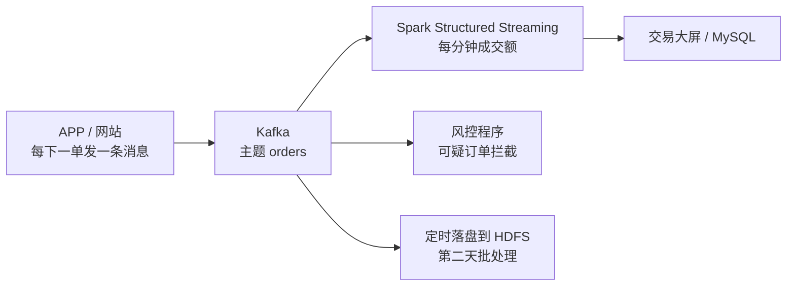
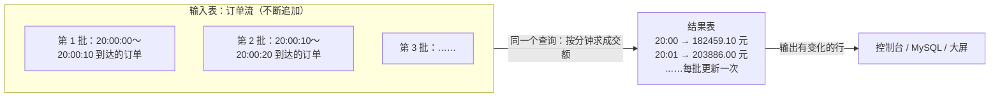
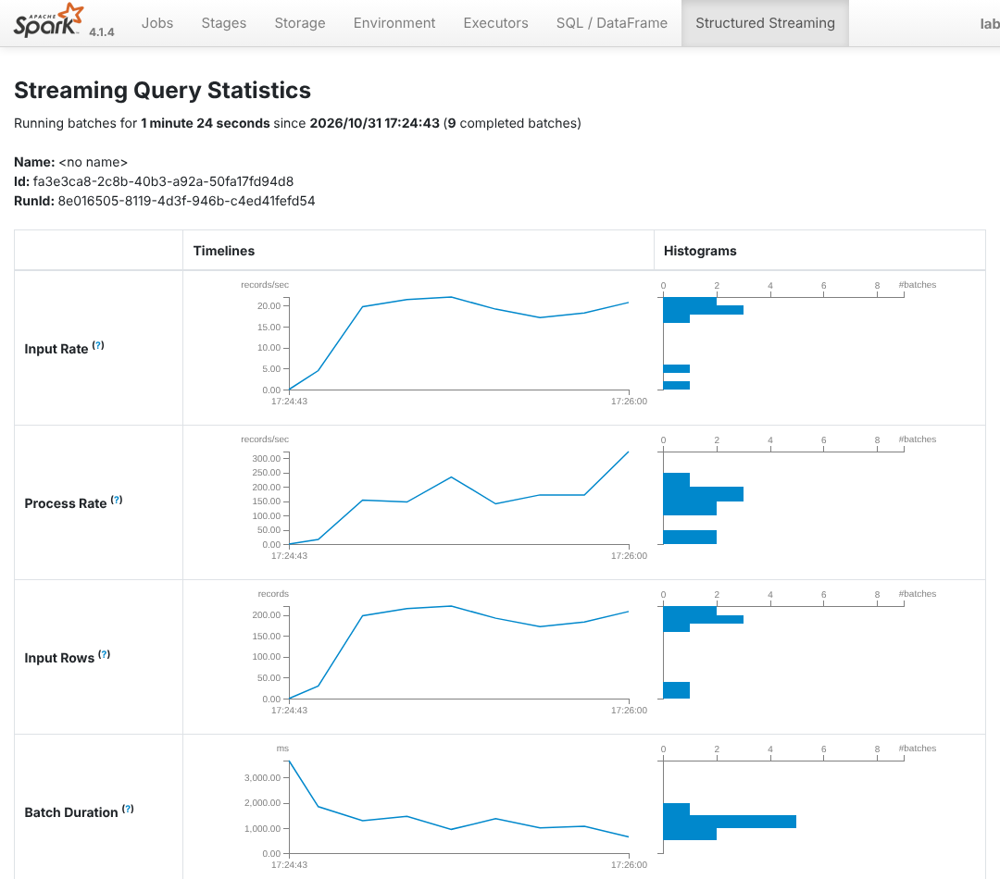
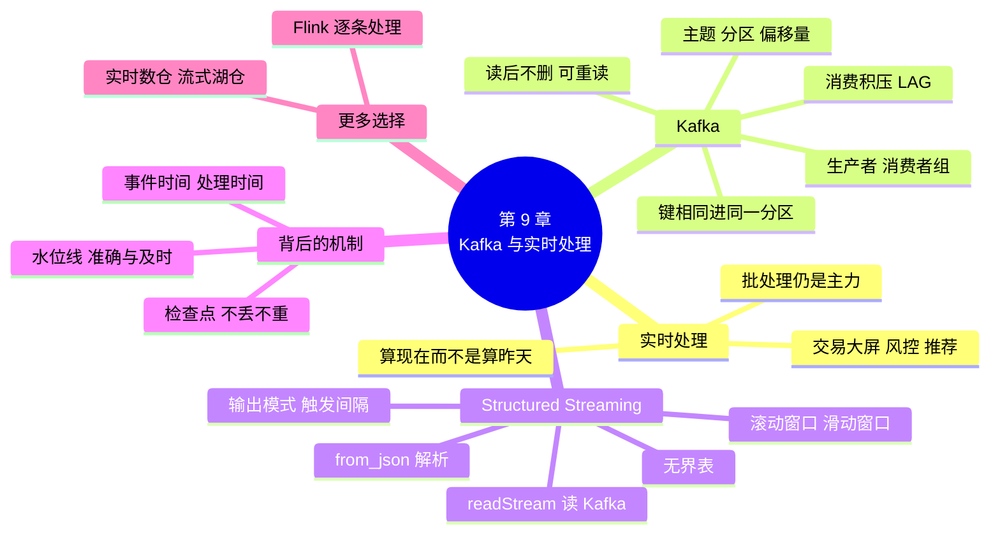

# 第 9 章 Kafka 与实时数据处理

!!! abstract "本章学时"
    理论 5 学时 · 实验 1 学时（本章共 3 个实验，教师可任选）

## 学习目标

学完本章，你应该能够：

1. **说出**实时处理的典型场景，以及消息队列在实时数据链路中的作用（记忆、理解）；
2. **解释** Kafka 的主题、分区、偏移量和消费者组，用命令行和 Python 收发消息、查看消费积压（理解、应用）；
3. **编写** Structured Streaming 程序，从 Kafka 读取订单，按事件时间窗口统计成交额（应用）；
4. **解释**水位线、输出模式和检查点的作用，根据业务要求选择合适的水位线（理解、评价）；
5. **说出** Flink 和实时数仓的用途，判断一个需求该用批处理还是实时处理（理解、评价）。

!!! info "先修要求"
    学习本章前，你需要掌握：

    - DataFrame 的 `select`、`withColumn`、`groupBy().agg()`，以及 `from_json`、`to_timestamp` 这类列函数（[第 7 章](../07-data-cleaning/index.md)、[第 8 章](../08-spark-sql/index.md)）；
    - spark 容器的使用和 Spark UI（[第 6 章 Spark 入门与 RDD 编程](../06-spark-rdd/index.md)）；
    - 批处理与流处理的区别（[第 1 章 1.3 节](../01-overview/index.md)）。

??? abstract "本章概念清单（18 个，点击查看定义和例子）"
    1. [消息队列](../../appendix/glossary.md#g-消息队列)
    2. [Kafka](../../appendix/glossary.md#g-Kafka)
    3. [Broker](../../appendix/glossary.md#g-Broker)
    4. [主题](../../appendix/glossary.md#g-主题)
    5. [生产者](../../appendix/glossary.md#g-生产者)
    6. [消费者组](../../appendix/glossary.md#g-消费者组)
    7. [偏移量](../../appendix/glossary.md#g-偏移量)
    8. [消费积压](../../appendix/glossary.md#g-消费积压)
    9. [Structured Streaming](../../appendix/glossary.md#g-Structured-Streaming)
    10. [无界表](../../appendix/glossary.md#g-无界表)
    11. [事件时间](../../appendix/glossary.md#g-事件时间)
    12. [滚动窗口](../../appendix/glossary.md#g-滚动窗口)
    13. [滑动窗口](../../appendix/glossary.md#g-滑动窗口)
    14. [水位线](../../appendix/glossary.md#g-水位线)
    15. [输出模式](../../appendix/glossary.md#g-输出模式)
    16. [检查点](../../appendix/glossary.md#g-检查点)
    17. [Flink](../../appendix/glossary.md#g-Flink)
    18. [实时数仓](../../appendix/glossary.md#g-实时数仓)

## 情景导入

国庆节晚上 8 点，小象优选的“国庆狂欢夜”开始了。老板站在会议室的大屏前，想看到“这一分钟卖了多少钱、哪个品类卖得最火”；风控部门想在可疑订单付款后几秒内就把它拦下来；推荐系统想根据用户刚刚加购的商品，马上换一批推荐。

前面几章做的都是“算昨天”：数据先落进 HDFS，第二天凌晨跑一遍 Hive 或 Spark，早上出报表。可大屏上的数字要每几秒刷新一次，等到明天就晚了。小林问组长：“能不能每分钟跑一次第 8 章的程序？”组长摇摇头：“每分钟启动一次 Spark 要十几秒，还得重新读全部数据。我们需要的是数据一来就算、算完就出结果，而且程序一直开着。”

本章学习实时处理。我们先在随书集群上加一个 Kafka 容器，用 Python 模拟国庆晚上的实时下单；再用 Spark 的 Structured Streaming 每 10 秒统计一次每分钟的成交额；最后研究两个实时处理特有的问题：手机断网、订单迟到了怎么办？程序重启了，会不会少算或多算？

## 9.1 实时处理解决什么问题

### 9.1.1 从“算昨天”到“算现在”

第 1 章把大数据处理分成[批处理](../../appendix/glossary.md#g-批处理)和[流处理](../../appendix/glossary.md#g-流处理)两种方式。流处理也叫实时处理，它和本书前面一直在做的批处理有几点不同：

| 比较项 | 批处理（第 4～8 章） | 实时处理（本章） |
|---|---|---|
| 数据 | 一段时间内攒好的、有边界的数据，如 9 月的订单 | 源源不断、没有尽头的数据，如此刻正在发生的订单 |
| 什么时候算 | 定时运行，如每天凌晨 | 程序一直运行，数据一到就算 |
| 结果多久出来 | 几分钟到几小时 | 几秒到几分钟 |
| 典型工具 | Hive、Spark | Kafka + Spark Structured Streaming、Flink |

实时处理并不是要取代批处理。大多数报表“算昨天”就够了，而且批处理更简单、更省资源；只有那些“晚了就没用”的需求，才值得用实时处理。

### 9.1.2 三个典型场景

| 场景 | 要做什么 | 要多快 |
|---|---|---|
| 交易大屏 | 每分钟的成交额、订单数、各品类排行，大促时投在大屏上 | 几秒到一分钟 |
| 实时风控 | 一个账号几分钟内在多个城市下单、同一张卡短时间多次付款，马上拦截 | 一两秒以内 |
| 实时推荐 | 用户刚看了、刚加购了什么，下一屏就推荐相关商品 | 一秒以内 |

Kafka 的官方文档也列举了类似的用途：实时处理支付和金融交易、实时跟踪车辆和物流、收集和分析传感器数据等。<sup class="cite">[[2]](#ref9-2)</sup> 这些场景有一个共同点：数据由很多个系统源源不断地产生，又要被好几个系统同时使用。一条典型的实时数据链路是这样的：



中间的 Kafka 像一个快递中转站：发件人（下单系统）只管把包裹送到站里，收件人（大屏、风控、数据仓库）各自来取，谁也不用等谁。下一节就来看这个中转站是怎样工作的。

## 9.2 Kafka：数据的快递中转站

### 9.2.1 为什么要在中间放一个消息队列

假如下单系统直接把每笔订单推给大屏程序和风控程序，会遇到几个麻烦：大屏程序重启的那几十秒，发给它的订单就丢了；国庆晚上订单量是平时的十倍，风控程序处理不过来，就会拖慢下单系统；以后再加一个推荐系统，下单系统的代码还要改。

[**消息队列**](../../appendix/glossary.md#g-消息队列 "在发送数据的系统和使用数据的系统之间暂存消息的中间件，让双方不必同时在线、各按自己的速度工作"){ .term }就是为解决这些问题而生的：发送方把消息写进队列就算完事，接收方按自己的速度来取，暂时处理不过来的消息先在队列里排着；新增一个接收方，发送方不用做任何改动。[**Kafka**](../../appendix/glossary.md#g-Kafka "开源的分布式消息系统（事件流平台），把消息按主题和分区顺序存放在磁盘上，供多个系统读取"){ .term } 是 LinkedIn 公司 2011 年前后为收集网站活动日志开发的消息系统，后来捐给 Apache 基金会，现在是大数据领域使用最广的消息队列。<sup class="cite">[[1]](#ref9-1)</sup>

和一般的消息队列相比，Kafka 有一点特别：**消息被读走以后并不删除**，而是按设定的保留时间（默认 7 天）留在磁盘上。<sup class="cite">[[2]](#ref9-2)</sup> 所以同一份消息可以被很多个系统各读一遍，某个系统出了问题，还能回过头来从某个位置重新读。

### 9.2.2 主题、分区和偏移量

运行 Kafka 服务的服务器叫 [**Broker**](../../appendix/glossary.md#g-Broker "运行 Kafka 服务、存放分区数据的服务器节点"){ .term }，生产环境一般有 3 台以上，随书环境只有 1 台。Broker 上的消息按下面三层组织：

- [**主题**](../../appendix/glossary.md#g-主题 "Kafka 中存放同一类消息的逻辑分类，相当于一个文件夹"){ .term }（Topic）：同一类消息放在一个主题里，比如订单消息放在 `orders`，访问日志放在 `access_log`。可以把主题想成一个文件夹。
- [**分区**](../../appendix/glossary.md#g-分区)（Partition）：一个主题被分成几个分区，分散存放在不同的 Broker 上，读写可以并行。这和第 4 章 MapReduce 的分区、第 6 章 RDD 的分区是同一个思路：把数据切开，大家一起干。
- [**偏移量**](../../appendix/glossary.md#g-偏移量 "消息在分区中的序号，从 0 开始；消费者组靠它记住每个分区读到了哪里"){ .term }（Offset）：每个分区里的消息按到达顺序排成一列，编号从 0 开始，这个编号就是偏移量。

每条消息由**键**（key）、**值**（value）和时间戳组成。值是消息内容，本章的订单消息就是一段 JSON 文本；键决定消息进哪个分区：Kafka 对键做哈希，再除以分区数取余数，所以**键相同的消息一定进同一个分区**。<sup class="cite">[[2]](#ref9-2)</sup> 在一个分区内，消息严格按写入的顺序排列，读的时候也按这个顺序读出；但不同分区之间不保证顺序。实验 9-1 用用户编号做键，同一个用户的订单就会按下单的先后排在同一个分区里。

### 9.2.3 生产者、消费者和消费者组

往主题里写消息的程序叫[**生产者**](../../appendix/glossary.md#g-生产者 "向 Kafka 主题发送消息的程序"){ .term }（Producer），从主题里读消息的程序叫消费者（Consumer）。消费者是主动来“拉”消息的，每次从上次读到的偏移量接着往下读。<sup class="cite">[[1]](#ref9-1)</sup>

一个消费者读得太慢怎么办？可以多开几个，组成一个[**消费者组**](../../appendix/glossary.md#g-消费者组 "用同一个 group.id 一起读一个主题的一组消费者，每个分区只分给组里的一个消费者，不同的组各读各的"){ .term }（Consumer Group）。Kafka 的规则只有两条：

1. **组内分摊**：一个分区只分给组里的一个消费者读，一个消费者可以读好几个分区。3 个分区、2 个消费者，就是一个读 2 个分区、另一个读 1 个分区；如果组里有 4 个消费者，就有 1 个分不到分区，只能闲着。所以**分区数决定了一个组最多能有几个消费者同时干活**。
2. **组间独立**：不同的组各自记录自己读到的偏移量，互不影响。大屏组读过的订单，风控组照样能从头读一遍。

组里有消费者宕机或新加入时，Kafka 会把分区重新分配一次，这叫“再均衡”。接手的消费者从组里记下的偏移量接着读，消息不会丢。

还有一个运维中天天要看的指标：分区里最新消息的偏移量，减去消费者组已经读到的偏移量，就是还没处理的消息数，叫[**消费积压**](../../appendix/glossary.md#g-消费积压 "分区中最新消息的偏移量与消费者组已读到的偏移量之差，即还没处理的消息数"){ .term }（LAG）。积压一直在涨，说明消费者跟不上生产者，要加消费者（同时可能要加分区）或者优化处理程序。

下面的动画可以自己发消息、调整分区数和消费者个数：

<iframe class="sim-frame" src="../../sims/kafka-groups/main.html" height="640" loading="lazy" title="Kafka 分区与消费者组"></iframe>

先按两次“生产者发 6 条”，看同一个用户的订单进了哪个分区；再把“大屏组消费者个数”改成 4，按“消费者读一轮”，看谁闲着；最后勾选“风控组”并让大屏组 1 号消费者宕机，看分区怎样重新分配。[全屏打开](../../sims/kafka-groups/main.html){ target=_blank }

### 9.2.4 随书环境：加一个 Kafka 容器

随书集群新增了配置文件 `labs/cluster/docker-compose.kafka.yml`，用 Apache 官方的 `apache/kafka:4.4.0` 镜像启动一个单节点 Kafka。从 4.0 版开始，Kafka 用自带的 KRaft 模式管理集群信息，不再需要另外安装 ZooKeeper，所以一个容器就够了。它开了两个“入口”：

| 谁来连 | 地址 | 用在哪里 |
|---|---|---|
| 其他容器（如 spark 容器） | `kafka:9092` | 实验 9-2、9-3 的 Spark 程序 |
| 本机上的程序 | `localhost:9094` | 实验 9-1 的 Python 生产者和消费者 |

Kafka 自带一套命令行工具，放在容器的 `/opt/kafka/bin/` 下。最常用的几个：

| 要做什么 | 命令（都要加 `--bootstrap-server localhost:9092`） |
|---|---|
| 建主题 | `kafka-topics.sh --create --topic orders --partitions 3` |
| 列出主题、查看分区 | `kafka-topics.sh --list`；`kafka-topics.sh --describe --topic orders` |
| 在命令行发消息 | `kafka-console-producer.sh --topic hello` |
| 在命令行读消息 | `kafka-console-consumer.sh --topic hello --from-beginning` |
| 查看消费者组的偏移量和积压 | `kafka-consumer-groups.sh --describe --group screen` |
| 查看每个分区最新的偏移量 | `kafka-get-offsets.sh --topic orders` |

编者用命令行发了三条带键的消息：`u001:第一条消息`、`u002:第二条消息`、`u001:第三条消息`，再用消费者从头读出来，并打印分区号和键：

```text
Partition:0	u001	第一条消息
Partition:0	u002	第二条消息
Partition:0	u001	第三条消息
Processed a total of 3 messages
```

三条消息碰巧都进了分区 0：u001 的两条一定在同一个分区，u002 哈希后的余数也恰好是 0。消息多了以后，不同的键会比较均匀地分散到各个分区。

## 9.3 用 Python 发消息和收消息

命令行适合试验，实际系统中消息由程序收发。Python 中常用的 Kafka 库是 kafka-python，它是纯 Python 写的，`pip install kafka-python` 就能装好。<sup class="cite">[[3]](#ref9-3)</sup> 发消息只要三步：

```python
import json
from kafka import KafkaProducer

producer = KafkaProducer(bootstrap_servers="localhost:9094")       # ① 连接 Kafka
order = {"order_id": "r000001", "user_id": "u0045797", "category": "食品生鲜",
         "amount": 173.8, "event_time": "2026-10-01 20:00:00"}
value = json.dumps(order, ensure_ascii=False).encode("utf-8")       # ② 字典 → JSON 文本 → 字节
producer.send("orders", key=order["user_id"].encode(), value=value) # ③ 发到主题 orders，键是用户编号
producer.flush()                                                     # 等所有消息真正发出去
```

Kafka 只认字节，所以发之前要把内容转成字节，读出来再转回去。`send` 是异步的：它把消息放进发送缓冲区就返回，由后台成批发出，速度很快；程序结束前调用 `flush()`，确保缓冲区里的消息都发出去了。

收消息用 `KafkaConsumer`，指定主题和消费者组，然后像遍历列表一样一条条读：

```python
from kafka import KafkaConsumer

consumer = KafkaConsumer("orders", bootstrap_servers="localhost:9094",
                         group_id="screen",               # 消费者组
                         auto_offset_reset="earliest")    # 这个组第一次读时从最早的消息开始
for msg in consumer:                                      # 没有新消息时会一直等着
    o = json.loads(msg.value.decode("utf-8"))
    print(msg.partition, msg.offset, o["user_id"], o["amount"])
```

`auto_offset_reset` 只在这个组**第一次**读这个主题时起作用：`earliest` 从最早的消息开始，`latest`（默认）只读之后新来的。组读过以后，Kafka 记下了它在每个分区的偏移量，再启动时就从记下的位置接着读。

实验 9-1 的 `order_producer.py` 在这个基础上模拟国庆晚上的下单：从用户表、商品表中随机抽取，平均每秒发 20 笔；模拟时钟从 2026-10-01 20:00:00 开始，现实 1 秒相当于模拟 6 秒，100 秒就能发完“10 分钟”的 1975 笔订单。随机种子是固定的，每个人发出的订单完全一样，运行 `python ch09/order_producer.py --dry-run` 还能直接打印每分钟订单数和成交额的“标准答案”，用来核对后面流计算的结果。

## 9.4 Structured Streaming：把数据流当成一张不断变长的表

### 9.4.1 无界表

[**Structured Streaming**](../../appendix/glossary.md#g-Structured-Streaming "Spark 的流处理组件，把源源不断的数据看成一张不断变长的表，用 DataFrame 和 SQL 的写法做增量计算"){ .term } 是 Spark 的流处理组件。它的想法很简单：把源源不断的数据看成一张**不断变长的表**，每来一条数据，就是在表的末尾追加一行，这张表没有尽头，叫[**无界表**](../../appendix/glossary.md#g-无界表 "Structured Streaming 对数据流的看法：新到的每条数据都是追加到表末尾的一行，表没有尽头"){ .term }。你像对普通表一样写 DataFrame 或 SQL 查询，Spark 自动把它变成“增量计算”：每隔一段时间，只处理新追加的那些行，把结果更新一下。<sup class="cite">[[4]](#ref9-4)</sup><sup class="cite">[[5]](#ref9-5)</sup>



这样做的好处是：第 7、8 章学的 DataFrame 写法几乎可以原样搬过来，只是把 `spark.read` 换成 `spark.readStream`，把 `write` 换成 `writeStream`。Structured Streaming 的论文中把这个设计概括为：用户只要像写批处理一样写查询，引擎负责把它增量化。<sup class="cite">[[4]](#ref9-4)</sup>

### 9.4.2 读 Kafka 并解析消息

从 Kafka 读数据，格式写 `kafka`，再告诉它 Broker 的地址和主题：<sup class="cite">[[6]](#ref9-6)</sup>

```python
raw = (spark.readStream.format("kafka")
       .option("kafka.bootstrap.servers", "kafka:9092")   # spark 容器里用 kafka:9092
       .option("subscribe", "orders")                     # 订阅的主题
       .option("startingOffsets", "latest")               # 第一次启动时从哪里读：latest 或 earliest
       .load())
```

得到的 `raw` 是一张流式 DataFrame，每一行是一条消息，列是固定的：`key`、`value`（都是字节）、`topic`、`partition`、`offset`、`timestamp`（消息写入 Kafka 的时间）等。订单内容在 `value` 里，要先转成字符串，再用 `from_json` 按事先定义的结构拆成各列：

```python
schema = (StructType()
          .add("order_id", StringType()).add("user_id", StringType())
          .add("category", StringType()).add("amount", DecimalType(10, 2))
          .add("event_time", StringType()))                # 只写用得到的列也可以
orders = (raw.select(F.from_json(F.col("value").cast("string"), schema).alias("o"))
             .select("o.*")
             .withColumn("event_time", F.to_timestamp("event_time")))
```

这里的 `from_json`、`to_timestamp` 和第 7 章清洗数据时用的是同一类函数。Spark 读 Kafka 需要额外的连接器 jar 包（4 个，实验 9-2 第 1 步下载），提交程序时用 `--jars $KAFKA_JARS` 加上。

### 9.4.3 按时间窗口统计

“每分钟成交额”就是按时间把订单切成一段一段，每段分别求和。Spark 用 `F.window` 函数做这件事，它像 `groupBy` 里的一个特殊的列：

```python
per_minute = (orders
              .groupBy(F.window("event_time", "1 minute"))
              .agg(F.count("*").alias("orders"), F.sum("amount").alias("gmv")))
```

窗口有两种常用的形式：

| 窗口 | 写法 | 特点 | 适合 |
|---|---|---|---|
| [**滚动窗口**](../../appendix/glossary.md#g-滚动窗口 "长度固定、首尾相接、互不重叠的时间窗口，每条数据只属于一个窗口"){ .term } | `F.window("event_time", "1 minute")` | 窗口首尾相接、不重叠，每笔订单只属于一个窗口 | 每分钟成交额、每小时 PV |
| [**滑动窗口**](../../appendix/glossary.md#g-滑动窗口 "长度固定、按较短步长向前滑动、相互重叠的时间窗口，一条数据可能属于多个窗口"){ .term } | `F.window("event_time", "5 minutes", "1 minute")` | 窗口长 5 分钟，每 1 分钟往前滑一次，相邻窗口重叠，一笔订单会算进 5 个窗口 | “最近 5 分钟的成交额”，每分钟刷新一次 |

`groupBy` 里还可以再加别的列，比如 `groupBy(F.window(...), "category")` 就是每分钟每个品类的成交额。

### 9.4.4 输出：输出模式和触发间隔

流查询用 `writeStream` 输出，`start()` 之后程序就一直运行，直到你按 `Ctrl + C`：

```python
query = (per_minute.writeStream
         .outputMode("update")                       # 输出模式
         .format("console")                          # 输出到哪里：控制台
         .option("checkpointLocation", "/xiaoxiang/checkpoint/lab9_2")   # 检查点，9.5.3 节
         .trigger(processingTime="10 seconds")       # 每 10 秒处理一批
         .start())
query.awaitTermination()                             # 让主程序等着，不要退出
```

结果表在不断变化，每次输出时写哪些行？这由[**输出模式**](../../appendix/glossary.md#g-输出模式 "流查询每次把结果表的哪些行写出去：append 只写最终结果，update 写有变化的行，complete 写全部结果"){ .term }决定：<sup class="cite">[[5]](#ref9-5)</sup>

| 输出模式 | 每批写出什么 | 适合 |
|---|---|---|
| `update` | 只写这一批中有变化的行 | 大屏、写进数据库后按主键更新 |
| `complete` | 每次把整张结果表全部写出 | 结果表很小，如各品类累计成交额 |
| `append` | 只写已经确定、以后不会再变的行 | 写文件、写 HDFS（文件写出去就不能改了） |

`trigger` 决定多久处理一批，不写就是“上一批处理完马上处理下一批”。`format` 除了 `console`，常用的还有写文件的 `parquet`、写回 Kafka 的 `kafka`，以及 `foreachBatch`：它把每一批结果当成一个普通的 DataFrame 交给你自己的函数，你可以用第 8 章学的 `write.jdbc` 把它写进 MySQL，实验 9-3 也用它把结果收集起来做比较。

实验 9-2 运行起来以后，Spark UI 上多出一个 Structured Streaming 页面，显示每一批的输入速度、处理速度和用时：



这是编者运行实验 9-2 时的截图。输入速度（Input Rate）每秒约 20 条，正是生产者发送的速度；处理速度（Process Rate）每秒 150～300 条，远大于输入速度，说明处理得过来。如果处理速度长期低于输入速度，每批的用时就会越来越长，结果越来越滞后，这时就要加资源或简化计算了。

## 9.5 看懂背后发生了什么

### 9.5.1 事件时间和处理时间

上面的窗口是按订单里的 `event_time` 划分的，这叫[**事件时间**](../../appendix/glossary.md#g-事件时间 "事件实际发生的时间，通常写在数据里；与数据到达、被处理的时间不同"){ .term }，即事情真正发生的时间。与它相对的是处理时间：数据到达 Spark、被处理的时间。正常情况下两者只差一两秒，但有时差得很多：用户在地铁里下单，手机没信号，订单 3 分钟后才发出来；某台服务器网络故障，一批日志半小时后才补传。

如果按处理时间统计，这笔 20:00 下的单会被算进 20:03 那一分钟，大屏上的数字就不准了。所以统计业务指标一般用事件时间。可这又带来一个新问题：20:00 这一分钟的窗口，要等到什么时候才算“结束”？总不能一直等下去，否则 Spark 要把从古至今每一分钟的中间结果都留在内存里。

### 9.5.2 水位线：最多等多久

[**水位线**](../../appendix/glossary.md#g-水位线 "流处理中“最多等迟到数据多久”的界线，等于见过的最大事件时间减去设定的等待时间；早于它结束的窗口不再更新"){ .term }（Watermark）就是对这个问题的回答。用 `withWatermark` 设定“最多等迟到的数据多久”：

```python
per_minute = (orders
              .withWatermark("event_time", "2 minutes")   # 最多等 2 分钟
              .groupBy(F.window("event_time", "1 minute"))
              .agg(F.count("*").alias("orders"), F.sum("amount").alias("gmv")))
```

Spark 在每批开始时计算水位线 = 目前见过的最大事件时间 − 2 分钟。一个窗口的结束时间早于水位线，就认为它“结束”了：结果不再更新，它的中间状态从内存里清掉，之后再来属于这个窗口的数据，直接丢弃。<sup class="cite">[[5]](#ref9-5)</sup> 举个例子：已经见过 20:05:30 下的订单，水位线就是 20:03:30，20:02～20:03 及更早的窗口都已结束；这时一笔 20:02:50 下单、刚刚才到的订单就不会被计入了。

这个“等多久”的设定，本质上是在三件事之间取舍，Google 的 Dataflow 论文把它概括为正确性、延迟和成本的平衡：<sup class="cite">[[7]](#ref9-7)</sup>

| 水位线设得…… | 结果准不准 | 结果多久能定下来 | 占多少内存 |
|---|---|---|---|
| 小（如 10 秒） | 迟到稍久的数据被丢掉，结果偏小 | 快 | 少，只保存最近一两个窗口 |
| 大（如 5 分钟） | 迟到的数据基本都能算上 | 慢，窗口要等 5 分钟后才定下来 | 多，要同时保存很多个窗口 |

实验 9-3 在同一份带迟到订单的数据上试了三种水位线，结果正好印证了这张表：

| 水位线 | 少算的订单 | 状态中最多同时保存的窗口 |
|---|---|---|
| 10 秒 | 83 笔 | 2 个 |
| 2 分钟 | 54 笔 | 4 个 |
| 5 分钟 | 0 笔 | 7 个 |

这份数据中有 92 笔订单迟到了 1～5 分钟。水位线 5 分钟时一笔不少，但每个窗口要多等 5 分钟才能定下来；10 秒时少算了 83 笔。该设多少，要看业务：交易大屏更看重“快”，可以设得小一些，第二天再用批处理把准确的数字补上；按分钟结算的账单更看重“准”，就要设得大一些。

!!! warning "水位线只在 update 和 append 模式下清理状态"
    `complete` 模式每次都要输出全部结果，Spark 必须保留所有窗口，水位线也就不起作用了。按事件时间做窗口统计时，一般用 `update` 或 `append` 模式。append 模式只输出已经结束的窗口，所以要等过了水位线才看得到结果。

下面的动画用 15 笔订单演示水位线怎样往前走：

<iframe class="sim-frame" src="../../sims/late-data/main.html" height="820" loading="lazy" title="时间窗口与迟到数据"></iframe>

先选“1 分钟”，一笔一笔按“下一笔到达”，看第 4、7 笔这样稍晚到的订单为什么还能算进去，第 10、13 笔为什么被丢掉了；再换成“0 秒”和“3 分钟”比较丢掉的笔数和还没结束的窗口数。[全屏打开](../../sims/late-data/main.html){ target=_blank }

### 9.5.3 检查点：重启以后接着算

流处理程序一跑就是几个月，难免要重启：升级程序、机器维护、出错退出。重启以后从哪里读？读过的订单会不会再算一遍？之前算到一半的“20:03 这一分钟”还在不在？

这些都靠[**检查点**](../../appendix/glossary.md#g-检查点 "流查询定期保存的读取进度和中间状态，程序重启后从这里接着算，不丢不重"){ .term }（Checkpoint）。设置了 `checkpointLocation` 以后，Spark 每处理一批，都把两样东西存进这个目录：一是这批读到了 Kafka 每个分区的哪个偏移量，二是各个窗口的中间结果（状态）。程序重启时，只要检查点目录不变，Spark 就从上次的偏移量接着读，并恢复中间结果，做到不丢也不重。这时 `startingOffsets` 不再起作用，它只管“第一次启动”。<sup class="cite">[[6]](#ref9-6)</sup>

随书 spark 容器中，不带 `file://` 的路径指 HDFS（第 6 章），所以实验 9-2 的检查点存在 HDFS 的 `/xiaoxiang/checkpoint/lab9_2` 下。生产环境中检查点也要放在 HDFS 或对象存储这类可靠的地方，放在某台机器的本地磁盘上，机器一坏就全没了。

编者在实验 9-2 中做了一个试验：程序运行到第 4 批（模拟时间约 20:03）时按 `Ctrl + C` 停掉，生产者继续发送；25 秒后重新启动程序。重启后的第一批（Batch 5）一下子处理了停机期间积压的订单，输出的 20:03 这一分钟是 208 笔、214716.90 元，与“标准答案”完全一致：停机前已经算进去的 110 笔从检查点里恢复了，停机期间到达的订单一笔也没漏。

!!! tip "想从头再来，要删掉检查点"
    换了程序逻辑（比如改了窗口长度）或者想从头重算，要先删掉检查点目录：`hdfs dfs -rm -r /xiaoxiang/checkpoint/lab9_2`。如果删掉并重建了 Kafka 主题，却没有删检查点，Spark 会发现偏移量对不上而报错 `Some data may have been lost`。

## 9.6 Flink 简介

讲实时处理绕不开 [**Flink**](../../appendix/glossary.md#g-Flink "开源的分布式流处理引擎，逐条处理数据、延迟低，国内实时计算的主流选择"){ .term }。它是德国柏林工业大学等机构研发、后来捐给 Apache 的流处理引擎，设计思想正好和 Spark 反过来：Spark 以批处理为本，Structured Streaming 默认把数据流切成一小批一小批地处理；Flink 以流处理为本，数据来一条处理一条，把批处理看成“有尽头的流”。<sup class="cite">[[8]](#ref9-8)</sup>

| 比较项 | Spark Structured Streaming | Flink |
|---|---|---|
| 处理方式 | 默认微批，每批间隔可以设到 1 秒以内 | 逐条处理 |
| 延迟 | 通常是秒级 | 可以做到毫秒级 |
| 优势 | 和 Spark 的批处理、SQL、机器学习用同一套代码和集群 | 延迟低，状态管理和事件时间处理功能丰富 |
| 国内使用 | 已有 Spark 平台的企业顺手用来做实时 | 阿里巴巴、字节跳动等大规模使用，实时计算的主流选择 |

两者的基本概念是相通的：事件时间、窗口、水位线、检查点在 Flink 中都有，写法也很接近，学会了本章的内容，再学 Flink 会很快。国内云厂商也都提供托管的 Flink 服务，比如阿里云的“实时计算 Flink 版”，用 SQL 就能写实时任务，不用自己搭集群。<sup class="cite">[[9]](#ref9-9)</sup>

## 9.7 前沿视窗

**实时数仓：让数据仓库也“实时”起来。**第 5 章的数据仓库每天凌晨加工一次，ODS 到 ADS 的每一层都是批处理，数据要第二天才能查到。[**实时数仓**](../../appendix/glossary.md#g-实时数仓 "数据从产生到可以查询只需秒级或分钟级的数据仓库，由流处理引擎持续加工各层数据"){ .term }把这些加工步骤换成一直运行的流处理任务：订单一进 Kafka，就被 Flink 或 Spark 持续清洗成 DWD、汇总成 DWS，几秒到几分钟后分析人员就能查到。

早期的做法是在批处理数仓旁边再搭一套实时链路，两套代码、两份数据，口径还容易对不上。近几年流行“流式湖仓”：用一种既能流式写入、又能批量查询的表格式存数据，一份数据、一套口径同时服务实时和离线查询。由 Flink 社区的 Table Store 项目发展而来、现为 Apache 顶级项目的 Paimon 就是这样的表格式，它的官方介绍是“可以与 Flink 和 Spark 一起构建实时湖仓架构”；<sup class="cite">[[10]](#ref9-10)</sup> 阿里云实时计算 Flink 版的解决方案中，也把“基于 Paimon 的流式湖仓”“基于 Hologres 的实时数仓”列为主要架构。<sup class="cite">[[9]](#ref9-9)</sup> 不管用哪种产品，本章学的消息队列、事件时间、窗口、水位线、检查点都是它们的基础。

## 本章实验

!!! abstract "实验总览"
    | 实验 | 类型 | 建议时长 | 内容 |
    |---|---|---|---|
    | 实验 9-1 | ★ 基础 | 35 分钟 | 启动 Kafka 容器，用命令行建主题、收发消息；用 Python 模拟国庆晚上的实时下单，体会消费者组分摊分区和消费积压 |
    | 实验 9-2 | ★ 基础 | 35 分钟 | 用 Structured Streaming 从 Kafka 读订单，每 10 秒更新一次每分钟的成交额和订单数；停掉程序再重启，验证检查点 |
    | 实验 9-3 | ☆ 拓展 | 25 分钟 | 发一批带迟到订单的数据，分别用 10 秒、2 分钟、5 分钟的水位线统计，与标准答案比较 |

    实验用第 6 章的 spark 容器和本章的 Kafka 容器，不需要 Hive 和 MySQL，Docker 分配 6 GB 内存即可。本机要安装 kafka-python。实验代码见配套资源 `labs/ch09/` 目录。编者的运行环境：4 核 CPU、16 GB 内存的 Linux 主机，Docker 29.9，Kafka 4.4.0、Spark 4.1.4 镜像，Python 3.12，kafka-python 3.0.12。

### 实验 9-1 ★ Kafka 收发消息

**实验目的**

1. 启动 Kafka 容器，用命令行工具建主题、查看分区、收发消息；
2. 用 Python 程序模拟实时下单，观察消息按键分到各个分区；
3. 体会消费者组的两条规则（组内分摊、组间独立），学会查看消费积压。

**实验环境**：随书集群加 spark 容器和 Kafka 容器（`docker-compose.kafka.yml`）；本机 Python 3.12。

**实验数据**：`labs/data/xiaoxiang/` 下的用户表和商品表（实验 1-1 生成），生产者从中随机抽取用户和商品组成订单。

**实验步骤与代码**

第 1 步，启动集群、spark 容器和 Kafka 容器。后面的命令都要带这三个 `-f`，可以先把它们存进一个变量：

```bash
cd labs/cluster
docker compose -f docker-compose.yml -f docker-compose.spark.yml -f docker-compose.kafka.yml up -d
# Linux、macOS：  C="docker compose -f docker-compose.yml -f docker-compose.spark.yml -f docker-compose.kafka.yml"
# PowerShell：    function C { docker compose -f docker-compose.yml -f docker-compose.spark.yml -f docker-compose.kafka.yml @args }
```

第 2 步，进入 Kafka 容器，建主题 `orders`（3 个分区），并查看分区情况：

```bash
$C exec kafka bash          # PowerShell 中写 C exec kafka bash
cd /opt/kafka/bin
./kafka-topics.sh --bootstrap-server localhost:9092 --create --topic orders --partitions 3
./kafka-topics.sh --bootstrap-server localhost:9092 --describe --topic orders
```

```text
Created topic orders.
Topic: orders	TopicId: ...	PartitionCount: 3	ReplicationFactor: 1	Configs: min.insync.replicas=1
	Topic: orders	Partition: 0	Leader: 1	Replicas: 1	Isr: 1	Elr: 	LastKnownElr: 
	Topic: orders	Partition: 1	Leader: 1	Replicas: 1	Isr: 1	Elr: 	LastKnownElr: 
	Topic: orders	Partition: 2	Leader: 1	Replicas: 1	Isr: 1	Elr: 	LastKnownElr: 
```

`Leader: 1` 表示这个分区由 1 号 Broker 负责读写，`Replicas: 1` 表示只有一个副本。容器刚启动时可能先出现几行 `Connection to node -1 ... could not be established` 的警告，等几秒 Kafka 就绪后命令会正常完成。

第 3 步，用命令行收发消息。建一个试验用的主题 `hello`，用生产者发三条带键的消息（键和值用冒号隔开，输入完按 `Ctrl + D` 结束），再用消费者从头读出来：

```bash
./kafka-topics.sh --bootstrap-server localhost:9092 --create --topic hello --partitions 3
./kafka-console-producer.sh --bootstrap-server localhost:9092 --topic hello \
    --reader-property parse.key=true --reader-property key.separator=:
>u001:第一条消息
>u002:第二条消息
>u001:第三条消息
./kafka-console-consumer.sh --bootstrap-server localhost:9092 --topic hello --from-beginning \
    --formatter-property print.key=true --formatter-property print.partition=true
```

结果见 9.2.4 节。消费者读完后会一直等新消息，按 `Ctrl + C` 退出，再输入 `exit` 退出容器。

第 4 步，在本机 `labs` 目录下安装 kafka-python，先看一眼“标准答案”：

```bash
pip install kafka-python -i https://pypi.tuna.tsinghua.edu.cn/simple
python ch09/order_producer.py --dry-run
```

```text
共 1975 笔订单，模拟 10-01 20:00 起 10 分钟，其中迟到 0 笔
                  orders       gmv
minute                            
2026-10-01 20:00     196  182459.1
2026-10-01 20:01     199  203886.0
2026-10-01 20:02     222  302643.0
2026-10-01 20:03     208  214716.9
2026-10-01 20:04     178  140686.8
2026-10-01 20:05     172  193402.7
2026-10-01 20:06     202  223733.8
2026-10-01 20:07     188  169877.1
2026-10-01 20:08     196  188312.3
2026-10-01 20:09     214  226893.4
```

第 5 步，体会消费者组。在本机开三个命令行窗口，都进入 `labs` 目录：

- 窗口 A 和窗口 B 都运行 `python ch09/order_consumer.py --group screen`，两个消费者同属“大屏组”；
- 等两个窗口都显示“已连接”后，在窗口 C 运行 `python ch09/order_producer.py`，开始发订单；
- 大约 40 秒后，在窗口 A、B 按 `Ctrl + C` 停掉两个消费者，记下它们各分到了哪些分区、读了多少条。

编者的结果（窗口 A 只列最后几行）：

```text
窗口 A：
分区 2 偏移量    0  20:00:00  u0056538  手机数码     779.90 元
分区 2 偏移量    1  20:00:00  u0004441  美妆个护     383.90 元
……
本消费者分到的分区：[2]
  分区 2：254 条
合计 254 条，金额 309,429.90 元

窗口 B：
本消费者分到的分区：[0, 1]
  分区 0：259 条
  分区 1：249 条
合计 508 条，金额 537,335.80 元
```

3 个分区被两个消费者分摊：一个读 1 个、另一个读 2 个，两人加起来读了 762 条，没有一条重复。

第 6 步，查看消费积压。生产者还在发，消费者已经停了，积压会越来越多。另开一个窗口查看大屏组的情况：

```bash
$C exec kafka /opt/kafka/bin/kafka-consumer-groups.sh --bootstrap-server localhost:9092 --describe --group screen
```

```text
Consumer group 'screen' has no active members.

GROUP           TOPIC           PARTITION  CURRENT-OFFSET  LOG-END-OFFSET  LAG   ...
screen          orders          0          259             406             147   ...
screen          orders          1          249             399             150   ...
screen          orders          2          254             390             136   ...
```

`CURRENT-OFFSET` 是大屏组在每个分区读到的位置，正好等于第 5 步读的条数；`LOG-END-OFFSET` 是分区里最新消息的偏移量；`LAG` 是两者之差，即积压。等生产者显示“发送完毕”后再查一次，三个分区的积压变成 420、397、396，合计 1213 条。

第 7 步，让大屏组接着读，再换一个组从头读：

```bash
python ch09/order_consumer.py --group screen --show 2     # 读完后按 Ctrl + C
python ch09/order_consumer.py --group risk --show 1       # 读完后按 Ctrl + C
```

```text
（大屏组）
分区 1 偏移量  249  20:03:39  u0009491  图书文具       5.00 元
分区 2 偏移量  254  20:03:37  u0018669  美妆个护     969.80 元
分区 0 偏移量  259  20:03:38  u0044198  美妆个护     217.90 元
……
合计 1213 条，金额 1,199,845.40 元

（风控组）
本消费者分到的分区：[0, 1, 2]
  分区 0：679 条
  分区 1：646 条
  分区 2：650 条
合计 1975 条，金额 2,046,611.10 元
```

大屏组从偏移量 249、254、259 接着读，正好是第 6 步记下的位置，读了剩下的 1213 条，再查积压就都是 0 了；风控组是新的组，从头读到了全部 1975 条，金额 2,046,611.10 元，等于第 4 步标准答案各分钟之和。

**实验记录表**

| 观察内容 | 你的结果 |
|---|---|
| 主题 `hello` 中三条消息各在哪个分区，为什么 u001 的两条在同一个分区 | |
| 第 5 步两个消费者各分到哪些分区、读了多少条 | |
| 第 6 步三个分区的 LAG | |
| 第 7 步大屏组从哪个偏移量接着读、读了多少条 | |
| 风控组读到的总条数和金额，是否与标准答案一致 | |

**常见问题排查**

| 现象 | 原因 | 解决办法 |
|---|---|---|
| `NoBrokersAvailable` | Kafka 容器没启动，或刚启动还没就绪 | `$C ps` 查看，等十几秒再试 |
| 本机程序连上了，但一直收不到消息、反复报连接 `kafka:9092` 失败 | 本机程序用了容器内部的地址 | 本机程序连 `localhost:9094`；容器里的程序才连 `kafka:9092` |
| 消费者启动后什么也不打印 | 这个组以前读过，已经读到了最新位置 | 换一个新的 `--group` 名字，或者先运行生产者 |
| 第三个消费者一直没有分到分区 | 组里的消费者比分区多 | 正常现象；要多个消费者同时干活，先增加分区 |
| `ModuleNotFoundError: No module named 'kafka'` | 没有安装 kafka-python | `pip install kafka-python` |

**思考与练习**

1. 在第 5 步同时开 4 个大屏组的消费者，会有几个闲着？如果主题有 6 个分区呢？
2. 生产者用用户编号做键。如果改成不带键发送（`key=None`），同一个用户的订单还会在同一个分区里吗？这会影响什么样的统计？

**实验报告要求**

提交第 5～7 步的输出截图和实验记录表，回答思考与练习的两个问题。

### 实验 9-2 ★ 实时成交额统计

**实验目的**

1. 编写 Structured Streaming 程序，从 Kafka 读订单消息并解析成表；
2. 按事件时间每 1 分钟一个窗口，实时统计成交额和订单数，并与标准答案核对；
3. 停掉程序再重启，验证检查点能让统计接着进行、不丢不重；在 Spark UI 上查看流处理的统计页面。

**实验环境**：同实验 9-1。

**实验数据**：生产者实时发送到主题 `orders` 的订单消息。

**实验步骤与代码**

第 1 步，下载 Spark 读 Kafka 用的 4 个 jar 包。它们的路径列在 `labs/jars/kafka-jars.txt` 中，在本机 `labs` 目录下运行：

```bash
# Linux、macOS：
while read f; do curl -o jars/$(basename $f) https://repo1.maven.org/maven2/$f; done < jars/kafka-jars.txt
# Windows PowerShell：
Get-Content jars\kafka-jars.txt | ForEach-Object { Invoke-WebRequest -Uri "https://repo1.maven.org/maven2/$_" -OutFile ("jars\" + (Split-Path $_ -Leaf)) }
```

下载慢的话，可以把地址中的 `https://repo1.maven.org/maven2/` 换成阿里云镜像 `https://maven.aliyun.com/repository/public/`。4 个文件共约 10 MB，其中最大的 `kafka-clients-3.9.1.jar` 约 9 MB。spark 容器里已经设好了环境变量 `KAFKA_JARS`，列出了这 4 个文件的路径。

第 2 步，打开 `labs/ch09/lab9_2_stream.py`，对照 9.4 节找到 ①读、②解析、③统计、④输出 四部分。然后进入 spark 容器运行它：

```bash
cd labs/cluster
$C exec spark bash
spark-submit --jars $KAFKA_JARS ch09/lab9_2_stream.py
```

看到 `Batch: 0` 和一张空表，说明程序已经连上 Kafka，正在等新消息（`startingOffsets` 是 `latest`，实验 9-1 发过的订单不会再算）。

第 3 步，在本机另一个窗口运行生产者：`python ch09/order_producer.py`。回到 spark 容器的窗口，每 10 秒会输出一批结果。

第 4 步，等生产者发完、输出不再变化后，对照第 4 步的标准答案检查每一分钟的最终结果，然后打开浏览器访问 `http://localhost:4040`，点 Structured Streaming 页，再点查询的 Run ID，查看统计页面（9.4.4 节的截图）。

第 5 步，验证检查点。先按 `Ctrl + C` 停掉程序（会出现一段 `Py4JNetworkError` 报错，最后一行是“查询已停止，下次启动从检查点接着算”，这是正常的）。为了让结果能和标准答案对照，先删掉检查点，从头做一遍：

```bash
$C exec master hdfs dfs -rm -r /xiaoxiang/checkpoint/lab9_2   # 在本机另一个窗口（labs/cluster 目录）执行
spark-submit --jars $KAFKA_JARS ch09/lab9_2_stream.py          # 回到 spark 容器的窗口执行
```

出现 `Batch: 0` 后，在本机再运行一次生产者；大约 40 秒后（程序输出到第 4 批左右）按 `Ctrl + C` 停掉 Spark 程序，生产者不要停；再过 20～30 秒，重新运行同一条 `spark-submit` 命令，观察重启后的第一批输出。

**运行结果**

程序启动约 10 秒后出现 `Batch: 0`。编者的输出（只列前 5 批）：

```text
-------------------------------------------
Batch: 1
-------------------------------------------
+------+------+--------+
|minute|orders|gmv     |
+------+------+--------+
|20:00 |89    |72522.00|
+------+------+--------+

-------------------------------------------
Batch: 2
-------------------------------------------
+------+------+---------+
|minute|orders|gmv      |
+------+------+---------+
|20:01 |93    |96751.60 |
|20:00 |196   |182459.10|
+------+------+---------+

-------------------------------------------
Batch: 3
-------------------------------------------
+------+------+---------+
|minute|orders|gmv      |
+------+------+---------+
|20:01 |199   |203886.00|
|20:02 |100   |126975.80|
+------+------+---------+
……
```

现实 10 秒相当于模拟 1 分钟，所以每一批大约推进一分钟。update 模式下每批只输出有变化的窗口：第 1 批 20:00 这一分钟才过了一半，只有 89 笔；第 2 批这一分钟结束，变成 196 笔、182459.10 元，与标准答案相同，以后就不再出现了。全部 10 分钟的最终结果都与标准答案一致。

第 5 步编者在第 4 批之后停掉程序，25 秒后重启，重启后的第一批是 Batch 5，而不是从 Batch 0 重新开始：

```text
-------------------------------------------
Batch: 5
-------------------------------------------
+------+------+---------+
|minute|orders|gmv      |
+------+------+---------+
|20:03 |208   |214716.90|
|20:05 |172   |193402.70|
|20:06 |202   |223733.80|
|20:07 |62    |82420.60 |
|20:04 |178   |140686.80|
+------+------+---------+
```

停机期间积压的订单在这一批里一起处理了。20:03 这一分钟在停机前（第 4 批）已经算了 110 笔，重启后恢复了这部分状态，加上新读到的订单变成 208 笔，与标准答案一致。

**实验记录表**

| 观察内容 | 你的结果 |
|---|---|
| 每批大约推进模拟时间几分钟，20:00 这一分钟在第几批定下来 | |
| 10 个窗口的最终结果与标准答案是否一致 | |
| Spark UI 上的输入速度和处理速度 | |
| 重启后第一批的编号，以及停机前后同一分钟的订单数 | |

**常见问题排查**

| 现象 | 原因 | 解决办法 |
|---|---|---|
| `Failed to find data source: kafka` | 没有加 `--jars $KAFKA_JARS`，或 jar 包没下载全 | `ls /labs/jars/` 检查 4 个文件；`echo $KAFKA_JARS` 检查环境变量（为空就先 `$C up -d spark` 重建容器） |
| 一直只输出空表 | 生产者没有运行，或发到了别的主题 | 确认生产者在运行、主题是 `orders` |
| `Some data may have been lost because they are not available in Kafka any more` | 删除重建了主题，检查点里的偏移量对不上 | 删掉检查点：`$C exec master hdfs dfs -rm -r /xiaoxiang/checkpoint/lab9_2` |
| 重启后从 Batch 0 开始，之前的结果都没了 | 改了检查点路径，或检查点被删了 | 检查点路径要保持不变 |
| `gmv` 一列全是 NULL | JSON 中的字段名和 schema 不一致 | 对照生产者发出的字段名检查 schema |

**思考与练习**

1. 把输出模式改成 `complete` 并在最后加 `.orderBy("minute")`，输出有什么变化？为什么 `update` 模式下不能加 `orderBy`？
2. 把触发间隔改成 `30 seconds`，每批的结果会怎样变化？大屏的刷新速度和 Spark 的负担各有什么变化？

**实验报告要求**

提交运行结果截图（含重启后的第一批）、Spark UI 统计页面截图和实验记录表，回答思考与练习的两个问题。

### 实验 9-3 ☆ 迟到数据怎么处理

**实验目的**

1. 发一批含迟到订单的数据，理解事件时间与到达顺序的差别；
2. 分别用三种水位线统计每分钟订单数和成交额，与标准答案比较；
3. 根据结果说明水位线大小对准确性、延迟和内存的影响。

**实验环境**：同实验 9-1、9-2。

**实验数据**：生产者用 `--late 0.05` 参数生成的订单，约 5% 的订单迟到 1～5 分钟。

**实验步骤与代码**

第 1 步，建一个新主题 `orders_late`，发一遍带迟到订单的数据（只需发一次，用时 100 秒）：

```bash
$C exec kafka /opt/kafka/bin/kafka-topics.sh --bootstrap-server localhost:9092 --create --topic orders_late --partitions 3
python ch09/order_producer.py --late 0.05 --topic orders_late
python ch09/order_producer.py --late 0.05 --dry-run        # 打印这份数据的标准答案
```

标准答案的第一行是 `共 1975 笔订单，……其中迟到 92 笔`，表中多出了 19:55～19:59 这几分钟：有的订单迟到了好几分钟，它们是 20:00 之前下的单，20:00 之后才到。

第 2 步，打开 `labs/ch09/lab9_3_late.py` 阅读。它先用**批处理**把主题里的全部消息读一遍，算出标准答案；再用**流处理**从头“重放”同样的消息（`maxOffsetsPerTrigger` 限制每批只取 60 条，模拟数据陆续到达；`trigger(availableNow=True)` 表示处理完现有的消息就停止），用 `foreachBatch` 把每个窗口最后一次输出的值收集起来，最后两者逐分钟对比。

第 3 步，在 spark 容器中分别用三种水位线运行，每次约 30 秒：

```bash
spark-submit --jars $KAFKA_JARS ch09/lab9_3_late.py "10 seconds"
spark-submit --jars $KAFKA_JARS ch09/lab9_3_late.py "2 minutes"
spark-submit --jars $KAFKA_JARS ch09/lab9_3_late.py "5 minutes"
```

**运行结果**

水位线 10 秒的结果：

```text
水位线 10 seconds：共处理 35 批，状态中最多同时保存 2 个窗口
分钟    标准答案(笔)  流计算(笔)  少算(笔)   标准答案(元)   流计算(元)
19:55          1           1        0         205.80        205.80
19:56          2           2        0        3038.40       3038.40
19:57          6           0        6       14045.90             0
19:58          8           1        7        6711.40       1649.70
19:59          9           0        9        8798.50             0
20:00        197         189        8      180934.60     176382.90
20:01        197         193        4      196136.40     195291.00
20:02        220         210       10      314058.20     292370.10
20:03        210         201        9      216778.60     207074.10
20:04        184         175        9      151994.40     135644.40
20:05        174         164       10      191982.80     183201.90
20:06        205         198        7      225028.60     222710.70
20:07        175         173        2      148449.00     147310.50
20:08        180         178        2      162878.10     162681.20
20:09        207         207        0      225570.40     225570.40
合计少算 83 笔
```

三种水位线的汇总：

| 水位线 | 少算的订单 | 状态中最多同时保存的窗口 | 少算最多的一分钟 |
|---|---|---|---|
| 10 秒 | 83 笔 | 2 个 | 20:02、20:05 各少 10 笔 |
| 2 分钟 | 54 笔 | 4 个 | 20:02 少 10 笔 |
| 5 分钟 | 0 笔 | 7 个 | 无，全部与标准答案一致 |

水位线 10 秒时，92 笔迟到订单中只有 9 笔被算上：19:55、19:56 的 3 笔是在最开始几批到达的，那时水位线还没有往前走；其余迟到 1 分钟以上的订单，到达时它们的窗口大多已经结束了。水位线 2 分钟时，迟到 2 分钟以内的订单基本都算上了，少算的是迟到更久的；5 分钟时一笔不少，代价是要同时在内存中保存 7 个窗口，每个窗口也要等 5 分钟以后才能定下来。同样的程序重复运行，结果完全相同。

**实验记录表**

| 水位线 | 少算的订单 | 状态中最多保存的窗口 | 你的结论 |
|---|---|---|---|
| 10 秒 | | | |
| 2 分钟 | | | |
| 5 分钟 | | | |

**常见问题排查**

| 现象 | 原因 | 解决办法 |
|---|---|---|
| 标准答案一列全是 0，或只有几行 | 主题 `orders_late` 是空的，或生产者没发完就停了 | 先完成第 1 步，等生产者显示“发送完毕” |
| 结果和书上不同，总数也不是 1975 | 生产者发了不止一遍，主题里有重复的订单 | 删除主题后重建，再发一遍 |
| 少算的笔数比书上多一些 | 第 1 步发送时生产者被中断过，消息顺序与书上不同 | 删除主题重建后重新发送 |
| 程序一直不停 | 没有写 `trigger(availableNow=True)` | 检查程序最后的 `trigger` 设置 |

**思考与练习**

1. 如果交易大屏要求“每分钟的数字在这一分钟结束后 30 秒内就要定下来”，水位线最大能设多少？代价是什么？
2. 被水位线丢掉的迟到订单就永远不算了吗？结合第 5 章的数据仓库，说说怎样第二天把准确的数字补上。

**实验报告要求**

提交三次运行的输出截图和实验记录表，回答思考与练习的两个问题，并为交易大屏推荐一个水位线设置，说明理由。

## 本章小结

- 实时处理“算现在”：数据源源不断，程序一直运行，几秒到几分钟出结果，用于交易大屏、实时风控、实时推荐。大多数报表用批处理就够了，只有“晚了就没用”的需求才值得用实时处理。
- **消息队列**让发送方和接收方各按自己的速度工作。**Kafka** 把消息按**主题**、分区存放，分区内用**偏移量**编号；键相同的消息进同一个分区，分区内有序。消息读走后不删除，多个系统可以各读一遍。
- **生产者**写消息，消费者按偏移量拉取。**消费者组**内一个分区只给一个消费者读，组间各读各的；分区数决定了一个组最多几个消费者同时干活。**消费积压**（LAG）持续增长说明消费者跟不上。
- **Structured Streaming** 把数据流看成**无界表**：`readStream` 读 Kafka，`from_json` 解析，`groupBy(F.window(...))` 按**事件时间**分**滚动窗口**或**滑动窗口**统计，`writeStream` 按**输出模式**（update、complete、append）每隔一段时间输出。
- **水位线** = 见过的最大事件时间 − 等待时间，早于它结束的窗口不再更新，迟到更久的数据被丢弃。实验 9-3 中水位线 10 秒少算 83 笔，5 分钟一笔不少但要同时保存 7 个窗口：水位线是在准确、及时和内存之间取舍。
- **检查点**保存读取进度和中间状态，程序重启后接着算、不丢不重；要放在 HDFS 这类可靠的存储上，改了程序逻辑要删掉重来。
- **Flink** 逐条处理、延迟更低，是国内实时计算的主流选择，概念与 Structured Streaming 相通；**实时数仓**和流式湖仓让数据仓库的各层也持续更新。



**下一章预告**

前面几章，我们一直在“统计”：算销售额、算排名、算每分钟的成交额，回答的都是“发生了什么”。可运营部接下来想问的是“将要发生什么”：哪些用户下个月还会回来买？哪些用户可以归成一类，用同一种方式去营销？这要用机器学习。下一章学习 Spark 的机器学习库 MLlib：用 Pipeline 把特征处理和模型串起来，预测用户会不会复购，用 K-Means 给用户分群，再用保存好的模型给全部用户批量打分，输出营销名单。

## 参考文献

正文中的上标编号（如<sup class="cite">[[1]](#ref9-1)</sup>）对应下面的文献。带链接的可以直接打开；书籍可在图书馆或电子书平台查阅。

<div class="refs" markdown>

**经典论文**

- <span id="ref9-1"></span>[1] KREPS J, NARKHEDE N, RAO J. Kafka: a distributed messaging system for log processing[C]//Proceedings of the 6th International Workshop on Networking Meets Databases (NetDB 2011). Athens, 2011.
    <span class="ref-note">Kafka 的第一篇论文：主题、分区、消费者组中每条消息只交给组内一个消费者，消费者主动拉取并自己记录读到的偏移量，对应 9.2 节。</span>
- <span id="ref9-4"></span>[4] ARMBRUST M, DAS T, TORRES J, et al. Structured Streaming: a declarative API for real-time applications in Apache Spark[C]//Proceedings of the 2018 International Conference on Management of Data (SIGMOD 2018). Houston: ACM, 2018: 601-613.
    <span class="ref-note">Structured Streaming 的设计论文：用户像写批处理一样写 DataFrame 或 SQL 查询，引擎自动把它变成增量计算，对应 9.4.1 节。</span>
- <span id="ref9-7"></span>[7] AKIDAU T, BRADSHAW R, CHAMBERS C, et al. The Dataflow model: a practical approach to balancing correctness, latency, and cost in massive-scale, unbounded, out-of-order data processing[J]. Proceedings of the VLDB Endowment, 2015, 8(12): 1792-1803.
    <span class="ref-note">Google 提出的流处理模型，系统讨论了事件时间、窗口、水位线和迟到数据，标题中的“正确性、延迟、成本”三者平衡正是 9.5.2 节水位线取舍的来源。</span>
- <span id="ref9-8"></span>[8] CARBONE P, KATSIFODIMOS A, EWEN S, et al. Apache Flink: stream and batch processing in a single engine[J]. Bulletin of the IEEE Computer Society Technical Committee on Data Engineering, 2015, 38(4): 28-38.
    <span class="ref-note">Flink 的设计论文：以数据流为统一模型，把批处理看成有边界的流，对应 9.6 节。</span>

**在线资源与数据**

- <span id="ref9-2"></span>[2] Apache Software Foundation. Introduction (Apache Kafka 4.4)[EB/OL]. [2026-10-31]. <https://kafka.apache.org/44/getting-started/introduction/>.
    <span class="ref-note">Kafka 官方入门：事件流的用途（实时支付、物流跟踪等），事件由键、值、时间戳组成，键相同的事件写入同一个分区并按写入顺序读出，消息读后不删除、按主题设定保留时间，对应 9.1、9.2 节。</span>
- <span id="ref9-3"></span>[3] kafka-python contributors. kafka-python documentation[EB/OL]. [2026-10-31]. <https://kafka-python.readthedocs.io/en/master/>.
    <span class="ref-note">纯 Python 的 Kafka 客户端：KafkaProducer 的 send 是异步的，KafkaConsumer 指定 group_id 后加入消费者组、自动分配分区和提交偏移量，对应 9.3 节和实验 9-1。</span>
- <span id="ref9-5"></span>[5] Apache Software Foundation. Structured Streaming programming guide: APIs on DataFrames and Datasets (Spark 4.1.4)[EB/OL]. [2026-10-31]. <https://spark.apache.org/docs/4.1.4/streaming/apis-on-dataframes-and-datasets.html>.
    <span class="ref-note">事件时间窗口、水位线（每次触发开始时设为最大事件时间减去阈值，超过阈值的迟到数据开始被丢弃）、输出模式，以及 complete 模式不能用水位线清理状态，对应 9.4、9.5 节。</span>
- <span id="ref9-6"></span>[6] Apache Software Foundation. Structured Streaming + Kafka integration guide (Spark 4.1.4)[EB/OL]. [2026-10-31]. <https://spark.apache.org/docs/4.1.4/streaming/structured-streaming-kafka-integration.html>.
    <span class="ref-note">读 Kafka 的连接器和各项参数：消息的列结构，startingOffsets 只在新查询第一次启动时起作用、恢复时总是从上次停下的地方接着读，maxOffsetsPerTrigger、failOnDataLoss 的含义，对应 9.4.2、9.5.3 节和实验 9-3。</span>
- <span id="ref9-9"></span>[9] 阿里云. 实时计算 Flink 版：解决方案[EB/OL]. [2026-10-31]. <https://help.aliyun.com/en/flink/realtime-flink/use-cases/solutions/>.
    <span class="ref-note">阿里云托管 Flink 服务的典型架构，包括基于 Paimon 的流式湖仓、基于 Hologres 的实时数仓、实时数据聚合等，对应 9.6、9.7 节。</span>
- <span id="ref9-10"></span>[10] Apache Software Foundation. Apache Paimon[EB/OL]. [2026-10-31]. <https://github.com/apache/paimon>.
    <span class="ref-note">Paimon 是一种表格式，可以与 Flink 和 Spark 一起构建实时湖仓架构，同时支持流式和批量读写，对应 9.7 节。</span>

</div>

## 课后练习

选择题和判断题可以直接点击选项作答，系统会马上告诉你对错，并展开答案与解析；多选题选好后点“提交答案”。简答和实操题请先自己作答，再点开“答案与解析”核对。每道题的解析下方都有“回看”链接，做错了可以直接跳回正文复习。

**一、单项选择题**

<div class="quiz" data-answer="B" markdown>

**1.** 下列需求中，最需要用实时处理来做的是（　　）。

- A. 每月给财务部门的各省销售额报表
- B. 大促期间每几秒刷新一次的交易大屏
- C. 统计上一年度每个品类的退货率
- D. 每周一发给店长的上周销量排行

</div>

??? tip "答案与解析"
    **答案：B**

    A、C、D 都是“算过去”，第二天或更晚出结果完全够用，用批处理更简单。交易大屏要几秒内反映最新的成交，晚了就没有意义，适合实时处理。

    考查：实时处理 · 认知层次：理解 · [回看 9.1.1](#911)
    { .quiz-meta }

<div class="quiz" data-answer="C" markdown>

**2.** 在下单系统和大屏程序之间放一个 Kafka，主要好处是（　　）。

- A. 订单数据会被自动清洗干净
- B. 大屏程序可以不写代码
- C. 下单系统只管发消息，大屏程序按自己的速度来取，重启期间的消息也不会丢
- D. 订单数据被读走后立即删除，节省磁盘

</div>

??? tip "答案与解析"
    **答案：C**

    消息队列让发送方和接收方解开耦合，各按自己的速度工作。Kafka 不负责清洗数据；消息读走后也不删除，而是按保留时间保存。

    考查：消息队列 · 认知层次：理解 · [回看 9.2.1](#921)
    { .quiz-meta }

<div class="quiz" data-answer="A" markdown>

**3.** 生产者用用户编号做键发送订单消息，下列说法正确的是（　　）。

- A. 同一个用户的订单一定在同一个分区，并且在分区内按发送的先后排列
- B. 同一个用户的订单会平均分到各个分区
- C. 所有订单在整个主题内严格按时间排序
- D. 键只用于显示，不影响消息进哪个分区

</div>

??? tip "答案与解析"
    **答案：A**

    Kafka 按键的哈希值除以分区数取余决定分区，键相同就进同一个分区；分区内有序，不同分区之间不保证顺序。

    考查：分区 · 认知层次：理解 · [回看 9.2.2](#922)
    { .quiz-meta }

<div class="quiz" data-answer="D" markdown>

**4.** 主题 orders 有 3 个分区，“大屏组”中启动了 4 个消费者，那么（　　）。

- A. 每个消费者读 3/4 个分区
- B. 4 个消费者都读全部 3 个分区
- C. Kafka 自动把分区增加到 4 个
- D. 有 1 个消费者分不到分区，闲着

</div>

??? tip "答案与解析"
    **答案：D**

    组内一个分区只分给一个消费者，3 个分区最多让 3 个消费者同时干活，多出来的只能闲着。想用更多消费者，要先增加分区。

    考查：消费者组 · 认知层次：应用 · [回看 9.2.3](#923)
    { .quiz-meta }

<div class="quiz" data-answer="B" markdown>

**5.** `kafka-consumer-groups.sh --describe` 显示某分区 CURRENT-OFFSET 为 259、LOG-END-OFFSET 为 679，说明（　　）。

- A. 这个分区丢了 420 条消息
- B. 这个消费者组在该分区还有 420 条消息没处理
- C. 这个分区一共只有 259 条消息
- D. 这个消费者组已经读完了这个分区

</div>

??? tip "答案与解析"
    **答案：B**

    LAG = LOG-END-OFFSET − CURRENT-OFFSET = 420，即消费积压。实验 9-1 第 6 步中，消费者停下后积压随生产者发送不断增加。

    考查：消费积压 · 认知层次：应用 · [回看 实验 9-1](#9-1-kafka)
    { .quiz-meta }

<div class="quiz" data-answer="C" markdown>

**6.** 在 Structured Streaming 中，把实时到来的数据看成（　　）。

- A. 一个个互不相关的小文件
- B. 一个只能读一次的 Python 列表
- C. 一张不断在末尾追加新行的表
- D. 一张每隔 10 秒被整个替换的表

</div>

??? tip "答案与解析"
    **答案：C**

    这就是“无界表”的想法：新数据是追加到表末尾的行，查询照常写，Spark 负责增量计算。

    考查：无界表 · 认知层次：理解 · [回看 9.4.1](#941)
    { .quiz-meta }

<div class="quiz" data-answer="A" markdown>

**7.** 要统计“最近 5 分钟的成交额，每 1 分钟刷新一次”，窗口应写成（　　）。

- A. `F.window("event_time", "5 minutes", "1 minute")`
- B. `F.window("event_time", "1 minute", "5 minutes")`
- C. `F.window("event_time", "5 minutes")`
- D. `F.window("event_time", "1 minute")`

</div>

??? tip "答案与解析"
    **答案：A**

    第二个参数是窗口长度，第三个参数是滑动步长。C、D 是滚动窗口，B 把长度和步长写反了。

    考查：滑动窗口 · 认知层次：应用 · [回看 9.4.3](#943)
    { .quiz-meta }

<div class="quiz" data-answer="D" markdown>

**8.** 设置了 `withWatermark("event_time", "2 minutes")`，Spark 已经见过下单时间为 20:05:30 的订单，这时到达一笔 20:02:50 下单的订单，它会（　　）。

- A. 计入 20:05 的窗口
- B. 计入 20:02 的窗口
- C. 让程序报错退出
- D. 被丢弃，因为 20:02～20:03 的窗口已在水位线 20:03:30 之前结束

</div>

??? tip "答案与解析"
    **答案：D**

    水位线 = 20:05:30 − 2 分钟 = 20:03:30。20:02～20:03 的窗口结束时间早于水位线，已经结束，属于它的迟到数据被丢弃。窗口是按事件时间划分的，不会把它算进 20:05。

    考查：水位线 · 认知层次：应用 · [回看 9.5.2](#952)
    { .quiz-meta }

<div class="quiz" data-answer="B" markdown>

**9.** 实时统计程序停掉后用同一个检查点目录重启，Spark 会（　　）。

- A. 从 Kafka 最早的消息开始重新统计
- B. 从上次读到的偏移量接着读，并恢复之前算到一半的结果
- C. 只读重启之后新来的消息，停机期间的消息不再处理
- D. 按 `startingOffsets` 的设置决定从哪里读

</div>

??? tip "答案与解析"
    **答案：B**

    检查点保存了读取进度和中间状态。实验 9-2 重启后第一批就是 Batch 5，20:03 这一分钟从 110 笔接着加到 208 笔。`startingOffsets` 只在第一次启动时起作用。

    考查：检查点 · 认知层次：理解 · [回看 9.5.3](#953)
    { .quiz-meta }

**二、多项选择题**

<div class="quiz quiz-multi" data-answer="ABD" markdown>

**1.** 关于 Kafka，下列说法正确的有（　　）。

- A. 一个主题可以分成多个分区，分散在不同的 Broker 上
- B. 偏移量是消息在分区中的序号
- C. 消息被一个消费者组读走后就从 Kafka 中删除
- D. 不同的消费者组可以各自把同一个主题完整地读一遍

</div>

??? tip "答案与解析"
    **答案：ABD**

    Kafka 的消息读后不删除，而是按主题设定的保留时间保存，所以不同的组可以各读一遍，出了问题也能回头重读。

    考查：Kafka · 认知层次：理解 · [回看 9.2](#92-kafka)
    { .quiz-meta }

<div class="quiz quiz-multi" data-answer="ACD" markdown>

**2.** 下列关于输出模式的说法，正确的有（　　）。

- A. update 模式每批只输出有变化的行
- B. complete 模式下，水位线可以帮助清理旧窗口的状态
- C. append 模式只输出以后不会再变的结果，适合写文件
- D. 交易大屏一般用 update 模式

</div>

??? tip "答案与解析"
    **答案：ACD**

    complete 模式每次都要输出全部结果，必须保留所有窗口，水位线不起清理作用。

    考查：输出模式 · 认知层次：理解 · [回看 9.4.4](#944)
    { .quiz-meta }

<div class="quiz quiz-multi" data-answer="BC" markdown>

**3.** 把水位线从 10 秒改成 5 分钟，会带来的变化有（　　）。

- A. 每分钟的结果定下来得更早
- B. 更多迟到的订单能被计入
- C. 内存中要同时保存更多窗口的状态
- D. 程序处理每批数据的速度变快

</div>

??? tip "答案与解析"
    **答案：BC**

    水位线越大，等得越久：迟到数据算得更全（实验 9-3 中从少算 83 笔变成 0 笔），但结果要更晚才能定下来，状态中最多保存的窗口从 2 个变成 7 个。

    考查：水位线 · 认知层次：分析 · [回看 实验 9-3](#9-3)
    { .quiz-meta }

<div class="quiz quiz-multi" data-answer="ABC" markdown>

**4.** 关于 Flink 和 Spark Structured Streaming，下列说法正确的有（　　）。

- A. Flink 逐条处理数据，延迟可以做到毫秒级
- B. Structured Streaming 默认把数据流切成一小批一小批地处理
- C. 两者都有事件时间、窗口、水位线、检查点这些概念
- D. 学会 Structured Streaming 后，Flink 的概念需要从零学起

</div>

??? tip "答案与解析"
    **答案：ABC**

    两者设计出发点不同（Spark 以批为本，Flink 以流为本），但核心概念相通，学会一个再学另一个会很快。

    考查：Flink · 认知层次：理解 · [回看 9.6](#96-flink)
    { .quiz-meta }

**三、判断题**

<div class="quiz quiz-judge" data-answer="×" markdown>

**1.** 有了实时处理，企业就不再需要每天凌晨运行的批处理了。

</div>

??? tip "答案与解析"
    **答案：×**

    大多数报表“算昨天”就够了，批处理更简单、更省资源，还常用来把实时结果中因迟到数据而不准的部分修正过来。

    考查：实时处理 · 认知层次：评价 · [回看 9.1.1](#911)
    { .quiz-meta }

<div class="quiz quiz-judge" data-answer="√" markdown>

**2.** 一个消费者组第一次读某个主题时，`auto_offset_reset="earliest"` 让它从最早的消息开始读；组读过以后再启动，就从组记下的偏移量接着读。

</div>

??? tip "答案与解析"
    **答案：√**

    实验 9-1 第 7 步中，大屏组从偏移量 249、254、259 接着读，而不是从 0 开始。

    考查：偏移量 · 认知层次：理解 · [回看 9.3](#93-python)
    { .quiz-meta }

<div class="quiz quiz-judge" data-answer="×" markdown>

**3.** 统计每分钟成交额时，按数据到达 Spark 的时间划分窗口最准确。

</div>

??? tip "答案与解析"
    **答案：×**

    到达时间是处理时间，迟到的订单会被算进错误的那一分钟。业务指标一般按事件时间（下单时间）统计。

    考查：事件时间 · 认知层次：理解 · [回看 9.5.1](#951)
    { .quiz-meta }

<div class="quiz quiz-judge" data-answer="√" markdown>

**4.** 删掉并重建了 Kafka 主题后，用原来的检查点重启流查询，可能报 `Some data may have been lost` 错误。

</div>

??? tip "答案与解析"
    **答案：√**

    检查点中记录的偏移量在新主题中不存在了。想从头再来，要同时删掉检查点。

    考查：检查点 · 认知层次：应用 · [回看 9.5.3](#953)
    { .quiz-meta }

<div class="quiz quiz-judge" data-answer="×" markdown>

**5.** 检查点目录放在 spark 容器的本地磁盘上最可靠，因为读写最快。

</div>

??? tip "答案与解析"
    **答案：×**

    本地磁盘所在的机器一坏，检查点就没了，程序无法接着算。检查点要放在 HDFS 或对象存储这类可靠的存储上。

    考查：检查点 · 认知层次：评价 · [回看 9.5.3](#953)
    { .quiz-meta }

**四、简答题**

**1.** 用“快递中转站”打比方，说明 Kafka 的主题、分区、偏移量和消费者组分别相当于什么。

??? tip "答案与解析"
    **参考答案：** Kafka 像一个快递中转站。主题相当于站里按类别划分的区域，比如“生鲜区”“家电区”，同一类包裹放在一起；分区相当于一个区域里的几条货架，包裹分散放在几条货架上，几个人可以同时取；偏移量相当于包裹在货架上的编号，从 0 开始依次排列；消费者组相当于一家来取件的公司，公司里几个取件员分工，每条货架只由一个取件员负责，公司记下每条货架取到了第几号；另一家公司来取件，可以从头把所有包裹再取一遍，因为中转站并不在取件后扔掉包裹。

    **评分要点：** 四个概念各 1.5 分，比方合理即可。

    考查：Kafka · 认知层次：理解 · [回看 9.2](#92-kafka)
    { .quiz-meta }

**2.** 什么是水位线？以实验 9-3 的结果为例，说明水位线设大设小各有什么好处和代价。

??? tip "答案与解析"
    **参考答案：** 水位线是流处理中“最多等迟到数据多久”的界线，等于目前见过的最大事件时间减去设定的等待时间。窗口的结束时间早于水位线，就认为窗口结束，结果不再更新，状态被清掉，之后再来的属于这个窗口的数据被丢弃。设小（如 10 秒）：结果定得快、内存中只保存最近 2 个窗口，但迟到稍久的数据被丢掉，实验 9-3 中少算了 83 笔；设大（如 5 分钟）：92 笔迟到订单全部计入、一笔不少，但每个窗口要等 5 分钟后才定下来，内存中同时保存 7 个窗口。要根据业务对及时和准确的要求来取舍。

    **评分要点：** 定义 2 分，设小的好处和代价 2 分，设大的好处和代价 2 分。

    考查：水位线 · 认知层次：分析 · [回看 9.5.2](#952)
    { .quiz-meta }

**3.** 小象优选的实时成交额程序每次升级都要重启。说明检查点是怎样保证重启后“不丢不重”的，以及使用检查点要注意什么。

??? tip "答案与解析"
    **参考答案：** 检查点在每处理一批后保存两样东西：这批读到了 Kafka 每个分区的哪个偏移量，以及各个窗口的中间结果。重启时用同一个检查点目录，Spark 就从记下的偏移量接着读（停机期间积压的消息在重启后第一批处理），不会漏读也不会重复读；窗口的中间结果也被恢复，算到一半的分钟可以接着累加。实验 9-2 中重启后第一批是 Batch 5，20:03 这一分钟由停机前的 110 笔接着加到 208 笔，与标准答案一致。注意：① 检查点要放在 HDFS 等可靠存储上；② 重启时路径不能变；③ 改了程序的统计逻辑，或者删除重建了 Kafka 主题，要先删掉检查点再从头开始。

    **评分要点：** 保存的两样东西 2 分，重启时怎样接着算 2 分，注意事项 2 分。

    考查：检查点 · 认知层次：理解 · [回看 9.5.3](#953)
    { .quiz-meta }

**五、实操题**

**1.** 仿照实验 9-1 的 `order_consumer.py`，写一个 Python 消费者（消费者组取名 `pay`），从头读主题 orders 中实验 9-1 发出的订单，统计每种支付方式的订单数和金额，按 `Ctrl + C` 后打印结果。写出代码和结果。

??? tip "答案与解析"
    **参考答案：**

    ```python
    import json
    from collections import defaultdict
    from kafka import KafkaConsumer

    consumer = KafkaConsumer("orders", bootstrap_servers="localhost:9094",
                             group_id="pay", auto_offset_reset="earliest")
    stat = defaultdict(lambda: [0, 0.0])            # 支付方式 → [订单数, 金额]
    try:
        for msg in consumer:
            o = json.loads(msg.value.decode("utf-8"))
            stat[o["pay_type"]][0] += 1
            stat[o["pay_type"]][1] += o["amount"]
    except KeyboardInterrupt:
        for pay, (n, gmv) in sorted(stat.items(), key=lambda kv: -kv[1][1]):
            print(f"{pay}\t{n}\t{gmv:,.2f}")
    finally:
        consumer.close()
    ```

    编者的结果（主题中只有实验 9-1 发出的一遍订单）：

    ```text
    微信支付	916	895,226.80
    支付宝	669	764,205.50
    花呗分期	195	213,267.60
    银行卡	195	173,911.20
    ```

    四种支付方式合计 1975 笔、2,046,611.10 元，与实验 9-1 第 7 步风控组读到的总数一致。如果主题中的订单发过不止一遍（比如做过实验 9-2），各项数字会成倍增加，比例不变。

    **评分要点：** 消费者参数正确 2 分，统计逻辑正确 2 分，结果与总数核对一致 2 分。

    考查：消费者组 · 认知层次：应用 · [回看 9.3](#93-python)
    { .quiz-meta }

**2.** 修改实验 9-2 的程序，统计“最近 5 分钟的成交额和订单数，每 1 分钟滑动一次”，运行后与按分钟的标准答案核对其中一个窗口。写出修改的代码和你的核对过程。

??? tip "答案与解析"
    **参考答案：** 只要改 ③ 中的窗口，并把输出的列换成窗口的起止时间：

    ```python
    per_5min = (orders
                .withWatermark("event_time", "1 minute")
                .groupBy(F.window("event_time", "5 minutes", "1 minute"))
                .agg(F.count("*").alias("orders"), F.sum("amount").alias("gmv"))
                .select(F.date_format("window.start", "HH:mm").alias("start"),
                        F.date_format("window.end", "HH:mm").alias("end"), "orders", "gmv"))
    ```

    编者的最终结果（订单只发了一遍时）：

    ```text
    start  end    orders  gmv
    19:56  20:01  196     182459.10
    19:57  20:02  395     386345.10
    19:58  20:03  617     688988.10
    19:59  20:04  825     903705.00
    20:00  20:05  1003    1044391.80
    20:01  20:06  979     1055335.40
    ……
    20:09  20:14  214     226893.40
    ```

    核对：20:00～20:05 这个窗口包含 20:00～20:04 这 5 分钟，按标准答案 196 + 199 + 222 + 208 + 178 = 1003 笔，成交额 182459.1 + 203886.0 + 302643.0 + 214716.9 + 140686.8 = 1044391.8 元，与流计算结果一致。开头的 19:56～20:01 等窗口只包含了 20:00 这一分钟的订单，所以和标准答案的 20:00 相同；一笔订单会出现在 5 个窗口里，所有窗口的订单数加起来是 1975 的 5 倍。

    **评分要点：** 窗口写法正确 2 分，程序能运行并输出 2 分，至少核对一个完整窗口 2 分。

    考查：滑动窗口 · 认知层次：应用 · [回看 9.4.3](#943)
    { .quiz-meta }
