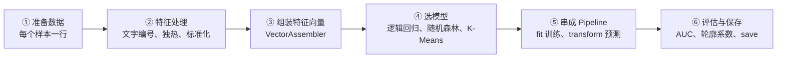
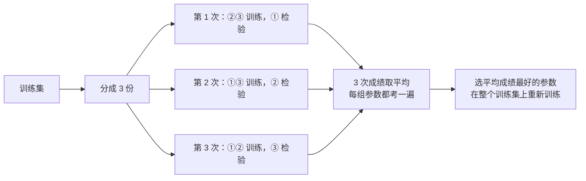
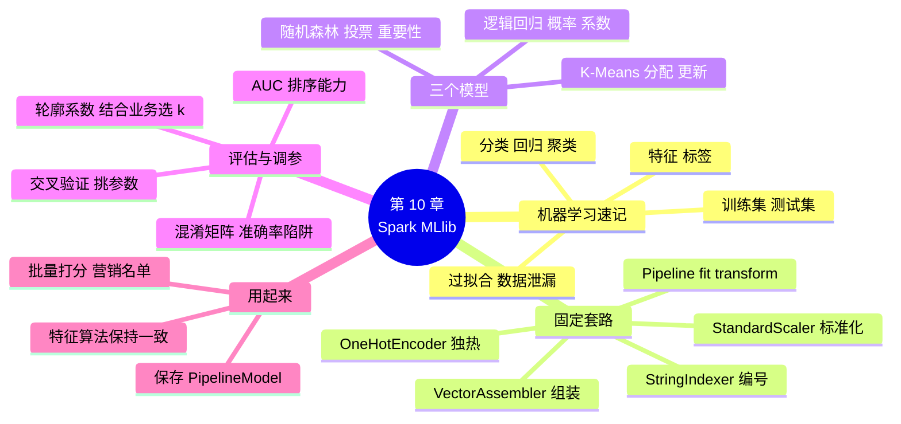

# 第 10 章 Spark MLlib 机器学习应用

!!! abstract "本章学时"
    理论 5 学时 · 实验 1 学时（本章共 3 个实验，教师可任选）

## 学习目标

学完本章，你应该能够：

1. **说出**特征、标签、训练集、测试集的含义，判断一个业务问题属于分类还是聚类（记忆、理解）；
2. **判断**什么时候该用 Spark MLlib、什么时候用单机的 scikit-learn 就够了（理解、评价）；
3. **按照** MLlib 的固定套路，用 StringIndexer、OneHotEncoder、VectorAssembler、StandardScaler 和 Pipeline 搭出一条完整的流水线（应用）；
4. **训练**逻辑回归、随机森林和 K-Means 模型，用 AUC、混淆矩阵和轮廓系数评价结果，用交叉验证挑参数（应用、分析）；
5. **保存和加载**模型，对全部用户批量打分，输出可以交给业务部门的营销名单（应用）。

!!! info "先修要求"
    学习本章前，你需要掌握：

    - DataFrame 的 `filter`、`groupBy().agg()`、`join`，以及读写 Parquet（[第 7 章](../07-data-cleaning/index.md)、[第 8 章](../08-spark-sql/index.md)）；
    - 实验 7-3 生成的订单宽表和实验 8-2 的 RFM 结果（[第 8 章 实验 8-2](../08-spark-sql/index.md#8-2-rfm)）；
    - 同学期《机器学习》课程中分类、聚类的基本概念（没学过也不要紧，10.1 节有速记）。

??? abstract "本章概念清单（18 个，点击查看定义和例子）"
    1. [机器学习](../../appendix/glossary.md#g-机器学习)
    2. [特征](../../appendix/glossary.md#g-特征)
    3. [标签](../../appendix/glossary.md#g-标签)
    4. [训练集](../../appendix/glossary.md#g-训练集)
    5. [测试集](../../appendix/glossary.md#g-测试集)
    6. [过拟合](../../appendix/glossary.md#g-过拟合)
    7. [特征向量](../../appendix/glossary.md#g-特征向量)
    8. [Pipeline](../../appendix/glossary.md#g-Pipeline)
    9. [独热编码](../../appendix/glossary.md#g-独热编码)
    10. [标准化](../../appendix/glossary.md#g-标准化)
    11. [逻辑回归](../../appendix/glossary.md#g-逻辑回归)
    12. [随机森林](../../appendix/glossary.md#g-随机森林)
    13. [混淆矩阵](../../appendix/glossary.md#g-混淆矩阵)
    14. [AUC](../../appendix/glossary.md#g-AUC)
    15. [交叉验证](../../appendix/glossary.md#g-交叉验证)
    16. [K-Means](../../appendix/glossary.md#g-K-Means)
    17. [轮廓系数](../../appendix/glossary.md#g-轮廓系数)
    18. [批量打分](../../appendix/glossary.md#g-批量打分)

## 情景导入

第 8 章的 RFM 分层交上去以后，运营部的王经理很满意，接着提了两个新问题：“十一黄金周，我们准备给老用户发一批满减券。券不能人人都发，预算只够发一万张左右。能不能找出**下周最可能回来买东西**的那批人？另外，8 类用户还是太多了，能不能让数据自己说话，把用户分成三四群，我们一群定一套打法？”

小林翻了翻自己的代码：前面几章算的都是“已经发生了什么”，这回要猜的是“将要发生什么”。组长说：“这就是机器学习的活儿了。用户和订单都在集群上，Spark 自带一个机器学习库 MLlib，写法跟 DataFrame 差不多，你学会它的‘固定套路’就行。”

本章先用十分钟复习机器学习的几个基本概念，然后学习 MLlib 的固定套路：特征处理 → 组装特征向量 → 选模型 → 串成 Pipeline → 评估 → 保存。三个实验分别完成王经理的需求：预测谁下周会复购，用 K-Means 给用户分群，最后加载模型给全部老用户打分，输出一份营销名单。

## 10.1 机器学习速记

### 10.1.1 机器学习在做什么

[**机器学习**](../../appendix/glossary.md#g-机器学习 "让计算机从历史数据中自动找出规律（模型），再用这个规律对新数据做预测或分组的方法"){ .term }就是让计算机从历史数据里自己找规律。以前我们写程序，是人把规则写死，比如“近 30 天买过 3 次以上的是活跃用户”；机器学习则是把一大堆历史数据交给算法，让它自己算出“什么样的用户会再来买”，算出来的这个规律叫**模型**。

描述每个用户的那些列叫[**特征**](../../appendix/glossary.md#g-特征 "描述一个样本的输入变量，模型根据它们做判断"){ .term }，比如购买次数、购买金额、会员等级；要预测的结果叫[**标签**](../../appendix/glossary.md#g-标签 "监督学习中要预测的结果，训练数据里已经知道答案"){ .term }，比如“下周有没有复购”。按有没有标签，常用的机器学习任务分成两大类：

| 类型 | 有没有标签 | 典型任务 | 本章的例子 | 常用模型 |
|---|---|---|---|---|
| 监督学习 · 分类 | 有，标签是类别 | 判断“是不是”“属于哪一类” | 用户下周会不会复购 | 逻辑回归、随机森林 |
| 监督学习 · 回归 | 有，标签是数值 | 预测“是多少” | 下个月能卖多少钱 | 线性回归、随机森林 |
| 无监督学习 · 聚类 | 没有 | 把相似的样本分成一群 | 把用户分成三四群 | K-Means |

本书只讲“怎样在 Spark 上把模型用起来”。每种模型的数学原理，同学期的《机器学习》课程会详细讲。

### 10.1.2 训练集、测试集和过拟合

判断一个模型好不好，不能拿它学过的数据来考它，就像考试不能考原题。通常把有标签的数据随机分成两份：[**训练集**](../../appendix/glossary.md#g-训练集 "用来让模型学习规律的那部分样本"){ .term }（一般 70%～80%）给模型学习，[**测试集**](../../appendix/glossary.md#g-测试集 "训练时不让模型看到、专门用来检验模型效果的样本"){ .term }留着检验。在 Spark 里一行代码就能分好：

```python
train, test = data.randomSplit([0.8, 0.2], seed=10)   # seed 固定，每次分得一样
```

如果模型在训练集上成绩很好、在测试集上明显变差，说明它把训练数据中的偶然细节也背了下来，这叫[**过拟合**](../../appendix/glossary.md#g-过拟合 "模型把训练数据中的偶然细节也背了下来，在训练集上很好、在新数据上变差"){ .term }。模型越复杂（树越深、参数越多）越容易过拟合，10.5.2 节的交叉验证就是用来挑一个“不太简单也不太复杂”的参数。

!!! warning "做预测类问题，特征和标签的时间不能重叠"
    实验 10-1 用 9 月 1～23 日的订单算特征，用 9 月 24～30 日有没有下单做标签。如果特征里混进了 24 日以后的订单，模型等于提前看到了答案，测试成绩会好得离谱，上线后却完全不准。这类错误叫“数据泄漏”，是新手最常犯的错误。

## 10.2 什么时候用 Spark 做机器学习

Python 里最常用的机器学习库是 scikit-learn，同学期的《机器学习》课程用的就是它。它简单、模型多、文档好，但所有数据都要装进一台电脑的内存。MLlib 是 Spark 自带的机器学习库，数据和计算分布在集群的各个节点上，2016 年的介绍论文中，它已经有 140 多位贡献者。<sup class="cite">[[1]](#ref10-1)</sup>

| 比较项 | scikit-learn | Spark MLlib |
|---|---|---|
| 数据放在哪里 | 一台电脑的内存（pandas） | 集群各节点（DataFrame） |
| 能处理的数据量 | 几百万行以内比较舒服 | 上亿行也可以 |
| 模型种类 | 非常多 | 常用的都有，少一些 |
| 小数据上的速度 | 快 | 慢（有调度开销） |
| 适合的场景 | 数据小，或已经抽样 | 数据大到单机放不下，或数据本来就在 Hive、HDFS 上 |

选择的原则和第 8 章“pandas 还是 Spark”一样：**数据一台电脑放得下，就用 scikit-learn；放不下，或者数据本来就在集群上、处理完要写回集群，才用 MLlib。**小象优选的 10 万订单其实用 scikit-learn 也能做，本章用它来练习 MLlib 的写法；到了真实的电商平台，几亿用户、几十亿条行为记录，就只能在集群上做了。

!!! note "两套接口，只学 `pyspark.ml`"
    Spark 里有两个机器学习包：`pyspark.mllib` 是基于 RDD 的老接口，已经只维护不更新；`pyspark.ml` 是基于 DataFrame 的新接口，官方推荐使用。大家习惯把两者都叫 MLlib，本书只用 `pyspark.ml`。

运行本章程序需要 NumPy。官方 Spark 镜像没有装 NumPy，所以本章给 spark 容器换了一个镜像：`labs/cluster/spark/Dockerfile` 在官方镜像上加装了 NumPy，第一次启动时自动构建，实验 10-1 第 1 步会讲到。

## 10.3 MLlib 的固定套路

### 10.3.1 六个步骤

不管做分类还是聚类，MLlib 程序都是同一个套路：



第 ① 步就是前几章学的 DataFrame 操作：把订单按用户汇总成“每个用户一行”。第 ②～⑥ 步是本章的新内容，下面逐个介绍。

### 10.3.2 特征处理的四个组件

MLlib 的模型有一个硬要求：所有特征必须是数字，并且装进**一列向量**里。原始数据中的“性别”“会员等级”是文字，“金额”“次数”又是分开的好几列，所以要先做处理。最常用的是下面四个组件（它们都在 `pyspark.ml.feature` 里）：<sup class="cite">[[3]](#ref10-3)</sup>

| 组件 | 作用 | 输入 → 输出 | 例子 |
|---|---|---|---|
| `StringIndexer` | 文字类别编号 | 字符串列 → 数字列 | 普通 → 0、白银 → 1、黄金 → 2、钻石 → 3（默认出现最多的编 0） |
| `OneHotEncoder` | 独热编码 | 编号列 → 0/1 向量列 | 黄金（2）→ [0, 0, 1] |
| `VectorAssembler` | 组装特征向量 | 多个数字列、向量列 → 一个向量列 | R、F、M、等级向量 → features |
| `StandardScaler` | 标准化 | 向量列 → 缩放后的向量列 | 金额（几千元）和次数（几次）缩放到同一量级 |

**为什么编号以后还要独热？**会员等级编成 0、1、2、3 以后，模型会以为“钻石（3）是白银（1）的 3 倍”，这没有道理。[**独热编码**](../../appendix/glossary.md#g-独热编码 "把有 n 种取值的类别列变成 n 个（MLlib 默认 n−1 个）只取 0 或 1 的列，避免把类别编号当成大小"){ .term }把每种取值变成单独的一位，哪一位是 1 就是哪个等级，各等级之间不再有大小关系。MLlib 默认去掉最后一位（4 种等级只用 3 位，全 0 就表示最后一种），可以少一个多余的特征。

**为什么要标准化？**购买金额动辄几千元，购买次数只有几次，品类数只有一两个。不缩放的话，逻辑回归的系数没法比较大小，K-Means 算距离时金额一个特征就“说了算”。[**标准化**](../../appendix/glossary.md#g-标准化 "把各个特征缩放到相近的范围（一般是除以标准差，可再减去平均值），让单位不同的特征可以放在一起比较"){ .term }把每个特征除以它的标准差（`withMean=True` 时还先减去平均值），让它们站到同一起跑线上。

`VectorAssembler` 输出的那一列就是[**特征向量**](../../appendix/glossary.md#g-特征向量 "把一个样本的全部特征按固定顺序排成的一列数，MLlib 的模型只接受这种向量列"){ .term }。用 `show()` 看，它长这样：

```text
+---+---+-----+----------------------------------------------------+
|R  |F  |M    |raw_features                                        |
+---+---+-----+----------------------------------------------------+
|8  |4  |632.9|[8.0,4.0,632.9,158.23,3.0,22.0,40.0,0.0,0.0,0.0,1.0]|
+---+---+-----+----------------------------------------------------+
```

这是用户 u0007916（男，40 岁，黄金会员）。前 7 个数是 R、F、M、平均每单金额、品类数、首购距今天数、年龄；后面是性别（1 位）和会员等级（3 位）独热编码的结果：性别按出现次数编号，女 0、男 1，去掉最后一位后只剩“是不是女”一位，男性是 0；等级普通 0、白银 1、黄金 2、钻石 3，黄金是 [0, 0, 1]。顺序由 `inputCols` 决定，训练和使用时必须一模一样。

### 10.3.3 Pipeline：把步骤串起来

如果一步一步地处理，训练时要对训练集做一遍编号、独热、组装、标准化，预测时还要对新数据原样再做一遍，而且编号的对应关系、标准化用的标准差都必须和训练时相同，非常容易出错。[**Pipeline**](../../appendix/glossary.md#g-Pipeline "MLlib 中把特征处理和模型按顺序串起来的流水线，整体训练（fit）、整体使用（transform）、整体保存"){ .term }（流水线）把这些步骤串成一个整体：

```python
from pyspark.ml import Pipeline
from pyspark.ml.feature import StringIndexer, OneHotEncoder, VectorAssembler, StandardScaler
from pyspark.ml.classification import LogisticRegression

indexer = StringIndexer(inputCols=["gender", "level"], outputCols=["gender_idx", "level_idx"])
encoder = OneHotEncoder(inputCols=["gender_idx", "level_idx"], outputCols=["gender_vec", "level_vec"])
assembler = VectorAssembler(inputCols=["R", "F", "M", "avg_amount", "categories",
                                       "days_since_first", "age", "gender_vec", "level_vec"],
                            outputCol="raw_features")
scaler = StandardScaler(inputCol="raw_features", outputCol="features")
lr = LogisticRegression(featuresCol="features", labelCol="label")

pipeline = Pipeline(stages=[indexer, encoder, assembler, scaler, lr])
model = pipeline.fit(train)          # 训练：从头到尾走一遍，每一步“学”出自己的参数
pred = model.transform(test)         # 预测：用学好的参数把新数据从头到尾走一遍
```

这里有两个动词要分清：<sup class="cite">[[2]](#ref10-2)</sup>

- **fit（训练）**：从数据中“学”东西。`StringIndexer` 学的是“哪个等级编几号”，`StandardScaler` 学的是每个特征的标准差，`LogisticRegression` 学的是每个特征的系数。会 fit 的组件叫 Estimator（估计器）。
- **transform（转换）**：用学好的东西处理数据，给 DataFrame 加上新的列。fit 的结果（如 `StringIndexerModel`、`LogisticRegressionModel`）和 `VectorAssembler` 这种不需要学的组件都能 transform，叫 Transformer（转换器）。

`pipeline.fit(train)` 返回的 `PipelineModel` 里装着 5 个学好的步骤。以后不管是测试集还是全部用户，只要 `model.transform(数据)` 一行，所有处理自动按训练时的方式完成。这正是 Pipeline 最大的好处：**训练和使用走的是同一条流水线，不会出现“训练时这样处理、用的时候那样处理”的错误。**

## 10.4 常用的三个模型

### 10.4.1 逻辑回归：算出“是”的概率

[**逻辑回归**](../../appendix/glossary.md#g-逻辑回归 "把特征加权求和后转换成 0～1 之间的概率，用来做“是 / 否”二分类的模型"){ .term }虽然名字里有“回归”，却是最常用的分类模型。它给每个特征一个系数（权重），把特征乘以系数加起来，再用一个 S 形函数转换成 0～1 之间的概率。概率大于 0.5（默认阈值）就预测为“是”。

`transform` 以后，DataFrame 里会多出三列：

| 列 | 内容 | 例子 |
|---|---|---|
| `rawPrediction` | 转换成概率之前的原始分数 | `[1.11, -1.11]` |
| `probability` | 属于每一类的概率，是一个向量 | `[0.7517, 0.2483]`：不复购 75%，复购 25% |
| `prediction` | 预测的类别 | `0.0` |

逻辑回归的好处是简单、快、好解释：标准化以后，系数是正的说明这个特征越大越可能复购，绝对值越大影响越大。实验 10-1 中购买次数 F 的系数是 +1.217，远大于其他特征。

### 10.4.2 随机森林：很多棵树一起投票

决策树像一连串“是否”问题：购买次数大于 2 吗？最近 7 天买过吗？……一层层问下去得出结论。一棵树容易过拟合，[**随机森林**](../../appendix/glossary.md#g-随机森林 "训练很多棵各不相同的决策树，让它们投票决定结果的模型，能给出特征重要性"){ .term }就训练很多棵树，每棵树只看一部分随机抽取的样本和特征，最后大家投票。<sup class="cite">[[7]](#ref10-7)</sup> 它通常比逻辑回归准一点，还能告诉你哪些特征最重要（`featureImportances`），缺点是不如逻辑回归好解释、训练也慢一些。

在 Pipeline 里换模型非常简单，只要换掉最后一步，前面的特征处理一行不用改：

```python
from pyspark.ml.classification import RandomForestClassifier

rf = RandomForestClassifier(featuresCol="features", labelCol="label", numTrees=50, maxDepth=5, seed=10)
rf_model = Pipeline(stages=[indexer, encoder, assembler, scaler, rf]).fit(train)
```

### 10.4.3 K-Means 聚类

[**K-Means**](../../appendix/glossary.md#g-K-Means "把样本分成 k 群的聚类方法：反复把每个点分给最近的中心、再把中心移到本群平均位置，直到中心不再移动"){ .term }是最常用的聚类方法，事先告诉它分几群（k），它反复做两件事：

1. **分配**：把每个点分给离它最近的中心；
2. **更新**：把每个中心移到本群所有点的平均位置。

中心不再移动（或者到了最大轮数 `maxIter`，默认 20）就停。在 Spark 上，数据分散在各个节点，每一轮 Driver 把 k 个中心广播给各节点，各节点只在本地给自己的数据分配并求和，交回“每群的人数和坐标之和”，Driver 再算出新中心。网络上传的只是 k 组数字，数据本身不动，这就是 K-Means 能在大数据上跑的原因。初始中心怎么选也有讲究，MLlib 默认用一种可以并行计算的 k-means++ 方法（k-means||）。<sup class="cite">[[5]](#ref10-5)</sup><sup class="cite">[[8]](#ref10-8)</sup>

下面的动画用 48 个点演示 Spark 上的 K-Means 怎样一轮一轮地算：

<iframe class="sim-frame" src="../../sims/dist-kmeans/main.html" height="900" loading="lazy" title="分布式 K-Means"></iframe>

选 k = 3，按“下一步”看一轮里的三个步骤，对照下方的表格验证“Driver 合计的坐标之和 ÷ 人数 = 新中心”；再按几次“换一组初始中心”，看收敛需要的轮数和分群结果会不会变。[全屏打开](../../sims/dist-kmeans/main.html){ target=_blank }

聚类没有标签，没法算准确率，常用[**轮廓系数**](../../appendix/glossary.md#g-轮廓系数 "衡量聚类效果的指标，−1～1，越接近 1 说明同群的点越近、不同群的点越远"){ .term }评价：它在 −1～1 之间，越接近 1 说明同一群的点挨得越紧、不同群离得越远。MLlib 用 `ClusteringEvaluator` 计算。但是轮廓系数只是参考，**k 最终要结合业务来定**：运营部门能分别管理的用户群一般就三五个，分成 8 群即使轮廓系数高一点，也用不起来。

```python
from pyspark.ml.clustering import KMeans
from pyspark.ml.evaluation import ClusteringEvaluator

model = KMeans(k=4, seed=1, featuresCol="features").fit(X)   # X 已有标准化后的 features 列
out = model.transform(X)                                      # 多出一列 prediction，是群号 0～3
print(ClusteringEvaluator(featuresCol="features").evaluate(out))
```

用 K-Means 做用户分群前，有两件事一定要做：一是**标准化**，否则金额一个特征就决定了分群；二是对“少数人特别大”的特征（比如购买次数、金额）先**取对数**，把长尾压短，否则几个超级用户就会单独占一群。实验 10-2 会做这两件事。

## 10.5 评估、调参和保存

### 10.5.1 准确率的陷阱：混淆矩阵和 AUC

实验 10-1 中，测试集里约 21% 的用户复购。假如模型偷懒，对所有人都说“不会复购”，准确率也有 79%。实际上，逻辑回归的准确率是 80.8%，只比偷懒高了一点。看[**混淆矩阵**](../../appendix/glossary.md#g-混淆矩阵 "按“真实是什么、预测成什么”交叉统计样本数的表，用来看模型错在哪里"){ .term }就明白了：

| | 预测不复购 | 预测复购 |
|---|---|---|
| **真实不复购** | 6525 | 65 |
| **真实复购** | 1538 | 203 |

1741 个真正复购的用户，模型只找出了 203 个。原因是大部分用户只买过一两次，模型算出的复购概率都在 0.16～0.25 之间，很少超过 0.5 的默认阈值。**当正、负样本数量相差很大时，不能只看准确率。**

更合适的指标是 [**AUC**](../../appendix/glossary.md#g-AUC "衡量模型把正例排在负例前面的能力，0.5 相当于随便猜，1 是完全排对"){ .term }。它衡量的是“排序能力”：随机抽一个复购用户和一个不复购用户，模型给复购用户打的分更高的可能性有多大。0.5 相当于抛硬币，1 是完全排对，和阈值设多少无关。<sup class="cite">[[9]](#ref10-9)</sup> MLlib 的 `BinaryClassificationEvaluator` 默认算的就是 AUC：

```python
from pyspark.ml.evaluation import BinaryClassificationEvaluator
auc = BinaryClassificationEvaluator(labelCol="label").evaluate(pred)   # 0.631
```

AUC 0.631 不算高，但对营销已经有用：按复购概率从高到低排，前 20% 的用户中有 38.5% 真的复购了，是随便挑（20.9%）的 1.8 倍。同样发 1 万张券，按模型挑人能多带来近一倍的回头客。**在营销场景，模型的用法往往不是“判断是或不是”，而是“排个队，先给最有希望的人发券”。**

!!! note "为什么 AUC 只有 0.63？"
    随书数据中，用户的性别、年龄、等级都是随机生成的，和买不买没有关系，能预测复购的只有过去的购买行为（次数、品类数）。真实业务中，还会加入浏览、加购、收藏、领券等行为特征，AUC 一般能到 0.7～0.8。想提高模型效果，**找到更有用的特征，比换更复杂的模型重要得多。**

### 10.5.2 交叉验证：让数据帮你挑参数

每个模型都有一些要人来定的参数，比如逻辑回归的正则化强度 `regParam`、随机森林的树的数量和深度。怎样挑？不能拿测试集来挑，否则测试集就“被看过”了。[**交叉验证**](../../appendix/glossary.md#g-交叉验证 "把训练集分成 k 份，轮流用其中一份检验、其余训练，取平均成绩来挑选参数"){ .term }只用训练集：把它分成 k 份（k 折），每次拿其中 1 份检验、其余 k−1 份训练，轮流 k 次取平均成绩。每组参数都这样考一遍，平均成绩最好的胜出，最后用它在整个训练集上再训练一次。<sup class="cite">[[6]](#ref10-6)</sup>



MLlib 中用 `ParamGridBuilder` 列出要试的参数，交给 `CrossValidator`：

```python
from pyspark.ml.tuning import ParamGridBuilder, CrossValidator

grid = ParamGridBuilder().addGrid(lr.regParam, [0.0, 0.01, 0.1]).build()
cv = CrossValidator(estimator=pipeline, estimatorParamMaps=grid,
                    evaluator=BinaryClassificationEvaluator(labelCol="label"), numFolds=3, seed=10)
cv_model = cv.fit(train)
best = cv_model.bestModel            # 最好的那条流水线（PipelineModel）
```

要注意计算量：3 个候选值 × 3 折 = 训练 9 次，最后再训练 1 次。候选值多了、折数多了，时间成倍增长。实验 10-1 的程序大部分时间就花在这一步上。

### 10.5.3 保存模型和批量打分

模型训练好以后要保存下来，以后直接加载使用，不必每次重新训练。保存整个 `PipelineModel`，连同编号的对应关系、标准化的参数都一起存下了：

```python
best.write().overwrite().save("file:///labs/data/models/repurchase")   # 保存（是一个目录）

from pyspark.ml import PipelineModel
model = PipelineModel.load("file:///labs/data/models/repurchase")     # 另一个程序里加载
scored = model.transform(all_users)                                   # 给全部用户打分
```

这种“加载模型、对一大批数据一次性算出结果”的用法叫[**批量打分**](../../appendix/glossary.md#g-批量打分 "加载已经训练好的模型，对一大批新数据一次性算出预测结果"){ .term }，是企业里最常见的模型使用方式：每天凌晨调度一次，把全部用户的分数写进 Hive 表或 MySQL，营销系统第二天直接取用。批量打分时有一条铁律：**新数据的特征必须和训练时用完全相同的方法计算**，只是时间窗口往后移。实验 10-3 为此把算特征的代码放进一个共用文件 `features.py`，训练和打分都调用它。

!!! tip "概率向量怎么取出一个数"
    `probability` 列是向量，不能直接排序。用 `pyspark.ml.functions.vector_to_array` 把它变成数组，再取第 2 个元素（下标 1）就是“复购”的概率：`vector_to_array("probability")[1]`。

## 10.6 前沿视窗

**大模型的训练数据，也是用大数据平台“洗”出来的。**训练一个大语言模型，要先从互联网上收集海量文本。这些原始网页里有大量广告、乱码、重复内容和低质量文字，必须清洗以后才能使用，所用的方法正是本书第 7 章的那一套：过滤、去重、按规则打分，只是规模大得多。

以 Hugging Face 公开的 FineWeb 数据集为例：它从 96 个 Common Crawl 网页快照中清洗出 15 万亿个词元（token）的文本，又从中筛选出 1.3 万亿词元的教育类文本 FineWeb-Edu。<sup class="cite">[[10]](#ref10-10)</sup> 整个过程包括提取正文、语言识别、质量过滤和大规模去重；其中“筛选教育类文本”这一步，就是先用大模型给几十万个网页标注“教育价值”，训练出一个打分模型，再给全部网页**批量打分**，和本章实验 10-3 的思路一样。中文大模型同样要清洗海量的中文网页、图书和代码。可以说，大模型能力的背后，是大数据平台在处理数据。

## 本章实验

!!! abstract "实验总览"
    | 实验 | 类型 | 建议时长 | 内容 |
    |---|---|---|---|
    | 实验 10-1 | ★ 基础 | 40 分钟 | 用 9 月前 23 天的订单做特征、后 7 天是否下单做标签，搭 Pipeline 训练逻辑回归，用 AUC 和混淆矩阵评估，比较随机森林，交叉验证挑参数，保存模型 |
    | 实验 10-2 | ★ 基础 | 30 分钟 | 在实验 8-2 的 RFM 结果上做 K-Means，用轮廓系数和业务需要选 k，根据各群画像给每群起名字，与 RFM 八类对照 |
    | 实验 10-3 | ☆ 拓展 | 25 分钟 | 加载实验 10-1 的模型，给全部 48644 个老用户打复购概率，挑出前 20% 输出营销名单 |

    实验只用 spark 容器（本地模式），不需要 Hive、MySQL 和 Kafka，Docker 分配 4 GB 内存即可。实验代码见配套资源 `labs/ch10/` 目录。编者的运行环境：4 核 CPU、16 GB 内存的 Linux 主机，Docker 29.9，Spark 4.1.4 镜像加装 NumPy 2.2.6。

### 实验 10-1 ★ 预测用户下周会不会复购

**实验目的**

1. 把订单数据整理成“每个用户一行”的样本表，正确划分特征和标签的时间；
2. 用 StringIndexer、OneHotEncoder、VectorAssembler、StandardScaler 和逻辑回归搭建 Pipeline，训练并预测；
3. 用 AUC、混淆矩阵和“前 20% 命中率”评估模型，比较随机森林，用交叉验证挑参数，保存模型。

**实验环境**：随书集群加 spark 容器（`docker-compose.spark.yml`），spark 容器使用加装了 NumPy 的镜像。

**实验数据**：实验 7-3 生成的订单宽表 `labs/data/xiaoxiang_clean/order_wide/`（已关联用户和商品信息）和清洗后的订单 `orders/`。

**实验步骤与代码**

第 1 步，重新构建并启动 spark 容器。本章起 `docker-compose.spark.yml` 中的 spark 服务改为按 `spark/Dockerfile` 构建（在官方镜像上加装 NumPy），第一次要带 `--build`，大约 1 分钟：

```bash
cd labs/cluster
docker compose -f docker-compose.yml -f docker-compose.spark.yml up -d --build spark
docker compose -f docker-compose.yml -f docker-compose.spark.yml exec spark python3 -c "import numpy; print(numpy.__version__)"
```

最后一行输出 `2.2.6` 说明 NumPy 装好了。如果构建时下载很慢或失败，检查网络；Dockerfile 默认使用清华大学的 PyPI 镜像。

第 2 步，阅读共用的特征程序 `labs/ch10/features.py`。函数 `user_features(spark, start, cut)` 用 `[start, cut)` 这段时间的已完成订单，给每个下过单的用户算出 R、F、M、平均每单金额 `avg_amount`、品类数 `categories`、首购距今天数 `days_since_first`，再带上性别、年龄、会员等级；函数 `buyers(spark, start, end)` 找出一段时间内下过单的用户，标上 `label = 1`。

第 3 步，运行实验程序。因为用到了 `features.py`，要用 `--py-files` 把它一起带上：

```bash
docker compose -f docker-compose.yml -f docker-compose.spark.yml exec spark \
  spark-submit --py-files /labs/ch10/features.py /labs/ch10/lab10_1_repurchase.py
```

程序的主要步骤如下（完整代码见 `lab10_1_repurchase.py`）：

```python
# ① 做样本：9 月 1～23 日的订单算特征，9 月 24～30 日有没有再买做标签
feat = user_features(spark, "2026-09-01", "2026-09-24")
data = (feat.join(buyers(spark, "2026-09-24", "2026-10-01"), "user_id", "left")
            .fillna({"label": 0.0}))          # 没在后 7 天出现的，标签补 0
# ② 8:2 划分
train, test = data.randomSplit([0.8, 0.2], seed=10)
# ③ 流水线（见 10.3.3 节）并训练
model = Pipeline(stages=[indexer, encoder, assembler, scaler, lr]).fit(train)
# ④ 评估：AUC、准确率、混淆矩阵
pred = model.transform(test)
auc = BinaryClassificationEvaluator(labelCol="label").evaluate(pred)
pred.groupBy("label").pivot("prediction", [0.0, 1.0]).count().orderBy("label").show()
# ⑤ 按复购概率排序，看前 20% 的命中率
p1 = F.udf(lambda v: float(v[1]), "double")("probability")
top = pred.withColumn("p", p1).orderBy(F.desc("p")).limit(top_n)
```

后面的第 ⑥～⑨ 步依次打印逻辑回归的系数、换成随机森林比较 AUC 和特征重要性、用 3 折交叉验证挑 `regParam`，最后保存最好的模型。

**运行结果**

程序用时约 5 分钟，其中交叉验证占了一大半。输出如下（警告信息已删去）：

```text
① 样本 40895 个用户，其中下周复购 8623 个，占 21.1%
+--------+------+---+-----+---+---+------+----------+-----+
| user_id|gender|age|level|  R|  F|     M|categories|label|
+--------+------+---+-----+---+---+------+----------+-----+
|u0007916|    男| 40| 黄金|  8|  4| 632.9|         3|  1.0|
|u0015790|    女| 40| 普通| 13|  2|3459.0|         2|  0.0|
|u0015078|    女| 49| 普通| 11|  1| 106.9|         1|  1.0|
|u0038366|    女| 43| 普通|  4|  2|3070.8|         2|  0.0|
|u0005685|    女| 24| 普通|  2|  1| 313.9|         1|  1.0|
+--------+------+---+-----+---+---+------+----------+-----+
only showing top 5 rows
② 训练集 32564 个，测试集 8331 个
③ 流水线的 5 个步骤： ['StringIndexerModel', 'OneHotEncoderModel', 'VectorAssembler', 'StandardScalerModel', 'LogisticRegressionModel']
+--------+---+---+-----+----------------------------------------+----------+
|user_id |R  |F  |label|probability                             |prediction|
+--------+---+---+-----+----------------------------------------+----------+
|u0000051|11 |2  |1.0  |[0.7517362970658414,0.24826370293415856]|0.0       |
|u0000474|19 |1  |0.0  |[0.8358303762111925,0.1641696237888075] |0.0       |
|u0001133|10 |1  |0.0  |[0.8354388036631871,0.16456119633681288]|0.0       |
|u0005600|9  |1  |0.0  |[0.8427985634496875,0.1572014365503125] |0.0       |
|u0007227|14 |1  |0.0  |[0.8406214922733711,0.15937850772662887]|0.0       |
+--------+---+---+-----+----------------------------------------+----------+
only showing top 5 rows
④ AUC = 0.631，准确率 = 80.8%
   混淆矩阵（行是真实，列是预测）：
+-----+----+---+
|label| 0.0|1.0|
+-----+----+---+
|  0.0|6525| 65|
|  1.0|1538|203|
+-----+----+---+
⑤ 概率最高的 1666 人里有 642 人复购，命中率 38.5%，是随便挑（20.9%）的 1.8 倍
⑥ 逻辑回归系数： R +0.017, F +1.217, M +0.032, avg_amount +0.001, categories +0.075, days_since_first -0.002, age +0.009
⑦ 随机森林 AUC = 0.638
   特征重要性： categories 0.41, F 0.40, M 0.08, R 0.04, avg_amount 0.04, days_since_first 0.03, age 0.01
⑧ regParam = 0.0   平均 AUC = 0.619
⑧ regParam = 0.01  平均 AUC = 0.619
⑧ regParam = 0.1   平均 AUC = 0.620
   最好的模型在测试集上 AUC = 0.631
⑨ 模型已保存到 data/models/repurchase/
```

**结果分析**

1. **样本**：9 月前 23 天下过单的老用户有 40895 个，其中 21.1% 在后 7 天又下了单。正、负样本大约 1 : 4，不算平衡。
2. **准确率的陷阱**：准确率 80.8% 看起来不错，但混淆矩阵显示，1741 个真复购的用户中模型只找出 203 个。大部分用户的复购概率在 0.16～0.25，达不到 0.5 的阈值（见 10.5.1 节）。
3. **排序才是正确用法**：AUC 0.631，按概率挑前 20% 的人，命中率 38.5%，是随便挑的 1.8 倍。发券、电话回访这类“资源有限、先挑最有希望的人”的场景，正需要这种排序能力。
4. **什么特征有用**：逻辑回归中购买次数 F 的系数（+1.217）远大于其他特征；随机森林认为品类数和购买次数最重要（合计 0.81）。年龄的系数和重要性都接近 0，这是因为随书数据的年龄、性别、等级是随机生成的，和购买行为无关。
5. **换模型、调参数的收益很小**：随机森林 AUC 0.638，只比逻辑回归高 0.007；交叉验证中三个 `regParam` 的平均 AUC 几乎一样。这说明瓶颈在特征，不在模型。

**实验记录表**

| 项目 | 你的结果 |
|---|---|
| 样本数 / 复购率 | |
| 逻辑回归 AUC / 准确率 | |
| 混淆矩阵中“真复购、预测复购”的人数 | |
| 前 20% 命中率 / 是随便挑的几倍 | |
| 随机森林 AUC，最重要的两个特征 | |
| 交叉验证选出的 regParam | |

**常见问题排查**

| 现象 | 原因 | 解决办法 |
|---|---|---|
| `ModuleNotFoundError: No module named 'numpy'` | spark 容器还是旧的官方镜像 | 按第 1 步带 `--build` 重新启动 spark 服务 |
| `ModuleNotFoundError: No module named 'features'` | 运行时没有带上 `features.py` | 命令里加 `--py-files /labs/ch10/features.py` |
| `Path does not exist: .../order_wide` | 没有做实验 7-3 | 先运行实验 7-3 生成订单宽表 |
| 报错说 features 列的类型必须是向量（Vector） | 把普通的数字列直接交给了模型 | 模型只接受向量列，先用 `VectorAssembler` 组装 |
| 程序运行很久 | 交叉验证要训练很多次 | 正常现象；课堂时间紧张时，可以先把第 ⑧ 步注释掉，直接保存 `model` |

**思考与练习**

1. 如果把阈值从 0.5 改成 0.25，混淆矩阵会怎样变化？“真复购、预测复购”的人数会变多还是变少？“真不复购、预测复购”呢？
2. 有同学把特征的时间范围写成了 9 月 1～30 日，标签仍是 24～30 日是否下单，结果 AUC 变成了 0.95 以上。这个模型能用吗？为什么？

**实验报告要求**

提交运行结果截图和实验记录表，回答思考与练习的两个问题，并用两三句话向王经理说明：这个模型能帮营销做什么、不能做什么。

### 实验 10-2 ★ K-Means 用户分群

**实验目的**

1. 对 RFM 特征做对数变换和标准化，用 K-Means 给用户分群；
2. 用轮廓系数和业务需要选择 k，根据各群的画像给每一群起名字；
3. 把 K-Means 的分群结果和第 8 章的 RFM 八类对照，比较两种分群方法。

**实验环境**：同实验 10-1。

**实验数据**：实验 8-2 生成的 `labs/data/xiaoxiang_clean/rfm/`，48644 个用户，每人一行 R、F、M 和 RFM 分类。

**实验步骤与代码**

第 1 步，运行程序：

```bash
docker compose -f docker-compose.yml -f docker-compose.spark.yml exec spark spark-submit /labs/ch10/lab10_2_kmeans.py
```

程序的核心代码如下：

```python
# ① F、M 少数人特别大，先取对数
rfm = (spark.read.parquet(f"{DATA}/xiaoxiang_clean/rfm")
            .withColumn("logF", F.log1p("F")).withColumn("logM", F.log1p("M")))
# ② 组装并标准化（withMean=True：先减平均值，再除以标准差）
assembler = VectorAssembler(inputCols=["R", "logF", "logM"], outputCol="raw")
scaler = StandardScaler(inputCol="raw", outputCol="features", withMean=True)
X = Pipeline(stages=[assembler, scaler]).fit(rfm).transform(rfm)
# ③ 试 k = 2～8
for k in range(2, 9):
    m = KMeans(k=k, seed=1, featuresCol="features").fit(X)
    print(k, ClusteringEvaluator(featuresCol="features").evaluate(m.transform(X)), m.summary.trainingCost)
# ④ k = 4，按群统计平均 R、F、M 和销售额占比
model = KMeans(k=4, seed=1, featuresCol="features").fit(X)
out = model.transform(X)
```

第 2 步，先把程序第 ⑤ 步的 `NAMES` 都写成“待填”运行一次，看第 ④ 步输出的画像，自己给每一群起名字，再填回 `NAMES` 重新运行。下面是编者起的名字。

**运行结果**

程序用时约 40 秒，输出如下：

```text
① 用户数 48644
+-------+---+---+--------+
|summary|  R|  F|       M|
+-------+---+---+--------+
|    min|  1|  1|     5.0|
|    25%|  5|  1|   184.7|
|    50%| 12|  1|   731.6|
|    75%| 20|  2|  3053.9|
|    max| 30|386|557739.5|
+-------+---+---+--------+
③ k = 2  轮廓系数 0.504  簇内距离平方和 92884
③ k = 3  轮廓系数 0.468  簇内距离平方和 68477
③ k = 4  轮廓系数 0.450  簇内距离平方和 55110
③ k = 5  轮廓系数 0.450  簇内距离平方和 44340
③ k = 6  轮廓系数 0.449  簇内距离平方和 39346
③ k = 7  轮廓系数 0.477  簇内距离平方和 33952
③ k = 8  轮廓系数 0.479  簇内距离平方和 30615
④ k = 4 时各群的画像
+----------+-----+-----+-----+------+-----+
|prediction|users|avg_R|avg_F| avg_M|m_pct|
+----------+-----+-----+-----+------+-----+
|         0| 6120|  6.1|  5.5|9603.0| 41.5|
|         1|13859| 23.3| 1.18|2107.0| 20.6|
|         2|12715| 12.3| 1.08| 121.0|  1.1|
|         3|15950|  7.3| 1.62|3269.0| 36.8|
+----------+-----+-----+-----+------+-----+
⑥ K-Means 群与 RFM 分类的对照（人数）
+------------+------------+------------+------------+------------+------------+------------+------------+------------+
|cluster_name|一般价值用户|一般发展用户|一般唤回用户|一般挽留用户|重要价值用户|重要发展用户|重要唤回用户|重要挽留用户|
+------------+------------+------------+------------+------------+------------+------------+------------+------------+
|小额尝鲜客  |660         |6650        |378         |5027        |0           |0           |0           |0           |
|忠实大客户  |1300        |0           |132         |0           |4220        |0           |468         |0           |
|沉睡客户    |0           |0           |1568        |8828        |0           |0           |742         |2721        |
|近期活跃客户|4982        |4064        |649         |176         |2691        |2424        |568         |396         |
+------------+------------+------------+------------+------------+------------+------------+------------+------------+
⑦ 分群结果已保存到 data/xiaoxiang_clean/user_cluster/
```

**结果分析**

1. **数据很偏**：一半以上的用户 9 月只买了 1 次，而购买次数最多的用户买了 386 次。不取对数的话，这几个超级用户会把一个中心“拽”过去单独成群。
2. **k 怎么选**：轮廓系数在 k = 2 时最高（0.504），k = 4～6 差不多（约 0.45）；簇内距离平方和随 k 增大一直下降，没有明显的拐点。只分 2 群太粗，运营用不上；结合“三五群好管理”的要求，选 k = 4。这也说明 k 没有唯一的正确答案，要结合业务定。
3. **四群画像和起名**：

    | 群号 | 起名 | 人数（占比） | 画像 | 销售额占比 | 营销建议 |
    |---|---|---|---|---|---|
    | 0 | 忠实大客户 | 6120（12.6%） | 平均 6 天前买过，买 5.5 次，9603 元 | 41.5% | 专属客服、会员权益，重点维护 |
    | 3 | 近期活跃客户 | 15950（32.8%） | 7 天前买过，1.6 次，3269 元 | 36.8% | 推荐关联商品，促成第二、三单 |
    | 1 | 沉睡客户 | 13859（28.5%） | 23 天没来，1.2 次，2107 元 | 20.6% | 发唤回券，限时提醒 |
    | 2 | 小额尝鲜客 | 12715（26.1%） | 12 天前买过，1.1 次，121 元 | 1.1% | 新人专区、低门槛满减，控制成本 |

4. **与 RFM 八类对照**：“沉睡客户”基本都是 RFM 中 R 低（很久没来）的四类；“忠实大客户”主要是重要价值用户；“小额尝鲜客”全部来自 M 低的“一般”类。两种方法大方向一致，区别在于：RFM 用平均值一刀切，规则清楚、好解释；K-Means 让数据自己找边界，能按需要分成任意几群，但群号没有含义，要人看画像起名，而且换了数据要重新起名。

**实验记录表**

| k | 轮廓系数 | 你的选择和理由 |
|---|---|---|
| 2 | | |
| 4 | | |
| 8 | | |

| 群号 | 人数 | 平均 R / F / M | 你起的名字 | 营销建议 |
|---|---|---|---|---|
| | | | | |

**常见问题排查**

| 现象 | 原因 | 解决办法 |
|---|---|---|
| `Path does not exist: .../rfm` | 没有做实验 8-2 | 先运行实验 8-2 |
| 有一群只有几个人，平均 F 好几十 | 忘了对 F、M 取对数 | 检查 `inputCols` 是不是 `logF`、`logM` |
| 每群的画像和书上一样，但群号顺序不同 | 群号由初始中心决定，换了 seed 或数据就会变 | 正常现象；按画像对应好以后再修改 `NAMES` |
| `withMean=True` 时报错说不支持稀疏向量 | 特征向量是稀疏格式 | 本实验都是数字列，不会出现；如遇到可以去掉 `withMean=True` |

**思考与练习**

1. 不做标准化、直接用 R、logF、logM 聚类，你预计分群主要由哪个特征决定？改程序验证一下。
2. 把 k 改成 3，四群中的哪两群被合并了？这样分对运营来说好不好用？

**实验报告要求**

提交运行结果截图和两张实验记录表，给每一群写一条营销建议，并说明你为什么选这个 k。

### 实验 10-3 ☆ 批量打分，输出营销名单

**实验目的**

1. 加载保存的 PipelineModel，用与训练时相同的方法计算新数据的特征；
2. 对全部老用户批量打分，取出复购概率，按分数挑出营销名单；
3. 把名单与分群结果关联，写成一个 CSV 文件交给业务部门。

**实验环境**：同实验 10-1。

**实验数据**：实验 10-1 保存的模型 `labs/data/models/repurchase/`，订单宽表，实验 10-2 的分群结果 `user_cluster/` 和实验 8-2 的 `rfm/`。

**实验步骤与代码**

第 1 步，运行程序：

```bash
docker compose -f docker-compose.yml -f docker-compose.spark.yml exec spark \
  spark-submit --py-files /labs/ch10/features.py /labs/ch10/lab10_3_scoring.py
```

程序的核心代码如下：

```python
model = PipelineModel.load(f"{DATA}/models/repurchase")
# 特征算法和训练时完全相同，只是截止日往后挪到 10 月 1 日，预测 10 月 1～7 日
users = user_features(spark, "2026-09-01", "2026-10-01")
scored = (model.transform(users)
               .withColumn("p_buy", F.round(vector_to_array("probability")[1], 4)))
q80 = scored.approxQuantile("p_buy", [0.8], 0.001)[0]          # 前 20% 的分数线
target = (scored.filter(F.col("p_buy") >= q80)
                .join(cluster, "user_id", "left").join(rfm, "user_id", "left"))
target.coalesce(1).write.mode("overwrite").option("header", True).csv(...)
```

第 2 步，在本机打开 `labs/data/xiaoxiang_clean/marketing_list/` 下的 CSV 文件，确认表头和内容。用 Excel 打开如果中文乱码，可以用 WPS，或者在 Excel 的“数据 → 从文本/CSV”中选择 UTF-8 编码导入。

**运行结果**

程序用时约 30 秒，输出如下：

```text
① 加载模型： ['StringIndexerModel', 'OneHotEncoderModel', 'VectorAssembler', 'StandardScalerModel', 'LogisticRegressionModel']
② 待打分的老用户 48644 个
③ 打分完成，48644 人，用时 6.1 秒
+-------+------+
|summary| p_buy|
+-------+------+
|    min|0.1649|
|    25%|0.1714|
|    50%|0.1773|
|    75%| 0.248|
|    max|   1.0|
+-------+------+
④ 前 20% 的分数线：p_buy ≥ 0.2610
   营销名单 9740 人，前 10 名：
+--------+---+---+--------+------+------------+------------+
|user_id |R  |F  |M       |p_buy |cluster_name|segment     |
+--------+---+---+--------+------+------------+------------+
|u0070449|1  |126|209290.0|1.0   |忠实大客户  |重要价值用户|
|u0014594|1  |386|557739.5|1.0   |忠实大客户  |重要价值用户|
|u0080631|1  |199|259341.8|1.0   |忠实大客户  |重要价值用户|
|u0069533|1  |143|204987.6|1.0   |忠实大客户  |重要价值用户|
|u0036213|1  |259|427320.2|1.0   |忠实大客户  |重要价值用户|
|u0045778|1  |109|179093.5|0.9998|忠实大客户  |重要价值用户|
|u0003105|1  |104|155255.2|0.9997|忠实大客户  |重要价值用户|
|u0019835|1  |83 |195242.5|0.9996|忠实大客户  |重要价值用户|
|u0087688|1  |84 |193997.3|0.9996|忠实大客户  |重要价值用户|
|u0093527|1  |89 |140056.4|0.9993|忠实大客户  |重要价值用户|
+--------+---+---+--------+------+------------+------------+
only showing top 10 rows
⑤ 名单按 K-Means 分群统计
+------------+-----+-----+
|cluster_name|users|avg_p|
+------------+-----+-----+
|  忠实大客户| 5942|0.422|
|近期活跃客户| 3446|0.285|
|    沉睡客户|  228|0.292|
|  小额尝鲜客|  124|0.272|
+------------+-----+-----+
⑥ 营销名单已保存到 data/xiaoxiang_clean/marketing_list/
```

**结果分析**

1. **打分很快**：给 48644 个用户打分只用了约 6 秒，训练才是耗时的部分。这就是“训练一次、天天打分”的原因。
2. **特征窗口往后移**：训练时特征截止到 9 月 24 日、预测 24～30 日；打分时截止到 10 月 1 日、预测 10 月 1～7 日。打分的用户（48644）比训练样本（40895）多，因为 9 月最后一周又有一批用户第一次下单。
3. **名单是谁**：9740 人中 61% 是“忠实大客户”，35% 是“近期活跃客户”。买得越多的人越可能再买，模型挑的人和 K-Means 的“忠实大客户”高度重合，这符合常识。
4. **给业务的建议**：这份名单上的人本来就很可能回来买，给他们发满减券，有一部分是“送了本来就会花的钱”。更好的做法是对名单分层：忠实大客户发会员权益而不是大额券，沉睡客户中的高分用户才是唤回券最值得投入的人。模型只给出“谁可能买”，怎样用还要结合业务判断。

**常见问题排查**

| 现象 | 原因 | 解决办法 |
|---|---|---|
| `Path does not exist: .../models/repurchase` | 实验 10-1 没有运行完，模型没保存 | 先完成实验 10-1 |
| `Path does not exist: .../user_cluster` | 没有做实验 10-2 | 先完成实验 10-2 |
| 加载模型后 transform 报错 `Unseen label` | 新数据中出现了训练时没见过的类别 | 给 `StringIndexer` 加参数 `handleInvalid="keep"` 后重新训练 |
| 输出目录里有多个 CSV 文件 | 没有 `coalesce(1)` | 写之前加 `coalesce(1)`；只在结果不大时这样做 |

**思考与练习**

1. 营销预算只够发 5000 张券，程序要改哪里？
2. 下周要再出一份名单，需要重新训练模型吗？如果三个月后再用，又该怎么办？

**实验报告要求**

提交运行结果截图和营销名单 CSV 的前 20 行截图，回答思考与练习的两个问题，并给王经理写一段 100 字左右的发券建议。

## 本章小结

- **机器学习**从历史数据中找规律。描述样本的是**特征**，要预测的是**标签**；有标签的是监督学习（分类、回归），没有标签的是无监督学习（聚类）。数据分成**训练集**和**测试集**，测试集只用来检验；模型在训练集上好、在测试集上差就是**过拟合**。做预测时，特征的时间必须早于标签的时间。
- 数据一台电脑放得下就用 scikit-learn，放不下或者本来就在集群上才用 MLlib。只学基于 DataFrame 的 `pyspark.ml`。
- MLlib 的固定套路：准备数据 → 特征处理 → 组装**特征向量** → 选模型 → 串成 **Pipeline** → 评估与保存。`StringIndexer` 给文字编号，**独热编码**避免把编号当成大小，`VectorAssembler` 组装向量，**标准化**统一量级。会 fit 的叫 Estimator，能 transform 的叫 Transformer，Pipeline 让训练和使用走同一条流水线。
- **逻辑回归**输出概率、好解释；**随机森林**多棵树投票、能给出特征重要性；**K-Means** 反复“分配、更新”直到中心不动，在 Spark 上每轮只传 k 组求和结果，用**轮廓系数**做参考，k 要结合业务定。
- 正负样本不平衡时不能只看准确率，要看**混淆矩阵**和 **AUC**；营销场景常用“按概率排序挑前 N%”。**交叉验证**只用训练集挑参数。实验 10-1 的 AUC 是 0.631，换模型、调参的收益都很小，好特征比复杂模型更重要。
- 保存整个 PipelineModel，以后加载后**批量打分**；打分时特征必须用和训练时相同的方法计算，只把时间窗口往后移。



**下一章预告**

本章的实验 10-1 跑了 5 分钟，可数据才 10 万行。如果换成 10 亿行，程序会不会跑一整天？前面各章也零零星星遇到过“慢”的问题：读 CSV 比读 Parquet 慢，Spark 在小数据上比 pandas 慢。下一章专门研究“慢”和“崩”：先学会在 Spark UI 上找到最慢的那一步，再按“现象 → 原因 → 怎么改”学习五类最常见的问题，包括小文件太多、读 CSV 太慢、大表关联小表、数据倾斜和内存不够，并在随书集群上亲手把一个慢程序改快。

## 参考文献

正文中的上标编号（如<sup class="cite">[[1]](#ref10-1)</sup>）对应下面的文献。带链接的可以直接打开；书籍可在图书馆或电子书平台查阅。

<div class="refs" markdown>

**经典论文**

- <span id="ref10-1"></span>[1] MENG X, BRADLEY J, YAVUZ B, et al. MLlib: machine learning in Apache Spark[J]. Journal of Machine Learning Research, 2016, 17(34): 1-7.
    <span class="ref-note">MLlib 的介绍论文：Spark 的开源分布式机器学习库，提供常用的学习算法和搭建端到端流水线的高层接口，当时已有 140 多位贡献者，对应 10.2 节。</span>
- <span id="ref10-7"></span>[7] BREIMAN L. Random forests[J]. Machine Learning, 2001, 45(1): 5-32.
    <span class="ref-note">随机森林的原始论文：每棵树用随机抽取的样本和特征训练，多棵树投票，对应 10.4.2 节。</span>
- <span id="ref10-8"></span>[8] BAHMANI B, MOSELEY B, VATTANI A, et al. Scalable k-means++[J]. Proceedings of the VLDB Endowment, 2012, 5(7): 622-633.
    <span class="ref-note">提出可以并行计算的初始中心选择方法 k-means||，Spark MLlib 的 KMeans 默认使用它，对应 10.4.3 节。</span>
- <span id="ref10-9"></span>[9] FAWCETT T. An introduction to ROC analysis[J]. Pattern Recognition Letters, 2006, 27(8): 861-874.
    <span class="ref-note">ROC 曲线和 AUC 的入门综述：AUC 等于随机抽一个正例和一个负例时，正例得分更高的概率，与阈值无关，对应 10.5.1 节。</span>
- <span id="ref10-10"></span>[10] PENEDO G, KYDLÍČEK H, BEN ALLAL L, et al. The FineWeb datasets: decanting the web for the finest text data at scale[C]//Advances in Neural Information Processing Systems 37 (NeurIPS 2024), Datasets and Benchmarks Track. 2024: 30811-30849.
    <span class="ref-note">从 96 个 Common Crawl 快照中清洗出 15 万亿词元的 FineWeb，并用打分模型筛出 1.3 万亿词元的 FineWeb-Edu，对应 10.6 节。</span>

**在线资源**

- <span id="ref10-2"></span>[2] Apache Software Foundation. ML Pipelines (Spark 4.1.4)[EB/OL]. [2026-10-31]. <https://spark.apache.org/docs/4.1.4/ml-pipeline.html>.
    <span class="ref-note">Pipeline、Transformer、Estimator 的定义：Estimator 用 fit 产生模型，模型是 Transformer，用 transform 给 DataFrame 加列；PipelineModel 保证训练和测试数据走相同的特征处理；模型和流水线可以保存和加载，对应 10.3.3、10.5.3 节。</span>
- <span id="ref10-3"></span>[3] Apache Software Foundation. Extracting, transforming and selecting features (Spark 4.1.4)[EB/OL]. [2026-10-31]. <https://spark.apache.org/docs/4.1.4/ml-features.html>.
    <span class="ref-note">特征处理组件的说明：StringIndexer 默认按出现次数从多到少编号、handleInvalid 的三种取值，以及 OneHotEncoder、VectorAssembler、StandardScaler 的用法，对应 10.3.2 节。</span>
- <span id="ref10-4"></span>[4] Apache Software Foundation. Classification and regression (Spark 4.1.4)[EB/OL]. [2026-10-31]. <https://spark.apache.org/docs/4.1.4/ml-classification-regression.html>.
    <span class="ref-note">逻辑回归、随机森林等分类和回归模型的参数与示例，对应 10.4.1、10.4.2 节和实验 10-1。</span>
- <span id="ref10-5"></span>[5] Apache Software Foundation. Clustering (Spark 4.1.4)[EB/OL]. [2026-10-31]. <https://spark.apache.org/docs/4.1.4/ml-clustering.html>.
    <span class="ref-note">KMeans 的参数（featuresCol、predictionCol），初始化方法 k-means||，示例中用 ClusteringEvaluator 计算轮廓系数，对应 10.4.3 节和实验 10-2。</span>
- <span id="ref10-6"></span>[6] Apache Software Foundation. ML Tuning: model selection and hyperparameter tuning (Spark 4.1.4)[EB/OL]. [2026-10-31]. <https://spark.apache.org/docs/4.1.4/ml-tuning.html>.
    <span class="ref-note">CrossValidator 把数据分成 k 折，对参数网格中的每组参数计算平均成绩，选出最好的参数后在整个数据集上重新训练；训练次数随参数组数和折数成倍增长，对应 10.5.2 节。</span>

</div>

## 课后练习

选择题和判断题可以直接点击选项作答，系统会马上告诉你对错，并展开答案与解析；多选题选好后点“提交答案”。简答和实操题请先自己作答，再点开“答案与解析”核对。每道题的解析下方都有“回看”链接，做错了可以直接跳回正文复习。

**一、单项选择题**

<div class="quiz" data-answer="C" markdown>

**1.** 下列问题中，属于聚类问题的是（　　）。

- A. 预测一个用户下周会不会复购
- B. 预测下个月全平台的销售额
- C. 在没有任何类别标注的情况下，把用户分成几群
- D. 判断一条评价是不是刷评

</div>

??? tip "答案与解析"
    **答案：C**

    A、D 有“是 / 否”的标签，是分类；B 预测的是数值，是回归；C 没有标签，让算法自己把相似的用户归到一起，是聚类。

    考查：机器学习 · 认知层次：理解 · [回看 10.1.1](#1011)
    { .quiz-meta }

<div class="quiz" data-answer="B" markdown>

**2.** 实验 10-1 中，`label` 列表示（　　）。

- A. 用户的会员等级
- B. 用户在 9 月 24～30 日有没有再下单
- C. 模型预测的复购概率
- D. 用户属于训练集还是测试集

</div>

??? tip "答案与解析"
    **答案：B**

    标签是要预测的结果，在训练数据中已经知道答案。实验 10-1 用 9 月 1～23 日的订单算特征，用 24～30 日是否下单作标签。C 是模型的输出 `probability`，不是标签。

    考查：标签 · 认知层次：理解 · [回看 10.1.1](#1011)
    { .quiz-meta }

<div class="quiz" data-answer="D" markdown>

**3.** 下列情况中，最适合用 Spark MLlib 而不是 scikit-learn 的是（　　）。

- A. 班级 50 名同学的成绩，预测谁会挂科
- B. 一个 20 MB 的 CSV 文件，做一次性的分析
- C. 想尝试几十种不同的模型，数据只有几万行
- D. 几亿条用户行为记录存放在 Hive 中，预测结果还要写回 Hive

</div>

??? tip "答案与解析"
    **答案：D**

    数据一台电脑放得下就用 scikit-learn，它更简单、模型更多，在小数据上更快。D 的数据量大、本来就在集群上，结果还要写回集群，用 MLlib 可以避免把数据搬来搬去。

    考查：机器学习 · 认知层次：评价 · [回看 10.2](#102-spark)
    { .quiz-meta }

<div class="quiz" data-answer="A" markdown>

**4.** 会员等级有普通、白银、黄金、钻石 4 种，用 `StringIndexer` 编号以后还要再做独热编码，原因是（　　）。

- A. 避免模型把编号 0、1、2、3 当成有大小、有倍数关系的数
- B. 独热编码能让数据量变小
- C. 模型不接受整数，只接受 0 和 1
- D. 独热编码可以去掉重复的数据

</div>

??? tip "答案与解析"
    **答案：A**

    编号只是“代号”，钻石编 3 不代表它是白银（1）的 3 倍。独热编码把每种取值变成单独的一位，各等级之间不再有大小关系。

    考查：独热编码 · 认知层次：理解 · [回看 10.3.2](#1032)
    { .quiz-meta }

<div class="quiz" data-answer="C" markdown>

**5.** 在 MLlib 中，把 R、F、M、年龄等多个数字列合成一个向量列 `features`，用的组件是（　　）。

- A. `StringIndexer`
- B. `StandardScaler`
- C. `VectorAssembler`
- D. `OneHotEncoder`

</div>

??? tip "答案与解析"
    **答案：C**

    MLlib 的模型只接受一列特征向量。`VectorAssembler` 按 `inputCols` 的顺序把多个列拼成一个向量列。

    考查：特征向量 · 认知层次：记忆 · [回看 10.3.2](#1032)
    { .quiz-meta }

<div class="quiz" data-answer="B" markdown>

**6.** 关于 Pipeline 的 `fit` 和 `transform`，下列说法正确的是（　　）。

- A. `fit` 给 DataFrame 加上预测列，`transform` 训练模型
- B. `pipeline.fit(train)` 得到 PipelineModel，再用它的 `transform` 处理测试集或新数据
- C. 测试集也要先 `fit` 一遍，才能 `transform`
- D. `StandardScaler` 不需要 `fit`，可以直接 `transform`

</div>

??? tip "答案与解析"
    **答案：B**

    `fit` 是从训练数据中“学”参数，`transform` 是用学好的参数处理数据。测试集只能 `transform`，如果拿它 `fit`，就等于让模型看过了测试数据。`StandardScaler` 要先 `fit` 算出每个特征的标准差，所以是 Estimator。

    考查：Pipeline · 认知层次：理解 · [回看 10.3.3](#1033-pipeline)
    { .quiz-meta }

<div class="quiz" data-answer="D" markdown>

**7.** 实验 10-1 中，逻辑回归的准确率是 80.8%，但 1741 个真复购的用户只找出了 203 个。造成这种情况的主要原因是（　　）。

- A. 训练集太小
- B. 逻辑回归不能做二分类
- C. 测试集划分错了
- D. 复购的用户只占约 21%，大部分用户的复购概率达不到 0.5 的默认阈值

</div>

??? tip "答案与解析"
    **答案：D**

    正、负样本约 1 : 4，模型对所有人都说“不复购”也有 79% 的准确率。大部分用户只买过一两次，算出的复购概率在 0.16～0.25，很少超过 0.5。所以样本不平衡时不能只看准确率，要看混淆矩阵和 AUC。

    考查：混淆矩阵 · 认知层次：分析 · [回看 10.5.1](#1051-auc)
    { .quiz-meta }

<div class="quiz" data-answer="A" markdown>

**8.** 一个模型的 AUC 是 0.5，说明（　　）。

- A. 它把复购用户排在不复购用户前面的能力和随便猜一样
- B. 它有一半的预测是对的，效果中等
- C. 它的准确率是 50%
- D. 它完全排对了

</div>

??? tip "答案与解析"
    **答案：A**

    AUC 衡量的是排序能力：随机抽一个正例和一个负例，正例得分更高的可能性。0.5 等于抛硬币，1 是完全排对。AUC 和准确率是两回事。

    考查：AUC · 认知层次：理解 · [回看 10.5.1](#1051-auc)
    { .quiz-meta }

<div class="quiz" data-answer="C" markdown>

**9.** 用 `CrossValidator` 做 3 折交叉验证，参数网格中 `regParam` 有 4 个候选值、`maxIter` 有 2 个候选值，挑参数的过程中一共要训练（　　）次模型（不算最后用最好的参数重新训练的那一次）。

- A. 6
- B. 8
- C. 24
- D. 9

</div>

??? tip "答案与解析"
    **答案：C**

    参数组合有 4 × 2 = 8 组，每组都要在 3 折上各训练一次，共 8 × 3 = 24 次。候选值和折数一多，训练时间就成倍增长。

    考查：交叉验证 · 认知层次：应用 · [回看 10.5.2](#1052)
    { .quiz-meta }

**二、多项选择题**

<div class="quiz quiz-multi" data-answer="ABD" markdown>

**1.** 用 K-Means 给用户分群，下列做法正确的有（　　）。

- A. 先对购买次数、金额这类“少数人特别大”的特征取对数
- B. 先做标准化，让各特征的量级一致
- C. 轮廓系数最高的 k 就是唯一正确的答案
- D. 固定 `seed`，让每次运行的分群结果相同

</div>

??? tip "答案与解析"
    **答案：ABD**

    不取对数，几个超级用户会单独占一群；不标准化，金额一个特征就决定了分群；初始中心不同，结果可能不同，所以要固定 seed。轮廓系数只是参考，实验 10-2 中 k = 2 最高，但只分 2 群对运营太粗，k 要结合业务来定。

    考查：K-Means · 认知层次：应用 · [回看 10.4.3](#1043-k-means)
    { .quiz-meta }

<div class="quiz quiz-multi" data-answer="ACD" markdown>

**2.** 关于 Spark 上的分布式 K-Means，下列说法正确的有（　　）。

- A. 每一轮，Driver 把 k 个中心广播给各个节点
- B. 每一轮，各节点把自己的全部数据发给 Driver，由 Driver 计算距离
- C. 各节点在本地给自己的数据找最近的中心，并按群求出人数和坐标之和
- D. Driver 把各节点的求和结果加起来，除以人数得到新中心

</div>

??? tip "答案与解析"
    **答案：ACD**

    数据不动、中心来回跑：网络上传的只是每个节点 k 组“人数和坐标之和”，而不是原始数据，这是 K-Means 能在大数据上运行的关键。B 的做法会把全部数据集中到一台机器上，正是分布式要避免的。

    考查：K-Means · 认知层次：理解 · [回看 10.4.3](#1043-k-means)
    { .quiz-meta }

<div class="quiz quiz-multi" data-answer="BC" markdown>

**3.** 下列做法中，会造成“数据泄漏”、让模型的测试成绩虚高的有（　　）。

- A. 用 9 月 1～23 日的订单算特征，预测 24～30 日是否复购
- B. 特征中包含了“9 月 24～30 日的购买次数”，标签是 24～30 日是否复购
- C. 用全部数据（包括测试集）做交叉验证挑参数，再在同一个测试集上报告成绩
- D. 用 `randomSplit` 并固定 seed 划分训练集和测试集

</div>

??? tip "答案与解析"
    **答案：BC**

    B 的特征里直接包含了答案；C 让测试集参与了挑参数，测试集已经“被看过”。A 的特征时间早于标签时间，是正确做法；D 只是让划分可以复现。

    考查：测试集 · 认知层次：分析 · [回看 10.1.2](#1012)
    { .quiz-meta }

<div class="quiz quiz-multi" data-answer="ABC" markdown>

**4.** 实验 10-3 用保存的模型批量打分，下列说法正确的有（　　）。

- A. 保存的 PipelineModel 中包含了等级编号的对应关系和标准化用的标准差
- B. 打分时新数据的特征必须用和训练时完全相同的方法计算
- C. 打分比训练快得多，48644 个用户只用了约 6 秒
- D. 每次打分前都必须重新训练模型

</div>

??? tip "答案与解析"
    **答案：ABC**

    整条流水线一起保存，加载后 `transform` 就会按训练时的方式处理新数据。所以通常是训练一次、多次打分；只有业务变化、模型效果下降时才需要重新训练。

    考查：批量打分 · 认知层次：理解 · [回看 10.5.3](#1053)
    { .quiz-meta }

**三、判断题**

<div class="quiz quiz-judge" data-answer="×" markdown>

**1.** 模型在训练集上的成绩越高，说明它在新数据上的效果一定越好。

</div>

??? tip "答案与解析"
    **答案：×**

    模型可能把训练数据中的偶然细节也背了下来，这就是过拟合：训练集成绩很高，测试集和新数据上反而变差。判断模型效果要看测试集。

    考查：过拟合 · 认知层次：理解 · [回看 10.1.2](#1012)
    { .quiz-meta }

<div class="quiz quiz-judge" data-answer="√" markdown>

**2.** 在 Pipeline 中把逻辑回归换成随机森林，只需要替换最后一个步骤，前面的特征处理可以不改。

</div>

??? tip "答案与解析"
    **答案：√**

    Pipeline 的每一步各管各的，换模型只要换掉 `stages` 中的最后一个。实验 10-1 第 ⑦ 步就是这样比较随机森林的。

    考查：Pipeline · 认知层次：应用 · [回看 10.4.2](#1042)
    { .quiz-meta }

<div class="quiz quiz-judge" data-answer="×" markdown>

**3.** 准确率达到 80% 以上的模型，就可以直接用来挑选营销对象。

</div>

??? tip "答案与解析"
    **答案：×**

    实验 10-1 中准确率 80.8%，但几乎没有找出复购用户，因为对所有人都说“不复购”也有 79% 的准确率。正负样本不平衡时要看混淆矩阵和 AUC，营销时按概率排序挑人。

    考查：混淆矩阵 · 认知层次：评价 · [回看 10.5.1](#1051-auc)
    { .quiz-meta }

<div class="quiz quiz-judge" data-answer="√" markdown>

**4.** 逻辑回归的 `probability` 列是一个向量，第 2 个元素是预测为类别 1 的概率。

</div>

??? tip "答案与解析"
    **答案：√**

    二分类时 `probability` 是 `[属于 0 类的概率, 属于 1 类的概率]`，两者相加等于 1。可以用 `vector_to_array("probability")[1]` 取出类别 1 的概率。

    考查：逻辑回归 · 认知层次：记忆 · [回看 10.4.1](#1041)
    { .quiz-meta }

<div class="quiz quiz-judge" data-answer="×" markdown>

**5.** 想让复购预测更准，最有效的办法总是换一个更复杂的模型。

</div>

??? tip "答案与解析"
    **答案：×**

    实验 10-1 中随机森林只比逻辑回归高 0.007，交叉验证调参几乎没有变化，瓶颈在特征。真实业务中加入浏览、加购、领券等行为特征，往往比换模型的提升大得多。

    考查：随机森林 · 认知层次：评价 · [回看 10.5.1](#1051-auc)
    { .quiz-meta }

**四、简答题**

**1.** 用自己的话说明 MLlib 的“固定套路”有哪几步，并说出 StringIndexer、OneHotEncoder、VectorAssembler、StandardScaler 各在哪一步、起什么作用。

??? tip "答案与解析"
    **参考答案：** 固定套路是：① 准备数据，整理成每个样本一行；② 特征处理；③ 组装特征向量；④ 选模型；⑤ 串成 Pipeline，用 fit 训练、transform 预测；⑥ 评估并保存。StringIndexer 和 OneHotEncoder 属于第 ② 步，前者把文字类别编成数字，后者把编号变成 0/1 向量，避免模型把编号当成大小；VectorAssembler 是第 ③ 步，把多个数字列和向量列拼成一个特征向量；StandardScaler 一般放在组装之后，把各特征缩放到相近的量级，让单位不同的特征可以放在一起比较。

    **评分要点：** 六个步骤 2 分，四个组件的位置和作用各 1 分。

    考查：Pipeline · 认知层次：理解 · [回看 10.3](#103-mllib)
    { .quiz-meta }

**2.** 运营部只有 1 万张券的预算。结合实验 10-1 的结果，说明为什么不该用“预测为 1 的人”作为发券名单，而应该怎样用这个模型。

??? tip "答案与解析"
    **参考答案：** 按 0.5 的默认阈值，测试集 8331 人中只有 268 人被预测为复购；实验 10-3 给全部 48644 个老用户打分，复购概率不低于 0.5 的也只有 1201 人，远远用不完预算，而且漏掉了大部分真正会复购的人。模型的 AUC 是 0.631，有一定的排序能力：按复购概率从高到低排，前 20% 的命中率 38.5%，是随便挑的 1.8 倍。所以应该给全部用户打分，按概率从高到低取前 1 万人发券（约占老用户的 20%，正是实验 10-3 的做法）（相当于把阈值调低到对应的分数线）。还要注意，概率最高的人本来就很可能回来买，可以对名单再分层，把券更多地给“有希望但需要推一把”的人。

    **评分要点：** 指出阈值 0.5 下名单太少、漏掉多 2 分，说明 AUC 和前 20% 命中率 2 分，提出按概率排序取前 1 万人 2 分。

    考查：AUC · 认知层次：评价 · [回看 10.5.1](#1051-auc)
    { .quiz-meta }

**3.** 比较第 8 章的 RFM 八类分层和本章的 K-Means 分群，各有什么优点和不足？

??? tip "答案与解析"
    **参考答案：** RFM 分层用 R、F、M 分别与平均值比较高低，组合成 8 类。优点是规则清楚、每类的含义一看就懂，业务人员容易接受；不足是一刀切，类别数固定为 8，阈值（平均值）受极端值影响大。K-Means 让数据自己找边界，可以按需要分成任意几群，能同时考虑多个特征；不足是群号没有含义，要人看画像起名，k 要人来定，换了数据或 seed 群号可能变，需要先取对数、标准化。实验 10-2 的对照表显示两种方法大方向一致，例如“沉睡客户”基本都是 RFM 中 R 低的四类。

    **评分要点：** RFM 的优点和不足 2 分，K-Means 的优点和不足 3 分，结合实验结果 1 分。

    考查：K-Means · 认知层次：分析 · [回看 实验 10-2](#10-2-k-means)
    { .quiz-meta }

**五、实操题**

**1.** 修改实验 10-1 的程序，把 `VectorAssembler` 中的年龄、性别、会员等级去掉，只保留 R、F、M、`avg_amount`、`categories`、`days_since_first` 六个行为特征，重新训练逻辑回归并在同一个测试集上计算 AUC 和混淆矩阵。与原来的结果比较，你能得出什么结论？

??? tip "答案与解析"
    **参考答案：** 只要修改 `inputCols`：

    ```python
    assembler = VectorAssembler(
        inputCols=["R", "F", "M", "avg_amount", "categories", "days_since_first"],
        outputCol="raw_features")
    ```

    编者的运行结果：AUC = 0.630，准确率 80.7%，混淆矩阵为 `[[6524, 66], [1538, 203]]`。与原来（AUC 0.631，`[[6525, 65], [1538, 203]]`）几乎完全相同。结论：年龄、性别、会员等级对预测复购几乎没有帮助（随书数据中它们是随机生成的），模型的效果全靠购买行为特征。真实项目中也常常如此，应该花力气寻找更有用的行为特征，而不是堆砌用户的基本信息。

    **评分要点：** 代码修改正确 2 分，结果正确 2 分，结论合理 2 分。

    考查：特征 · 认知层次：分析 · [回看 实验 10-1](#10-1)
    { .quiz-meta }

**2.** 把实验 10-2 中的 k 改成 3，重新运行，写出三群的画像（人数、平均 R、F、M、销售额占比），并说明与 k = 4 相比，原来的四群是怎样重新组合的。

??? tip "答案与解析"
    **参考答案：** 把 `K = 4` 改成 `K = 3`（`NAMES` 中的名字要相应修改）。编者的运行结果：

    | 群号 | 人数 | 平均 R | 平均 F | 平均 M | 销售额占比 |
    |---|---|---|---|---|---|
    | 0 | 12375 | 7.1 | 3.79 | 7539 | 65.9% |
    | 1 | 18174 | 22.4 | 1.14 | 1691 | 21.7% |
    | 2 | 18095 | 7.7 | 1.22 | 973 | 12.4% |

    用实验 10-2 保存的分群结果和 k = 3 的结果交叉统计，可以看出：群 0 = 全部“忠实大客户”（6120）+ 约 6000 个买得较多的“近期活跃客户”；群 1 = 几乎全部“沉睡客户”（13590）+ 约 3900 个较久没来的“小额尝鲜客”；群 2 = 其余的“近期活跃客户”（9271）和“小额尝鲜客”（8778）。也就是说，k = 3 时“近期活跃客户”和“小额尝鲜客”被拆开并进了其他群。k = 3 更简单，但“最近买过、金额中等”的人和“只买过一单小额的人”混在一起，营销策略很难兼顾，对运营来说 k = 4 更好用。（只要答出“近期活跃客户”被拆分合并、并作出合理评价即可。）

    **评分要点：** 修改正确 1 分，画像正确 2 分，说明合并关系 2 分，评价 1 分。

    考查：K-Means · 认知层次：分析 · [回看 实验 10-2](#10-2-k-means)
    { .quiz-meta }
