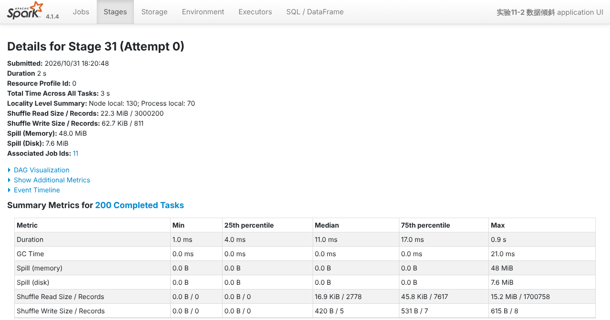
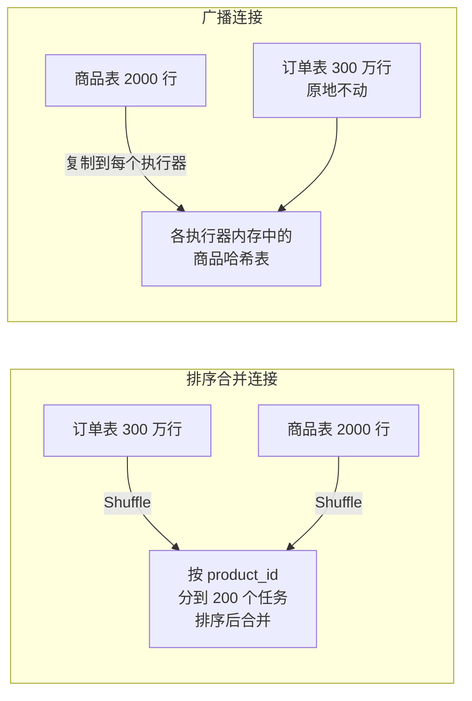
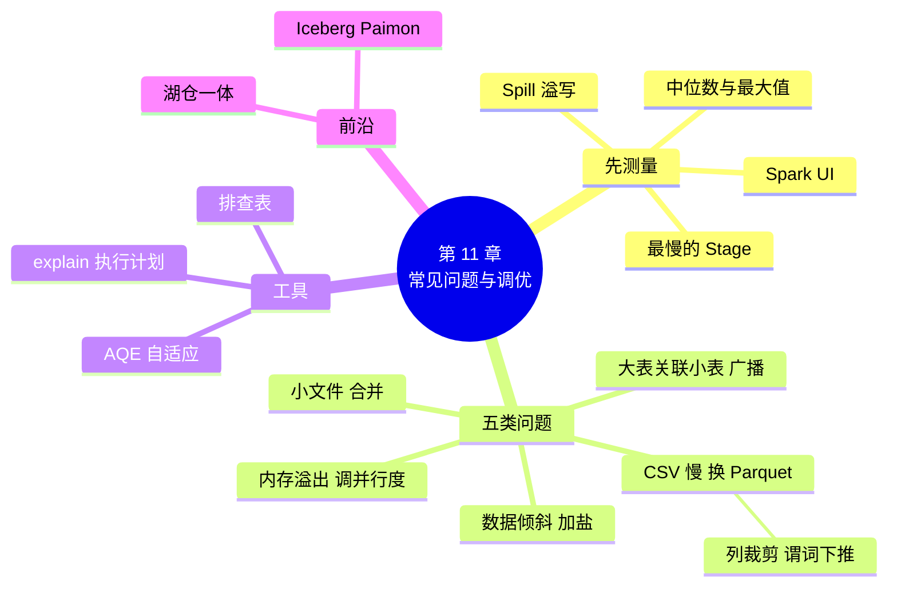

# 第 11 章 常见问题与调优

!!! abstract "本章学时"
    理论 4 学时 · 实验 1 学时（本章共 3 个实验，教师可任选）

## 学习目标

学完本章，你应该能够：

1. **使用** Spark UI 找到一个程序中最慢的阶段，从任务耗时的分布判断是整体慢还是个别任务慢（应用、分析）；
2. **解释**小文件、CSV 格式、大表关联小表、数据倾斜、内存不够这五类问题的现象和原因（理解）；
3. **运用**合并文件、换用 Parquet、广播连接、加盐、调分区数和内存参数等方法解决对应的问题（应用）；
4. **对照**性能问题排查表，为一个慢程序或报错的程序找出可能的原因并提出改法（分析、评价）；
5. **说出**湖仓一体的基本思路（记忆、理解）。

!!! info "先修要求"
    学习本章前，你需要掌握：

    - Spark 的 Job、Stage、Task 和 Spark UI 的基本用法（[第 6 章](../06-spark-rdd/index.md)）；
    - Shuffle 的过程（[第 4 章](../04-mapreduce-yarn/index.md)），以及 HDFS 的块和小文件问题（[第 3 章](../03-hdfs/index.md)）；
    - DataFrame 的读写、关联和分组聚合（[第 7 章](../07-data-cleaning/index.md)、[第 8 章](../08-spark-sql/index.md)）；
    - 实验 1-1 生成的 300 万行订单 `labs/data/scale/orders_3000000.csv`。

??? abstract "本章概念清单（12 个，点击查看定义和例子）"
    1. [行式存储](../../appendix/glossary.md#g-行式存储)
    2. [行组](../../appendix/glossary.md#g-行组)
    3. [列裁剪](../../appendix/glossary.md#g-列裁剪)
    4. [谓词下推](../../appendix/glossary.md#g-谓词下推)
    5. [广播连接](../../appendix/glossary.md#g-广播连接)
    6. [排序合并连接](../../appendix/glossary.md#g-排序合并连接)
    7. [数据倾斜](../../appendix/glossary.md#g-数据倾斜)
    8. [加盐](../../appendix/glossary.md#g-加盐)
    9. [自适应查询执行](../../appendix/glossary.md#g-自适应查询执行)
    10. [内存溢出](../../appendix/glossary.md#g-内存溢出)
    11. [并行度](../../appendix/glossary.md#g-并行度)
    12. [湖仓一体](../../appendix/glossary.md#g-湖仓一体)

## 情景导入

“双十一”前一周，小象优选的数据组遇到了一连串麻烦：

- 每天凌晨跑的“各省销售日报”，原来 10 分钟就出结果，最近要跑 40 分钟；
- 一个按店铺计算佣金的程序，进度条到 199/200 就不动了，最后一个任务足足跑了半小时；
- 实习生小林写的程序报了一大串红字，最后一行是 `java.lang.OutOfMemoryError: Java heap space`。

组长把大家叫到一起：“大数据程序‘能跑’只是第一步，‘跑得快、不崩’才算合格。性能问题看起来五花八门，其实九成都逃不出五类：小文件太多、读 CSV 太慢、大表关联小表、数据倾斜、内存不够。今天我们先学会看 Spark UI，找到到底慢在哪里，再一类一类地解决。”

本章不讲 Spark 的源代码，也不背几十个参数，而是按“**现象 → 原因 → 怎么改**”的顺序，学会处理最常见的五类问题。每一类都在随书集群上用 300 万行订单亲手做一遍。

## 11.1 先学会看 Spark UI

### 11.1.1 优化之前先测量

优化的第一条原则是：**先测量，再动手。**凭感觉改参数，常常改了半天，慢的地方根本没碰到。Spark 程序运行时，在 4040 端口提供一个网页，也就是第 6 章用过的 [**Spark UI**](../../appendix/glossary.md#g-Spark-UI)。<sup class="cite">[[3]](#ref11-3)</sup> 复习一下它的三层结构：

| 层次 | 是什么 | 在 Spark UI 的哪里看 |
|---|---|---|
| Job（作业） | 一个行动（如 `count`、`collect`、`write`）触发一个 Job | Jobs 页 |
| Stage（阶段） | Job 在 Shuffle 处切开得到的阶段 | Stages 页，或点开某个 Job |
| Task（任务） | 阶段在一个分区上的执行单元，一个分区一个任务 | 点开某个 Stage，下方的任务列表 |

一个 Stage 的所有任务都做完了，下一个 Stage 才能开始。所以**一个阶段的用时，取决于最慢的那个任务**，这一点是理解后面几类问题的关键。

### 11.1.2 三步找到慢在哪里

**第 1 步，找最慢的 Job 和 Stage。**在 Jobs 页和 Stages 页按 Duration（用时）排序，找出最慢的那个阶段。SQL / DataFrame 页还能看到每个查询的执行计划图，以及每一步处理了多少行。

**第 2 步，点开这个 Stage，看 Summary Metrics（汇总指标）。**这张表给出全部任务各项指标的最小值、25% 分位、中位数、75% 分位和最大值。下图是实验 11-2 中一个关联阶段的截图：



**第 3 步，判断是“整体慢”还是“个别慢”。**

- **中位数和最大值差不多，但都很大**：是整体慢，比如读的数据太多、格式太慢、Shuffle 量太大，对应 11.2～11.4 节；
- **最大值是中位数的几十上百倍**：是个别任务慢，基本就是数据倾斜，对应 11.5 节。上图中耗时中位数 11 毫秒、最长 0.9 秒，读入行数中位数 2778、最多 170 万，一眼就能看出倾斜；
- **出现 Spill（溢写）**：内存放不下，数据被临时写到磁盘，对应 11.6 节。上图中最大的那个任务溢写了 48 MiB，因为它一个人要处理 170 万行。

!!! tip "程序跑完 Spark UI 就关了怎么办"
    Spark UI 只在程序运行期间可以访问。想在程序结束后再看，可以在程序最后加一句 `input("按回车结束")` 让它停住；生产环境则会打开事件日志（`spark.eventLog.enabled`），用 History Server 查看历史程序。本章实验的程序把要看的指标直接打印了出来（`labs/ch11/ui.py` 从 Spark UI 的接口读取），方便填写实验记录表。

## 11.2 小文件太多

**现象**：数据总共不大，读起来却很慢；Spark UI 上任务数特别多，每个任务只跑几毫秒；HDFS 的 NameNode 内存越来越紧张。

**原因**：第 3 章讲过[**小文件问题**](../../appendix/glossary.md#g-小文件问题)：每个文件不管多小，在 NameNode 中都要占一条元数据。对 Spark 来说，每打开一个文件也有固定开销（读文件尾部的元数据、建立连接等）。Spark 读文件时会把小文件拼在一起，按“每个文件额外算 4 MB 开销、每个分区最多 128 MB”来分任务，<sup class="cite">[[1]](#ref11-1)</sup> 但开销依然存在。

小文件通常是自己“写”出来的：

- 流处理程序每隔几秒写一次，每次写一批小文件（第 9 章）；
- 写结果之前分区数很大（比如 Shuffle 后默认 200 个分区），每个分区写一个文件；
- 按天、按小时的分区表，再按省份细分，每个目录里只有几条数据。

**怎么改**：

1. **写之前合并分区**：结果不大时，用 `coalesce(n)` 把分区合并成 n 个再写，每个文件最好在 128 MB 到 1 GB 之间。`coalesce` 只合并、不 Shuffle，比 `repartition` 便宜。
2. **定期合并历史文件**：读出小文件，合并后写到新目录，再替换旧目录（实验 11-1 第 ⑤ 步）。
3. **分区不要分得太细**：按天分区一般够了，不要再按省、按小时分到每个目录只有几 KB。

实验 11-1 中，同样 300 万行订单，写成 2000 个小文件（平均每个 36 KB）时按省统计要 2.57 秒；合并成 4 个文件以后只要 0.24 秒，快了 10 倍。

## 11.3 读 CSV 太慢：换成 Parquet

**现象**：每次查询都要扫描很久；明明只用到两三列，Spark UI 上读入的数据量却和文件一样大。

**原因**：CSV 是[**行式存储**](../../appendix/glossary.md#g-行式存储 "把一行的各列数据连续存放，适合按行写入和按主键查整行，分析时即使只要一列也得读出整行"){ .term }：一行接一行地写，每行的各列挨在一起。要统计 amount 一列，也得把每一行完整读出来、切开、转换类型，再丢掉不用的列。而且 CSV 是文本，数字“2399.0”要存 6 个字符，读的时候还要再转成数字。

[**Parquet**](../../appendix/glossary.md#g-Parquet) 是[**列式存储**](../../appendix/glossary.md#g-列式存储)（第 5、7 章已经用过）：它先把数据按行切成若干[**行组**](../../appendix/glossary.md#g-行组 "Parquet 文件中按行切分的数据块，块内按列存放，并记录每列的最小值、最大值等统计信息"){ .term }，每个行组内一列接一列存放，文件尾部记录每一列在哪里，以及每列的最小值、最大值等统计信息。<sup class="cite">[[4]](#ref11-4)</sup> 列式存储的思想来自数据库领域的 C-Store 等研究，Google 的 Dremel 把它用到了嵌套数据上，Parquet 就是按 Dremel 的方法设计的开源格式。<sup class="cite">[[5]](#ref11-5)</sup><sup class="cite">[[6]](#ref11-6)</sup> 这样做有三个好处：

| 好处 | 原理 | 实验 11-1 的结果 |
|---|---|---|
| 文件小 | 同一列类型相同、取值重复多，压缩效果好 | 239.8 MB 的 CSV 变成 51.8 MB |
| [**列裁剪**](../../appendix/glossary.md#g-列裁剪 "查询只读取用到的列，其余列不从磁盘读出，列式存储才能做到"){ .term } | 只读查询用到的列 | 按省统计只读 3 列，约 6.7 MB |
| [**谓词下推**](../../appendix/glossary.md#g-谓词下推 "把过滤条件交给数据源在读取时执行，借助统计信息跳过不可能满足条件的数据"){ .term } | 过滤条件交给读取环节，用统计信息跳过整个行组<sup class="cite">[[7]](#ref11-7)</sup> | 执行计划中出现 `PushedFilters` |

下面的动画对比了同一张表在两种存储方式下的排列，以及不同查询要读的数据：

<iframe class="sim-frame" src="../../sims/row-column/main.html" height="720" loading="lazy" title="行式与列式存储"></iframe>

先选“SELECT SUM(amount)”，在行式和列式之间切换，比较要读的格子数；再选“amount > 1000”，勾选和取消“用最小值 / 最大值跳过行组”；最后选“只查一行”，想一想网站的订单详情页该用哪种存储。[全屏打开](../../sims/row-column/main.html){ target=_blank }

**怎么改**：

1. **原始数据进来以后，第一步就转成 Parquet**（或 Hive 中常用的 ORC），后面所有分析都读 Parquet。Spark 写 Parquet 时默认用 Snappy 压缩、自动保存表结构，读取时默认打开过滤条件下推。<sup class="cite">[[10]](#ref11-10)</sup> 实验 11-1 中，同一个查询从 CSV 的 1.91 秒降到 0.39 秒。
2. **只选需要的列**：`select("province", "amount")` 比 `select("*")` 好，Spark 会把列裁剪推到文件读取环节。
3. **不得不读 CSV 时，给出表结构**：`inferSchema=True` 要先把文件完整扫一遍来猜类型，实验 11-1 中数行数用了 2.1 秒，直接给出 `schema` 只要 0.5 秒。

行式存储也有自己的长处：按主键查一整行、频繁插入和修改单行，MySQL 这类业务数据库用的就是行式。**业务系统用行式，分析系统用列式**，这是大数据平台的通常做法。

## 11.4 大表关联小表：广播连接

**现象**：一张几亿行的订单表关联一张几千行的商品表，Spark UI 上出现两个很大的 Shuffle，程序很慢。

**原因**：两张表关联时，键相同的行必须到同一个任务里才能配对。默认的做法叫[**排序合并连接**](../../appendix/glossary.md#g-排序合并连接 "两张表都按关联键 Shuffle 并排序，再把键相同的行合并，适合两张大表关联"){ .term }（Sort Merge Join）：两张表都按关联键 Shuffle，各自排序，再一边扫一边合并。两张大表关联时只能这样做，但为了一张小表，让几亿行的大表也 Shuffle 一遍，代价太大了。

[**广播连接**](../../appendix/glossary.md#g-广播连接 "把小表复制到每个执行器，大表在本地直接与它关联，大表不需要 Shuffle"){ .term }（Broadcast Hash Join）换了个思路：把小表完整复制一份发给每个执行器，在内存里建好哈希表；大表的每个分区就地查这张表，**大表一行都不用移动**。这和第 6 章讲的“移动计算比移动数据便宜”是一个道理。



**怎么改**：

1. **Spark 会自动广播**：小表估计小于 `spark.sql.autoBroadcastJoinThreshold`（默认 10 MB）时，自动用广播连接。实验 11-3 的商品表只有 2000 行，默认就是广播。
2. **自动判断不准时，手动指定**：小表是经过过滤、聚合算出来的，Spark 估不准它的大小，就可以用 `F.broadcast(小表)` 明确要求广播；SQL 中写 `/*+ BROADCAST(p) */`。<sup class="cite">[[1]](#ref11-1)</sup>
3. **别把大表广播出去**：广播的表要放进每个执行器的内存，几 GB 的表广播会导致内存溢出。一般几十 MB 以内才适合广播。

实验 11-3 中，关闭自动广播后变成排序合并连接，Shuffle 写出 14.0 MB，用时 1.31 秒；用 `F.broadcast()` 指定广播后没有大表 Shuffle，用时 0.58 秒。这里的订单表只有 300 万行，在几亿行的生产数据上，两者的差距会大得多。

!!! note "AQE 也会帮你改"
    Spark 3.2 起默认打开[**自适应查询执行**](../../appendix/glossary.md#g-自适应查询执行 "Spark 在运行中根据每个阶段的实际数据量调整后续执行计划，如合并小分区、拆分倾斜分区、改用广播连接"){ .term }（AQE）。它在每个阶段跑完后，根据实际的数据量调整后面的计划：发现某一边其实很小，就把排序合并连接改成广播连接；发现分区太小太多，就把它们合并。<sup class="cite">[[1]](#ref11-1)</sup> 不过事后改不如一开始就广播，能自己判断的，最好在代码里写清楚。

## 11.5 个别任务特别慢：数据倾斜

**现象**：进度条到 199/200 就不动了；Spark UI 的 Summary Metrics 中，任务耗时和读入行数的最大值是中位数的几十上百倍；有时这个任务还会因为内存不够而失败。

**原因**：Shuffle 按键分配数据，键相同的数据一定进同一个任务。如果某个键的数据特别多（热点店铺、热门商品、“未知”这样的默认值、空值），它所在的任务就要干别人几十倍的活，这就是[**数据倾斜**](../../appendix/glossary.md#g-数据倾斜 "某些键的数据特别多，Shuffle 后集中到少数任务，使这几个任务特别慢、拖慢整个阶段"){ .term }。一个阶段要等最慢的任务做完才结束，其他任务早早做完也只能等着。

实验 11-2 模拟了“秒杀日”：旗舰店 s001 一家就占了 57% 的订单，是店铺订单数中位数的 514 倍。关联店铺表时，200 个任务中有一个要处理 170 万行，用时约 1 秒，其余任务的中位数只有 2778 行、十几毫秒（见 11.1.2 节的截图）。

**怎么改**：

1. **先看热点是不是“脏数据”**：如果热点键是空值、“未知”、测试账号，最简单的办法是先过滤掉，或者单独处理。
2. **小表能广播就广播**：广播连接不按键 Shuffle 大表，根本不会倾斜。实验 11-2 是假设店铺表很大、不能广播。
3. **[加盐](../../appendix/glossary.md#g-加盐 "给热点键加上随机后缀（盐），把它的数据拆到多个任务；关联时另一张表的对应行复制相同的份数"){ .term }打散**：给大表的每一行随机加一个 0～N−1 的“盐”，和原来的键一起作为关联键，热点店铺的数据就被拆到了 N 个任务；另一张表的每一行复制 N 份，盐分别是 0～N−1，保证每份数据都能找到配对。

```python
N = 20
salted_orders = orders.withColumn("salt", (F.rand(seed=7) * N).cast("int"))          # 大表：随机加盐
salted_shops = shops.withColumn("salt", F.explode(F.sequence(F.lit(0), F.lit(N - 1))))  # 小表：每行复制 N 份
result = salted_orders.join(salted_shops, ["shop_id", "salt"])                        # 按（店铺, 盐）关联
```

实验 11-2 中加 20 份盐以后，最大的任务从 170 万行降到 17.7 万行，最长的任务耗时从约 1 秒降到约 0.2 秒，结果和不加盐完全一样。

4. **聚合时分两步**：按（键, 盐）先聚合一次，再去掉盐按键聚合一次。不过 Spark 的 `sum`、`count` 等聚合会先在每个分区内部分聚合，一般不需要手动加盐；真正容易倾斜的是关联和不带 Top N 限制的窗口函数。

!!! warning "为什么笔记本上加盐“不显得快”"
    实验 11-2 中，加盐前后整个程序的用时差不多（都是 3 秒多）。原因是随书环境只有 4 个 CPU 核：倾斜时 1 个核处理热点、另外 3 个核处理其余数据，大家都不闲着；加盐还多了复制店铺表的开销。到了有几百个核的集群上，其余几百个任务一眨眼就做完了，整个阶段要干等那 1 个热点任务，倾斜的代价才会成倍显现。下面的动画可以把核数调大，直观地看到这一点。

<iframe class="sim-frame" src="../../sims/skew-salt/main.html" height="860" loading="lazy" title="数据倾斜与加盐"></iframe>

先保持热点占比 50%、不加盐，在“4 核”和“64 核”之间切换，比较阶段用时和理想用时；再在 64 核下把盐调到 4、8、16 份。[全屏打开](../../sims/skew-salt/main.html){ target=_blank }

至于 AQE：它也能自动拆分倾斜的关联分区，但默认只处理“比中位数大 5 倍、并且超过 256 MB”的分区。<sup class="cite">[[1]](#ref11-1)</sup> 实验 11-2 中热点分区只有 15 MB 左右，没有达到门槛，AQE 只是把 200 个小任务合并成了几个，热点分区仍然原样留在一个任务里。生产环境中的倾斜分区动辄几个 GB，AQE 能解决一大部分；它处理不了的（比如窗口函数中的倾斜），还要靠加盐。

## 11.6 内存不够报错

**现象**：程序报错退出，常见的几种报错是：

- `java.lang.OutOfMemoryError: Java heap space`：Java 堆内存不够；
- 在 YARN 上运行时，`Container killed by YARN for exceeding memory limits`：容器用的内存超过了 YARN 允许的上限；
- 不报错但特别慢，Spark UI 的 Spill（溢写）列很大：内存放不下，数据被临时写到了磁盘。

**原因**：[**内存溢出**](../../appendix/glossary.md#g-内存溢出 "程序需要的内存超过了分配给它的上限而报错退出"){ .term }（OOM）可能发生在 Driver 上，也可能发生在执行器上，原因不同：

| 出在哪里 | 常见原因 | 例子 |
|---|---|---|
| Driver | 把大量数据拉回 Driver：`collect()`、`toPandas()`，或者广播了太大的表 | 编者把 300 万行订单 `collect()` 到只有 512 MB 内存的 Driver，报 `OutOfMemoryError: Java heap space` |
| 执行器 | 单个任务要处理的数据太多：分区数太少，或者数据倾斜 | 实验 11-2 中处理 170 万行的那个任务溢写了 48 MiB |

**怎么改**（按先后顺序试）：

1. **不要把大数据拉回 Driver**：只把聚合后的小结果 `collect()`；要看几行用 `show()` 或 `limit(n)`；大结果直接 `write` 到 HDFS 或数据库。
2. **增加[并行度](../../appendix/glossary.md#g-并行度 "一个阶段同时被拆成多少个任务，决定能用上多少个 CPU 核、每个任务处理多少数据"){ .term }，让每个任务处理的数据少一些**：调大 `spark.sql.shuffle.partitions`（默认 200），或者对大数据先 `repartition(n)`。Spark 官方调优指南给出的经验是每个 CPU 核分配 2～3 个任务，并且指出，任务工作集太大引起的内存溢出，最简单的解决办法就是提高并行度。<sup class="cite">[[2]](#ref11-2)</sup> 一个常用的估算：每个任务处理 100～200 MB 的数据比较合适。
3. **解决数据倾斜**：如果只有一两个任务内存不够，先按 11.5 节处理倾斜，加内存治标不治本。
4. **最后才是加内存**：`--driver-memory`（Driver 内存）、`--executor-memory`（每个执行器的内存）、`--executor-cores`（每个执行器的核数）。业界常见的配置是每个执行器 4～5 个核、每个核配 2～4 GB 内存；在 YARN 上报“超过内存上限”时，还要调大 `spark.executor.memoryOverhead`（堆外内存，默认是执行器内存的 10%，至少 384 MB）。

```bash
spark-submit --master yarn \
  --driver-memory 2g --executor-memory 8g --executor-cores 4 --num-executors 10 \
  --conf spark.sql.shuffle.partitions=400 \
  --conf spark.executor.memoryOverhead=1g \
  app.py
```

!!! tip "参数不是越大越好"
    执行器内存给得太大，Java 垃圾回收一次要停很久；核数给得太多，多个任务抢同一个执行器的内存。随书环境是 4 核、16 GB 的单机，用本地模式默认值就够了，不要照搬生产集群的配置。

## 11.7 性能问题排查表

把本章的内容整理成一张表。遇到问题时，先在 Spark UI 上看清现象，再按表查原因和改法。

| 现象（在 Spark UI 上看到什么） | 可能的原因 | 首先尝试的改法 |
|---|---|---|
| 任务数特别多，每个任务只跑几毫秒 | 小文件太多 | 写之前 `coalesce`；定期合并小文件；分区别分太细 |
| 读入的数据量接近整个文件，而查询只用几列 | 读的是 CSV 等行式文本 | 转成 Parquet / ORC；只 `select` 需要的列；读 CSV 时给出 schema |
| 大表关联小表，出现两个大 Shuffle | 用了排序合并连接 | 小表用 `F.broadcast()` 广播 |
| 最大任务耗时、读入行数是中位数的几十倍 | 数据倾斜 | 先查热点是否脏数据；能广播就广播；关联加盐；确认 AQE 已打开 |
| Driver 报 `OutOfMemoryError` | `collect()` / `toPandas()` 拉回太多数据，或广播的表太大 | 只拉回聚合结果；大结果直接写文件 |
| 执行器报 `OutOfMemoryError` 或被 YARN 杀掉，Spill 很大 | 每个任务的数据太多 | 增加分区数；处理倾斜；最后再加内存和 memoryOverhead |
| 同一个 DataFrame 被用了很多次，每次都从头算 | 没有缓存 | 对多次使用的中间结果 `cache()`，用完 `unpersist()` |
| 所有任务都均匀地慢，CPU 一直很忙 | 计算量本身大，或用了 Python UDF | 优先用内置函数代替 Python UDF；加机器、加核 |

!!! example "排查的顺序"
    **先看格式和数据量**（11.2、11.3），**再看 Shuffle**（11.4），**再看任务分布**（11.5），**最后才调内存参数**（11.6）。越靠前的改法越简单、收益越大。很多时候，把 CSV 换成 Parquet、把小表广播出去，程序就快了好几倍，根本用不着去调参数。

## 11.8 前沿视窗

**湖仓一体：把数据湖和数据仓库合二为一。**第 5 章的数据仓库（Hive）把数据整理成规整的表，适合做报表；而很多公司还有一个“数据湖”，把日志、图片、原始文件直接放进 HDFS 或对象存储，供机器学习使用。两套系统各存一份数据，既浪费空间，又容易对不上。

2021 年，Databricks 公司的几位创始人（其中包括 Spark 的作者 Matei Zaharia）在论文中提出了[**湖仓一体**](../../appendix/glossary.md#g-湖仓一体 "在数据湖的开放文件格式上加上事务、版本等表管理能力，让一份数据同时支持报表分析和机器学习"){ .term }（Lakehouse）的架构：数据只存一份，用 Parquet 这样的开放格式放在便宜的存储上，再在上面加一层“表格式”，提供数据库才有的事务、版本、更新删除等能力，同时支持报表分析和机器学习。<sup class="cite">[[8]](#ref11-8)</sup> 目前常用的表格式有 Apache Iceberg、Apache Paimon（第 9 章介绍过）、Delta Lake 等，Spark、Flink、Trino 等多种引擎可以同时读写同一张表。<sup class="cite">[[9]](#ref11-9)</sup> 本章学的列式存储、小文件合并、分区裁剪，正是这些表格式在底层自动帮你做的事情。

## 本章实验

!!! abstract "实验总览"
    | 实验 | 类型 | 建议时长 | 内容 |
    |---|---|---|---|
    | 实验 11-1 | ★ 基础 | 30 分钟 | 300 万行订单从 CSV 转成 Parquet，比较文件大小、查询耗时和执行计划；把数据写成 2000 个小文件再合并，比较查询耗时 |
    | 实验 11-2 | ★ 基础 | 35 分钟 | 模拟秒杀日热点店铺，在 Spark UI 上找到倾斜的任务；用加盐把热点打散，与 AQE 的效果比较 |
    | 实验 11-3 | ☆ 拓展 | 20 分钟 | 订单关联商品，比较自动广播、关闭广播、手动指定广播三种情况的关联方式、Shuffle 量和耗时 |

    实验只用 spark 容器（本地模式），Docker 分配 4 GB 内存即可。实验代码见配套资源 `labs/ch11/` 目录，其中 `ui.py` 是共用的计时和读取 Spark UI 指标的小工具。编者的运行环境：4 核 CPU、16 GB 内存的 Linux 主机，Docker 29.9，Spark 4.1.4。**本章的耗时与电脑性能关系很大，你的数字可以和书上不同，重要的是几种做法之间的对比。**

### 实验 11-1 ★ CSV 换成 Parquet

**实验目的**

1. 把 300 万行订单从 CSV 转成 Parquet，比较文件大小和同一查询的耗时；
2. 在执行计划中找到列裁剪（ReadSchema）和谓词下推（PushedFilters）；
3. 体会小文件对查询的影响，学会合并小文件。

**实验环境**：随书集群加 spark 容器（`docker-compose.spark.yml`）。

**实验数据**：实验 1-1 生成的 `labs/data/scale/orders_3000000.csv`（239.8 MB）。如果还没有生成，在本机 `labs` 目录运行 `python ch01/lab1_1_data_size.py --max 3000000`。

**实验步骤与代码**

第 1 步，运行程序：

```bash
cd labs/cluster
docker compose -f docker-compose.yml -f docker-compose.spark.yml exec spark \
  spark-submit --py-files /labs/ch11/ui.py /labs/ch11/lab11_1_parquet.py
```

程序的主要步骤如下：

```python
# ① 读 CSV：inferSchema 和指定 schema 两种方式，各数一次行数
spark.read.csv(CSV, header=True, inferSchema=True).count()
spark.read.csv(CSV, header=True, schema=SCHEMA).count()
# ② 转成 Parquet
spark.read.csv(CSV, header=True, schema=SCHEMA).write.mode("overwrite").parquet(PQ)
# ③ 同一个查询分别读 CSV 和 Parquet
d.filter(F.col("status") == "已完成").groupBy("province").agg(F.sum("amount"))
# ⑤ 每个文件最多 1500 行，故意写出 2000 个小文件；再 coalesce(4) 合并
pq_df.write.option("maxRecordsPerFile", 1500).parquet(SMALL)
spark.read.parquet(SMALL).coalesce(4).write.parquet(SMALL + "_merged")
```

`ui.py` 中的 `timed()` 把每个查询运行 3 次、取最短的一次，避免第一次运行时的预热影响比较。

第 2 步，在本机文件管理器中打开 `labs/data/scale/`，比较 `orders_3000000.csv`、`orders_parquet/`、`orders_small_files/` 三者的大小和文件个数。

第 3 步（选做），在第 ③ 步之后加一句 `input("按回车结束")`，重新运行，在浏览器打开 <http://localhost:4040>，在 SQL / DataFrame 页分别点开 CSV 和 Parquet 的查询，比较扫描节点（Scan csv、Scan parquet）上显示的信息。

**运行结果**

程序用时约 1 分钟，输出如下：

```text
① 数行数：CSV + inferSchema 2.1 秒，CSV + 指定类型 0.5 秒
② CSV 239.8 MB → Parquet 51.8 MB（4 个文件），只有原来的 22%
③ 各省销售额：CSV 1.91 秒（读入 240.1 MB），Parquet 0.39 秒；结果相同：True
   前 3 名： [('广东', 399436862.7), ('河南', 309052537.0), ('山东', 302957507.7)]
④ Parquet 扫描的关键信息：
   PushedFilters: [IsNotNull(status), EqualTo(status,已完成)]
   ReadSchema: struct<amount:double,province:string,status:string>
   查询用到的 3 列单独存放只有 6.7 MB，这就是 Parquet 要读的量
⑤ 2000 个小文件：共 71.3 MB，平均每个 36 KB，查询 2.57 秒，任务数 66
   合并成 4 个文件：共 50.6 MB，查询 0.24 秒，任务数 7
```

**结果分析**

1. **给出 schema 很重要**：`inferSchema=True` 要先把 240 MB 完整扫一遍来猜类型，比直接给出 schema 慢了约 4 倍。
2. **Parquet 又小又快**：文件只有 CSV 的 22%；同一个查询从 1.91 秒降到 0.39 秒，约快 5 倍。CSV 每次都要读完 240 MB，而 Parquet 只读用到的 3 列，这 3 列一共约 6.7 MB。
3. **执行计划印证了原理**：`ReadSchema` 只有 amount、province、status 三列，这是列裁剪；`PushedFilters` 中的 `EqualTo(status,已完成)` 被交给了 Parquet 读取环节，这是谓词下推。
4. **小文件的代价**：同样的数据拆成 2000 个文件后，总大小从 51.8 MB 涨到 71.3 MB（每个文件都有自己的文件头、文件尾和统计信息，数据少了压缩效果也差），查询用了 2.57 秒，是合并后（0.24 秒）的 10 倍多。Spark 把 2000 个小文件拼成了 66 个任务，但打开每个文件的开销省不掉。

!!! note "为什么 Spark UI 上 Parquet 的“读入”很小"
    在本地文件上运行时，Spark UI 显示的 Parquet 读入字节数明显偏小（编者的环境中只有 0.3 MB 左右），不能直接用来和 CSV 比较。所以程序用“把这 3 列单独存一份、看它有多大”的办法来估算 Parquet 实际要读的数据量。读 HDFS 上的文件时，这个数字是准确的。

**实验记录表**

| 项目 | CSV | Parquet | 小文件（2000 个） | 合并后 |
|---|---|---|---|---|
| 文件大小（MB） | | | | |
| 文件个数 | 1 | | | |
| 按省统计耗时（秒） | | | | |
| 任务数 | — | — | | |

**常见问题排查**

| 现象 | 原因 | 解决办法 |
|---|---|---|
| `Path does not exist: .../orders_3000000.csv` | 没有生成 300 万行的数据 | 在本机 `labs` 目录运行 `python ch01/lab1_1_data_size.py --max 3000000` |
| `ModuleNotFoundError: No module named 'ui'` | 运行时没有带上 `ui.py` | 命令里加 `--py-files /labs/ch11/ui.py` |
| 耗时和书上差很多 | 电脑性能不同，或者同时开着别的程序 | 正常现象；关注 CSV 与 Parquet、小文件与合并后之间的倍数 |
| 磁盘空间不够 | 本实验会写出约 180 MB 的 Parquet 文件 | 做完本章实验后可以删除 `data/scale/orders_small_files*` 和 `orders_parquet_3cols` |

**思考与练习**

1. 把第 ③ 步的查询改成 `select("*")` 后再统计，Parquet 的优势还有这么大吗？为什么？
2. 公司的日志每 5 分钟写一批文件到 HDFS，一天下来有几千个小文件。你会建议怎样处理？

**实验报告要求**

提交运行结果截图和实验记录表，回答思考与练习的两个问题。

### 实验 11-2 ★ 处理一个热点店铺引起的数据倾斜

**实验目的**

1. 构造一份热点店铺占一半以上订单的数据，在 Spark UI 中观察倾斜的任务；
2. 用加盐的方法打散热点数据，比较加盐前后各任务的数据量和耗时，并验证结果不变；
3. 了解 AQE 对倾斜的处理和它的门槛。

**实验环境**：同实验 11-1。

**实验数据**：实验 11-1 生成的 `labs/data/scale/orders_parquet/`，以及商品表 `labs/data/xiaoxiang/products.csv`（含店铺编号，其中店铺 s001 是平台的头部旗舰店）。

**实验步骤与代码**

第 1 步，运行程序：

```bash
docker compose -f docker-compose.yml -f docker-compose.spark.yml exec spark \
  spark-submit --py-files /labs/ch11/ui.py /labs/ch11/lab11_2_skew.py
```

程序开头关掉了 AQE，并关掉了自动广播（假设店铺表很大），让倾斜原样暴露出来：

```python
spark = (SparkSession.builder
         .config("spark.sql.adaptive.enabled", "false")
         .config("spark.sql.autoBroadcastJoinThreshold", "-1")
         .config("spark.sql.shuffle.partitions", "200").getOrCreate())
# ① 秒杀日：一半订单随机改成 s001 的
flash = (orders.join(F.broadcast(products.select("product_id", "shop_id", "category")), "product_id")
               .withColumn("shop_id", F.when(F.rand(seed=11) < 0.5, "s001").otherwise(F.col("shop_id"))))
# ② 直接关联店铺表，按品类算佣金
flash.join(shops, "shop_id").groupBy("category").agg(F.sum(F.col("amount") * F.col("rate")))
# ③ 加盐后关联（代码见 11.5 节）
# ④ 打开 AQE，不加盐再算一次
```

`ui.py` 中的 `slowest_stage()` 从 Spark UI 的接口读出关联阶段各任务的耗时和读入行数，打印中位数和最大值。

第 2 步（选做），在第 ② 步之后加一句 `input("按回车结束")`，重新运行，打开 <http://localhost:4040> 的 Stages 页，找到 200 个任务的那个阶段，点开看 Summary Metrics 和 Event Timeline（事件时间线），与 11.1.2 节的截图对照。

**运行结果**

程序用时约 50 秒，输出如下：

```text
① 秒杀日 3000000 笔订单，每店订单数的中位数 3308；s001 有 1700757 笔，占 57%，是中位数的 514 倍
② 直接关联：3.03 秒。关联阶段 200 个任务，每个任务读入的行数：中位数 2778，最多 1700758；任务耗时：中位数 13 毫秒，最长 953 毫秒
③ 加盐以后：3.44 秒。关联阶段 200 个任务，每个任务读入的行数：中位数 5703，最多 176596；任务耗时：中位数 17 毫秒，最长 175 毫秒
④ 打开 AQE：1.45 秒。关联阶段 3 个任务，每个任务读入的行数：中位数 1109215，最多 1700758；任务耗时：中位数 465 毫秒，最长 825 毫秒
⑤ 三种做法的结果相同：True
   图书文具：佣金 785208.22 元
   家居日用：佣金 5488896.77 元
   家用电器：佣金 36411721.01 元
```

**结果分析**

1. **倾斜一目了然**：直接关联时，读入行数最多的任务（170 万行，比 s001 的订单数多 1 行，是店铺表中 s001 那一行）是中位数的 600 多倍，耗时是中位数的 70 多倍。
2. **加盐把热点拆开了**：加 20 份盐后，最大的任务只有 17.7 万行（约等于 170 万 ÷ 20 再加上同一分区里其他店铺的数据），最长耗时从 953 毫秒降到 175 毫秒。中位数从 2778 行变成 5703 行，是因为其他店铺的订单也被盐拆成了 20 份，分得更均匀，原来几乎空着的任务也分到了数据。
3. **为什么总时间没变短**：在 4 核的电脑上，倾斜时其他 3 个核也没闲着；加盐还多了复制店铺表的开销，所以总时间差不多（见 11.5 节的说明和动画）。在几百个核的集群上，加盐能让这个阶段的用时从“等最慢的那个任务”降到接近平均水平。
4. **AQE 做了什么**：打开 AQE 后，200 个任务被合并成 3 个，总时间降到 1.45 秒，这是因为省掉了大量小任务的调度开销。但热点分区（约 15 MB）没有超过 AQE 的倾斜门槛（256 MB），所以没有被拆开，最大的任务仍是 170 万行。
5. **结果正确**：三种做法算出的各品类佣金相同，加盐不会改变结果。

**实验记录表**

| 做法 | 总耗时（秒） | 关联阶段任务数 | 读入行数：中位数 / 最大 | 任务耗时：中位数 / 最长（毫秒） |
|---|---|---|---|---|
| 直接关联 | | | | |
| 加盐（N = 20） | | | | |
| 打开 AQE | | | | |

**常见问题排查**

| 现象 | 原因 | 解决办法 |
|---|---|---|
| `Path does not exist: .../orders_parquet` | 没有做实验 11-1 | 先完成实验 11-1 |
| `urllib.error.URLError` | 程序读不到 Spark UI 的接口，可能 4040 端口被另一个 Spark 程序占用 | 关掉其他正在运行的 Spark 程序（如 pyspark 交互界面）再运行 |
| 加盐后结果对不上 | 店铺表没有复制 N 份，或者盐的范围不一致 | 大表的盐是 0～N−1 的随机整数，小表要用 `sequence(0, N-1)` 复制出同样的 N 个值 |
| 每次运行的佣金都不一样 | 店铺佣金比例用了 `rand()`，每次计算都会变 | 用确定的方法生成（程序中用店铺编号的哈希值） |

**思考与练习**

1. 把盐的个数 N 改成 5 和 50，各运行一次，最大任务的读入行数和耗时怎样变化？盐是不是越多越好？
2. 如果热点不是 s001，而是一批店铺编号为空（NULL）的订单，你会怎样处理？

**实验报告要求**

提交运行结果截图和实验记录表，回答思考与练习的两个问题。

### 实验 11-3 ☆ 广播连接

**实验目的**

1. 在执行计划中识别广播连接和排序合并连接；
2. 比较自动广播、关闭广播、手动指定广播三种情况的 Shuffle 量和耗时。

**实验环境**：同实验 11-1。

**实验数据**：实验 11-1 生成的 `orders_parquet/`（300 万行）和商品表 `products.csv`（2000 行）。

**实验步骤与代码**

第 1 步，运行程序：

```bash
docker compose -f docker-compose.yml -f docker-compose.spark.yml exec spark \
  spark-submit --py-files /labs/ch11/ui.py /labs/ch11/lab11_3_broadcast.py
```

程序的核心是同一个查询在三种设置下各运行一次：

```python
q = lambda: orders.join(products, "product_id").groupBy("category").agg(F.sum("amount"))
run("② 默认（自动广播）：", "auto")
spark.conf.set("spark.sql.autoBroadcastJoinThreshold", "-1")      # 关闭自动广播
run("③ 关闭广播：", "off")
q = lambda: orders.join(F.broadcast(products), "product_id").groupBy("category").agg(F.sum("amount"))
run("④ 用 broadcast() 指定：", "hint")
```

函数 `join_type()` 从执行计划中找出用的是哪种关联。

第 2 步，在 pyspark 中对第 ③ 种情况调用 `explain()`，找到 `SortMergeJoin` 和它下面的两个 `Exchange`（Shuffle）；再对第 ④ 种情况调用 `explain()`，找到 `BroadcastHashJoin` 和 `BroadcastExchange`。

**运行结果**

程序用时约 25 秒，输出如下：

```text
① 订单 3000000 行，商品 2000 行；自动广播的门槛 spark.sql.autoBroadcastJoinThreshold = 10485760b
② 默认（自动广播）：BroadcastHashJoin，0.81 秒，Shuffle 写出 0.0 MB，任务 8 个
③ 关闭广播：SortMergeJoin，1.31 秒，Shuffle 写出 14.0 MB，任务 12 个
④ 用 broadcast() 指定：BroadcastHashJoin，0.58 秒，Shuffle 写出 0.0 MB，任务 8 个
⑤ 三种做法的结果相同：True
   手机数码：3291083427.39
   家用电器：724382251.1
   服饰鞋包：348410433.6
```

**结果分析**

1. **默认就是广播**：自动广播的门槛是 10 MB（10485760 字节），2000 行的商品表远小于它，Spark 自动选择了广播连接，订单表不用 Shuffle（Shuffle 写出的 0.0 MB 只是按品类聚合时的少量数据）。
2. **关闭广播的代价**：变成排序合并连接后，订单表和商品表都要按 product_id Shuffle，写出 14.0 MB，用时 1.31 秒，比广播慢约一倍。数据量越大，差距越大。
3. **手动指定**：即使自动广播关着，`F.broadcast()` 也能强制广播。当小表是算出来的、Spark 估不准大小时，就用这种写法。

**常见问题排查**

| 现象 | 原因 | 解决办法 |
|---|---|---|
| 关闭广播后执行计划里仍是 BroadcastHashJoin | 在关闭之前就生成了执行计划，或者代码里用了 `F.broadcast()` | 先 `spark.conf.set(...)`，再重新构造查询 |
| 广播一张大表时报内存错误 | 广播的表要放进 Driver 和每个执行器的内存 | 只广播几十 MB 以内的小表 |

**思考与练习**

1. 把商品表换成 300 万行的订单表自己（订单表关联订单表），还应该用广播吗？为什么？
2. 在 Spark SQL 中怎样写广播提示？把实验中的查询改写成 SQL 并验证。

**实验报告要求**

提交运行结果截图和两种关联方式的 `explain()` 截图，回答思考与练习的两个问题。

## 本章小结

- 优化之前先测量。**Spark UI** 上找最慢的 Stage，看 Summary Metrics：中位数和最大值都大是整体慢，最大值远大于中位数是个别慢（倾斜），出现 Spill 是内存不够。一个阶段的用时取决于最慢的任务。
- **小文件太多**：任务多、开销大。写之前 `coalesce`，定期合并，分区别分得太细。实验 11-1 中合并后快了 10 倍。
- **读 CSV 太慢**：**行式存储**要读整行。换成 Parquet：按**行组**列式存放，压缩好，**列裁剪**只读用到的列，**谓词下推**用统计信息跳过数据。实验 11-1 中文件变成 22%，查询快约 5 倍。业务系统用行式，分析系统用列式。
- **大表关联小表**：**排序合并连接**要 Shuffle 两张表；**广播连接**把小表复制到每个执行器，大表不动。默认 10 MB 以下自动广播，也可以用 `F.broadcast()` 指定。
- **数据倾斜**：热点键集中到一个任务，整个阶段等它。先查是不是脏数据，能广播就广播，关联时**加盐**打散。**自适应查询执行**（AQE）能合并小分区、拆分超过门槛的倾斜分区、自动改用广播。核越多，倾斜的代价越大。
- **内存溢出**：Driver 端多是 `collect()` 拉回了太多数据；执行器端多是每个任务的数据太多。先少拉数据、提高**并行度**、处理倾斜，最后才加内存。
- **湖仓一体**：一份开放格式的数据，加上表格式的管理能力，同时服务报表和机器学习。



**下一章预告**

数据算得又快又准，最后还要“让人看懂”。下一章是全书的最后一章：先学习怎样为比较、构成、分布、趋势、关系选对图表，用 pyecharts 做一份交互式销售报告，用 Superset 搭一个销售看板；再学习大数据项目必须遵守的数据合规要求，包括个人信息保护法、数据安全法的要点和手机号、身份证号的脱敏写法；最后把全书串起来，完成小象优选“从原始日志到看板”的综合项目。

## 参考文献

正文中的上标编号（如<sup class="cite">[[1]](#ref11-1)</sup>）对应下面的文献。带链接的可以直接打开；书籍可在图书馆或电子书平台查阅。

<div class="refs" markdown>

**经典论文**

- <span id="ref11-5"></span>[5] STONEBRAKER M, ABADI D J, BATKIN A, et al. C-Store: a column-oriented DBMS[C]//Proceedings of the 31st International Conference on Very Large Data Bases (VLDB 2005). Trondheim, 2005: 553-564.
    <span class="ref-note">列式数据库的代表性研究：把同一列的数据连续存放并压缩，适合读多写少的分析查询，对应 11.3 节。</span>
- <span id="ref11-6"></span>[6] MELNIK S, GUBAREV A, LONG J J, et al. Dremel: interactive analysis of web-scale datasets[C]//Proceedings of the 36th International Conference on Very Large Data Bases (VLDB 2010). Singapore, 2010: 330-339.
    <span class="ref-note">Google 提出的嵌套数据列式存储方法，Parquet 就是按它的思路设计的开源格式，对应 11.3 节。</span>
- <span id="ref11-7"></span>[7] ARMBRUST M, XIN R S, LIAN C, et al. Spark SQL: relational data processing in Spark[C]//Proceedings of the 2015 ACM SIGMOD International Conference on Management of Data. Melbourne: ACM, 2015: 1383-1394.
    <span class="ref-note">Spark SQL 与 Catalyst 优化器的设计论文，包括数据源接口如何把列裁剪和过滤条件下推到数据源，对应 11.3、11.4 节。</span>
- <span id="ref11-8"></span>[8] ARMBRUST M, GHODSI A, XIN R, et al. Lakehouse: a new generation of open platforms that unify data warehousing and advanced analytics[C]//11th Conference on Innovative Data Systems Research (CIDR 2021). 2021.
    <span class="ref-note">湖仓一体的提出：在 Parquet 等开放的直接访问格式上，同时支持数据仓库式的分析和机器学习，对应 11.8 节。</span>

**在线资源**

- <span id="ref11-1"></span>[1] Apache Software Foundation. Performance tuning (Spark 4.1.4)[EB/OL]. [2026-10-31]. <https://spark.apache.org/docs/4.1.4/sql-performance-tuning.html>.
    <span class="ref-note">Spark SQL 性能调优：读文件时的分区大小（128 MB）和打开文件开销（4 MB），自动广播门槛（10 MB）和 BROADCAST 提示，AQE（3.2.0 起默认打开）合并分区、改用广播连接、拆分倾斜分区（大于中位数 5 倍且超过 256 MB），对应 11.2、11.4、11.5 节。</span>
- <span id="ref11-2"></span>[2] Apache Software Foundation. Tuning Spark (Spark 4.1.4)[EB/OL]. [2026-10-31]. <https://spark.apache.org/docs/4.1.4/tuning.html>.
    <span class="ref-note">Spark 调优指南：建议每个 CPU 核 2～3 个任务；任务工作集太大引起内存溢出时，最简单的办法是提高并行度；大的只读数据用广播变量，对应 11.6 节。</span>
- <span id="ref11-3"></span>[3] Apache Software Foundation. Web UI (Spark 4.1.4)[EB/OL]. [2026-10-31]. <https://spark.apache.org/docs/4.1.4/web-ui.html>.
    <span class="ref-note">Spark UI 各页面的说明：Stage 详情页的任务汇总指标（耗时、GC、Shuffle 读写、溢写等）和事件时间线，对应 11.1 节。</span>
- <span id="ref11-4"></span>[4] Apache Software Foundation. File format (Apache Parquet)[EB/OL]. [2026-10-31]. <https://parquet.apache.org/docs/file-format/>.
    <span class="ref-note">Parquet 文件结构：数据分成若干行组，每个行组中每列一个列块，文件尾部的元数据记录各列块的位置，读取时先读元数据、只读需要的列块，对应 11.3 节。</span>
- <span id="ref11-9"></span>[9] Apache Software Foundation. Apache Iceberg[EB/OL]. [2026-10-31]. <https://iceberg.apache.org/>.
    <span class="ref-note">面向大型分析表的高性能表格式，Spark、Trino、Flink、Presto、Hive、Impala 等引擎可以同时安全地读写同一张表，对应 11.8 节。</span>
- <span id="ref11-10"></span>[10] Apache Software Foundation. Parquet files (Spark 4.1.4)[EB/OL]. [2026-10-31]. <https://spark.apache.org/docs/4.1.4/sql-data-sources-parquet.html>.
    <span class="ref-note">Spark 读写 Parquet：自动保存表结构，默认 Snappy 压缩，过滤条件下推默认打开，对应 11.3 节和实验 11-1。</span>

</div>

## 课后练习

选择题和判断题可以直接点击选项作答，系统会马上告诉你对错，并展开答案与解析；多选题选好后点“提交答案”。简答和实操题请先自己作答，再点开“答案与解析”核对。每道题的解析下方都有“回看”链接，做错了可以直接跳回正文复习。

**一、单项选择题**

<div class="quiz" data-answer="B" markdown>

**1.** 一个 Spark 阶段有 200 个任务，其中 199 个在 1 秒内完成，最后 1 个用了 5 分钟。这个阶段的用时大约是（　　）。

- A. 1 秒
- B. 5 分钟
- C. 200 个任务用时的平均值
- D. 200 个任务用时的中位数

</div>

??? tip "答案与解析"
    **答案：B**

    一个阶段的所有任务都完成，下一个阶段才能开始，所以阶段的用时取决于最慢的那个任务。

    考查：Spark UI · 认知层次：理解 · [回看 11.1.1](#1111)
    { .quiz-meta }

<div class="quiz" data-answer="D" markdown>

**2.** 在 Spark UI 某个 Stage 的 Summary Metrics 中，任务耗时的中位数是 12 毫秒，最大值是 0.9 秒；读入行数的中位数是 2778，最大值是 170 万。最可能的问题是（　　）。

- A. 小文件太多
- B. 读的是 CSV
- C. Driver 内存不够
- D. 数据倾斜

</div>

??? tip "答案与解析"
    **答案：D**

    最大值是中位数的几十上百倍，说明个别任务分到的数据特别多，这是数据倾斜的典型特征。小文件和 CSV 的问题表现为“整体慢”，中位数和最大值相差不大。

    考查：数据倾斜 · 认知层次：分析 · [回看 11.1.2](#1112)
    { .quiz-meta }

<div class="quiz" data-answer="A" markdown>

**3.** 下列做法中，最容易产生大量小文件的是（　　）。

- A. 流处理程序每 5 秒写一批结果，每批按 200 个分区写出
- B. 每天凌晨把当天的订单合并成一个 Parquet 文件
- C. 写结果前先 `coalesce(4)`
- D. 按天分区存放订单，每天几百 MB

</div>

??? tip "答案与解析"
    **答案：A**

    每 5 秒写 200 个文件，一天就是 345 万个文件，每个只有几 KB。B、C 是合并文件的做法，D 每个分区几百 MB，大小合适。

    考查：小文件问题 · 认知层次：应用 · [回看 11.2](#112)
    { .quiz-meta }

<div class="quiz" data-answer="C" markdown>

**4.** 执行计划中出现 `ReadSchema: struct<amount:double,province:string,status:string>`，说明 Spark 对 Parquet 做了（　　）。

- A. 谓词下推
- B. 广播连接
- C. 列裁剪
- D. 数据倾斜处理

</div>

??? tip "答案与解析"
    **答案：C**

    ReadSchema 列出了实际读取的列，订单表有 9 列，这里只读了查询用到的 3 列，这就是列裁剪。谓词下推对应的是 `PushedFilters`。

    考查：列裁剪 · 认知层次：理解 · [回看 11.3](#113-csv-parquet)
    { .quiz-meta }

<div class="quiz" data-answer="B" markdown>

**5.** 下列场景中，更适合用行式存储的是（　　）。

- A. 统计全年各省的销售额
- B. 网站订单详情页，按订单号查出一笔订单的全部信息
- C. 计算每个品类的平均客单价
- D. 统计每天的访问量

</div>

??? tip "答案与解析"
    **答案：B**

    按主键查一整行、频繁插入修改单行，行式存储（如 MySQL）把一行的各列放在一起，配合索引一次就能读出。A、C、D 是只用少数列、扫描大量行的分析查询，适合列式存储。

    考查：行式存储 · 认知层次：评价 · [回看 11.3](#113-csv-parquet)
    { .quiz-meta }

<div class="quiz" data-answer="A" markdown>

**6.** 广播连接比排序合并连接快的主要原因是（　　）。

- A. 大表不需要 Shuffle，在本地直接与内存中的小表关联
- B. 广播连接不需要读取大表
- C. 广播连接会自动把数据转成 Parquet
- D. 广播连接只计算一部分数据

</div>

??? tip "答案与解析"
    **答案：A**

    广播连接把小表复制到每个执行器，大表的每个分区原地查小表，省掉了大表的 Shuffle 和排序。大表仍然要完整读一遍。

    考查：广播连接 · 认知层次：理解 · [回看 11.4](#114)
    { .quiz-meta }

<div class="quiz" data-answer="D" markdown>

**7.** 关联时给大表加盐（随机整数 0～N−1），另一张表必须（　　）。

- A. 也随机加一个 0～N−1 的盐
- B. 删除热点店铺的那一行
- C. 改成广播
- D. 每一行复制 N 份，盐分别是 0～N−1

</div>

??? tip "答案与解析"
    **答案：D**

    大表中热点店铺的每一行可能带着 0～N−1 中的任何一个盐，另一张表只有为每个盐都准备一份，才能保证每一行都找得到配对。如果另一张表也随机加盐，大部分行会配不上。

    考查：加盐 · 认知层次：应用 · [回看 11.5](#115)
    { .quiz-meta }

<div class="quiz" data-answer="C" markdown>

**8.** 程序在 Driver 上报 `java.lang.OutOfMemoryError: Java heap space`，代码中有 `rows = df.collect()`，df 有 3 亿行。最合适的改法是（　　）。

- A. 把 `spark.sql.shuffle.partitions` 调大
- B. 给每个执行器加内存
- C. 不要把全部数据拉回 Driver，改为先聚合再 `collect()`，或直接 `write` 写出
- D. 对 df 加盐

</div>

??? tip "答案与解析"
    **答案：C**

    Driver 内存溢出多半是把大量数据拉回了 Driver。调分区数、给执行器加内存都解决不了 Driver 的问题，应该只拉回聚合后的小结果，大结果直接写到文件或数据库。

    考查：内存溢出 · 认知层次：应用 · [回看 11.6](#116)
    { .quiz-meta }

<div class="quiz" data-answer="B" markdown>

**9.** 按照本章推荐的排查顺序，下列做法应该放在最后考虑的是（　　）。

- A. 把 CSV 换成 Parquet
- B. 调大执行器内存
- C. 把小表广播出去
- D. 检查各任务的数据量是否倾斜

</div>

??? tip "答案与解析"
    **答案：B**

    排查顺序是：先看格式和数据量，再看 Shuffle，再看任务分布，最后才调内存参数。加内存治标不治本，还可能掩盖倾斜等真正的问题。

    考查：内存溢出 · 认知层次：评价 · [回看 11.7](#117)
    { .quiz-meta }

**二、多项选择题**

<div class="quiz quiz-multi" data-answer="ABC" markdown>

**1.** 与 CSV 相比，Parquet 的优点有（　　）。

- A. 同一列数据类型相同，压缩效果好，文件更小
- B. 查询时可以只读用到的列
- C. 可以利用每个行组的最小值、最大值跳过不满足条件的数据
- D. 可以用记事本直接打开查看和修改

</div>

??? tip "答案与解析"
    **答案：ABC**

    Parquet 是二进制的列式格式，不能用记事本查看和修改，这正是它不如 CSV 的地方。实验 11-1 中 Parquet 只有 CSV 的 22%，同一查询快约 5 倍。

    考查：Parquet · 认知层次：理解 · [回看 11.3](#113-csv-parquet)
    { .quiz-meta }

<div class="quiz quiz-multi" data-answer="ACD" markdown>

**2.** 关于数据倾斜，下列说法正确的有（　　）。

- A. 空值、“未知”这类默认值也常常成为热点键
- B. 只要打开 AQE，所有的倾斜都会被自动解决
- C. 小表能广播的话，广播连接不会因为热点键而倾斜
- D. CPU 核越多，倾斜对整个阶段用时的影响越明显

</div>

??? tip "答案与解析"
    **答案：ACD**

    AQE 只拆分超过门槛（默认比中位数大 5 倍且超过 256 MB）的关联分区，对窗口函数中的倾斜无能为力；实验 11-2 中的热点分区只有 15 MB 左右，AQE 没有拆开它。核越多，其他任务做完得越快，等待热点任务的时间占比越大。

    考查：数据倾斜 · 认知层次：分析 · [回看 11.5](#115)
    { .quiz-meta }

<div class="quiz quiz-multi" data-answer="ABD" markdown>

**3.** 下列措施中，可以缓解执行器内存溢出的有（　　）。

- A. 调大 `spark.sql.shuffle.partitions`，让每个任务处理的数据少一些
- B. 处理数据倾斜，避免个别任务数据过多
- C. 把更多数据 `collect()` 到 Driver 上处理
- D. 适当调大 `--executor-memory` 和 `spark.executor.memoryOverhead`

</div>

??? tip "答案与解析"
    **答案：ABD**

    C 会把压力转移到 Driver，导致 Driver 内存溢出。A、B 是首先要尝试的改法，D 是最后的手段。

    考查：并行度 · 认知层次：应用 · [回看 11.6](#116)
    { .quiz-meta }

<div class="quiz quiz-multi" data-answer="BC" markdown>

**4.** 关于自适应查询执行（AQE），下列说法正确的有（　　）。

- A. 它在程序开始运行前一次性确定全部执行计划
- B. Spark 3.2 起默认打开
- C. 它可以把太多太小的分区合并，减少任务数
- D. 打开以后就不需要关心数据格式和小文件了

</div>

??? tip "答案与解析"
    **答案：BC**

    AQE 是在每个阶段跑完后，根据实际的数据量调整后续的计划，而不是事先一次定死。实验 11-2 中它把 200 个任务合并成了 3 个。它不能替代选择合适的文件格式、合并小文件等基本做法。

    考查：自适应查询执行 · 认知层次：理解 · [回看 11.4](#114)
    { .quiz-meta }

**三、判断题**

<div class="quiz quiz-judge" data-answer="×" markdown>

**1.** 程序慢的时候，第一步应该是把执行器内存和核数调到最大。

</div>

??? tip "答案与解析"
    **答案：×**

    优化的第一条原则是先测量：在 Spark UI 上找到最慢的阶段，判断是哪一类问题，再对症下药。盲目加资源常常改不到点子上。

    考查：Spark UI · 认知层次：评价 · [回看 11.1.1](#1111)
    { .quiz-meta }

<div class="quiz quiz-judge" data-answer="√" markdown>

**2.** 读 CSV 时给出表结构（schema），比使用 `inferSchema=True` 更快。

</div>

??? tip "答案与解析"
    **答案：√**

    `inferSchema=True` 要先把文件完整读一遍来猜每列的类型。实验 11-1 中数行数时，inferSchema 用了 2.1 秒，给出 schema 只用 0.5 秒。

    考查：Parquet · 认知层次：记忆 · [回看 11.3](#113-csv-parquet)
    { .quiz-meta }

<div class="quiz quiz-judge" data-answer="×" markdown>

**3.** 广播的表越大，广播连接的效果越好，所以几 GB 的表也应该广播。

</div>

??? tip "答案与解析"
    **答案：×**

    广播的表要放进 Driver 和每个执行器的内存，太大会导致内存溢出，复制到每个执行器的网络开销也很大。一般只广播几十 MB 以内的小表，自动广播的默认门槛是 10 MB。

    考查：广播连接 · 认知层次：理解 · [回看 11.4](#114)
    { .quiz-meta }

<div class="quiz quiz-judge" data-answer="√" markdown>

**4.** 加盐只改变数据在任务之间的分配，正确的加盐写法不会改变计算结果。

</div>

??? tip "答案与解析"
    **答案：√**

    盐只是临时增加的关联键，另一张表的每个盐都有一份，所有的行都能配对。实验 11-2 中加盐前后各品类的佣金完全相同。

    考查：加盐 · 认知层次：理解 · [回看 实验 11-2](#11-2)
    { .quiz-meta }

<div class="quiz quiz-judge" data-answer="√" markdown>

**5.** 湖仓一体的思路是让一份开放格式的数据，同时支持报表分析和机器学习。

</div>

??? tip "答案与解析"
    **答案：√**

    湖仓一体在 Parquet 等开放格式之上增加表格式（如 Iceberg、Paimon），提供事务、版本等能力，避免数据湖和数据仓库各存一份数据。

    考查：湖仓一体 · 认知层次：记忆 · [回看 11.8](#118)
    { .quiz-meta }

**四、简答题**

**1.** 用“现象 → 原因 → 怎么改”的格式，说明小文件太多这个问题。

??? tip "答案与解析"
    **参考答案：** 现象：数据总量不大，读起来却很慢；Spark UI 上任务数特别多、每个任务只跑几毫秒；HDFS 的 NameNode 内存紧张。原因：每个文件都要在 NameNode 中占一条元数据，Spark 每打开一个文件也有固定开销，文件越小、越多，开销占比越大；小文件多数是流处理频繁写出、写之前分区数太多、分区表分得太细造成的。怎么改：写之前用 `coalesce` 合并分区，让每个文件在 128 MB 到 1 GB 之间；定期把历史小文件读出来合并后重写；分区不要分得太细。实验 11-1 中 2000 个小文件查询用 2.57 秒，合并成 4 个文件后只要 0.24 秒。

    **评分要点：** 现象 2 分，原因 2 分，改法 2 分。

    考查：小文件问题 · 认知层次：理解 · [回看 11.2](#112)
    { .quiz-meta }

**2.** 什么是数据倾斜？结合实验 11-2，说明加盐的做法和效果，以及为什么在 4 核的电脑上总时间没有明显变短。

??? tip "答案与解析"
    **参考答案：** 数据倾斜是指某些键的数据特别多，Shuffle 后集中到少数任务，这几个任务特别慢，整个阶段都要等它们。实验 11-2 中店铺 s001 占 57% 的订单，关联时一个任务要处理 170 万行、耗时约 1 秒，而中位数只有 2778 行、13 毫秒。加盐：给订单随机加 0～19 的盐，店铺表每行复制 20 份、盐分别为 0～19，按（店铺, 盐）关联，热点店铺被拆到 20 个任务，最大的任务降到 17.7 万行、175 毫秒，结果不变。在 4 核的电脑上，倾斜时其余 3 个核也在处理其他数据，并没有闲着，加盐还多了复制店铺表的开销，所以总时间差不多；在几百个核的集群上，其他任务很快做完，整个阶段要干等热点任务，加盐的效果才明显。

    **评分要点：** 定义 2 分，加盐做法和效果 2 分，解释 4 核的情况 2 分。

    考查：数据倾斜 · 认知层次：分析 · [回看 11.5](#115)
    { .quiz-meta }

**3.** 小林的程序在 YARN 上运行时，有几个任务反复报 `Container killed by YARN for exceeding memory limits`，他准备把执行器内存从 4 GB 加到 16 GB。请你按本章的排查顺序给他提建议。

??? tip "答案与解析"
    **参考答案：** 先别急着加内存。① 打开 Spark UI，找到失败的阶段，看 Summary Metrics：如果只有少数几个任务的读入数据量远大于中位数，是数据倾斜，应先检查热点键（是否空值、默认值），能广播的小表改成广播，关联时加盐；② 如果各任务都很大、Spill 很多，说明每个任务的数据太多，调大 `spark.sql.shuffle.partitions` 或对数据 `repartition`，让每个任务处理 100～200 MB；③ 检查数据格式，能用 Parquet 并只选需要的列，可以减少读入的数据量；④ 以上都做了还不够，再适当调大 `spark.executor.memoryOverhead`（这个报错常常是堆外内存不够）和执行器内存，不要一下子加到很大，否则垃圾回收会很慢。

    **评分要点：** 指出先看 Spark UI 1 分，倾斜的处理 2 分，增加并行度 2 分，最后才加内存和 memoryOverhead 1 分。

    考查：内存溢出 · 认知层次：评价 · [回看 11.6](#116)
    { .quiz-meta }

**五、实操题**

**1.** 把实验 11-2 中盐的个数 N 分别改成 5 和 50，运行加盐的关联，记录关联阶段读入行数的最大值、最长任务耗时和总耗时，与 N = 20 比较，说说盐是不是越多越好。

??? tip "答案与解析"
    **参考答案：** 只要修改 `N = 20` 这一行。编者的运行结果：

    | N | 读入行数：中位数 / 最大 | 任务耗时：中位数 / 最长（毫秒） | 总耗时（秒） |
    |---|---|---|---|
    | 5 | 4876 / 393987 | 15 / 281 | 3.26 |
    | 20 | 5703 / 176596 | 17 / 175 | 3.44 |
    | 50 | 6612 / 74492 | 22 / 94 | 4.27 |

    N 越大，热点店铺被拆得越细，最大的任务越小（N = 5 时约 170 万 ÷ 5 = 34 万行再加上同一分区里的其他数据）；但店铺表要复制 N 份，每个任务的固定开销也在增加，中位数和总耗时反而上升。所以盐不是越多越好，一般让热点拆开后的每份数据与普通任务的数据量相当即可，常用 10～100 之间的值，并结合实测调整。

    **评分要点：** 修改正确 1 分，结果记录 2 分，分析趋势 2 分，结论 1 分。

    考查：加盐 · 认知层次：分析 · [回看 实验 11-2](#11-2)
    { .quiz-meta }

**2.** 读入实验 11-1 生成的 `orders_parquet`，用 `partitionBy("province")` 按省份分区写出，统计一共写出了多少个 Parquet 文件；再在写之前加上 `repartition("province")`，重新统计文件个数。解释两次结果为什么不同。

??? tip "答案与解析"
    **参考答案：**

    ```python
    d = spark.read.parquet("file:///labs/data/scale/orders_parquet")
    d.write.mode("overwrite").partitionBy("province").parquet("file:///labs/data/scale/by_prov")
    d.repartition("province").write.mode("overwrite").partitionBy("province").parquet("file:///labs/data/scale/by_prov2")
    ```

    统计文件个数可以用 `find labs/data/scale/by_prov -name "*.parquet" | wc -l`。编者的结果：直接 `partitionBy` 写出 124 个文件，先 `repartition("province")` 后写出 31 个文件。原因：写文件时，每个任务会为自己数据中出现的每个省份各写一个文件。orders_parquet 读进来是 4 个分区，每个分区都含有全部 31 个省份，所以写出 4 × 31 = 124 个文件；先按省份 `repartition`，同一个省的数据都到了同一个任务，每个省只写 1 个文件，共 31 个。数据量更大、分区更多时（例如 200 个分区），直接写会产生 200 × 31 = 6200 个小文件，这是小文件的常见来源。

    **评分要点：** 代码正确 2 分，两次文件个数正确 2 分，解释 2 分。

    考查：小文件问题 · 认知层次：应用 · [回看 11.2](#112)
    { .quiz-meta }
