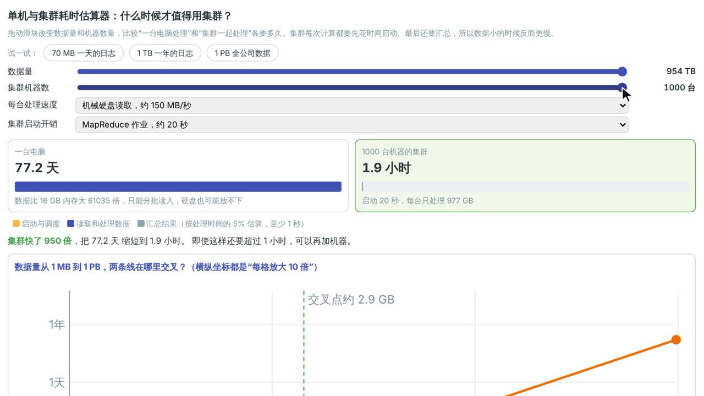
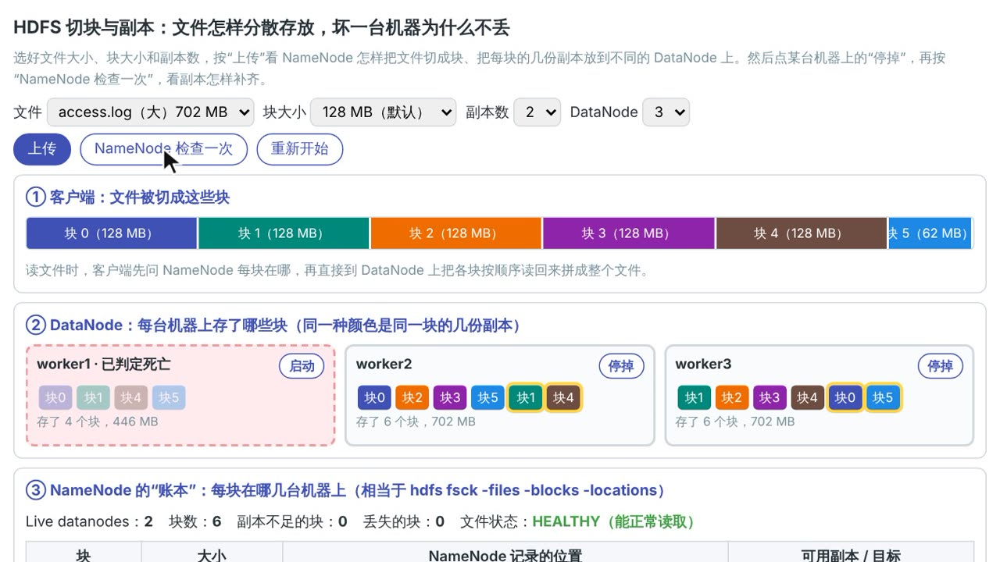
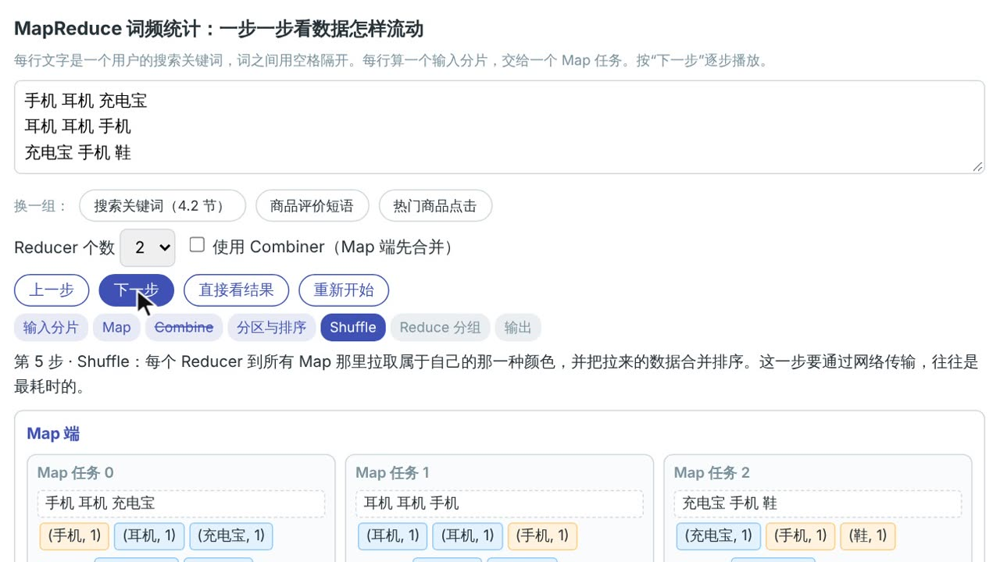
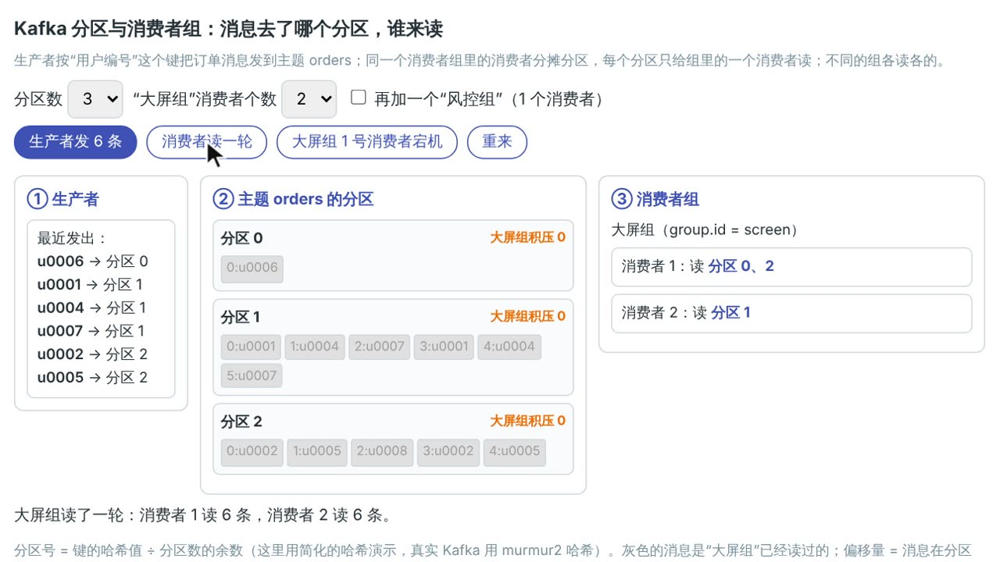
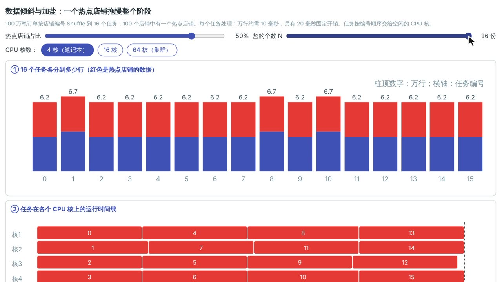

# 大数据技术处理技术

**面向成人教育人工智能技术应用专业（专科）的网络教材**

<!-- 书名、课程信息框和“目录与实验”表由 python tools/course.py sync 根据 course.yml 生成；全书概览表由 python tools/book_stats.py 生成 -->

<!-- course:start -->
!!! abstract "课程信息"
    4 学分 · 72 学时（理论 60 学时 + 实验 12 学时） · 第 3 学期 · 12 章 · 36 个实验 · 期末闭卷
<!-- course:end -->

<!-- showcase:start -->
## 先玩一玩

一台电脑算不动的时候，大数据技术怎样接手

<ol class="sc-list">
<li data-sim="sims/cluster-estimator/main.html" data-video="assets/showcase/cluster-estimator" data-title="单机与集群耗时估算器" data-play="拖动数据量，看单机和集群的耗时曲线在哪交叉。">
数据多大时，才值得动用一个集群？

<b>单机与集群耗时估算器</b>　拖动数据量，看单机和集群的耗时曲线在哪交叉。

<a href="sims/cluster-estimator/main.html">打开动画</a>　<a class="sc-chap" href="chapters/01-overview/" title="第 1 章 大数据概述与技术生态">去读第1章 →</a>
</li>
<li data-sim="sims/hdfs-blocks/main.html" data-video="assets/showcase/hdfs-blocks" data-title="HDFS 切块与副本" data-play="上传一个文件，再亲手“停掉”一台节点。">
停掉一台机器，文件为什么还丢不了？

<b>HDFS 切块与副本</b>　上传一个文件，再亲手“停掉”一台节点。

<a href="sims/hdfs-blocks/main.html">打开动画</a>　<a class="sc-chap" href="chapters/03-hdfs/" title="第 3 章 HDFS 分布式文件系统">去读第3章 →</a>
</li>
<li data-sim="sims/mapreduce-wordcount/main.html" data-video="assets/showcase/mapreduce-wordcount" data-title="MapReduce 词频统计全流程" data-play="Map、Shuffle、Reduce 一步一步亮起来。">
拆开来数、合起来算：一次分布式统计全过程

<b>MapReduce 词频统计全流程</b>　Map、Shuffle、Reduce 一步一步亮起来。

<a href="sims/mapreduce-wordcount/main.html">打开动画</a>　<a class="sc-chap" href="chapters/04-mapreduce-yarn/" title="第 4 章 MapReduce 与 YARN">去读第4章 →</a>
</li>
<li data-sim="sims/kafka-groups/main.html" data-video="assets/showcase/kafka-groups" data-title="Kafka 分区与消费者组" data-play="发几条消息，再让一个消费者“下线”。">
消费者宕机了，消息会不会丢？

<b>Kafka 分区与消费者组</b>　发几条消息，再让一个消费者“下线”。

<a href="sims/kafka-groups/main.html">打开动画</a>　<a class="sc-chap" href="chapters/09-streaming/" title="第 9 章 Kafka 与实时数据处理">去读第9章 →</a>
</li>
<li data-sim="sims/skew-salt/main.html" data-video="assets/showcase/skew-salt" data-title="数据倾斜与加盐" data-play="加一点“盐”，红色长条被摊平。">
一家热门店铺，拖垮了整个任务

<b>数据倾斜与加盐</b>　加一点“盐”，红色长条被摊平。

<a href="sims/skew-salt/main.html">打开动画</a>　<a class="sc-chap" href="chapters/11-tuning/" title="第 11 章 常见问题与调优">去读第11章 →</a>
</li>
</ol>

<!-- showcase:end -->

## 这本书讲什么

一家电商平台每天产生上亿条点击、加购、下单记录，一个大模型的训练语料动辄几十 TB。这些数据一台电脑存不下、算不完，要把很多台普通服务器组织起来一起存、一起算，这就是大数据技术。对人工智能技术应用专业的同学来说，大数据是“喂养”人工智能的上游：训练数据的采集、清洗和加工，模型上线后的数据回流和监控，都离不开大数据平台。

全书以一家虚构的电商平台“小象优选”为贯穿案例，跟着一条数据的“旅程”往前走：先认识大数据和它的技术生态，在自己的电脑上用 Docker 搭起 Hadoop 小集群；然后学习 HDFS 存储、MapReduce 与 YARN 计算和调度、Hive 数据仓库；接着用 Spark 做数据清洗、统计分析、实时处理和机器学习；最后学习常见问题的排查与调优、数据可视化和数据合规，完成一个从原始日志到数据看板的综合项目。

## 本书的特点

- **应用为主**：每章先讲“能用它做什么”，再讲“怎么做”，原理只保留看懂作业运行过程所必需的部分；
- **看得见**：用交互动画把“数据怎样在机器之间流动”“集群资源怎样分配”画出来，可以自己调参数反复看；
- **跑得通**：每章 3 个动手实验（★ 基础、☆ 拓展），在自己电脑上的 Docker 小集群里运行，只用 Python 和 SQL，不要求会 Java；
- **结果真实**：书中的运行结果、网页截图都是编者在随书集群上实际运行得到的，数据由随书脚本按固定随机种子生成，你的结果可以和书上逐行对照；
- **会排错**：每个实验都有“常见问题排查”表，收录编者真实踩过的坑，教你看日志、看网页找原因；
- **在线练习**：每章课后的单选、多选和判断题可以在网页上直接作答，并查看解析。

## 全书概览

<!-- stats:start -->

| 章 | 正文字数 | 实验 | 课后练习 （可在线作答） | 术语 | 参考文献 | 交互动画 |
|---|---|---|---|---|---|---|
| [第 1 章](chapters/01-overview/index.md) | 1.0 万 | 3 | 23（18） | 16 | 10 | 1 |
| [第 2 章](chapters/02-environment/index.md) | 0.8 万 | 3 | 23（18） | 13 | 9 | 1 |
| [第 3 章](chapters/03-hdfs/index.md) | 0.8 万 | 3 | 23（18） | 17 | 10 | 1 |
| [第 4 章](chapters/04-mapreduce-yarn/index.md) | 1.3 万 | 3 | 23（18） | 22 | 10 | 2 |
| [第 5 章](chapters/05-hive/index.md) | 0.9 万 | 3 | 23（18） | 21 | 10 | 1 |
| [第 6 章](chapters/06-spark-rdd/index.md) | 0.7 万 | 3 | 23（18） | 16 | 9 | 1 |
| [第 7 章](chapters/07-data-cleaning/index.md) | 0.8 万 | 3 | 23（18） | 16 | 10 | 1 |
| [第 8 章](chapters/08-spark-sql/index.md) | 0.8 万 | 3 | 23（18） | 14 | 10 | 1 |
| [第 9 章](chapters/09-streaming/index.md) | 1.0 万 | 3 | 23（18） | 18 | 10 | 2 |
| [第 10 章](chapters/10-mllib/index.md) | 0.8 万 | 3 | 23（18） | 18 | 10 | 1 |
| [第 11 章](chapters/11-tuning/index.md) | 0.8 万 | 3 | 23（18） | 12 | 10 | 2 |
| [第 12 章](chapters/12-visualization-project/index.md) | 0.9 万 | 3 | 23（18） | 15 | 10 | 1 |
| **合计** | **10.6 万** | **36** | **276（216）** | **198** | **118** | **15** |

正文字数只统计汉字，不含代码和课后练习；单选、多选和判断题可以在网页上直接作答。配套学习资源：[交互动画](sims/index.md) 15 个 · [学习图谱](learning-graph/index.md) 198 个概念 · [常见问题](faq/index.md) 27 问 · [术语表](appendix/glossary.md) 198 条。

<!-- stats:end -->

## 目录与实验

<!-- toc:start -->
| 章节 | 实验 |
|---|---|
| [第 1 章 大数据概述与技术生态](chapters/01-overview/index.md) | 实验 1-1 ★ 生成小象优选数据，感受“数据变大” 实验 1-2 ★ 第一次运行 PySpark 实验 1-3 ☆ 画一张企业数据流程图 |
| [第 2 章 实验环境：Docker 与 Hadoop 集群](chapters/02-environment/index.md) | 实验 2-1 ★ 安装 Docker 并运行第一个容器 实验 2-2 ★ 一条命令启动 Hadoop 集群并检查 实验 2-3 ☆ 改配置、加节点 |
| [第 3 章 HDFS 分布式文件系统](chapters/03-hdfs/index.md) | 实验 3-1 ★ HDFS 文件管理 实验 3-2 ★ 节点坏了数据还在吗 实验 3-3 ☆ 用 Python 把分析结果存进 HDFS |
| [第 4 章 MapReduce 与 YARN](chapters/04-mapreduce-yarn/index.md) | 实验 4-1 ★ 在本机“演”一遍 MapReduce 实验 4-2 ★ 统计网站访问日志 实验 4-3 ☆ 加一个 Combiner 会快多少 |
| [第 5 章 Hive 数据仓库](chapters/05-hive/index.md) | 实验 5-1 ★ 建表、导入与统计 实验 5-2 ★ 分区表 实验 5-3 ☆ 做一张销售日报 |
| [第 6 章 Spark 入门与 RDD 编程](chapters/06-spark-rdd/index.md) | 实验 6-1 ★ PySpark 本地模式与 Spark UI 实验 6-2 ★ 用 RDD 统计访问日志 实验 6-3 ☆ 把作业提交到 YARN 集群 |
| [第 7 章 用 Spark 做数据清洗](chapters/07-data-cleaning/index.md) | 实验 7-1 ★ 清洗小象优选的“脏”订单数据 实验 7-2 ★ 解析访问日志 实验 7-3 ☆ 多表合并与清洗报告 |
| [第 8 章 DataFrame 与 Spark SQL 数据分析](chapters/08-spark-sql/index.md) | 实验 8-1 ★ 小象优选销售多维分析 实验 8-2 ★ RFM 用户分层 实验 8-3 ☆ 读写 Hive 与 MySQL，比较 pandas 和 Spark 的耗时 |
| [第 9 章 Kafka 与实时数据处理](chapters/09-streaming/index.md) | 实验 9-1 ★ Kafka 收发消息 实验 9-2 ★ 实时成交额统计 实验 9-3 ☆ 迟到数据怎么处理 |
| [第 10 章 Spark MLlib 机器学习应用](chapters/10-mllib/index.md) | 实验 10-1 ★ 预测用户是否复购 实验 10-2 ★ K-Means 用户分群 实验 10-3 ☆ 批量打分 |
| [第 11 章 常见问题与调优](chapters/11-tuning/index.md) | 实验 11-1 ★ CSV 换成 Parquet 实验 11-2 ★ 处理一个热点店铺引起的数据倾斜 实验 11-3 ☆ 广播连接 |
| [第 12 章 数据可视化、数据合规与综合项目](chapters/12-visualization-project/index.md) | 实验 12-1 ★ pyecharts 销售报告 实验 12-2 ★ Superset 销售看板 实验 12-3 ☆ 综合项目 |

附录：[A Linux 与 PySpark 速查](appendix/a-linux-pyspark.md) · [B 大数据组件速查](appendix/b-components.md) · [C 实验环境与数据说明](appendix/c-environment.md) · [D 术语表](appendix/glossary.md)
<!-- toc:end -->

## 配套资源

- [交互动画](sims/index.md)、[学习图谱](learning-graph/index.md)、[常见问题](faq/index.md)
- 实验代码与数据：仓库中的 `labs/` 目录
- 课件、教案和 Word/PDF 版教材：见仓库的 Releases 页面
